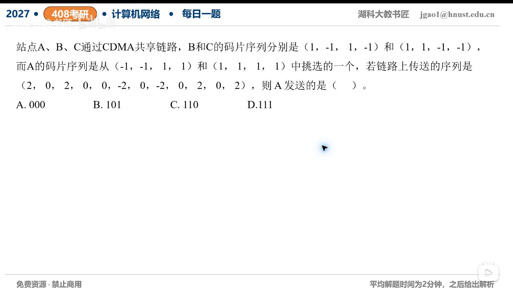

[目录](README.md)　·　[« 2026-10-05](1005.md)　·　[2026-10-07 »](1007.md)

# 2026-10-06

[原视频](https://www.bilibili.com/video/BV1YjHn6BE1Q/)

考点：CDMA码片序列与发送比特。解析待核对；先依据题图独立作答，暂不把本题计入已解析数。

[返回年表](README.md) · [总目录](../README.md)
