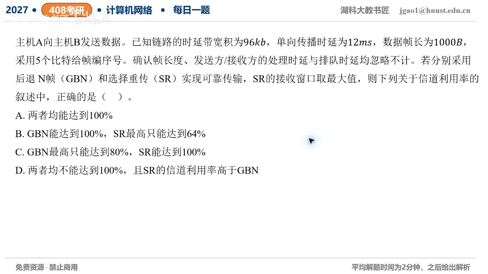

[目录](README.md)　·　[« 2026-10-06](1006.md)　·　[2026-10-08 »](1008.md)

# 2026-10-07

[原视频](https://www.bilibili.com/video/BV1zqpF64EFh/)

考点：GBN与SR的窗口和信道利用率。解析待核对；先依据题图独立作答，暂不把本题计入已解析数。

[返回年表](README.md) · [总目录](../README.md)
