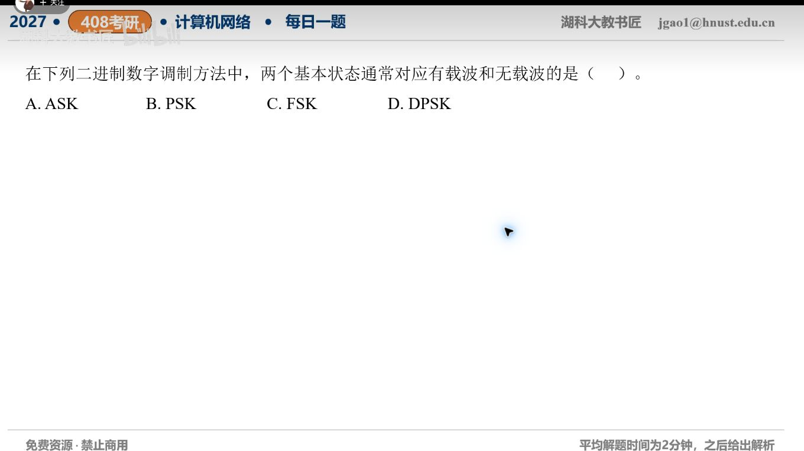

[目录](README.md)　·　[« 2026-10-08](1008.md)　·　[2026-10-10 »](1010.md)

# 2026-10-09

[原视频](https://www.bilibili.com/video/BV1R8HQ6FEUX/)

考点：ASK、PSK、FSK与DPSK基本状态。解析待核对；先依据题图独立作答，暂不把本题计入已解析数。

[返回年表](README.md) · [总目录](../README.md)
