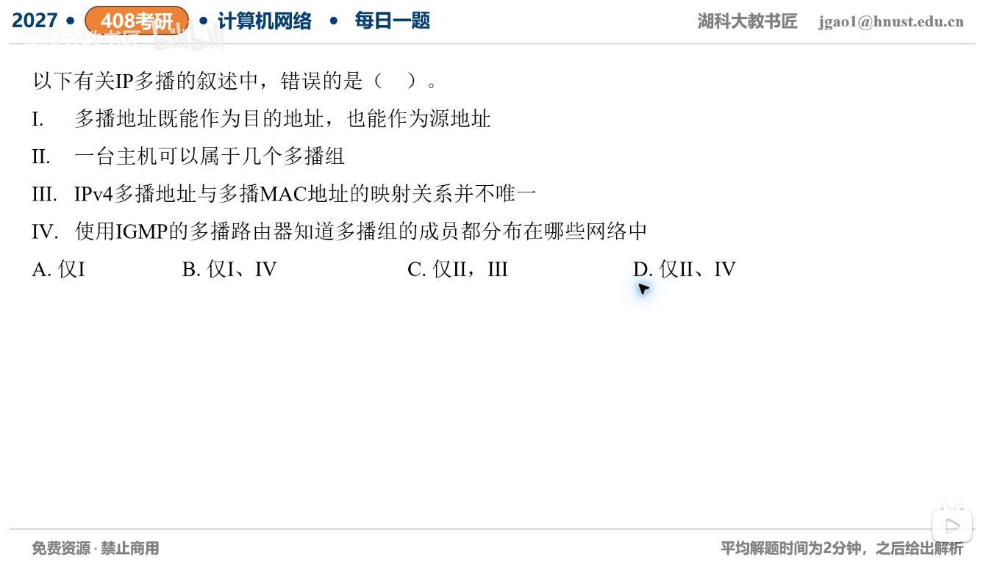

[目录](README.md)　·　[« 2026-10-15](1015.md)　·　[2026-10-17 »](1017.md)

# 2026-10-16

[原视频](https://www.bilibili.com/video/BV1r9J26HEjX/)

考点：IP多播、组成员与IGMP。解析待核对；先依据题图独立作答，暂不把本题计入已解析数。

[返回年表](README.md) · [总目录](../README.md)
