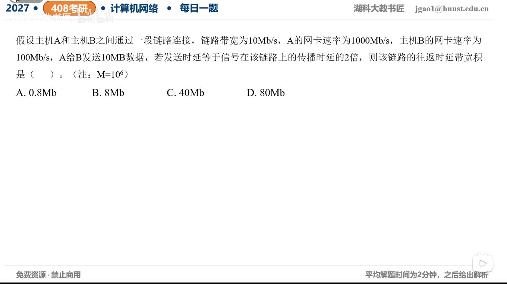

[目录](README.md)　·　[« 2026-10-21](1021.md)　·　[2026-10-23 »](1023.md)

# 2026-10-22

[原视频](https://www.bilibili.com/video/BV1Coni6aEo6/)

考点：时延带宽积与往返时延。解析待核对；先依据题图独立作答，暂不把本题计入已解析数。

[返回年表](README.md) · [总目录](../README.md)
