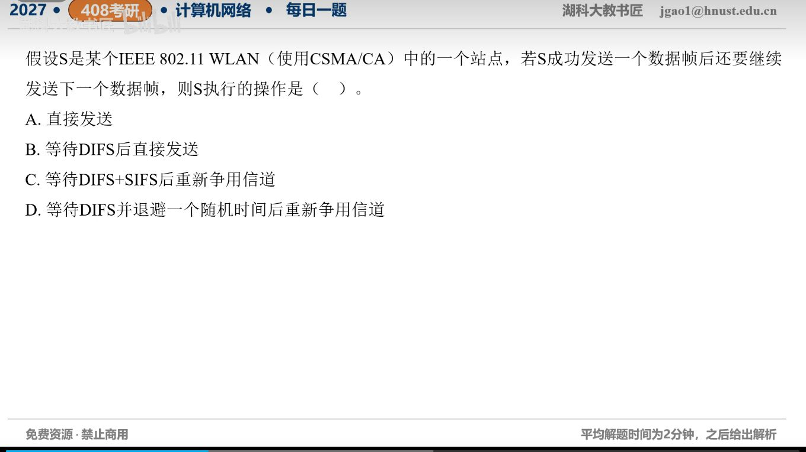

[目录](README.md)　·　[« 2026-10-24](1024.md)　·　[2026-10-26 »](1026.md)

# 2026-10-25

[原视频](https://www.bilibili.com/video/BV158HK6YELN/)

考点：CSMA/CA成功发送后的帧间间隔。解析待核对；先依据题图独立作答，暂不把本题计入已解析数。

[返回年表](README.md) · [总目录](../README.md)
