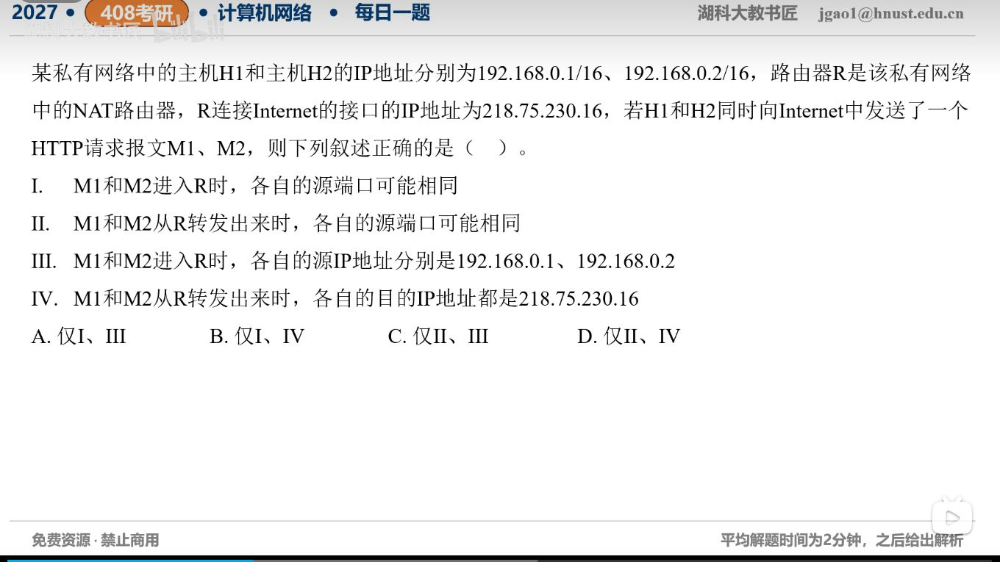

[目录](README.md)　·　[« 2026-10-25](1025.md)　·　[2026-10-27 »](1027.md)

# 2026-10-26

[原视频](https://www.bilibili.com/video/BV1NrnX6mESH/)

考点：NAT转换中TCP连接的地址与端口。解析待核对；先依据题图独立作答，暂不把本题计入已解析数。

[返回年表](README.md) · [总目录](../README.md)
