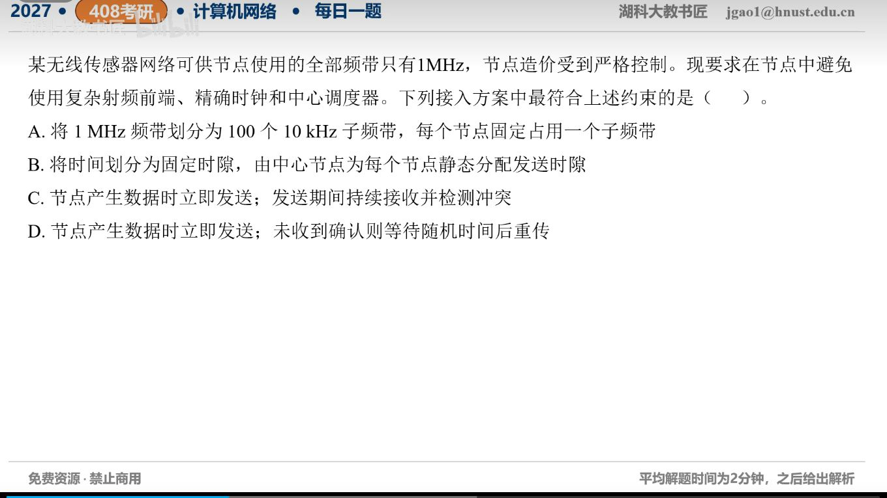

[目录](README.md)　·　[« 2026-10-26](1026.md)　·　[2026-10-28 »](1028.md)

# 2026-10-27

[原视频](https://www.bilibili.com/video/BV1EbHc6ZE2g/)

考点：受限无线传感器网络的多址接入。解析待核对；先依据题图独立作答，暂不把本题计入已解析数。

[返回年表](README.md) · [总目录](../README.md)
