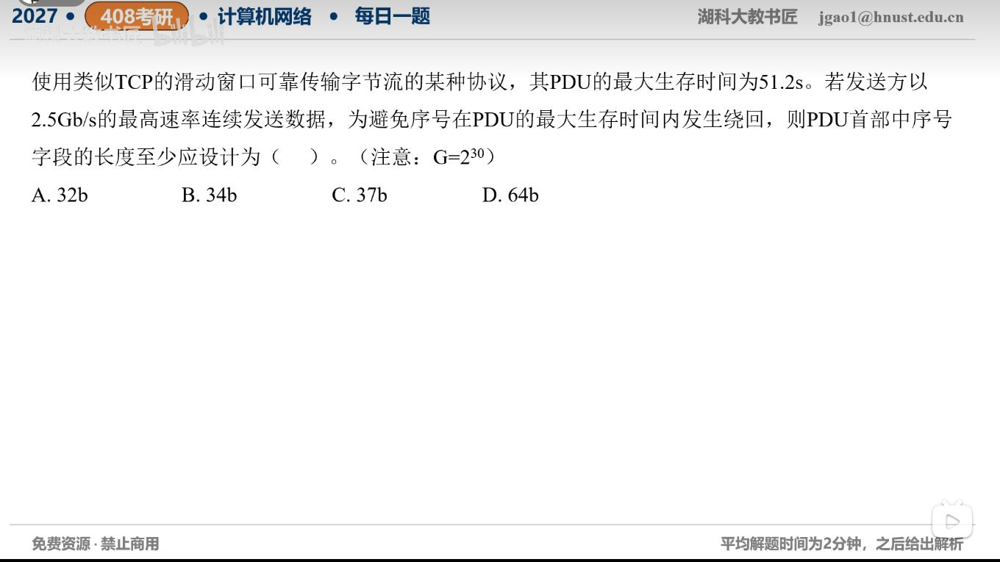

[目录](README.md)　·　[« 2026-10-27](1027.md)　·　[2026-10-29 »](1029.md)

# 2026-10-28

[原视频](https://www.bilibili.com/video/BV1Wbxu6vE9w/)

考点：滑动窗口序号字段位数。解析待核对；先依据题图独立作答，暂不把本题计入已解析数。

[返回年表](README.md) · [总目录](../README.md)
