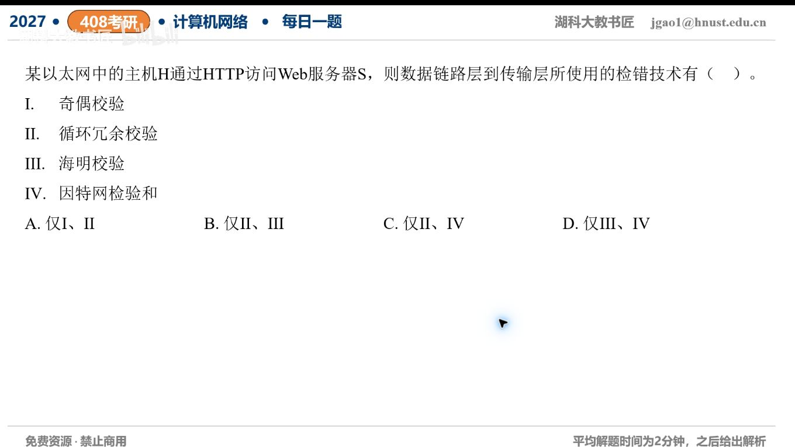

[目录](README.md)　·　[« 2026-10-30](1030.md)　·　[2026-11-01 »](1101.md)

# 2026-10-31

[原视频](https://www.bilibili.com/video/BV1LDxe64EXT/)

考点：数据链路层差错检测技术。解析待核对；先依据题图独立作答，暂不把本题计入已解析数。

[返回年表](README.md) · [总目录](../README.md)
