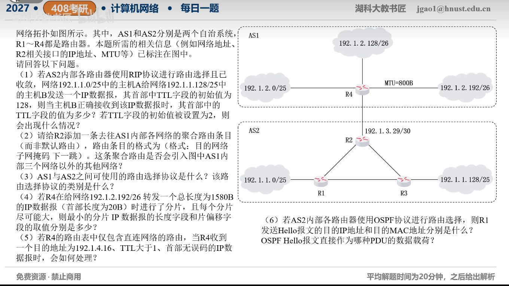

[目录](README.md)　·　[« 2026-10-31](1031.md)　·　[2026-11-02 »](1102.md)

# 2026-11-01

[原视频](https://www.bilibili.com/video/BV1Cuxk64EeU/)

考点：跨自治系统路由、分片与OSPF综合题。解析待核对；先依据题图独立作答，暂不把本题计入已解析数。

[返回年表](README.md) · [总目录](../README.md)
