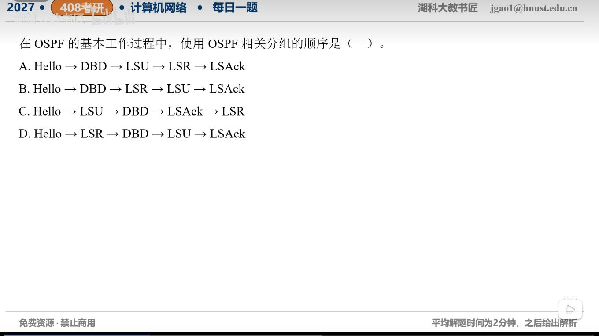

[目录](README.md)　·　[« 2026-11-04](1104.md)　·　[2026-11-06 »](1106.md)

# 2026-11-05

[原视频](https://www.bilibili.com/video/BV1cRx96xEQr/)

考点：OSPF邻接建立与链路状态同步顺序。解析待核对；先依据题图独立作答，暂不把本题计入已解析数。

[返回年表](README.md) · [总目录](../README.md)
