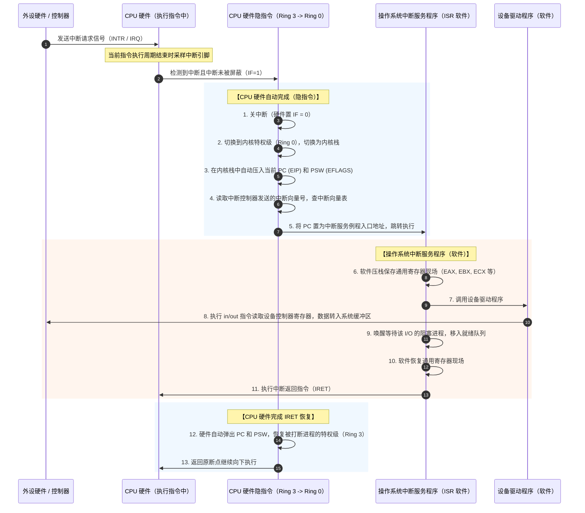

# 中断、自陷与异常处理的底层硬件全链路

> 关联真题：2026-24、2023-46  
> 核心痛点：为什么 INT 3 偏偏是自陷？为什么它可以用来做断点调试？中断发生那一瞬间，到底是谁把什么东西存到了哪里？

---

## 一、 INT 3 为什么是“自陷”？为什么它是单字节（0xCC）？

### 1. 自陷（Trap）的物理本质
自陷是**CPU 内部由一条预先安排的指令故意引发的同步异常**。
- **与故障（Fault）的区别**：故障是被动且意料之外的（如缺页、除以零），故障修复后重新执行当前指令；自陷是程序员或编译器**主动埋设的钩子**，自陷处理完毕后，CPU 通常执行下一条指令。
- **自陷的根本用途**：
  1. 系统调用（System Call，如 x86 的 `int 0x80` 或 `syscall` 指令）；
  2. 调试器断点（Debugger Breakpoint，如 `INT 3`）。

### 2. 为什么 INT 3 必须是单字节 `0xCC`？
在 x86 指令集中，普通的软件中断指令格式是双字节的：
```text
CD <imm8>   ; 例如 CD 80 代表 int 0x80（两字节）
```
如果调试器使用 `CD 03`（两字节）来下断点，会引发致命缺陷：
- x86 指令长度是可变长的（1 到 15 字节），存在大量的**单字节指令**（如 `push eax` 编码为 `0x50`，`nop` 为 `0x90`）。
- 调试器设置软件断点的物理机制是：**将目标内存地址处的原有机器码读出备份，并在该位置强行覆写断点指令**。
- 如果断点指令占 2 个字节，而目标位置恰好是一条 1 字节指令，覆写时就会**把后面一条指令的首字节也顺带踩烂覆盖掉**！
- 一旦程序有分支跳转到后面那条指令，CPU 会因操作码破损而崩溃跑飞。

因此，Intel 在微架构设计时，专门为 `INT 3` 单独分配了一个**唯一的单字节操作码：`0xCC`**。
- 调试器暂停程序：把目标指令的第 1 个字节替换为 `0xCC`；
- CPU 执行到 `0xCC`：硬件触发 3 号向量异常，由硬件自动压栈断点并切入内核态调试器例程；
- 用户继续运行：调试器把原指令首字节写回去，指令指针 EIP 减 1 指回原指令，执行并继续。

---

## 二、 中断响应与处理：谁在什么时候执行了什么？

很多同学做题时把“硬件完成的”和“操作系统软件完成的”混为一谈。必须看清纳秒级流水线上的严格职责分工：

### 全流程拓扑切片



### 核心责任切分总结：

1. **CPU 硬件隐指令负责“保命与引路”**：
   - 保护断点（PC）和程序状态（PSW）；
   - 切换特权级并切换到内核栈；
   - 查向量表完成硬件级跳转。
   - *（硬件绝对不负责保存通用寄存器，因为硬件不知道操作系统 ISR 代码到底会用到哪几个寄存器！）*

2. **操作系统 ISR 软件负责“干活与恢复”**：
   - 软件用 `push` 指令自行保存将要被修改的通用寄存器；
   - 驱动程序与外设控制器芯片交互（读数据端口、清中断标志位）；
   - 更新进程状态（如将等待 I/O 的进程从阻塞队列唤醒移入就绪队列）；
   - 软件用 `pop` 指令恢复通用寄存器，最后执行 `IRET` 特权指令通知硬件还原 PC 和 PSW。
