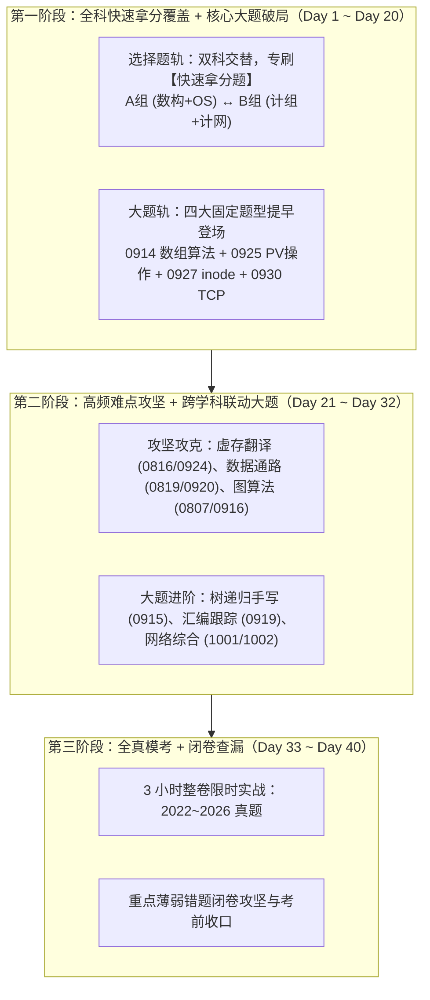

# 40 天多学科并行冲刺计划：全景题单、大题前置与三阶段作战路径

> **导言**：本文档针对 408 统考最后 40 天制定。彻底打破题单纯按日期单向串行推进的弊端，建立**“多学科交替推进 + 大题提前介入 + 快速拿分题剪枝”**的高效作战模型。
>
> 历史 65 天计划底稿已归档于 [65-day-sprint.md](65-day-sprint.md)。

---

## 一、 全景学科与真题题号映射表

全库 59 篇题单的日期名字只是**能力线节点的历史代号**，本质是**按学科和真题题号切分的 59 个专项模块**。为解决“日期命名看不出学科与题号”的痛点，以下为完整的学科、题号与文件对应关系：

### 1. 选择题专项（40 篇，第 1～40 题，单选题每题 2 分，满分 80 分）

| 学科 | 408 对应题号 | 涵盖文件 | 考点核心方向 | 题量 |
| :--- | :--- | :--- | :--- | :--- |
| **数据结构** | **Q01～Q11** | [0731](../src/0731.md) 时间复杂度：循环执行次数<br>[0801](../src/0801.md) 位置关系：指针、下标与压缩存储<br>[0802](../src/0802.md) 受限容器：栈与队列的状态推进<br>[0803](../src/0803.md) 树的形状：遍历序列如何约束结构<br>[0804](../src/0804.md) 编码代价：哈夫曼树与前缀码<br>[0805](../src/0805.md) 有序树：从局部旋转到多路分裂<br>[0806](../src/0806.md) 图的骨架：表示、遍历与连通<br>[0807](../src/0807.md) 图上的推进：拓扑、最短路与关键路径<br>[0808](../src/0808.md) 查找落点：折半、分块与散列<br>[0809](../src/0809.md) 失配之后：KMP如何保留已知部分<br>[0810](../src/0810.md) 排序过程：一趟以后什么已经确定<br>[0811](../src/0811.md) 外存归并：内存装不下以后怎样排序 | 复杂度分析、顺序表/链表/矩阵、栈入出序列、树与二叉树还原、哈夫曼树WPL、AVL/B树、邻接矩阵/表与连通度、Dijkstra/拓扑/关键路径、散列表ASL、KMP、内排比较次数与稳定性、败者树外排 | 12 篇<br>共 156 题 |
| **计算机组成原理** | **Q12～Q22** | [0812](../src/0812.md) 位模式解释权：整数、浮点与类型转换<br>[0813](../src/0813.md) 有限位运算：溢出、标志与乘除<br>[0814](../src/0814.md) 存储器拼装：容量、长宽与片选<br>[0815](../src/0815.md) Cache访问：地址切分、局部性与替换<br>[0816](../src/0816.md) 地址翻译链：虚拟地址怎样到达数据<br>[0817](../src/0817.md) 指令取数：格式、寻址与有效地址<br>[0818](../src/0818.md) 程序层级：从源程序到CPU真正执行对象<br>[0819](../src/0819.md) 数据通路：状态元件、操作元件与控制信号<br>[0820](../src/0820.md) 流水线：结果何时产生，下一条何时需要<br>[0821](../src/0821.md) 性能方程：工作量与每步耗时<br>[0822](../src/0822.md) 传输时间：宽度、频率、事务与瓶颈<br>[0823](../src/0823.md) I/O路径：轮询、中断与DMA控制权交接 | 补码移位/IEEE 754浮点、OF/SF/ZF/CF标志、DRAM交叉编址/芯片扩展、Cache相联映射/命中率、TLB/页表转换、指令寻址方式、微程序/指令集体系结构ISA、单/多周期数据通路、流水线冒险/吞吐率、CPI/MIPS性能方程、总线带宽、中断响应/DMA传输 | 12 篇<br>共 189 题 |
| **操作系统** | **Q23～Q32** | [0824](../src/0824.md) 系统边界：应用如何进入内核<br>[0825](../src/0825.md) 执行生命线：进程、线程、状态与调度<br>[0826](../src/0826.md) 并发约束：把交错执行压成可证明顺序<br>[0827](../src/0827.md) 资源闭环：死锁、避免与检测<br>[0828](../src/0828.md) 内存边界：分配、回收与保护<br>[0829](../src/0829.md) 页面驻留：置换、工作集与缺页代价<br>[0830](../src/0830.md) 文件路径：名字、索引、数据块与共享<br>[0831](../src/0831.md) 设备服务：缓冲、磁盘与请求调度 | 用户态/内核态切换与系统调用、进程线程区别/调度算法、信号量物理含义/临界区、银行家算法与死锁、动态分区分配、段页式管理/CLOCK/FIFO/LRU置换、文件目录/FCB/硬软链接、磁盘寻道调度(SSTF/SCAN)/设备驱动 | 8 篇<br>共 172 题 |
| **计算机网络** | **Q33～Q40** | [0901](../src/0901.md) 分层路径：数据穿过网络时每层做什么<br>[0902](../src/0902.md) 信号与速率：带宽怎样限制可传数据<br>[0903](../src/0903.md) 链路可靠性：帧、窗口与重传状态<br>[0904](../src/0904.md) 局域网转发：介质竞争、MAC与交换机<br>[0905](../src/0905.md) 网络地址：子网、分片与可达范围<br>[0906](../src/0906.md) 控制转发路径：ARP、路由协议与下一跳<br>[0907](../src/0907.md) 端到端状态：TCP序号、窗口与拥塞<br>[0908](../src/0908.md) 应用会话：DNS、Web、邮件与文件传输 | 体系结构分层模型、奈氏准则/香农公式/编码、GBN/SR滑动窗口重传、CSMA/CD碰撞检测/以太网帧/VLAN、IPv4子网划分/CIDR/分片、ARP/RIP/OSPF/BGP路由转发表、TCP三次握手四次挥手/慢开始/拥塞避免、DNS递归迭代/HTTP Cookie/状态码 | 8 篇<br>共 133 题 |

---

### 2. 综合大题专项（19 篇，第 41～47 题，满分 70 分）

大题在试卷中占据 **70/150 分**，必须立即前置训练，绝不能推迟到最后：

| 学科 | 408 对应题号 | 涵盖文件 | 考点核心模型 | 题量 |
| :--- | :--- | :--- | :--- | :--- |
| **数据结构大题** | **Q41 / Q42** | [0914](../src/0914.md) 线性结构：数组与链表大题<br>[0915](../src/0915.md) 树的递归含义：路径、编码、表达式与形态<br>[0916](../src/0916.md) 图的结构判定：从邻接信息恢复全局性质<br>[0917](../src/0917.md) 图上的最优推进：最短路、生成树与关键路径<br>[0918](../src/0918.md) 查找与排序：分布、权重和内存边界决定代价 | **Q41 算法手写**：双指针扫描、链表反转/重排、树递归求高度/WPL/表达式、图连通分支判定。<br>**Q42 应用分析**：散列冲突模拟、AVL/B树插入分裂、拓扑/关键路径工期计算、败者树归并。 | 5 篇<br>共 35 题 |
| **计组大题** | **Q43 / Q44** | [0919](../src/0919.md) 表示到汇编：类型、指令与调用解释<br>[0920](../src/0920.md) 指令落到数据通路：寄存器、部件与控制信号<br>[0921](../src/0921.md) 总线与 I/O：事务次数、控制交接和有效吞吐<br>[0922](../src/0922.md) 流水与异常：相关、转移和精确状态收口<br>[0923](../src/0923.md) Cache 局部性：地址映射、访问序列与缺失代价<br>[0924](../src/0924.md) 地址翻译链：TLB、页表与 Cache 的先后关系 | **Q43 指令与汇编**：定长/变长操作码扩展、机器码反汇编、寄存器传参跟踪。<br>**Q44 硬件综合**：单周期/流水线数据通路MUX选择信号推导、Cache组相联命中分析、TLB+多级页表跨学科联合翻译。 | 6 篇<br>共 39 题 |
| **操作系统大题** | **Q45 / Q46** | [0925](../src/0925.md) 并发同步：把资源约束翻译成可证明顺序<br>[0926](../src/0926.md) 页面驻留：分配、置换与缺页过程<br>[0927](../src/0927.md) 文件与磁盘：名字、索引和物理块连接<br>[0928](../src/0928.md) 进程生命线：调度、输入与用户—内核边界 | **Q45 PV 操作大题（必考，7~8分）**：生产者-消费者、读者-写者、理发师、独木桥变式。<br>**Q46 存储与文件**：多级页表虚拟地址拆解与物理地址计算、UNIX inode 直接/间接索引寻址与磁盘块号推算。 | 4 篇<br>共 34 题 |
| **计网大题** | **Q47** | [0929](../src/0929.md) 寻址与路由：从前缀匹配到路由协议收敛<br>[0930](../src/0930.md) 传输窗口：序号空间、确认与超时推进<br>[1001](../src/1001.md) 链路与局域网：竞争、封装、交换和跨网转发<br>[1002](../src/1002.md) 网络服务：配置、地址转换与应用会话 | **Q47 协议综合**：<br>1. 路由汇聚 CIDR、转发表最长前缀匹配；<br>2. TCP 拥塞窗口（慢开始/拥塞避免/快重传）拐点推算与 RTT 传输耗时；<br>3. 跨网段数据通信全流程（ARP + 默认网关 + 交换机自学习 + NAT 端口映射）。 | 4 篇<br>共 20 题 |

---

## 二、 打破日期串行的作战逻辑：靠后的题如何立刻见面？

### 1. 传统日期线性推进的致命伤
如果从 0731 线性往后刷：
* 前 12 天全在做数据结构选择题；
* 中间 12 天全在做计组选择题；
* 到了第 32 天才刚看完计网选择题；
* **最后 8 天才第一次摸大题！**
这种安排会导致计网和大题在考前仓促上阵，而前面刷的数据结构已经遗忘大半，完全不适应 408 统考跨学科交叉综合命题的特点。

### 2. 40 天多学科交替双轨推进原则
1. **大题立即前置（Day 1 启动）**：
   - 模式固定的高分大题（如 [0925](../src/0925.md) 的 PV 信号量手写、[0927](../src/0927.md) 的 inode 多级索引、[0930](../src/0930.md) 的 TCP 拥塞控制图、[0914](../src/0914.md) 的数组双指针手写）有极其固定的模板。
   - 越早建立肌肉记忆，后期做综合题越有底气。每天固定手写 1～2 道大题。
2. **学科交替绑定**：
   - **轨道 A（数构 + 操作系统）**：偏软件与算法逻辑思维（代码、链表、树、进程调度、并发同步）。
   - **轨道 B（计组 + 计算机网络）**：偏硬件与通路通信思维（数据流动、二进制位、信号、协议封装、转发）。
   - 奇数天推进轨道 A，偶数天推进轨道 B，两套思维模式轮流切换，大幅降低大脑抗疲劳度。
3. **后置学科（计网）前置介入**：
   - 不再把 0901~0908 放在一个月后。在第一周的轨道 B 中直接同步推进计网基础题单。

---

## 三、 提速策略：利用题单“快速拿分”与“耗时攻坚”标签剪枝

所有 59 篇题单均已完成结构重构，内部明确划分为两部分：
* `## 一、 快速拿分题`：概念直接、题干清晰、模式固定。考场目标 30~60 秒一题。
* `## 二、 耗时攻坚题`：参数伪装深、状态交错多、多步骤计算。考场容易超时或手滑。

### 40 天精简提速执行法则：
1. **第一轮（前 20 天）**：**通刷全部题单的“快速拿分题”**，耗时攻坚题仅选代表性 1~2 题。
   - 迅速把 40 道选择题的基本盘拉满（保底 55~60 分）；
   - 建立全科 408 知识全景雷达，避免产生“某一科还没看”的心理焦虑。
2. **第二轮（中间 12 天）**：**专啃“耗时攻坚题”中的拉分大户**。
   - 重点突破：Cache/虚存两级地址翻译、流水线数据冲突、平衡树/红黑树旋转、inode寻址与磁盘块计算。
3. **第三轮（最后 8 天）**：**整卷限时模考 + 错题闭卷复盘**。

---

## 四、 40 天三阶段周密作战路线图



### 第一阶段（Day 1 ～ Day 20）：全科快速拿分覆盖 + 核心大题破局

| 日期 | 选择题轨道（只做每篇的“快速拿分题”） | 大题轨道（草稿纸规范手写 1～2 题） |
| :---: | :--- | :--- |
| **Day 1** | 数构 [0731](../src/0731.md) (复杂度) + OS [0824](../src/0824.md) (系统边界) | **数构大题** [0914](../src/0914.md) 题 01、02（数组归并/逆置） |
| **Day 2** | 计组 [0812](../src/0812.md) (位模式) + 计网 [0901](../src/0901.md) (分层路径) | **OS 大题** [0925](../src/0925.md) 题 01、02（经典生产者消费者） |
| **Day 3** | 数构 [0801](../src/0801.md) (指针下标) + OS [0825](../src/0825.md) (进程生命线) | **计网大题** [0929](../src/0929.md) 题 01、02（CIDR路由聚合） |
| **Day 4** | 计组 [0813](../src/0813.md) (溢出运算) + 计网 [0902](../src/0902.md) (香农带宽) | **计组大题** [0919](../src/0919.md) 题 01、02（汇编与机器指令） |
| **Day 5** | 数构 [0802](../src/0802.md) (栈与队列) + OS [0826](../src/0826.md) (并发约束) | **数构大题** [0914](../src/0914.md) 题 03、04（主元素/未出现正整数） |
| **Day 6** | 计组 [0814](../src/0814.md) (存储拼装) + 计网 [0903](../src/0903.md) (滑动重传) | **OS 大题** [0925](../src/0925.md) 题 03、04（抽烟者/读写者变式） |
| **Day 7** | 数构 [0803](../src/0803.md) (树的形状) + OS [0827](../src/0827.md) (死锁闭环) | **计网大题** [0930](../src/0930.md) 题 01、02（TCP拥塞控制曲线） |
| **Day 8** | 计组 [0815](../src/0815.md) (Cache访问) + 计网 [0904](../src/0904.md) (局域网转发) | **计组大题** [0923](../src/0923.md) 题 01、02（Cache组相联计算） |
| **Day 9** | 数构 [0804](../src/0804.md) (哈夫曼树) + OS [0828](../src/0828.md) (内存分配) | **OS 大题** [0927](../src/0927.md) 题 01、02（UNIX inode直接/间接项） |
| **Day 10** | 计组 [0816](../src/0816.md) (地址翻译) + 计网 [0905](../src/0905.md) (子网分片) | **计组大题** [0920](../src/0920.md) 题 01、02（数据通路控制信号） |
| **Day 11** | 数构 [0805](../src/0805.md) (有序树AVL/B树) + OS [0829](../src/0829.md) (页面置换) | **数构大题** [0915](../src/0915.md) 题 01、02（二叉树递归WPL/表达式） |
| **Day 12** | 计组 [0817](../src/0817.md) (指令寻址) + 计网 [0906](../src/0906.md) (路由转发) | **OS 大题** [0925](../src/0925.md) 题 05、06（独木桥/同步计数器） |
| **Day 13** | 数构 [0806](../src/0806.md) (图骨架) + OS [0830](../src/0830.md) (文件路径) | **计网大题** [1001](../src/1001.md) 题 01、02（以太网与交换机转发表） |
| **Day 14** | 计组 [0818](../src/0818.md) (程序层级) + 计网 [0907](../src/0907.md) (TCP状态) | **计组大题** [0924](../src/0924.md) 题 01、02（TLB+页表+Cache翻译） |
| **Day 15** | 数构 [0807](../src/0807.md) (图拓扑与路) + OS [0831](../src/0831.md) (磁盘I/O) | **数构大题** [0916](../src/0916.md) 题 01、02（图连通/入度出度算法） |
| **Day 16** | 计组 [0819](../src/0819.md) (数据通路) + 计网 [0908](../src/0908.md) (应用会话) | **OS 大题** [0926](../src/0926.md) 题 01、02（两级页表缺页计算） |
| **Day 17** | 数构 [0808](../src/0808.md) (散列折半) + [0809](../src/0809.md) (KMP) | **数构大题** [0917](../src/0917.md) 题 01、02（Dijkstra/关键路径手算） |
| **Day 18** | 计组 [0820](../src/0820.md) (流水线) + [0821](../src/0821.md) (性能方程) | **计组大题** [0921](../src/0921.md) 题 01、02（总线与DMA中断开销） |
| **Day 19** | 数构 [0810](../src/0810.md) (内排) + [0811](../src/0811.md) (外排归并) | **数构大题** [0918](../src/0918.md) 题 01、02（堆排/散列大题） |
| **Day 20** | 计组 [0822](../src/0822.md) (总线) + [0823](../src/0823.md) (中断DMA) | **计网大题** [1002](../src/1002.md) 题 01、02（DHCP+DNS+NAT全流程） |

---

### 第二阶段（Day 21 ～ Day 32）：高频难点攻坚 + 跨学科综合大题

此阶段重点吃透“耗时攻坚题”及历年最易翻车的跨学科综合大题：

* **Day 21~22【虚存与硬件联合攻坚】**：
  * 选择题攻坚：[0815](../src/0815.md) 组相联二、[0816](../src/0816.md) 虚存地址拆解、[0829](../src/0829.md) CLOCK置换算法。
  * 大题攻坚：[0924](../src/0924.md)（历年 408 计组/OS 结合大题核心：从虚页号查 TLB，未命中查页表，命中物理页框再进 Cache 查 Tag）。
* **Day 23~24【CPU 数据通路与流水线冲突】**：
  * 选择题攻坚：[0819](../src/0819.md) 单周期控制信号表格、[0820](../src/0820.md) 流水线旁路与气泡。
  * 大题攻坚：[0920](../src/0920.md)（时钟周期计算、指令译码控制信号推导）、[0922](../src/0922.md)（流水线时空图绘制与数据冒险）。
* **Day 25~26【并发同步 PV 原语深度扫荡】**：
  * 专啃 [0925](../src/0925.md) 剩余 8 道高难度 PV 大题（多进程复杂制约、环形缓冲区互斥、独木桥防死锁）。
  * 目标：做到考场任何变式 PV 题 10 分钟内规范手写成型。
* **Day 27~28【树、图高级算法与综合大题】**：
  * 选择题攻坚：[0805](../src/0805.md) B树/B+树高度与分裂、[0807](../src/0807.md) 关键路径与缩短工期。
  * 大题攻坚：[0915](../src/0915.md) 树递归代码设计、[0916](../src/0916.md) 图连通性算法。
* **Day 29~30【文件系统 inode 与磁盘 I/O 调度】**：
  * 专攻 [0830](../src/0830.md) 与 [0927](../src/0927.md)：计算直接块、一级/二级/三级间接块支持的最大文件长度，反算磁盘寻道与旋转延迟。
* **Day 31~32【网络协议全链路抓包分析】**：
  * 专攻 [0907](../src/0907.md)、[0929](../src/0929.md)、[0930](../src/0930.md)：综合题分析从主机开机、DHCP 获 IP、DNS 查域名、TCP 建立连接到 HTTP 请求完成的各层数据包首部变化。

---

### 第三阶段（Day 33 ～ Day 40）：全真套卷模考 + 闭卷查漏收口

* **Day 33**：全真限时模考 **2022 年 408 真题**（8:30~11:30，严格按 180 分钟交卷并对照评分标准打分）。
* **Day 34**：精细复盘 2022 错题，针对丢分模块回溯对应题单（如 PV 丢分回溯 0925，流水线丢分回溯 0920）。
* **Day 35**：全真限时模考 **2023 年 408 真题**。
* **Day 36**：精细复盘 2023 错题，闭卷抽检高频错题与薄弱点。
* **Day 37**：全真限时模考 **2024 年 408 真题**。
* **Day 38**：全真限时模考 **2025 年 408 真题**。
* **Day 39**：模考 **2026 年最新 408 真题**（查验 2026 最新命题风向，重点审视 2026-43~44 数据通路与 2026-47 网络综合大题）。
* **Day 40**：考前封口日。回顾所有错题标记，闭卷背诵算法经典模板（双指针/树递归/PV互斥骨架），保持平稳心态迎考。

---

## 五、 每日任务执行模板（建议每日 3.5 小时分配）

```markdown
### 每日作战记录 [第 X 天]
1. 【选择题快攻】（约 60 分钟）：
   - 完成指定 2 篇题单中的“一、快速拿分题”（约 15~20 题）。
   - 目标：看图连线、特征秒杀，平均 1.5 分钟/题。

2. 【大题硬核手写】（约 75 分钟）：
   - 在草稿纸上规范手写 2 道指定大题（伪代码/结构图/详细计算式）。
   - 对照解析红笔修正，重点看给分点与踩分项。

3. 【攻坚题复盘与断点记录】（约 45 分钟）：
   - 深入推演 1~2 道今天遇到的“耗时攻坚题”。
   - 将仍然卡顿的机制记录为断点，利用 review 工具或 AI 靶向答疑。

4. 【当日闭卷抽检】（约 30 分钟）：
   - 不看书，在草稿纸上默写今天涉及的核心公式或算法框架。
```
