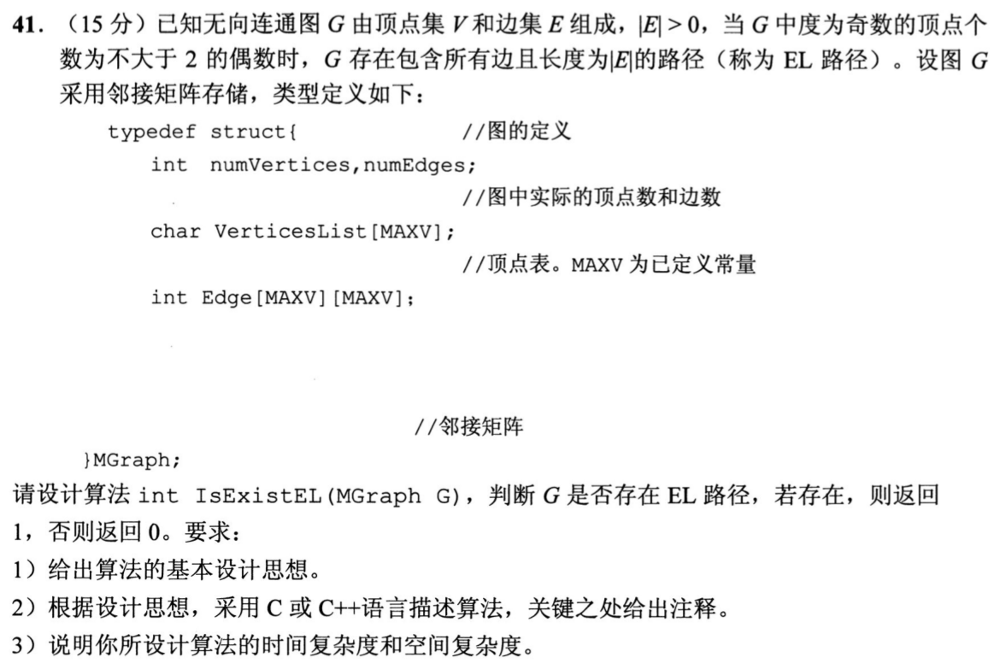
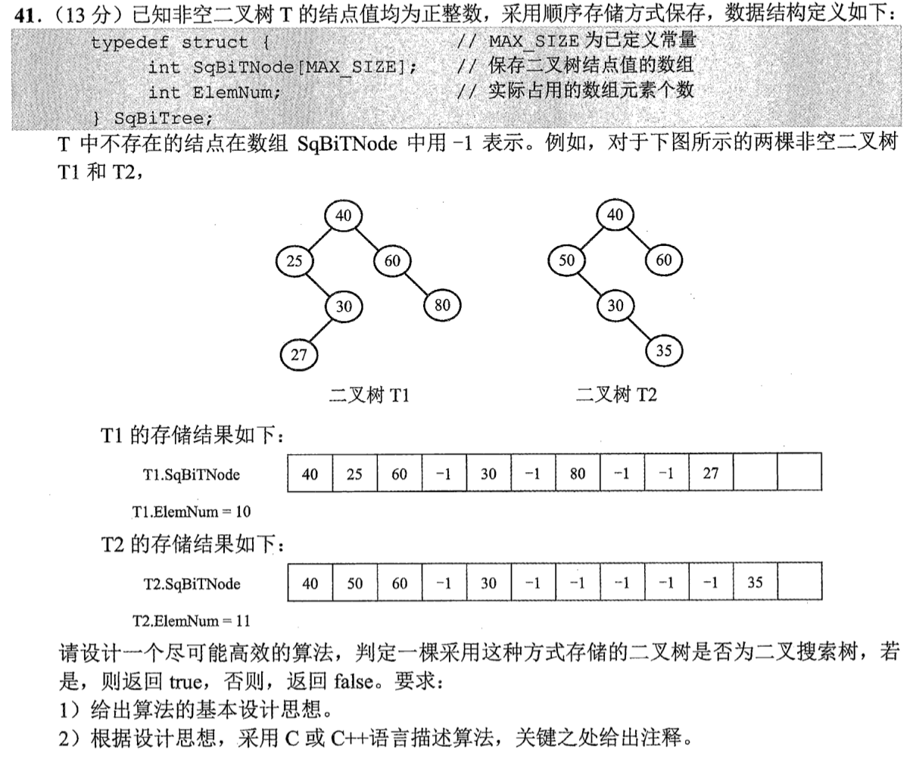

# Day 01｜2020—2026年题，以题带学

[总入口](README.md) · [Day 02 →](day02.md)

**当前选择题7道（原13道），配套大题2道，均为2020—2026年。** 原版每日材料在页末HTML注释中完整保留，暂不执行。这里只更新已有第1—8天，不新增后续每日页。

## 今天按这个顺序做

1. **回忆至多10分钟：** 只处理上次一处真实断点；第1天直接尝试首题。
2. **选择题及补学至多50分钟：** 共7题，先作答再展开讲解；做得少、耗时短时直接进入重做或下一环节，不为凑时间补入旧题。
   - [0731｜复杂度：先数动作，再判量级](modules/0731.md)：2题。
   - [0824｜系统边界：谁触发、谁处理、谁受保护](modules/0824.md)：5题。
3. **两道大题及补学至多50分钟：** 每题先独立尝试，再读折叠讲解，随后遮住重做；已能独立完成的不用耗满25分钟。
4. **闭卷检查至多10分钟：** 只留一处明天要修复的断点。

**120分钟是上限，不是必须用满的任务量，也不是已验证的完成时间。** 状态记I（独立完成）、H（引导后可重现）、U（仍不会）。时间到仍未完成，就记下真实题号和断点；不能靠继续加时把U写成完成。省下的时间用于当天错题重做，不自动增加新题。

## 大题1｜2021-41 · 判定无向图是否存在EL路径

原题定位：[src/0916.md](../src/0916.md)，以年份题号2021-41定位。



<details>
<summary>没有入口时的第一步</summary>

题干已保证图连通且至少有一条边，并给出了判定条件。先数每个顶点的度，再统计奇数度顶点，不需要真的寻找路径。

</details>

<details>
<summary>完整解法与必要补学</summary>

**思想。** 对邻接矩阵逐行求和得到各顶点度数；奇数度顶点数为0或2时返回1，否则返回0。连通性是题设，不能多添一次不必要的图遍历；若换成一般输入，才须额外核验所有有边顶点连通。

```c
int IsExistEL(MGraph G) {
    int odd = 0;
    for (int i = 0; i < G.numVertices; ++i) {
        int degree = 0;
        for (int j = 0; j < G.numVertices; ++j)
            degree += G.Edge[i][j];
        if (degree % 2 != 0) ++odd;
    }
    return odd == 0 || odd == 2;
}
```

共检查V²个矩阵元素，时间O(V²)，辅助空间O(1)。这是判定题，无须写输出路径的算法。代码沿用原题无向图邻接矩阵的0/1表示。

</details>

<details>
<summary>重做后检查</summary>

三角形的度数为2、2、2，返回1；四顶点星形的度数为3、1、1、1，返回0。闭卷说明为什么不需要重新证明题设给出的判定定理。

</details>

## 大题2｜2022-41 · 顺序存储二叉树的BST判定

原题定位：[src/0915.md](../src/0915.md)，以年份题号2022-41定位。



<details>
<summary>没有入口时的第一步</summary>

数组按0开始编号，左、右孩子分别在2i+1和2i+2。不能只比较父子，要检查祖先留下的整个取值区间。

</details>

<details>
<summary>完整解法与必要补学</summary>

**思想。** 从根开始，为每棵子树携带允许的开区间(lo,hi)。当前值必须严格落在区间中；左子树收紧上界，右子树收紧下界。越过ElemNum或遇到−1表示空结点，直接返回真。

```c
#include <stdbool.h>
#include <limits.h>
bool checkBST(const SqBiTree *T, int i, long long lo, long long hi) {
    if (i >= T->ElemNum || T->SqBiTNode[i] == -1) return true;
    int x = T->SqBiTNode[i];
    if (x <= lo || x >= hi) return false;
    return checkBST(T, 2*i+1, lo, x)
        && checkBST(T, 2*i+2, x, hi);
}
bool IsBST(SqBiTree T) {
    return checkBST(&T, 0, LLONG_MIN, LLONG_MAX);
}
```

只访问树中实际结点及其空孩子位置，时间O(v)，v为非空结点数，亦为数组使用长度n的O(n)上界；递归栈O(h)。也可按中序遍历检查严格递增，但不能直接扫描数组，因为数组是层序位置布局。原题只要求算法思想与实现，不虚构分项分值。

</details>

<details>
<summary>重做后检查</summary>

原图T1满足BST条件，T2不满足：根40的左子树中出现50，已违反祖先40的上界。即使某些父子关系看似正常也不能通过。

</details>

## 最后闭卷检查

1. 外层翻倍而内层做i次，为什么总量不是n log n？
2. EL路径判定为何只数奇数度顶点，不必实际找路径？
3. BST为什么必须满足祖先留下的区间，而不能只检查父子？

不誊写整篇解答，只在纸上留一行：

```text
实际用时__分钟；选择题I__/H__/U__；大题1 I/H/U；大题2 I/H/U
未完成的题号__；明天只回看__；卡住的具体一步__
```

## 暂缓的原版材料

以下完整旧版仅在源文件注释中保存，其中旧年份题目暂不安排。

<!-- 暂缓：更新前的整份每日材料；原文保留，当前不安排。
# Day 01｜120分钟以题带学

[总入口](README.md) · [Day 02 →](day02.md)

**总时间上限120分钟，补学、核对、纠错均含在内。** 任务是完成本日指定题，不是刷完整个原文件。状态只记独立完成I、引导后完成H、仍有断点U，不把看过或到时当掌握。

## 今天直接按这个顺序做

1. **0—10分钟：** 回忆昨天留下的一处断点；Day 1用于直接尝试首题，不先找课程。
2. **10—60分钟：** 做下面两个模块，共13道选择题。先尝试，遇到知识缺口在本页补学；模块时间按题数分配，读解答和纠错算在50分钟内。
   - [0731｜复杂度：先数动作，再判量级](modules/0731.md)：3题。
   - [0824｜系统边界：谁触发、谁处理、谁受保护](modules/0824.md)：10题。
3. **60—110分钟：** 完成下面两道大题，每题25分钟：读题与独立尝试5分钟，卡住读折叠解法7分钟，遮住后重写或重算10分钟，核对2分钟，标状态1分钟。已能独立完成时无需等到用满。
4. **110—120分钟：** 做文末检查，只记一处最值得明天回看的断点，停止当天训练。

**防止时间失控：** 选择题45—90秒没有入口就读本页讲解；不用先去搜视频或整理新笔记。独立做对且依据正确的题立即离开；引导后仍不会的保留U，次日开头处理。120分钟到时如仍未完成，记录真实未完成题号，不能勾成通关；这也是校准本计划工作量的依据。

## 大题1｜2009-42 · 单链表倒数第k个结点

原题定位：[src/0914.md 第01题](../src/0914.md)。以年份题号为准，避免原计划题名错位。


<details>
<summary>没有入口时的第一步</summary>

先不追求最优：能否先数长度？再想怎样让两个指针保持固定距离。

</details>

<details>
<summary>完整解法与必要补学</summary>

**思路和步骤。** 头结点不参与计数，p、q均从首个数据结点出发。p先走k步；若中途到NULL，结点不足k个，返回0。随后二者同时前进，直到p==NULL，此时q正好是倒数第k个结点。输出q的数据并返回1。

```c
int kth(Node *list, int k) {
    if (k <= 0) return 0;
    Node *p = list->link, *q = list->link;
    for (int i = 0; i < k; ++i) {
        if (p == NULL) return 0;
        p = p->link;
    }
    while (p != NULL) {
        p = p->link;
        q = q->link;
    }
    printf("%d\n", q->data);
    return 1;
}
```

Node沿用题目的data/link结构。时间O(n)、辅助空间O(1)，不改原链表。若暂时不会双指针，先遍历得长度n，再走到第n−k+1个结点，也可实现O(n)、O(1)；之后用固定间距解释改进的一趟扫描。**边界核对：** 空表、k=1、k=n、k>n。必须处理输出和返回值，不能只返回指针。原题要求思想、步骤与代码，三项均在此闭合，不虚构官方分项评分。

</details>

<details>
<summary>重做后检查</summary>

用a→b→c、k=3跟踪：p先走3步到NULL，q仍在a，答案a；k=4则在预走阶段返回0。

</details>

## 大题2｜2010-42 · 数组循环左移p位

原题定位：[src/0914.md 第02题](../src/0914.md)。以年份题号为准，避免原计划题名错位。


<details>
<summary>没有入口时的第一步</summary>

把原数组分成A=前p项、B=其余项；目标AB→BA。先用5个数试逆置，确认区间端点。

</details>

<details>
<summary>完整解法与必要补学</summary>

**思想。** 分别逆置A、B，再逆置整体。第一次得到AʳBʳ，整体逆置后得到BA。

```c
void reverse(int R[], int l, int r) {
    while (l < r) {
        int t = R[l]; R[l] = R[r]; R[r] = t;
        ++l; --r;
    }
}
void left_rotate(int R[], int n, int p) {
    reverse(R, 0, p - 1);
    reverse(R, p, n - 1);
    reverse(R, 0, n - 1);
}
```

题设已给n>1且0<p<n，代码按这个前提。共线性次交换，时间O(n)，仅一个临时变量，空间O(1)。原题是13分，旧执行页的4+4+2不构成可靠评分标准，本页不沿用。用辅助数组也能实现，但空间O(n)，应说明与最省空间解的区别，不承诺固定得分。

</details>

<details>
<summary>重做后检查</summary>

[0,1,2,3,4]，p=2：逆前段得[1,0,2,3,4]，逆后段得[1,0,4,3,2]，逆整体得[2,3,4,0,1]。闭卷写出三个区间即可检查是否把p误当p−1。

</details>

## 最后10分钟：闭卷检查与交付

1. 为什么2019-01是平方根而非对数？
2. trap与关中断为什么一个允许用户执行、一个不允许？
3. 闭卷写出循环左移的三个逆置区间，并解释倒数k结点的指针间距。

在纸上留一行即可，不抄解答、不另建整理任务：

```text
实际用时__分钟；选择题 I__/H__/U__；大题1 I/H/U；大题2 I/H/U
明天只回看：题号__；卡住的具体一步__
```

**完成与掌握分别记录。** 指定题均作答并核对、引导后能重现关键步骤，算本日执行完成；U仍存在就保留未通过项，不以此证明已掌握整个模块。扩展原题单的攻坚部分放到后续阶段；当天有余时也只在120分钟内追加。
-->
