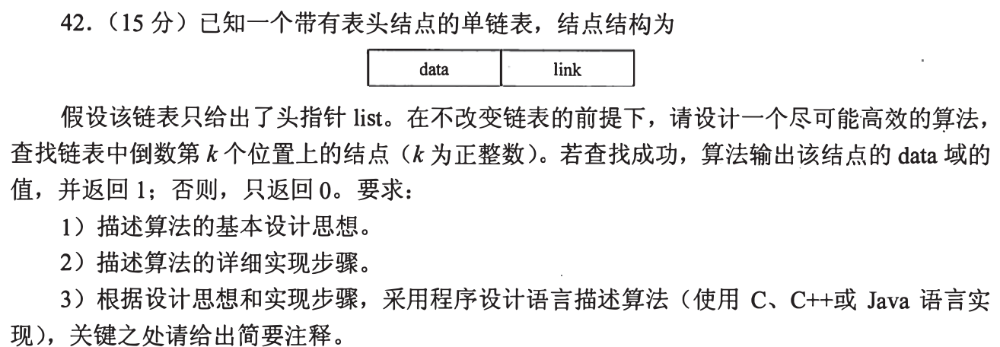
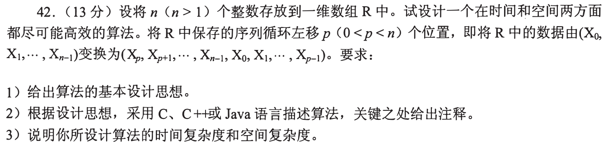

# Day 01｜120分钟以题带学

[总入口](README.md) · [Day 02 →](day02.md)

**总时间上限120分钟，补学、核对、纠错均含在内。** 任务是完成本日指定题，不是刷完整个原文件。状态只记独立完成I、引导后完成H、仍有断点U，不把看过或到时当掌握。

## 今天直接按这个顺序做

1. **0—10分钟：** 回忆昨天留下的一处断点；Day 1用于直接尝试首题，不先找课程。
2. **10—60分钟：** 做下面两个模块，共13道选择题。先尝试，遇到知识缺口在本页补学；模块时间按题数分配，读解答和纠错算在50分钟内。
   - [0731｜复杂度：先数动作，再判量级](modules/0731.md)：3题。
   - [0824｜系统边界：谁触发、谁处理、谁受保护](modules/0824.md)：10题。
3. **60—110分钟：** 完成下面两道大题，每题25分钟：读题与独立尝试5分钟，卡住读折叠解法7分钟，遮住后重写或重算10分钟，核对2分钟，标状态1分钟。已能独立完成时无需等到用满。
4. **110—120分钟：** 做文末检查，只记一处最值得明天回看的断点，停止当天训练。

**防止时间失控：** 选择题45—90秒没有入口就读本页讲解；不用先去搜视频或整理新笔记。独立做对且依据正确的题立即离开；引导后仍不会的保留U，次日开头处理。120分钟到时如仍未完成，记录真实未完成题号，不能勾成通关；这也是校准本计划工作量的依据。

## 大题1｜2009-42 · 单链表倒数第k个结点

原题定位：[src/0914.md 第01题](../src/0914.md)。以年份题号为准，避免原计划题名错位。



<details>
<summary>没有入口时的第一步</summary>

先不追求最优：能否先数长度？再想怎样让两个指针保持固定距离。

</details>

<details>
<summary>完整解法与必要补学</summary>

**思路和步骤。** 头结点不参与计数，p、q均从首个数据结点出发。p先走k步；若中途到NULL，结点不足k个，返回0。随后二者同时前进，直到p==NULL，此时q正好是倒数第k个结点。输出q的数据并返回1。

```c
int kth(Node *list, int k) {
    if (k <= 0) return 0;
    Node *p = list->link, *q = list->link;
    for (int i = 0; i < k; ++i) {
        if (p == NULL) return 0;
        p = p->link;
    }
    while (p != NULL) {
        p = p->link;
        q = q->link;
    }
    printf("%d\n", q->data);
    return 1;
}
```

Node沿用题目的data/link结构。时间O(n)、辅助空间O(1)，不改原链表。若暂时不会双指针，先遍历得长度n，再走到第n−k+1个结点，也可实现O(n)、O(1)；之后用固定间距解释改进的一趟扫描。**边界核对：** 空表、k=1、k=n、k>n。必须处理输出和返回值，不能只返回指针。原题要求思想、步骤与代码，三项均在此闭合，不虚构官方分项评分。

</details>

<details>
<summary>重做后检查</summary>

用a→b→c、k=3跟踪：p先走3步到NULL，q仍在a，答案a；k=4则在预走阶段返回0。

</details>

## 大题2｜2010-42 · 数组循环左移p位

原题定位：[src/0914.md 第02题](../src/0914.md)。以年份题号为准，避免原计划题名错位。



<details>
<summary>没有入口时的第一步</summary>

把原数组分成A=前p项、B=其余项；目标AB→BA。先用5个数试逆置，确认区间端点。

</details>

<details>
<summary>完整解法与必要补学</summary>

**思想。** 分别逆置A、B，再逆置整体。第一次得到AʳBʳ，整体逆置后得到BA。

```c
void reverse(int R[], int l, int r) {
    while (l < r) {
        int t = R[l]; R[l] = R[r]; R[r] = t;
        ++l; --r;
    }
}
void left_rotate(int R[], int n, int p) {
    reverse(R, 0, p - 1);
    reverse(R, p, n - 1);
    reverse(R, 0, n - 1);
}
```

题设已给n>1且0<p<n，代码按这个前提。共线性次交换，时间O(n)，仅一个临时变量，空间O(1)。原题是13分，旧执行页的4+4+2不构成可靠评分标准，本页不沿用。用辅助数组也能实现，但空间O(n)，应说明与最省空间解的区别，不承诺固定得分。

</details>

<details>
<summary>重做后检查</summary>

[0,1,2,3,4]，p=2：逆前段得[1,0,2,3,4]，逆后段得[1,0,4,3,2]，逆整体得[2,3,4,0,1]。闭卷写出三个区间即可检查是否把p误当p−1。

</details>

## 最后10分钟：闭卷检查与交付

1. 为什么2019-01是平方根而非对数？
2. trap与关中断为什么一个允许用户执行、一个不允许？
3. 闭卷写出循环左移的三个逆置区间，并解释倒数k结点的指针间距。

在纸上留一行即可，不抄解答、不另建整理任务：

```text
实际用时__分钟；选择题 I__/H__/U__；大题1 I/H/U；大题2 I/H/U
明天只回看：题号__；卡住的具体一步__
```

**完成与掌握分别记录。** 指定题均作答并核对、引导后能重现关键步骤，算本日执行完成；U仍存在就保留未通过项，不以此证明已掌握整个模块。扩展原题单的攻坚部分放到后续阶段；当天有余时也只在120分钟内追加。
