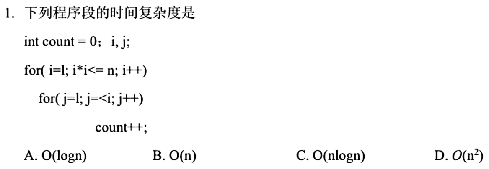
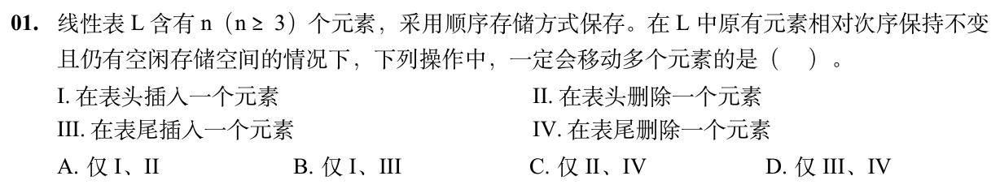
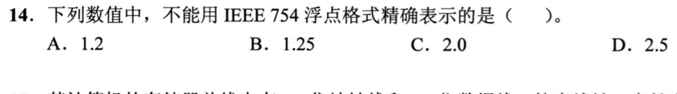
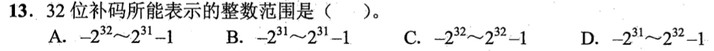
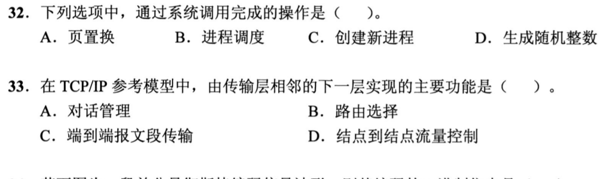
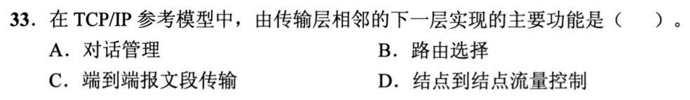
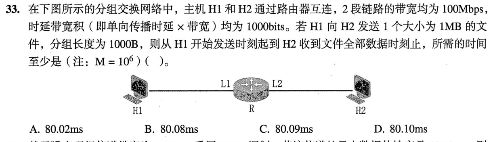
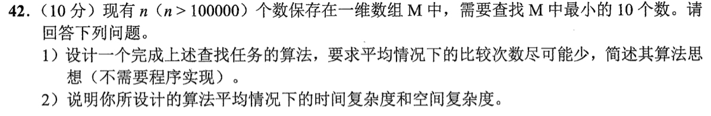

# Day 02｜选择题主线，全量覆盖

[← Day 01](day01.md) · [总入口](README.md) · [Day 03 →](day03.md)

**本日新题：选择题7道，大题1道。** 选择题先做；同一题号只在一天计为首次覆盖。原有讲解按需展开，不再额外执行旧版每日页的两道大题和复盘排期。

## 今天按这个顺序做

1. **0–75分钟｜选择题及核对。** 按下方七题逐题作答，写选项和一句依据；单题独立尝试至多2分钟，无入口先标U，再补概念。核对和遮住重做包含在本段，避免一道难题拖住整组。
2. **75–110分钟｜大题针对训练。** 这一道最多35分钟；保留整题及所有小问，先写能确定的部分。无入口5分钟后再看已有讲解；优先练会建模、公式、状态表或代码的第一步，不为誊写长解挤占选择题。
3. **110–120分钟｜闭卷回收。** 从今天错误的选择题中选一题遮住重做；若七题均独立正确，再回收大题的一处断点。记录实际完成题号，未完成保留U。

**120分钟为预算上限，不保证每个人都能做完。** 题量已排齐不等于已完成；到点停止，用下方记录保留未做和待核对项。

## 选择题｜本日必做7题

### 选择题1｜2025-01 · 数据结构

[原题单 0731｜时间复杂度：循环执行次数](../src/0731.md)



<details>
<summary>答案与解析</summary>

**答案：B。**

**直接法：** 外层i从1加到⌊√n⌋，内层每轮执行i次。令m=⌊√n⌋，总次数为1+2+…+m=m(m+1)/2，与n同量级，故O(n)。

**排除法／易混点：** A错在把i++看成翻倍；C、D错在没有先由i²≤n得到外层上限√n。√n轮，每轮最多√n次，已经给出O(n)上界。

</details>

### 选择题2｜2026-01 · 数据结构

[原题单 0731｜时间复杂度：循环执行次数](../src/0731.md)



<details>
<summary>答案与解析</summary>

**答案：A。**

**直接法：** 表头插入要将原n个元素后移，表头删除要将后续n−1个元素前移；n>3，I、II都必然移动多个元素。

**排除法／易混点：** III表尾插入已有空位，直接写入；IV表尾删除只需减小表长，不必搬动其余元素。保持原元素相对次序，排除了用末尾元素覆盖表头的做法。

</details>

### 选择题3｜2021-14 · 组成原理

[原题单 0812｜位模式的解释权：整数、浮点与类型转换](../src/0812.md)



<details>
<summary>答案与解析</summary>

**答案：A。**

**直接法：** 1.2=6/5，最简分母含因子5，二进制是无限循环小数，有限尾数不能精确保存。

**排除法／易混点：** B的1.25=1.01₂，C的2.0=10₂，D的2.5=10.1₂，均能用有限二进制位精确表示。判断的是精确性，不是能否存下一个近似值。

</details>

### 选择题4｜2022-13 · 组成原理

[原题单 0812｜位模式的解释权：整数、浮点与类型转换](../src/0812.md)



<details>
<summary>答案与解析</summary>

**答案：B。**

**直接法：** 32位补码最高位的权是−2³¹，其余31位最大和为2³¹−1，因此范围为−2³¹到2³¹−1。

**排除法／易混点：** 其余选项至少有一端用到了2³²量级，已经超过32位补码的范围。负端比正端的绝对值多1，不是关于0对称。

</details>

### 选择题5｜2021-32 · 操作系统

[原题单 0824｜系统边界：应用如何进入内核](../src/0824.md)



<details>
<summary>答案与解析</summary>

**答案：C。**

**直接法：** 创建新进程需要内核建立进程管理信息、分配资源，用户程序通过系统调用请求完成，所以选C。

**排除法／易混点：** A页置换、B进程调度也是内核工作，但它们是内核管理机制，不等于用户主动调用的系统服务；D题中的普通伪随机整数可由用户态算法生成。不能用“内核会做”替代“通过系统调用请求”。

</details>

### 选择题6｜2021-33 · 计算机网络

[原题单 0901｜分层路径：数据穿过网络时每层做什么](../src/0901.md)



<details>
<summary>答案与解析</summary>

**答案：B。**

**直接法：** TCP/IP中传输层的下一层是网络层，路由选择是网络层功能。

**排除法／易混点：** A对话管理对应OSI会话层；C端到端报文段传输属于传输层自身；D结点到结点流控属于链路层。题目问“下一层”，不要直接选传输层的功能。

</details>

### 选择题7｜2023-33 · 计算机网络

[原题单 0901｜分层路径：数据穿过网络时每层做什么](../src/0901.md)



<details>
<summary>答案与解析</summary>

**答案：D。**

**直接法：** 1000B分组在100Mb/s链路发送一次需80μs；每段传播时延=1000bit÷100Mb/s=10μs。1MB文件分1000组，经过两段等速、存储转发链路，总时间=(1000+1)×80μs+2×10μs=80.10ms。

**排除法／易混点：** A的80.02ms只算了文件在首链路的发送和两段传播，漏掉最后一组在第二段链路的发送。不能把整份文件的发送时间乘2，因为两段可流水传输。

</details>

## 大题｜整题作答，针对断点

### 大题1｜2022-42 · 数据结构

[原题单 0914｜线性结构：数组与链表大题](../src/0914.md)



<details>
<summary>答案与解析</summary>

（1）取前10个数建立大根堆，堆中始终保存已经扫描部分的最小10个。逐个读后续元素x：若x不小于堆顶，丢弃；若x小于堆顶，则用x替换堆顶并向下调整。扫描完后堆内即是最小10个，不要求它们内部已经排好序，原题也明确不要求程序代码。

（2）一般保留k个时，建堆O(k)，其余每个数先和堆顶比较，只有入选时才花O(log k)调整；总时间上界O(n log k)。本题k=10固定，时间为O(n)，额外堆空间O(10)=O(1)；也可在原数组前10项建堆。随机输入时，扫描越往后，新元素入选最小10个的机会越小，因此大多数元素只需一次堆顶比较。不能为拿最小10个直接付出全排序的O(n log n)代价。

</details>

## 今日记录

```text
实际用时__；选择题已作答__/7，已核对__/7，I__/H__/U__
大题实际完成的小问__；未做或未核对的题号__
下一次先回收的选择题__；错误发生在__
```
