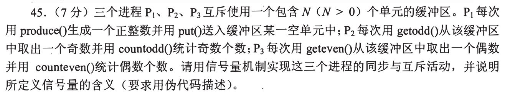
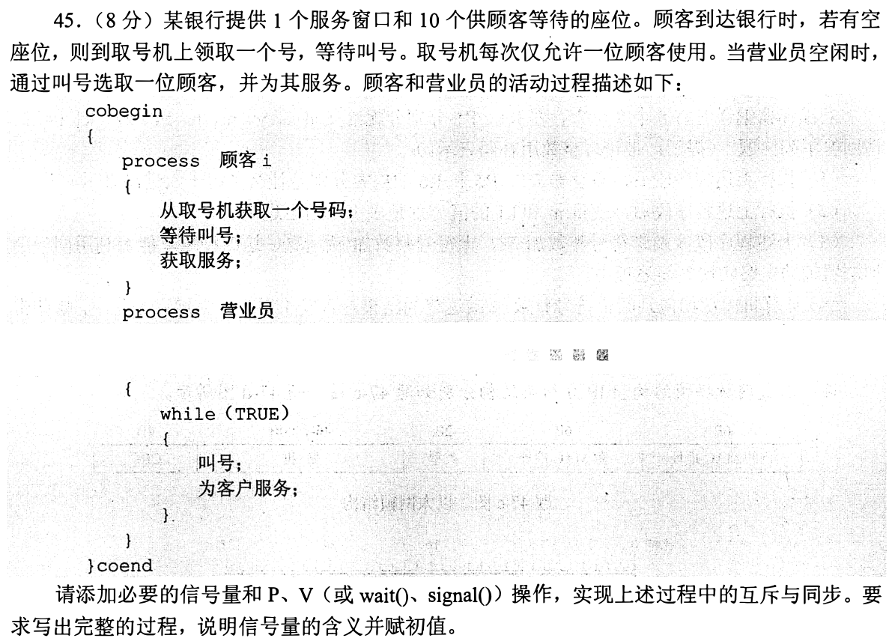

# Day 02｜120分钟以题带学

[← Day 01](day01.md) · [总入口](README.md) · [Day 03 →](day03.md)

**总时间上限120分钟，补学、核对、纠错均含在内。** 任务是完成本日指定题，不是刷完整个原文件。状态只记独立完成I、引导后完成H、仍有断点U，不把看过或到时当掌握。

## 今天直接按这个顺序做

1. **0—10分钟：** 回忆昨天留下的一处断点；Day 1用于直接尝试首题，不先找课程。
2. **10—60分钟：** 做下面两个模块，共17道选择题。先尝试，遇到知识缺口在本页补学；模块时间按题数分配，读解答和纠错算在50分钟内。
   - [0812｜整数与浮点：先切位，再解释](modules/0812.md)：10题。
   - [0901｜分层：服务对象与协议职责](modules/0901.md)：7题。
3. **60—110分钟：** 完成下面两道大题，每题25分钟：读题与独立尝试5分钟，卡住读折叠解法7分钟，遮住后重写或重算10分钟，核对2分钟，标状态1分钟。已能独立完成时无需等到用满。
4. **110—120分钟：** 做文末检查，只记一处最值得明天回看的断点，停止当天训练。

**防止时间失控：** 选择题45—90秒没有入口就读本页讲解；不用先去搜视频或整理新笔记。独立做对且依据正确的题立即离开；引导后仍不会的保留U，次日开头处理。120分钟到时如仍未完成，记录真实未完成题号，不能勾成通关；这也是校准本计划工作量的依据。

## 大题1｜2009-45 · 奇数与偶数分别消费的缓冲区

原题定位：[src/0925.md 第01题](../src/0925.md)。以年份题号为准，避免原计划题名错位。



<details>
<summary>没有入口时的第一步</summary>

不是只有一类消费者：先列空位、奇数个数、偶数个数，再列对缓冲区的互斥。

</details>

<details>
<summary>完整解法与必要补学</summary>

**信号量。** empty=N表示空位，odd=0表示可取奇数，even=0表示可取偶数，mutex=1保护缓冲区。P等待一个资源，V归还或发布一个资源。

```text
P1: while true:
    x = produce()
    P(empty)
    P(mutex); put(x); V(mutex)
    if x为奇数: V(odd)
    else: V(even)

P2: while true:
    P(odd)
    P(mutex); x = getodd(); V(mutex)
    V(empty)
    countodd()

P3: while true:
    P(even)
    P(mutex); x = geteven(); V(mutex)
    V(empty)
    counteven()
```

题目函数countodd()/counteven()按题设使用，不擅自要求传参。先P同步资源、再P互斥锁：若持mutex等待empty，消费者可能无法进缓冲区释放空位，形成死锁。统计动作放锁外，避免扩大临界区。不能只设full后让消费者取错奇偶数；两个计数信号量分别控制两种数据。

</details>

<details>
<summary>重做后检查</summary>

N=1且放入奇数：empty从1到0、odd从0到1；偶数消费者继续等待，奇数消费者取走后empty恢复1。

</details>

## 大题2｜2011-45 · 银行取号、十个等待座位、一个窗口

原题定位：[src/0925.md 第02题](../src/0925.md)。以年份题号为准，避免原计划题名错位。



<details>
<summary>没有入口时的第一步</summary>

与上一题不同：座位是容量，取号机是互斥资源，叫号是同步事件。不能把全部活动用一把锁包住。

</details>

<details>
<summary>完整解法与必要补学</summary>

下面给出显式按号码叫人的伪代码，避免把所有顾客混用一个通知信号量而隐含任意唤醒。seat=10限制等待座位；lock=1保护取号机和号码队列；waiting=0统计待叫号者；每位顾客的called[t]=0是其叫号通知。票号与队列操作置于lock临界区。

```text
顾客i:
    P(seat)
    P(lock)
        t = 从取号机领取号码
        建立called[t]=0; 将t加入等待队列
    V(lock)
    V(waiting)
    P(called[t])
    V(seat)                // 到窗口，释放等候座位
    获取服务

营业员:
    while true:
        P(waiting)
        P(lock); t = 队首出队; V(lock)
        叫号码t
        V(called[t])
        为t对应顾客服务       // 完成本次服务再进入下一轮
```

满10个等待座位时，新顾客阻塞在P(seat)，不能先占住取号机再等座位。叫号后去窗口即释放等待座位，不需要一直占到服务结束。服务只有一名营业员串行执行，窗口无需再重复加互斥锁。此写法显式保存叫号对象，额外队列和逐号通知属于实现选择；考试也可使用对唤醒次序作出恰当约定的等价简化写法。

</details>

<details>
<summary>重做后检查</summary>

已有1人在窗口、10人在等候时，第12位顾客须等待座位。营业员叫下一号，该顾客离开座位，才允许新顾客取号等候。

</details>

## 最后10分钟：闭卷检查与交付

1. IEEE754的E=0与E=1，隐含位、实际指数分别怎样取？
2. 为什么ICMP由IP直接承载？
3. 闭卷列出奇偶消费者题四个信号量及初值，并说明P操作顺序。

在纸上留一行即可，不抄解答、不另建整理任务：

```text
实际用时__分钟；选择题 I__/H__/U__；大题1 I/H/U；大题2 I/H/U
明天只回看：题号__；卡住的具体一步__
```

**完成与掌握分别记录。** 指定题均作答并核对、引导后能重现关键步骤，算本日执行完成；U仍存在就保留未通过项，不以此证明已掌握整个模块。扩展原题单的攻坚部分放到后续阶段；当天有余时也只在120分钟内追加。
