# Day 03｜数据结构＋操作系统

[← Day 02](day02.md) · [总入口](README.md) · [Day 04 →](day04.md)

**选择题：15道，来自两份完整src题单；大题：2道。** 先做选择题，再展开题下解析。组内题目沿用src顺序；标为复做的组，已会的快速通过，重点处理上次错题。

**预计用时：85—130分钟。** 选择题及核对约40—65分钟，大题约40—55分钟，最后用5—10分钟重做今天最值得记住的一道错题。约两小时是配题目标，不是必须耗满或到点强停；计算卡住时先保留题号，先完成其余选择题。

## 选择题组1｜0801 · 数据结构

[位置关系：指针、下标与压缩存储](../src/0801.md) · 8道 · 首次。

### 选择题1｜2020-01

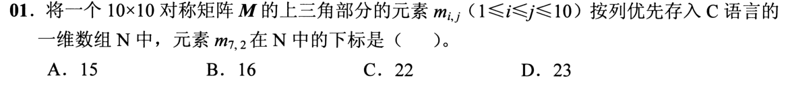

<details>
<summary>答案与解析</summary>

**答案：C。**

矩阵对称，m₇,₂与m₂,₇共用存储位置。上三角按列存储，第7列之前有1+2+3+4+5+6=21个元素；m₂,₇在本列排第2，C数组从0编号，下标为21+1=22。不能直接拿下三角的行号7、列号2套入上三角存储。

</details>

### 选择题2｜2021-01

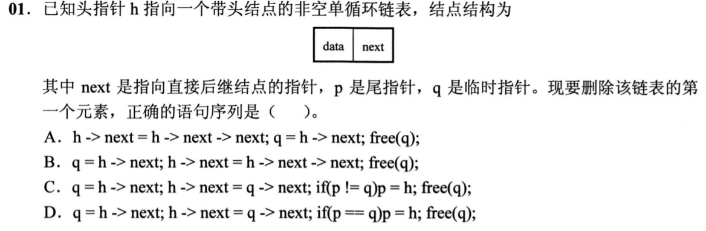

<details>
<summary>答案与解析</summary>

**答案：D。**

先q=h→next，再h→next=q→next；若p==q说明删的是唯一数据结点，尾指针p必须改为h，最后释放q。

</details>

### 选择题3｜2021-03

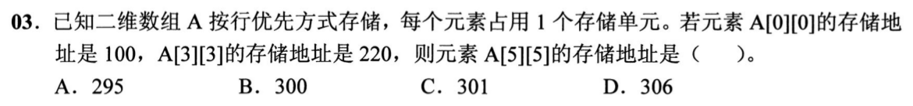

<details>
<summary>答案与解析</summary>

**答案：B。**

设每行有c个元素，则A[3][3]相对A[0][0]偏移3c+3=220−100=120，得c=39。A[5][5]的地址为100+5×39+5=300。每元素只占一个存储单元，不再乘额外的字节数。

</details>

### 选择题4｜2023-02

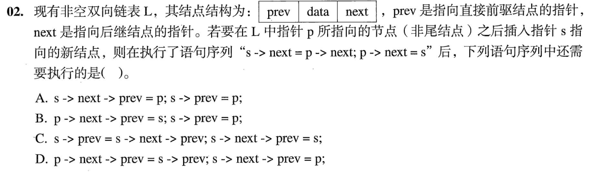

<details>
<summary>答案与解析</summary>

**答案：C。**

两条next赋值后，s的后继仍是原p的后继，其prev仍指p。先s→prev=s→next→prev得到p，再s→next→prev=s，补齐反向链。

</details>

### 选择题5｜2023-03

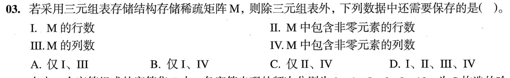

<details>
<summary>答案与解析</summary>

**答案：A。**

需要保存矩阵总行数、总列数，即I、III；含非零元素的行列数不能告诉你末尾全零行列有多少。

</details>

### 选择题6｜2024-01

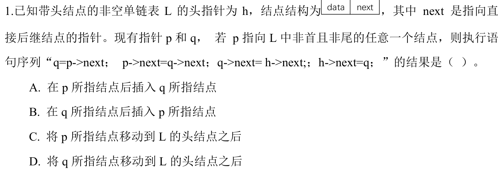

<details>
<summary>答案与解析</summary>

**答案：D。**

先把q=p的后继摘下：p→next=q→next；再将q头插到h之后。被移动的是q，不是p。

</details>

### 选择题7｜2026-01

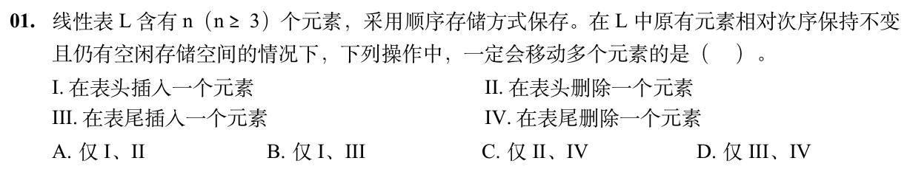

<details>
<summary>答案与解析</summary>

**答案：A。**

表头插入要将原n个元素后移，表头删除要将后续n−1个元素前移；n≥3，I、II都必然移动多个元素。

III表尾插入已有空位，直接写入；IV表尾删除只需减小表长，不必搬动其余元素。保持原元素相对次序，排除了用末尾元素覆盖表头的做法。

</details>

### 选择题8｜2026-02

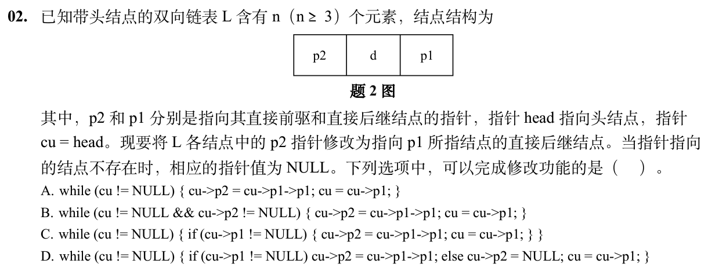

<details>
<summary>答案与解析</summary>

**答案：D。**

逐个结点沿p1向后走：若有后继，令p2指向后继的后继；若已到尾结点，令p2=NULL。D对两种情况都处理并始终推进cu。A在尾结点解引用NULL；B一开始head的p2就是NULL，循环不执行；C到尾结点后不再推进cu，会死循环。

</details>

## 选择题组2｜0831 · 操作系统

[设备服务：缓冲、磁盘与请求调度](../src/0831.md) · 7道 · 首次。

### 选择题9｜2021-26

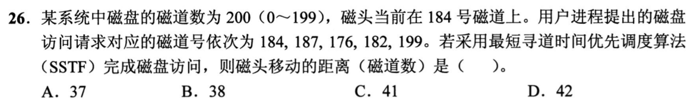

<details>
<summary>答案与解析</summary>

**答案：C。**

SSTF每次从当前位置挑最近请求。184号请求先原地完成，随后依次到182、187、176、199，移动量为0+2+5+11+23=41。选的是离当前磁头最近的请求，不是按输入次序，也不是把全部请求从小到大排序。

</details>

### 选择题10｜2022-32

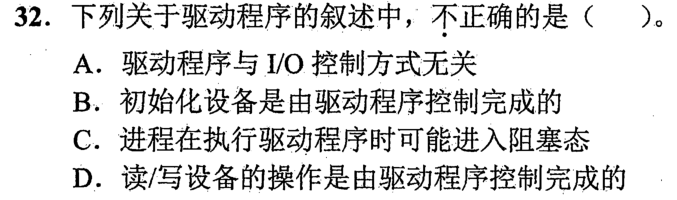

<details>
<summary>答案与解析</summary>

**答案：A。**

驱动必须配合具体I/O控制方式：查询方式要反复读状态，中断方式要处理中断，DMA方式要设置传输参数，因此“与I/O控制方式无关”错误。设备初始化、启动读写都由驱动控制；同步I/O等待设备完成时，请求进程可能阻塞，B、C、D成立。

</details>

### 选择题11｜2023-32

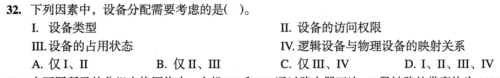

<details>
<summary>答案与解析</summary>

**答案：D。**

分配设备既要看设备类型是否满足请求，也要查进程有无访问权限、设备是否被占用，并建立逻辑设备到实际物理设备的对应关系。四项分别对应适用性、保护、可用性和设备独立性，均需考虑。

</details>

### 选择题12｜2024-31

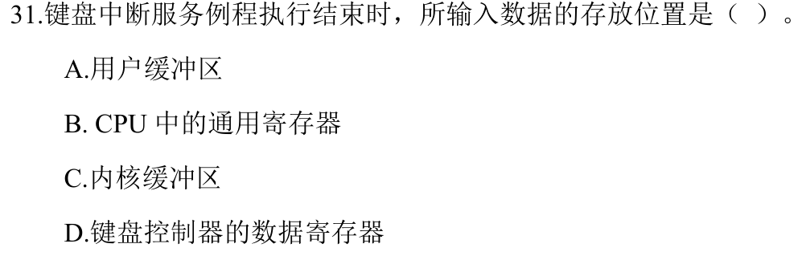

<details>
<summary>答案与解析</summary>

**答案：C。**

中断例程把字符放入内核缓冲区。CPU寄存器只是临时载体，用户缓冲区属于后续交付。

</details>

### 选择题13｜2024-32

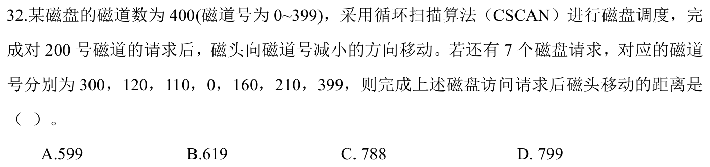

<details>
<summary>答案与解析</summary>

**答案：C。**

磁头向小号方向服务：200→160→120→110→0；随后循环跳到399，再向下服务300、210。总距离为200+399+(399−210)=788。循环扫描的回跳也有真实寻道距离；只扫到最小请求再跳最高请求的C-LOOK不能替代本题C-SCAN。

</details>

### 选择题14｜2026-31

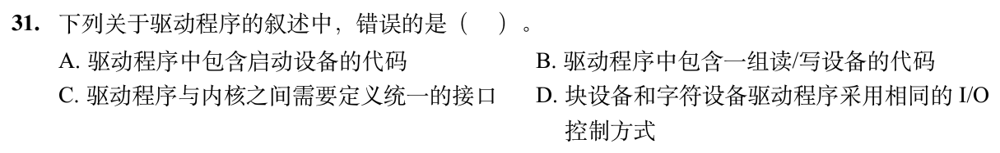

<details>
<summary>答案与解析</summary>

**答案：D。**

块设备和字符设备的传输单位与设备特性不同，I/O控制方式可以不同。它们仍可在内核规定的接口下提供启动和读写操作。

</details>

### 选择题15｜2026-32

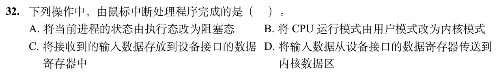

<details>
<summary>答案与解析</summary>

**答案：D。**

鼠标中断处理程序读取设备接口的数据寄存器，将输入数据交给内核缓冲区，选D。模式切换在开始执行处理程序前由硬件完成，B不属于该程序执行的动作；把数据放进接口寄存器是设备完成的，C也不对。中断输入通常唤醒等待者，不是把当前进程改为阻塞。

</details>

## 解答题

### 大题1｜2023-41

[原题单 0916｜图的结构判定：从邻接信息恢复全局性质](../src/0916.md)

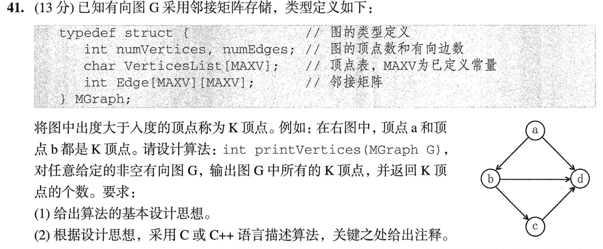

<details>
<summary>答案与解析</summary>

（1）对每个顶点分别计数，出度大于入度时输出并累加。例图中 a 的出、入度为2、0，b 为2、1，只有这两点符合。

（2）按题图无权图的0/1矩阵约定，代码如下。自环若存在，对出、入度各加一。耗时 O(n²)，辅助空间为常量。

```c
#include <stdio.h>

int printVertices(MGraph G) {
    int count = 0;
    for (int i = 0; i < G.numVertices; ++i) {
        int out = 0, in = 0;
        for (int j = 0; j < G.numVertices; ++j) {
            out += G.Edge[i][j] != 0; // 行：i 发出
            in += G.Edge[j][i] != 0;  // 列：到达 i
        }
        if (out > in) {
            printf("%c ", G.VerticesList[i]);
            ++count;
        }
    }
    return count;
}
```

</details>

### 大题2｜2024-41

[原题单 0916｜图的结构判定：从邻接信息恢复全局性质](../src/0916.md)

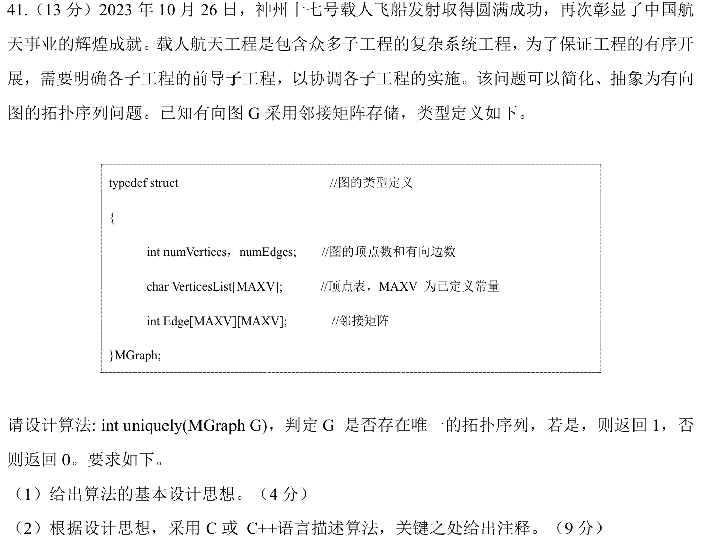

<details>
<summary>答案与解析</summary>

（1）先统计入度，把零入度顶点入队。每轮恰有一个候选时，取该顶点并删除它的出边。空队列且还有未处理顶点说明有环。出现多个候选时，只要全图有拓扑序，每个候选都可先取，因此序列不唯一。

（2）按0/1邻接矩阵约定，辅助空间 O(n)，矩阵扫描 O(n²)。

```c
int uniquely(MGraph G) {
    int n = G.numVertices;
    int in[MAXV] = {0}, queue[MAXV];
    int head = 0, tail = 0;
    for (int u = 0; u < n; ++u)
        for (int v = 0; v < n; ++v)
            if (G.Edge[u][v] != 0) ++in[v];
    for (int v = 0; v < n; ++v)
        if (in[v] == 0) queue[tail++] = v;
    for (int removed = 0; removed < n; ++removed) {
        if (tail - head != 1) return 0;  // 候选为空或超过一个
        int u = queue[head++];
        for (int v = 0; v < n; ++v)
            if (G.Edge[u][v] != 0 && --in[v] == 0)
                queue[tail++] = v;
    }
    return 1;
}
```

</details>

## 一行记录

```text
实际用时__；未完成或未核对的题号__；今天最容易混淆的是__
```
