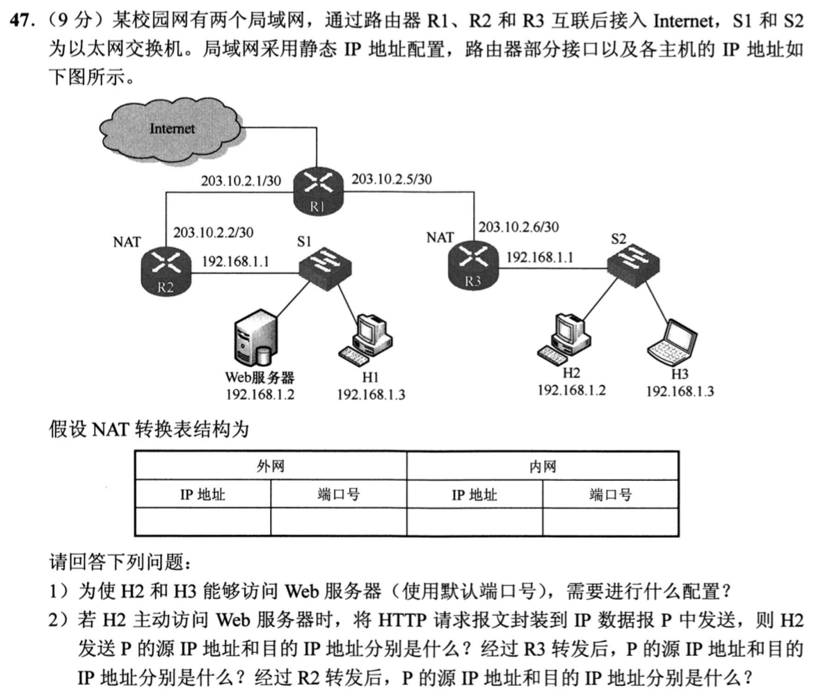
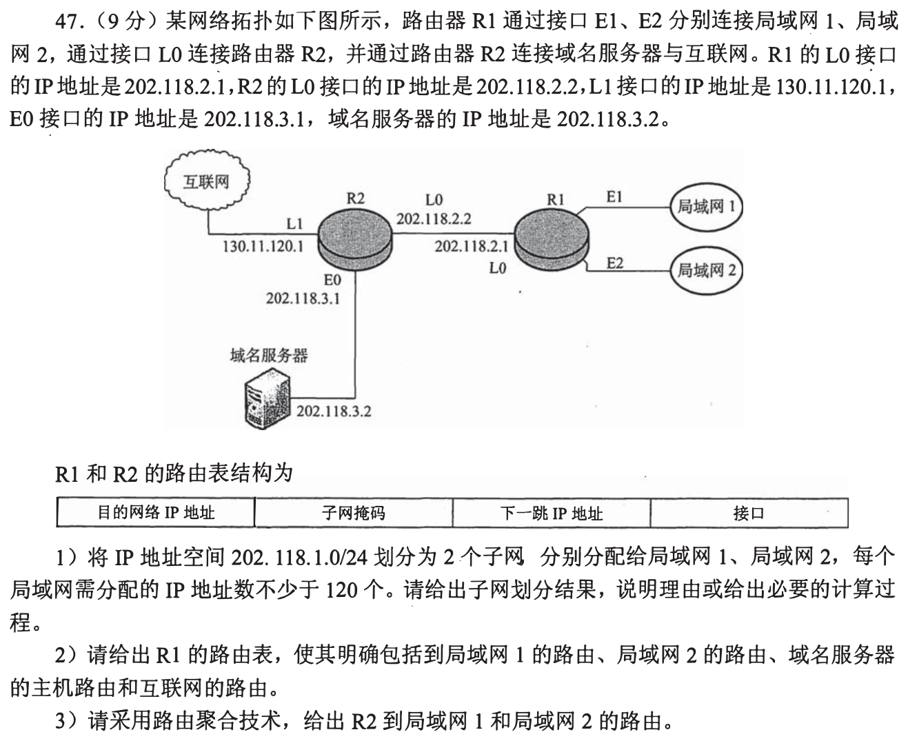
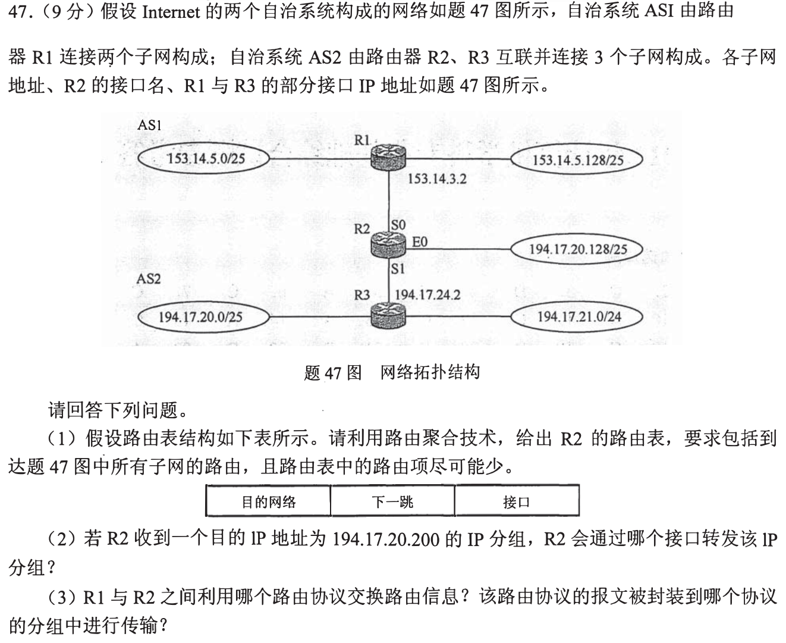

# Day 03｜2020—2026年题，以题带学

[← Day 02](day02.md) · [总入口](README.md) · [Day 04 →](day04.md)

**当前选择题6道（原17道），配套大题2道，均为2020—2026年。** 原版每日材料在页末HTML注释中完整保留，暂不执行。这里只更新已有第1—8天，不新增后续每日页。

## 今天按这个顺序做

1. **回忆至多10分钟：** 只处理上次一处真实断点；第1天直接尝试首题。
2. **选择题及补学至多50分钟：** 共6题，先作答再展开讲解；做得少、耗时短时直接进入重做或下一环节，不为凑时间补入旧题。
   - [0801｜指针与下标：把逻辑关系画出来](modules/0801.md)：4题。
   - [0825｜进程与线程：资源、执行和状态](modules/0825.md)：2题。
3. **两道大题及补学至多50分钟：** 每题先独立尝试，再读折叠讲解，随后遮住重做；已能独立完成的不用耗满25分钟。
4. **闭卷检查至多10分钟：** 只留一处明天要修复的断点。

**120分钟是上限，不是必须用满的任务量，也不是已验证的完成时间。** 状态记I（独立完成）、H（引导后可重现）、U（仍不会）。时间到仍未完成，就记下真实题号和断点；不能靠继续加时把U写成完成。省下的时间用于当天错题重做，不自动增加新题。

## 大题1｜2020-47 · 私网重叠时的NAT与服务器映射

原题定位：[src/1002.md](../src/1002.md)，以年份题号2020-47定位。



<details>
<summary>没有入口时的第一步</summary>

两侧私网虽然都用192.168.1.0网段，但由不同NAT路由器隔离。右侧访问左侧服务器，要使用左侧NAT的公网地址。

</details>

<details>
<summary>完整解法与必要补学</summary>

（1）在R2配置静态端口映射：公网`203.10.2.2:80`对应内网Web服务器`192.168.1.2:80`，让H2、H3访问`http://203.10.2.2/`。还须有正确的默认网关与出网路由：右侧主机通过R3，R3默认下一跳203.10.2.5；R2默认下一跳203.10.2.1。图中已标出R2、R3提供NAT，右侧主动连接还须有出站转换项。

（2）只跟踪题目要求的IP字段：

| 位置 | 源IP | 目的IP |
|---|---|---|
| H2发出 | 192.168.1.2 | 203.10.2.2 |
| 经R3转发 | 203.10.2.6 | 203.10.2.2 |
| 经R2转发 | 203.10.2.6 | 192.168.1.2 |

R3做源地址转换，R2按静态映射做目的地址转换。R3的外侧临时端口只需与其NAT表一致，原题未给定，不能编造固定数值。若H2直接把目的IP写成192.168.1.2，它指向右侧本地地址，无法表示左侧服务器。

</details>

<details>
<summary>重做后检查</summary>

解释为什么经过R2后源IP仍是203.10.2.6，而不是变成左侧的192.168.1.2；再沿相反方向解释应答如何通过两张NAT表回到H2。

</details>

## 大题2｜2021-47 · 访问Web前的ARP、DNS与交换机学习

原题定位：[src/1002.md](../src/1002.md)，以年份题号2021-47定位。


<details>
<summary>没有入口时的第一步</summary>

先判断DNS与网关是否和H1同网段；交换机只从收到帧的源MAC学习，不因把广播发给H2就学到H2。

</details>

<details>
<summary>完整解法与必要补学</summary>

（1）HTTP之外的应用层协议是DNS。本题常规DNS查询由DNS→UDP→IP→以太网逐层封装。ARP提供地址解析，不能混写成DNS的应用层承载协议。

（2）H1先ARP查询本地域名服务器MAC，完成DNS查询后，再ARP查询默认网关MAC，并通过网关建立TCP连接、发HTTP请求。到t1，S已学到：

| MAC地址 | 端口 |
|---|---:|
| 00-11-22-33-44-cc（H1） | 4 |
| 00-11-22-33-44-bb（DNS） | 1 |
| 00-11-22-33-44-aa（R） | 2 |

H2未发送帧，因此没有H2→端口3的表项。

（3）H2至少收到2个ARP请求广播帧：H1查DNS、H1查网关，目的MAC均为FF-FF-FF-FF-FF-FF。ARP应答已使DNS与网关的MAC被学习，DNS、TCP、HTTP后续单播不会再因为目的MAC未知而泛洪到H2。此处依题设没有无关通信，且H1的ARP表初始为空。

</details>

<details>
<summary>重做后检查</summary>

若S没有H2的表项，能否推出H2什么帧都没收到？不能：接收广播不产生源地址学习，学习依据是“从端口收到该主机发来的帧”。

</details>

## 最后闭卷检查

1. 双链表删除前，为什么要先修相邻结点的指针？
2. H2访问左侧服务器，目的IP为什么写左侧公网地址？
3. 交换机为什么没有H2表项，但H2仍收到两个广播？

不誊写整篇解答，只在纸上留一行：

```text
实际用时__分钟；选择题I__/H__/U__；大题1 I/H/U；大题2 I/H/U
未完成的题号__；明天只回看__；卡住的具体一步__
```

## 暂缓的原版材料

以下完整旧版仅在源文件注释中保存，其中旧年份题目暂不安排。

<!-- 暂缓：更新前的整份每日材料；原文保留，当前不安排。
# Day 03｜120分钟以题带学

[← Day 02](day02.md) · [总入口](README.md) · [Day 04 →](day04.md)

**总时间上限120分钟，补学、核对、纠错均含在内。** 任务是完成本日指定题，不是刷完整个原文件。状态只记独立完成I、引导后完成H、仍有断点U，不把看过或到时当掌握。

## 今天直接按这个顺序做

1. **0—10分钟：** 回忆昨天留下的一处断点；Day 1用于直接尝试首题，不先找课程。
2. **10—60分钟：** 做下面两个模块，共17道选择题。先尝试，遇到知识缺口在本页补学；模块时间按题数分配，读解答和纠错算在50分钟内。
   - [0801｜指针与下标：把逻辑关系画出来](modules/0801.md)：7题。
   - [0825｜进程与线程：资源、执行和状态](modules/0825.md)：10题。
3. **60—110分钟：** 完成下面两道大题，每题25分钟：读题与独立尝试5分钟，卡住读折叠解法7分钟，遮住后重写或重算10分钟，核对2分钟，标状态1分钟。已能独立完成时无需等到用满。
4. **110—120分钟：** 做文末检查，只记一处最值得明天回看的断点，停止当天训练。

**防止时间失控：** 选择题45—90秒没有入口就读本页讲解；不用先去搜视频或整理新笔记。独立做对且依据正确的题立即离开；引导后仍不会的保留U，次日开头处理。120分钟到时如仍未完成，记录真实未完成题号，不能勾成通关；这也是校准本计划工作量的依据。

## 大题1｜2009-47 · 子网划分与静态路由

原题定位：[src/0929.md 第01题](../src/0929.md)。以年份题号为准，避免原计划题名错位。



<details>
<summary>没有入口时的第一步</summary>

先求满足120台主机的最少主机位，再把直接网、主机路由和默认路由分开。

</details>

<details>
<summary>完整解法与必要补学</summary>

**(1)** 主机位h满足2^h−2≥120，h=7；/24借1位变成两个/25：202.118.1.0/25和202.118.1.128/25，掩码255.255.255.128，各有126个可用主机地址。可用范围分别.1—.126与.129—.254。

**(2) R1路由表：**

| 目的网络/主机 | 掩码 | 下一跳 | 出口 |
|---|---|---|---|
|202.118.1.0|255.255.255.128|直接交付|E1|
|202.118.1.128|255.255.255.128|直接交付|E2|
|202.118.3.2|255.255.255.255|202.118.2.2|L0|
|0.0.0.0|0.0.0.0|202.118.2.2|L0|

题目要求明确给出DNS主机路由，故即使默认路由能送达也单列/32。R1—R2链路的直连前缀未给出，不能擅自编造/24掩码。

**(3)** 两个/25合并为202.118.1.0/24，R2下一跳202.118.2.1、出口L0。聚合要求前缀连续对齐且下一跳相同。

</details>

<details>
<summary>重做后检查</summary>

改成每网至少130台，/25的126台不够；原/24不能再分成两个都够用的传统子网。

</details>

## 大题2｜2013-47 · 路由聚合与最长前缀

原题定位：[src/0929.md 第02题](../src/0929.md)。以年份题号为准，避免原计划题名错位。



<details>
<summary>没有入口时的第一步</summary>

聚合可覆盖更大范围，但直连的更长前缀优先。不要把被覆盖地址一概送到同一出口。

</details>

<details>
<summary>完整解法与必要补学</summary>

**(1) R2最简转发表：**

| 目的网络 | 下一跳 | 接口 |
|---|---|---|
|153.14.5.0/24|153.14.3.2|S0|
|194.17.20.128/25|直接交付|E0|
|194.17.20.0/23|194.17.24.2|S1|

AS1的两个/25合成/24。R3的194.17.20.0/25与194.17.21.0/24可用/23覆盖；虽覆盖了R2直连的20.128/25，但最长前缀匹配让这部分仍走E0，所以共3项。

**(2)** 194.17.20.200同时匹配/23和/25，选更长的/25，从E0转发。

**(3)** R1、R2处于不同自治系统，交换路由用BGP（外部BGP），其报文承载于TCP报文段，TCP再封装于IP数据报；若题目只要直接承载协议，答TCP。

</details>

<details>
<summary>重做后检查</summary>

20.100走S1，20.200走E0，21.10走S1；用三个地址验证聚合不改变所需出口。

</details>

## 最后10分钟：闭卷检查与交付

1. 链表删除时为什么先保存待删结点再改链？
2. 运行→就绪和运行→阻塞怎样区分？
3. /23和/25同时命中为什么选择/25？

在纸上留一行即可，不抄解答、不另建整理任务：

```text
实际用时__分钟；选择题 I__/H__/U__；大题1 I/H/U；大题2 I/H/U
明天只回看：题号__；卡住的具体一步__
```

**完成与掌握分别记录。** 指定题均作答并核对、引导后能重现关键步骤，算本日执行完成；U仍存在就保留未通过项，不以此证明已掌握整个模块。扩展原题单的攻坚部分放到后续阶段；当天有余时也只在120分钟内追加。
-->
