# Day 04｜组成原理＋计算机网络

[← Day 03](day03.md) · [总入口](README.md) · [Day 05 →](day05.md)

**选择题：16道，来自两份完整src题单；大题：1道。** 先做选择题，再展开题下解析。组内题目沿用src顺序；标为复做的组，已会的快速通过，重点处理上次错题。

**预计用时：100—150分钟。** 选择题及核对约70—105分钟，大题约25—35分钟，最后用5—10分钟重做今天最值得记住的一道错题。约两小时是配题目标，不是必须耗满或到点强停；计算卡住时先保留题号，先完成其余选择题。

## 选择题组1｜0813 · 组成原理

[有限位运算：溢出、标志与乘除](../src/0813.md) · 5道 · 首次。

### 选择题1｜2021-13

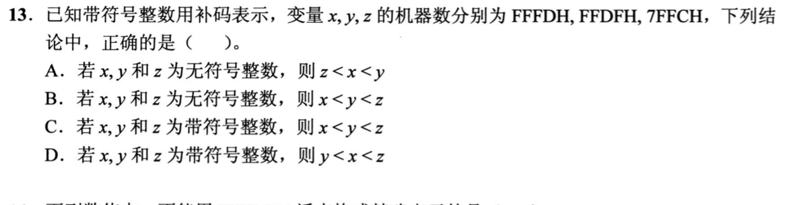

<details>
<summary>答案与解析</summary>

**答案：D。**

* **核心判据**：16 位有符号补码的大小比较规则：最高位为 0 代表正数，最高位为 1 代表负数，**正数必然严格大于负数**；在负数集合内部，十六进制位串越接近 `FFFFH`（$-1$），其真值越大。
* **正选推导**：
  * $z = \text{7FFCH}$：最高符号位为 0（正数），其真值 $z = +32764$；
  * $x = \text{FFFDH}$：最高符号位为 1（负数），真值 $= \text{FFFDH} - 2^{16} = -3$；
  * $y = \text{FFDFH}$：最高符号位为 1（负数），真值 $= \text{FFDFH} - 2^{16} = -33$；
  * 代数大小排序：$-33 < -3 < +32764 \iff y < x < z$，选 D。
* **干扰项击穿**：
  * 若误把它们当成无符号数比较：$z (32764) < y (65503) < x (65533)$，这属于对有符号补码本质判据的完全混淆。

</details>

### 选择题2｜2023-16

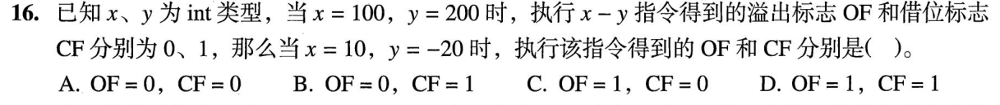

<details>
<summary>答案与解析</summary>

**答案：B。**

* **核心判据**：溢出标志（OF）与借位标志（CF）在硬件逻辑上完全正交隔离：
  * **OF（有符号专用）**：衡量有符号运算是否超出表示范围。$10 - (-20) = 30$，完全在 32 位整型表示范围 $[-2^{31}, 2^{31}-1]$ 之内，故 $\mathbf{\text{OF} = 0}$。
  * **CF（无符号专用）**：衡量无符号减法是否发生借位。当且仅当**被减数的无符号数值严格小于减数的无符号数值**时，硬件置 $\text{CF} = 1$。
* **正选推导**：
  * 被减数 $a = 10$，其 32 位无符号数值为 10；
  * 减数 $b = -20$，其 32 位补码位模式为 $2^{32} - 20 = \text{FFFFFFECH}$，在无符号数解释下代表一个高达约 $4.29 \times 10^9$ 的巨大正数；
  * 无符号比较：$10 < (2^{32} - 20)$，小数减大数，硬件 ALU 必然向更高位借位，故 $\mathbf{\text{CF} = 1}$。
  * 综上，$\text{OF} = 0, \text{CF} = 1$，选 B。
* **干扰项击穿**：
  * 致命误区：误认为 $10 - (-20) = 30 > 0$ 结果为正数所以“没有借位，$\text{CF}=0$”。这是用高级语言的有符号直觉去套无符号硬件标志。加法器执行减法时做的是 $A + \sim B + 1$，最高进位 $C_{\text{out}} = 0$，对减法而言借位标志 $\text{CF} = C_{\text{out}} \oplus 1 = 1$。

</details>

### 选择题3｜2024-15

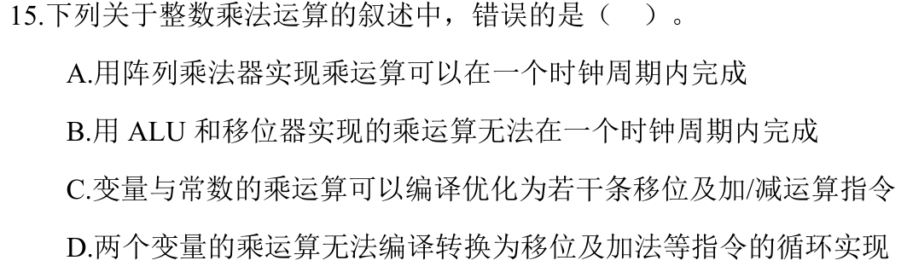

<details>
<summary>答案与解析</summary>

**答案：D。**

* **核心判据**：计算机运算器的物理实现原理：
  * **纯硬件乘法器（如阵列乘法器 Array Multiplier）**：完全基于组合逻辑加法树实现，能够在一个较长的时钟周期内直接输出乘积；
  * **算法乘法器**：任何两个变量之间的乘法，在物理上均可使用多周期“**移位 + 累加**”的循环控制逻辑逐步完成。
* **D 选项错误（正选项）**：声称“两个变量相乘无法通过移位和加法实现”，完全违背了乘法器的经典设计原理！在没有配置硬件乘法器的轻量级 CPU 或早期处理器中，变量乘法就是通过循环移位和加法实现的，选 D。
* **A、B、C 正确性解析**：
  * **A**：常数乘法可被编译器优化为开销极小的移位与加减指令组合（如 $x \times 10 = (x \ll 3) + (x \ll 1)$）；
  * **B**：阵列乘法器由全加器阵列直接级联，无时序反馈回路，属于纯组合逻辑；
  * **C**：串行循环乘法器每轮只能处理 1~2 位乘数，必须依赖多个时钟周期的时序状态机驱动。

</details>

### 选择题4｜2025-14

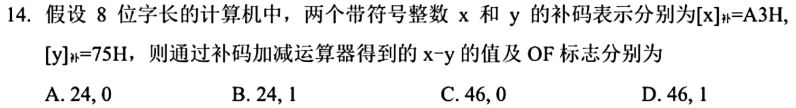

<details>
<summary>答案与解析</summary>

**答案：D。**

* **核心判据**：
  * **OF 判定**：8 位补码异号相减，$X$ 为负数（$\text{A3H}$ 最高位为 1），$Y$ 为正数（$\text{75H}$ 最高位为 0）。“负数减正数”结果必为负数，若机器码结果最高位变为 0（正数），则必定发生溢出（$\text{OF} = 1$）。
  * **寄存器截断结果**：ALU 硬件按照模 $2^8 = 256$ 进行二进制加减，仅在寄存器中保留低 8 位机器码。
* **正选推导**：
  1. **真值代数运算与溢出分析**：
     * $X = \text{A3H} = 163 - 256 = -93$；
     * $Y = \text{75H} = +117$；
     * 理论差值 $= -93 - 117 = -210$；
     * 8 位补码的表示边界为 $[-128, 127]$，$-210 < -128$ 发生严重下溢，故 $\mathbf{\text{OF} = 1}$。
  2. **硬件寄存器保存结果**：
     * 8 位硬件直接相减：$\text{A3H} - \text{75H} = \text{2EH}$；
     * 位模式 `2EH` 展开为 `0010 1110`，其最高符号位为 0，解释为十进制正数：$2 \times 16 + 14 = \mathbf{46}$。
  * 故 $\text{OF} = 1$，寄存器内数值为 46，选 D。
* **干扰项击穿**：
  * 误区：把未截断的数学真值 $-210$ 误填为寄存器中的数值；硬件寄存器只有 8 位，溢出后高位丢弃，只能容纳截断后的 46。

</details>

### 选择题5｜2026-13

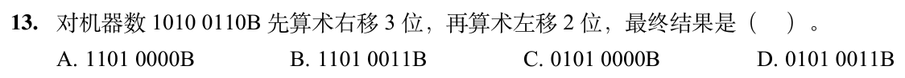

<details>
<summary>答案与解析</summary>

**答案：A。**

* **核心判据**：移位操作具有不可逆的信息丢失特性，**绝对不能在代数上将“算术右移 3 位 + 算术左移 2 位”抵消为“右移 1 位”**！
  * **补码算术右移**：符号位不变，高位空出的位**全部复制补入符号位**，低位移出丢弃；
  * **补码算术左移**：整体左移，高位移出丢弃，低位空出的位**一律补 0**（注意：左移低位永远补 0，绝不补符号位！）。
* **正选推导**：
  1. 初始 8 位补码：`1010 0110`（最高符号位为 1）；
  2. **算术右移 3 位**：高位补 3 个符号位 `1`，末尾 3 位 `110` 彻底丢弃：
     `1010 0110` $\to$ `1111 0100`；
  3. **随后算术左移 2 位**：整体左移 2 位，低位补 2 个 `0`：
     `1111 0100` $\to$ **`1101 0000`**；
  * 故选 A。
* **干扰项击穿**：
  * 若误以为两者可代数相消为“右移 1 位”，会错误算出 `1101 0011`，把第一次右移已经丢弃的低位数据凭空带了回来。

</details>

## 选择题组2｜0907 · 计算机网络

[端到端状态：TCP序号、窗口与拥塞](../src/0907.md) · 11道 · 首次。

### 选择题6｜2020-38

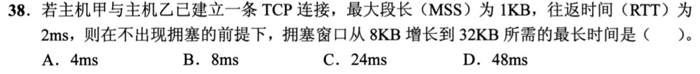

<details>
<summary>答案与解析</summary>

**答案：D。**

* **核心判据**：TCP 拥塞控制状态机转换规则：
  * **慢开始阶段**：`cwnd` 呈指数级翻倍增长（每个 RTT 翻倍）；
  * **拥塞避免阶段**：`cwnd` 呈加法线性增长（每个 RTT 仅增加 1 MSS）；
  * **“最长时间”的边界判定**：若要求增长耗时最长，则意味着连接从 `8KB` 起始点就**直接处于加法增大的拥塞避免阶段**（例如此前发生拥塞，门限刚好被降至 8KB）。
* **正选推导**：
  * 处于拥塞避免阶段时，每个 RTT（2ms）窗口仅增加 1 MSS（1KB）；
  * 从 8KB 线性增加至 32KB，需要的窗口增量为 $\Delta = 32 - 8 = 24\text{ KB}$；
  * 所需的 RTT 轮数 $= \frac{24\text{ KB}}{1\text{ KB}} = 24\text{ 轮}$；
  * 总耗时最长为 $24 \times 2\text{ms} = \mathbf{48\text{ms}}$，选 D。
* **干扰项击穿**：
  * 若处于慢开始指数增长：$8 \to 16 \to 32$，只需 2 个 RTT（4ms），这是可能的最短时间，题干明确设问“最长时间”。

</details>

### 选择题7｜2020-39

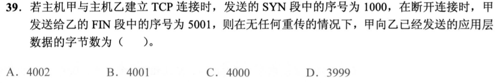

<details>
<summary>答案与解析</summary>

**答案：C。**

* **核心判据**：TCP 序号消耗与应用层载荷映射机制：
  * **SYN 报文段不携带任何应用层数据，但物理上消耗 1 个序号**（`seq = 1000`），因此首个应用层数据字节的序号严格从 `1001` 开始；
  * **FIN 报文段不携带应用层数据，但同样消耗 1 个序号**（本报文段使用 `seq = 5001`），说明在发出 FIN 之前，已发送的最后一个应用层数据字节序号恰好为 $5001 - 1 = 5000$。
* **正选推导**：
  * 本连接发送的应用层数据字节序号闭区间为 $[1001, 5000]$；
  * 传送的应用层数据总字节数 $= 5000 - 1001 + 1 = 5001 - 1001 = \mathbf{4000\text{ 字节}}$，选 C。
* **干扰项击穿**：
  * 若直接用 $5001 - 1000 = 4001$，漏掉了 SYN 自身占用的 1 个序号；
  * 若算成 $5001 - 1000 - 2 = 3999$，混淆了端点闭开区间的数学定义。

</details>

### 选择题8｜2021-38

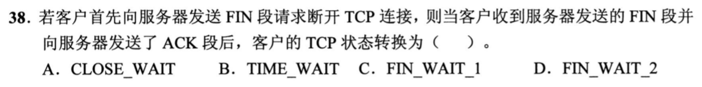

<details>
<summary>答案与解析</summary>

**答案：B。**

* **核心判据**：TCP 四次挥手有限状态机（FSM）路径：
  * **主动关闭方**：`ESTABLISHED` $\to$ 发送 FIN 进入 `FIN_WAIT_1` $\to$ 收到对端 ACK 进入 `FIN_WAIT_2` $\to$ 收到对端 FIN 并回复最后 ACK 后进入 **`TIME_WAIT`**，强制等待 $2\text{MSL}$ 后进入 `CLOSED`。
* **正选推导**：
  * 题设“客户端主动关闭连接，在收到服务器发送的 FIN 报文段并发出最终的 ACK 报文段后”，根据状态机转移，客户端立即进入 **`TIME_WAIT`** 状态，选 B。
* **干扰项击穿**：
  * **CLOSE_WAIT**：是**被动关闭方**在收到对方 FIN 报文段后进入的状态；
  * **LAST_ACK**：是被动关闭方发送自己的 FIN 报文段后等待对方最后确认的状态。

</details>

### 选择题9｜2021-39

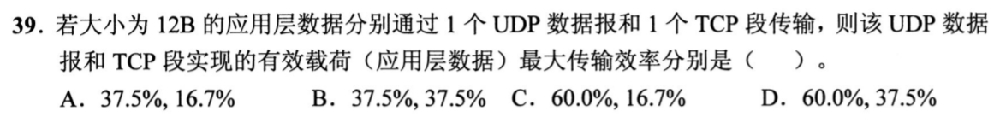

<details>
<summary>答案与解析</summary>

**答案：D。**

* **核心判据**：传输层传输效率定义公式为 $\text{Efficiency} = \frac{\text{应用层载荷大小}}{\text{传输层总报文长度}}$。
  * **UDP 首部固定为最小 8 字节**；
  * **TCP 首部在无任何可选字段时最小为 20 字节**。
* **正选推导**：
  * 应用层数据载荷 $= 12\text{ 字节}$；
  * UDP 最大传输效率：
    $$\text{Eff}_{\text{UDP}} = \frac{12}{12 + 8} = \frac{12}{20} = \mathbf{60\%}$$
  * TCP 最大传输效率：
    $$\text{Eff}_{\text{TCP}} = \frac{12}{12 + 20} = \frac{12}{32} = \mathbf{37.5\%}$$
  * 故选 D。
* **干扰项击穿**：
  * 题目明确要求只计算 UDP 和 TCP 本身的传输效率，切勿把下层的 IP 首部（20B）或以太网帧头帧尾（18B）算入。

</details>

### 选择题10｜2021-40

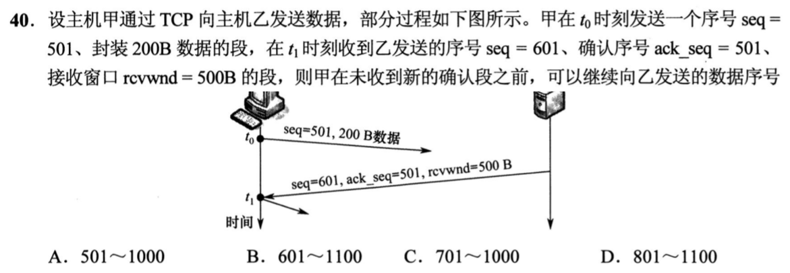

<details>
<summary>答案与解析</summary>

**答案：C。**

* **核心判据**：TCP 滑动窗口边界不变量：接收方通过 `ack` 和 `rwnd` 划定允许发送的合法序号闭区间为 $[\text{ack}, \text{ack} + \text{rwnd} - 1]$。已发送的字节不能重复发送，只能从未发送的起始序号开始新发。
* **正选推导**：
  1. 乙回复甲的报文中：$\text{ack} = 501, \text{rwnd} = 500$；
  2. 此时乙允许甲发送的有效字节序号区间为 $[501, 501 + 500 - 1] = [501, 1000]$；
  3. 题干指出甲已连续发送了 $[501, 700]$ 共 200 字节数据；
  4. 扣除已发送的数据后，甲在窗口内**还能新发送的数据序号范围**严格为 **`701 ~ 1000`**，选 C。
* **干扰项击穿**：
  * 乙报文自身携带的 `seq = 601` 属于乙向甲反向传输数据流的序列号，与甲的发送窗口没有任何关系，切勿被该字段误导。

</details>

### 选择题11｜2022-38

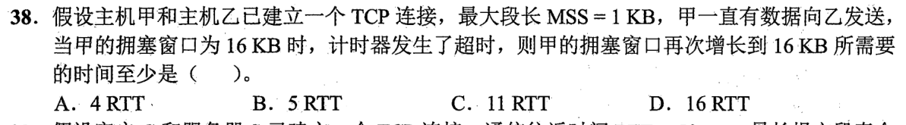

<details>
<summary>答案与解析</summary>

**答案：C。**

* **核心判据**：TCP 超时重传（Timeout）惩罚机制：
  1. 发生超时时，门限值更新为当前拥塞窗口的一半：$\text{ssthresh} = \max(\text{cwnd} / 2, 2\text{MSS}) = 16\text{KB} / 2 = 8\text{KB}$；
  2. 拥塞窗口被**硬性重置归零为 1 MSS（1KB）**；
  3. 从 1KB 重启慢开始阶段（指数增长）；达到门限 8KB 后立即切换为拥塞避免阶段（线性加法增长）。
* **正选推导**：
  * **慢开始阶段（1KB $\to$ 8KB）**：
    * 经过第 1 个 RTT：$1\text{KB} \to 2\text{KB}$；
    * 经过第 2 个 RTT：$2\text{KB} \to 4\text{KB}$；
    * 经过第 3 个 RTT：$4\text{KB} \to 8\text{KB}$（达到门限 $\text{ssthresh} = 8\text{KB}$，耗时 3 RTT）；
  * **拥塞避免阶段（8KB $\to$ 16KB）**：
    * 此后每个 RTT 窗口仅线性增加 1KB；
    * 从 8KB 增至 16KB 还需要增加 $16 - 8 = 8\text{KB}$，耗时 8 RTT；
  * **总耗时累加**：$3\text{ RTT} + 8\text{ RTT} = \mathbf{11\text{ RTT}}$，选 C。
* **干扰项击穿**：
  * 切勿误以为超时后 `cwnd` 从 8KB 起步；也切勿在越过 8KB 门限后继续翻倍（若继续翻倍会算成 4 RTT 错解）。

</details>

### 选择题12｜2022-39

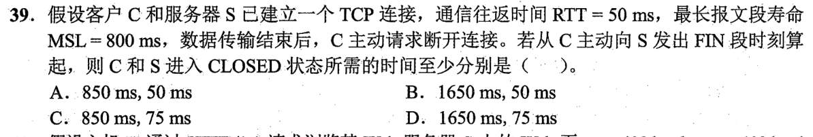

<details>
<summary>答案与解析</summary>

**答案：D。**

* **核心判据**：主动关闭方彻底关闭的时延流转模型：**发起 FIN $\to$ 单程传播 $\to$ 服务端合并回送 FIN/ACK $\to$ 单程传播 $\to$ 客户端发送最后 ACK 并进入 TIME_WAIT $\to$ 等待完整的 $2\text{MSL}$ 物理计时 $\to$ CLOSED 彻底关闭**。
* **正选推导**：
  1. $t = 0\text{ms}$：客户端甲发出第 1 次挥手 FIN 报文段；
  2. $t = 25\text{ms}$：服务端乙收到 FIN，因无数据发送，立即合并发送第 2 次 ACK 与第 3 次 FIN；
  3. $t = 50\text{ms}$：客户端甲收到乙的 FIN，立即回复第 4 次挥手 ACK，并在此时**正式进入 TIME_WAIT 状态**；
  4. 客户端必须强制等待 $2\text{MSL} = 2 \times 800\text{ms} = 1600\text{ms}$；
  5. 客户端甲彻底关闭的时间点 $= 50\text{ms} + 1600\text{ms} = \mathbf{1650\text{ms}}$，选 D。
* **干扰项击穿**：
  * 服务端（被动关闭方）在 $t = 50 + 25 = 75\text{ms}$ 收到甲最后的 ACK 后即可立即彻底关闭；但题干明确设问的是**客户端甲**的彻底关闭时间。

</details>

### 选择题13｜2024-38

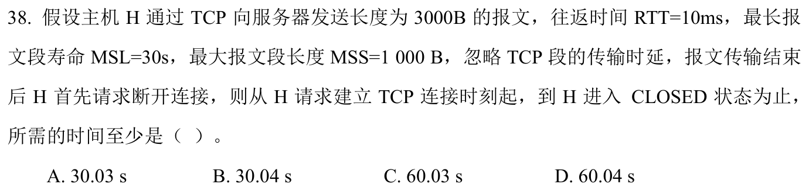

<details>
<summary>答案与解析</summary>

**答案：D。**

* **核心判据**：完整 TCP 交互会话生命周期模型：**建连时延（三次握手 1 RTT） + 数据传输时延（慢开始阶段） + 挥手时延（1 RTT） + TIME_WAIT 强制等待时间（$2\text{MSL}$）**。
* **正选推导**：
  1. **连接建立**：三次握手完成，客户端收到 SYN+ACK 并可发数据，耗时 **1 RTT**；
  2. **数据传输（共 3 个段）**：
     * 慢开始初始 `cwnd = 1 MSS`，第 1 轮发 1 个段，耗时 1 RTT；
     * 收到确认后 `cwnd` 增至 2 MSS，第 2 轮并发发送剩余 2 个段，耗时 1 RTT；
     * 数据传输总计耗时 **2 RTT**；
  3. **连接释放**：客户端发 FIN，收到服务端的 ACK+FIN，客户端回复最后 ACK，耗时 **1 RTT**；
  4. **TIME_WAIT 状态**：强制等待 $2\text{MSL} = 2 \times 30\text{s} = 60\text{s}$；
  5. **总时间求和**：
     $$\text{总时间} = (1 + 2 + 1) \times \text{RTT} + 2\text{MSL} = 4 \times 0.01\text{s} + 60\text{s} = \mathbf{60.04\text{s}}$$
  * 故选 D。

</details>

### 选择题14｜2024-39

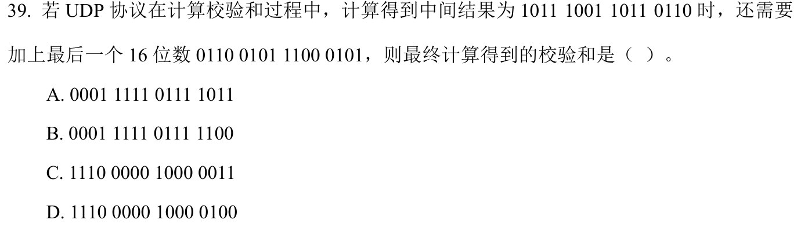

<details>
<summary>答案与解析</summary>

**答案：C。**

* **核心判据**：网络校验和（Internet Checksum）二进制反码求和（1's Complement Sum）三步法则：
  1. 将所有 16 位整型数据按普通二进制加法累加；
  2. **循环进位（End-around Carry）**：若相加产生最高位进位（溢出到第 17 位），必须将该进位回卷加到最低位；
  3. **逐位取反**：对回卷后的结果按位取反得到最终校验和。
* **正选推导**：
  1. 两个 16 位数二进制累加：
     $$\text{B9B6H} + \text{65C5H} = \text{11F7BH}$$
  2. 最高位产生进位 1，将其回卷加至最低位：
     $$\text{1F7BH} + 1 = \text{1F7CH}$$
  3. 对 `1F7CH`（`0001 1111 0111 1100`）按位取反：
     $$\sim(\text{0001 1111 0111 1100}_2) = \text{1110 0000 1000 0011}_2 = \mathbf{\text{E083H}}$$
  * 故选 C。
* **干扰项击穿**：
  * **A 项**：未做进位回卷且未取反；
  * **B 项**：仅算出累加值未做反码取反；
  * **D 项**：取反前漏掉了进位回卷。

</details>

### 选择题15｜2025-38

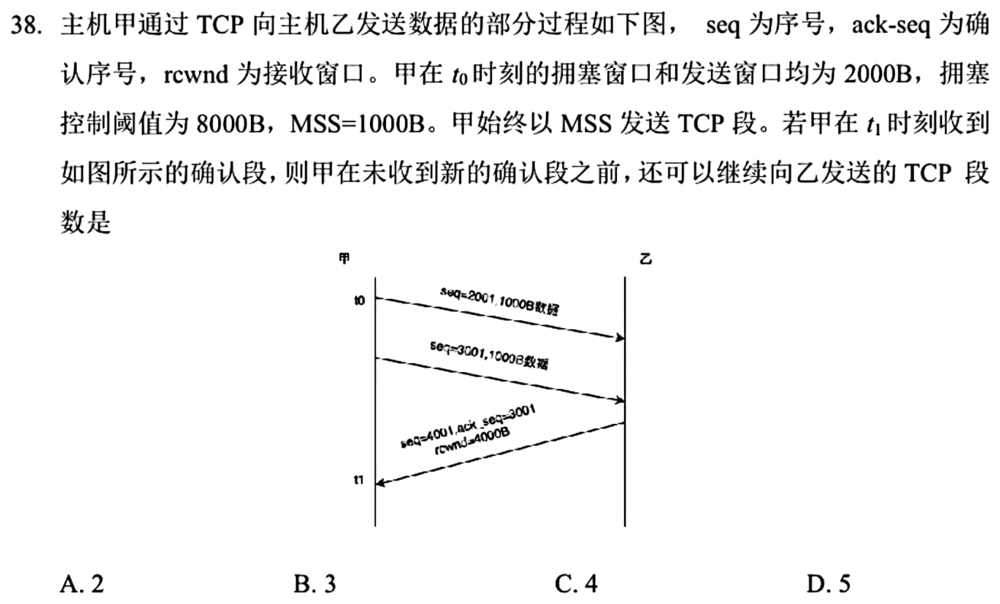

<details>
<summary>答案与解析</summary>

**答案：A。**

* **核心判据**：TCP 发送方可用窗口物理不变量：
  $$\text{还可新发数据量} = \min(\text{cwnd}, \text{rwnd}) - \text{已发送但未被确认的在途字节数}$$
* **正选推导**：
  1. 甲收到乙发来的 `ack = 3001`：确认了此前发送的第一个 1000B 数据段（序号 2001~3000）；
  2. 第二个 1000B 数据段（序号 3001~4000）仍未确认，当前**在途未确认数据量为 1000 字节**；
  3. 拥塞窗口更新：当前 $\text{cwnd} = 2000\text{B} < \text{ssthresh} = 8000\text{B}$，处于慢开始阶段。收到一个有效 ACK 增加 1 个 MSS（1000B），故更新后 $\text{cwnd} = 2000 + 1000 = 3000\text{B}$；
  4. 当前有效发送窗口为：$W = \min(\text{cwnd}, \text{rwnd}) = \min(3000, 4000) = 3000\text{B}$；
  5. 扣除在途数据后，甲当前还可发送的字节数：
     $$\text{剩余可用容量} = 3000\text{B} - 1000\text{B} = \mathbf{2000\text{ 字节}}$$
  * 即还可以新发 2 个 1000B 的报文段，选 A。
* **干扰项击穿**：
  * 易混点：看到当前窗口扩大为 3000B 就盲目认为还能新发 3000B，完全漏掉了已经在网络中飞行（在途）的 1000B 未确认数据。

</details>

### 选择题16｜2025-39

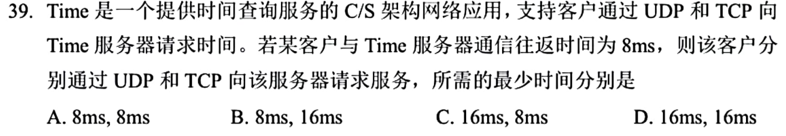

<details>
<summary>答案与解析</summary>

**答案：B。**

* **核心判据**：传输层连接开销对应用层请求时延的直接影响：
  * **UDP（无连接）**：客户端直接发查询报文，服务端直接回送应答报文，全程耗时仅为 **1 个 RTT**；
  * **TCP（面向连接）**：必须先执行三次握手建立连接（耗时 1 RTT），在第三次握手的 ACK 报文中捎带 DNS 查询请求，服务端回复响应耗时再加 1 RTT，总共耗时 **2 个 RTT**。
* **正选推导**：
  * 题设单向传播及传输时延总计 $1\text{ RTT} = 8\text{ms}$；
  * UDP 总耗时 $= 1 \times 8\text{ms} = 8\text{ms}$；
  * TCP 总耗时 $= 2 \times 8\text{ms} = 16\text{ms}$；
  * 故选 B。

</details>

## 解答题

### 大题1｜2025-41

[原题单 0914｜线性结构：数组与链表大题](../src/0914.md)

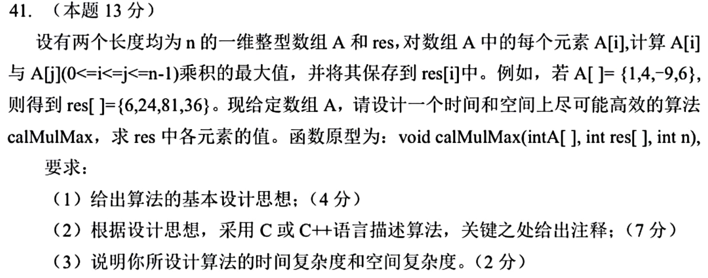

<details>
<summary>答案与解析</summary>

* **核心判据与数学符号性质**：
  对于给定的当前元素 $A[i]$，要求在后缀区间 $j \in [i, n-1]$ 中寻找一个元素 $A[j]$，使得乘积 $A[i] \times A[j]$ 最大：
  1. **若 $A[i] \ge 0$（非负数）**：为了让乘积最大，乘数应当尽可能大，因此应乘以后缀区间的**最大值（$\max_{j \ge i} A[j]$）**；
  2. **若 $A[i] < 0$（负数）**：负负得正，为了让乘积最大，乘数应当尽可能小（绝对值最大的负数），因此应乘以后缀区间的**最小值（$\min_{j \ge i} A[j]$）**；
  3. **后缀单调维护不变量**：从数组末端逆向扫描至首端，动态维护当前后缀区间的最大值 `hi` 和最小值 `lo`。由于后缀区间 $[i, n-1]$ 仅比 $[i+1, n-1]$ 多了一个元素 $A[i]$，只需常数时间更新 `hi` 和 `lo`，即可直接计算出 `res[i]`，彻底消除 $O(n^2)$ 的嵌套循环。

* **算法设计思想与步骤**：
  1. 初始化两个变量 `hi = A[n - 1]` 和 `lo = A[n - 1]`，分别记录后缀最大值与最小值；
  2. 从数组下标 $n - 1$ 开始逆向遍历至 0：
     * 首先将当前元素 $A[i]$ 纳入后缀集合：更新 `lo = min(lo, A[i])`，更新 `hi = max(hi, A[i])`（确保后缀包含 $A[i]$ 自身，满足 $j \ge i$）；
     * 依据 $A[i]$ 的符号特征计算最大乘积：
       - 若 $A[i] \ge 0$，则 `res[i] = A[i] * hi`；
       - 若 $A[i] < 0$，则 `res[i] = A[i] * lo`；
  3. 逆向遍历结束后，`res` 数组中即为每个位置对应的最大乘积。

* **C 语言代码实现**：
```c
void calMulMax(int A[], int res[], int n) {
    if (n <= 0) return;

    // 初始化后缀极值
    int lo = A[n - 1];
    int hi = A[n - 1];

    // 从后向前单向逆序扫描
    for (int i = n - 1; i >= 0; --i) {
        int x = A[i];

        // 1. 先将当前元素纳入后缀范围 [i, n-1]
        if (x < lo) lo = x;
        if (x > hi) hi = x;

        // 2. 根据正负号选择与最大值还是最小值相乘
        if (x >= 0) {
            res[i] = x * hi;
        } else {
            res[i] = x * lo;
        }
    }
}
```

* **时空复杂度深度分析**：
  * **时间复杂度**：算法仅对长度为 $n$ 的数组进行了单次反向线性遍历，循环体内仅包含常数次比较和单次乘法运算，时间复杂度严格为 **$O(n)$**。
  * **空间复杂度**：算法仅使用了常数个辅助变量（`lo`, `hi`, `i`, `x`），辅助空间复杂度严格为 **$O(1)$**。

</details>

## 一行记录

```text
实际用时__；未完成或未核对的题号__；今天最容易混淆的是__
```
