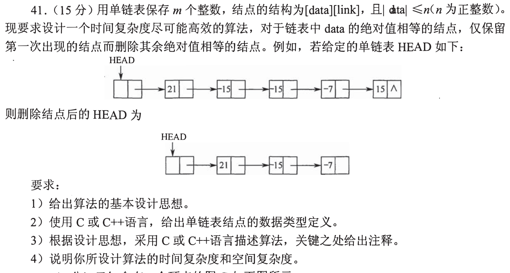
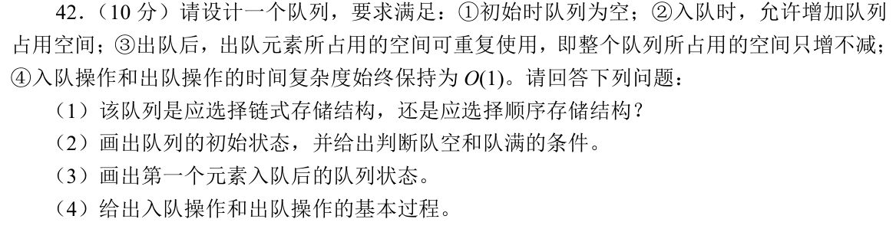

# Day 05｜120分钟以题带学

[← Day 04](day04.md) · [总入口](README.md) · [Day 06 →](day06.md)

**总时间上限120分钟，补学、核对、纠错均含在内。** 任务是完成本日指定题，不是刷完整个原文件。状态只记独立完成I、引导后完成H、仍有断点U，不把看过或到时当掌握。

## 今天直接按这个顺序做

1. **0—10分钟：** 回忆昨天留下的一处断点；Day 1用于直接尝试首题，不先找课程。
2. **10—60分钟：** 做下面两个模块，共13道选择题。先尝试，遇到知识缺口在本页补学；模块时间按题数分配，读解答和纠错算在50分钟内。
   - [0802｜栈与队列：按操作逐步跟踪](modules/0802.md)：5题。
   - [0826｜并发约束：资源数量与互斥对象](modules/0826.md)：8题。
3. **60—110分钟：** 完成下面两道大题，每题25分钟：读题与独立尝试5分钟，卡住读折叠解法7分钟，遮住后重写或重算10分钟，核对2分钟，标状态1分钟。已能独立完成时无需等到用满。
4. **110—120分钟：** 做文末检查，只记一处最值得明天回看的断点，停止当天训练。

**防止时间失控：** 选择题45—90秒没有入口就读本页讲解；不用先去搜视频或整理新笔记。独立做对且依据正确的题立即离开；引导后仍不会的保留U，次日开头处理。120分钟到时如仍未完成，记录真实未完成题号，不能勾成通关；这也是校准本计划工作量的依据。

## 大题1｜2015-41 · 按绝对值保留首次结点

原题定位：[src/0914.md 第03题](../src/0914.md)。以年份题号为准，避免原计划题名错位。



<details>
<summary>没有入口时的第一步</summary>

|data|≤n把无限查重变成0…n的直接标记。删除时前驱不能同步前移。

</details>

<details>
<summary>完整解法与必要补学</summary>

**思想及数据类型。** 设seen[0…n]初值全0。一次扫描链表；未见过的绝对值做标记并保留，见过则摘除释放。带头结点，用前驱pre维护删除位置。

```c
typedef struct Node {
    int data;
    struct Node *link;
} Node;
void unique_abs(Node *head, int n) {
    unsigned char *seen = calloc(n + 1, sizeof(*seen));
    if (!seen) return; // 实际程序需处理分配失败
    Node *pre = head, *p = head->link;
    while (p) {
        int key = p->data < 0 ? -p->data : p->data;
        if (!seen[key]) {
            seen[key] = 1;
            pre = p; p = p->link;
        } else {
            pre->link = p->link;
            free(p);
            p = pre->link;
        }
    }
    free(seen);
}
```

使用stdlib.h。题设data受n范围约束，这里按可表示的普通int范围处理。扫描m个结点O(m)，初始化n+1个标记O(n)，总时间O(m+n)，辅助空间O(n)；不能把初始化开销隐去。原例保留21、−15、−7，后续15都删。

</details>

<details>
<summary>重做后检查</summary>

用1→−1→1跟踪：保留第一个1，后两次都删除；pre必须留在第一个1处，才能处理连续重复。

</details>

## 大题2｜2019-42 · 可扩容且复用空间的队列

原题定位：[src/0914.md 第04题](../src/0914.md)。以年份题号为准，避免原计划题名错位。



<details>
<summary>没有入口时的第一步</summary>

题目不是固定容量数组，也不是出队就free。用循环链上的活动段和空闲段，入队时先复用空闲结点。

</details>

<details>
<summary>完整解法与必要补学</summary>

**(1)** 选链式结构；固定顺序数组满后搬移扩容无法保证每次入队O(1)。构造单循环链，使用front、rear两指针及一个保留结点。front指向当前队头之前的结点，rear指最后一个有效元素；沿rear→next到front的结点可用于后续入队。

**(2) 初始状态：** 只分配一个结点s，s→next=s，front=rear=s，逻辑上无元素。队空条件front==rear；现有存储结点已用尽的条件rear→next==front。这里“满”表示需要扩容，不表示拒绝入队。

**(3) 第一个元素x入队：** 原来rear→next==front，在rear之后新建结点p，p→next=front，rear→next=p；rear=p，rear→data=x。环为front→x→front。

**(4) 入队：** 若rear→next==front，则在rear后插入一个新结点；随后rear=rear→next，把新值放到rear。若已有空闲结点则直接使用，无需分配。出队：先判空，否则front=front→next，读出front→data；不释放这个结点，它成为新的保留结点，原保留结点进入可复用空间。

连接、赋值都为常数次，入队与出队均O(1)（按教材把单结点分配视为常数操作）。队列占用结点只增不减；不把“保留结点”误算为一个有效元素。

</details>

<details>
<summary>重做后检查</summary>

模拟入A、入B、出A、出B、再入C：最后一步应复用已有结点，而不是再次分配；每次front==rear都表示逻辑空。

</details>

## 最后10分钟：闭卷检查与交付

1. 后缀表达式减法的弹栈顺序是什么？
2. TestAndSet与阻塞信号量等待时有什么区别？
3. 去重连续删除时，pre为何不前移？

在纸上留一行即可，不抄解答、不另建整理任务：

```text
实际用时__分钟；选择题 I__/H__/U__；大题1 I/H/U；大题2 I/H/U
明天只回看：题号__；卡住的具体一步__
```

**完成与掌握分别记录。** 指定题均作答并核对、引导后能重现关键步骤，算本日执行完成；U仍存在就保留未通过项，不以此证明已掌握整个模块。扩展原题单的攻坚部分放到后续阶段；当天有余时也只在120分钟内追加。
