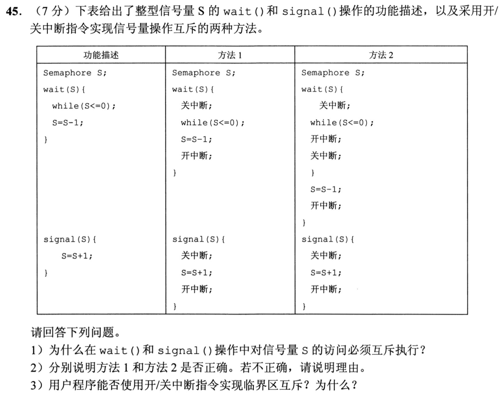
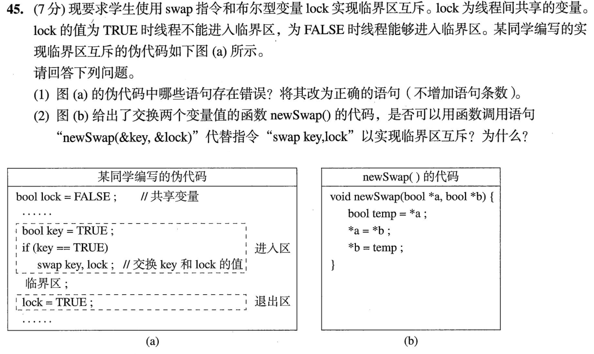
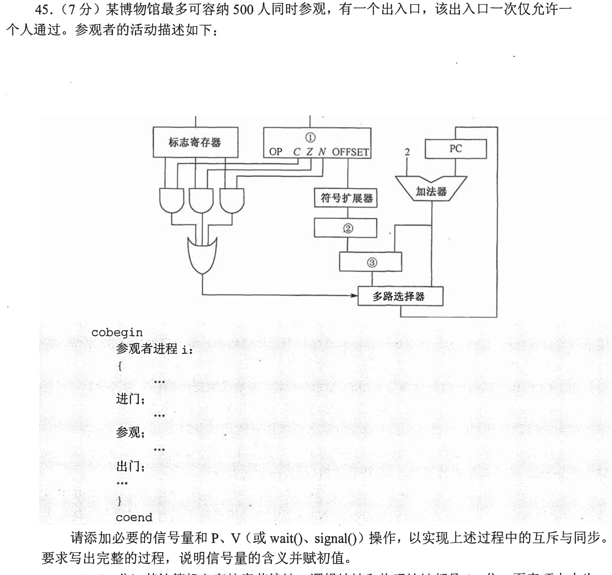
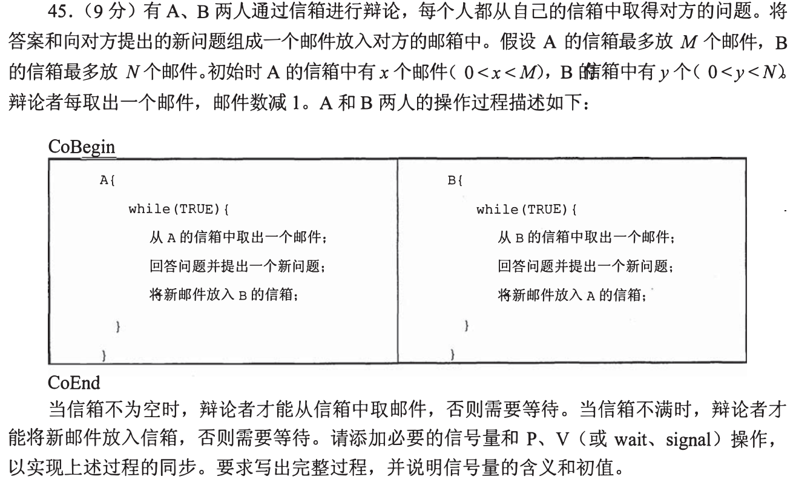

# Day 06｜2020—2026年题，以题带学

[← Day 05](day05.md) · [总入口](README.md) · [Day 07 →](day07.md)

> ### 🎯 本日攻坚目的
> 区分按字编址、按字节编址和低位交叉编址，判断相邻结点流控并复算 CRC。大题分别检查关中断的临界区和 Swap 指令的原子性。
>
> ### 📋 本日对应解决的 src 题单
> - [src/0814.md](../src/0814.md) 存储器拼装：容量、长宽与片选（共3题：`2021-15`、`2023-15`、`2026-15`）$\to$ [进入在线自测](modules/0814.md)
> - [src/0903.md](../src/0903.md) 链路可靠性：帧、窗口与重传状态（共2题：`2022-33`、`2023-37`）$\to$ [进入在线自测](modules/0903.md)
> - [src/0925.md](../src/0925.md) 并发同步与硬件原语大题（2题：`2021-45` 关中断实现信号量，`2023-45` Swap自旋锁原子性）

**当前选择题5道（原13道），配套大题2道，均为2020—2026年。** 原版每日材料在页末HTML注释中完整保留，暂不执行。

## 今天按这个顺序做

1. **回忆至多10分钟：** 只处理上次一处真实断点；第1天直接尝试首题。
2. **选择题及补学至多50分钟：** 共5题，先作答再展开讲解；做得少、耗时短时直接进入重做或下一环节，不为凑时间补入旧题。
   - [0814｜存储器：容量、地址位与芯片引脚](modules/0814.md)：3题。
   - [0903｜链路可靠性：确认、窗口和检错](modules/0903.md)：2题。
3. **两道大题及补学至多50分钟：** 每题先独立尝试，再读折叠讲解，随后遮住重做；已能独立完成的不用耗满25分钟。
4. **闭卷检查至多10分钟：** 只留一处明天要修复的断点。

**120分钟是上限，不是必须用满的任务量，也不是已验证的完成时间。** 状态记I（独立完成）、H（引导后可重现）、U（仍不会）。时间到仍未完成，就记下真实题号和断点；不能靠继续加时把U写成完成。省下的时间用于当天错题重做，不自动增加新题。

## 大题1｜2021-45 · 整数信号量的两种关中断实现

原题定位：[src/0925.md](../src/0925.md)，以年份题号2021-45定位。



<details>
<summary>没有入口时的第一步</summary>

分别跟踪 S≤0 和 S>0 两条路径。题图方法2的 while 行末误排了分号，结合下方右花括号，按“开中断、关中断在循环体内”阅读。

</details>

<details>
<summary>完整解法与必要补学</summary>

（1）S是共享资源计数，检查与修改必须互斥。否则两个调用者可能同时看到S=1并都通过等待，导致同一份资源被重复分配。

（2）以本题的单处理器模型判断。方法1错误：S≤0时一直关中断忙等，能执行 signal 的进程得不到调度，S可能一直无法增大。方法2正确：只有检查得到 S≤0 才进入循环体临时开中断，给其他进程运行机会；重新关中断后再检查。最后一次检查得到 S>0 时直接跳过循环体，接着执行 S--，这两步始终关中断。signal 修改 S 时也关中断。

题图中方法2的左花括号排印有误。可对照[公开题面转写](https://csgraduates.com/study_methods/408quiz/2021/#45)核对开、关中断的位置。

（3）用户程序不能用开/关中断指令实现临界区互斥，因为它们是特权指令，只能在内核态执行；用户态应通过提供的同步机制或原子操作实现互斥。即使在内核使用，单纯屏蔽本CPU中断也不能自动解决多核之间的互斥。

</details>

<details>
<summary>重做后检查</summary>

令甲第一次看到 S=0，在循环体开中断后乙执行 signal。甲恢复后先关中断并重新检查。若此时 S=1，甲直接减1；若许可已被别人用掉，甲回到循环体继续等。

</details>

## 大题2｜2023-45 · swap自旋锁与原子性

原题定位：[src/0925.md](../src/0925.md)，以年份题号2023-45定位。



<details>
<summary>没有入口时的第一步</summary>

先问循环为什么要反复试，再问退出时如何释放锁；普通函数交换两个变量与硬件swap指令并不等价。

</details>

<details>
<summary>完整解法与必要补学</summary>

（1）进入区中的`if (key == TRUE)`须改为`while (key == TRUE)`；退出区中的`lock = TRUE`须改为`lock = FALSE`。正确逻辑为：

```text
bool key = TRUE;
while (key == TRUE) swap key, lock;
临界区;
lock = FALSE;
```

硬件swap原子交换key与共享lock。拿到FALSE的线程停止自旋，同时把lock置TRUE；没拿到锁的线程继续等待。

（2）不能直接用题示newSwap替代。函数里的读取、赋值是多条普通操作，可与另一线程交错；函数调用本身不会使整个函数原子化。两个线程可能都在lock为FALSE时读到它并误以为取得锁。判断依据是原子保证，不是变量交换后的单线程结果是否相同。

</details>

<details>
<summary>重做后检查</summary>

lock初值FALSE，甲先swap得到key=FALSE并把lock置TRUE；乙swap后key仍TRUE。甲退出设FALSE后，乙下一次交换才可能成功。

</details>

## 最后闭卷检查

1. 2021-15 中4M个地址对应多少字节？改成按字节编址时需多少片？
2. 方法2何时开中断？为什么 S>0 的那次检查与 S-- 之间不会开中断？
3. 普通newSwap函数为什么不等于原子swap指令？

不誊写整篇解答，只在纸上留一行：

```text
实际用时__分钟；选择题I__/H__/U__；大题1 I/H/U；大题2 I/H/U
未完成的题号__；明天只回看__；卡住的具体一步__
```

## 暂缓的原版材料

以下完整旧版仅在源文件注释中保存，其中旧年份题目暂不安排。

<!-- 暂缓：更新前的整份每日材料；原文保留，当前不安排。
# Day 06｜120分钟以题带学

[← Day 05](day05.md) · [总入口](README.md) · [Day 07 →](day07.md)

**总时间上限120分钟，补学、核对、纠错均含在内。** 任务是完成本日指定题，不是刷完整个原文件。状态只记独立完成I、引导后完成H、仍有断点U，不把看过或到时当掌握。

## 今天直接按这个顺序做

1. **0—10分钟：** 回忆昨天留下的一处断点；Day 1用于直接尝试首题，不先找课程。
2. **10—60分钟：** 做下面两个模块，共13道选择题。先尝试，遇到知识缺口在本页补学；模块时间按题数分配，读解答和纠错算在50分钟内。
   - [0814｜存储器：容量、地址位与芯片引脚](modules/0814.md)：7题。
   - [0903｜链路可靠性：确认、窗口和检错](modules/0903.md)：6题。
3. **60—110分钟：** 完成下面两道大题，每题25分钟：读题与独立尝试5分钟，卡住读折叠解法7分钟，遮住后重写或重算10分钟，核对2分钟，标状态1分钟。已能独立完成时无需等到用满。
4. **110—120分钟：** 做文末检查，只记一处最值得明天回看的断点，停止当天训练。

**防止时间失控：** 选择题45—90秒没有入口就读本页讲解；不用先去搜视频或整理新笔记。独立做对且依据正确的题立即离开；引导后仍不会的保留U，次日开头处理。120分钟到时如仍未完成，记录真实未完成题号，不能勾成通关；这也是校准本计划工作量的依据。

## 大题1｜2013-45 · 博物馆容量与出入口互斥

原题定位：[src/0925.md 第03题](../src/0925.md)。以年份题号为准，避免原计划题名错位。



<details>
<summary>没有入口时的第一步</summary>

500份容量和1个门锁是两种约束；如果满馆者拿着门锁等名额，馆内人就出不去。

</details>

<details>
<summary>完整解法与必要补学</summary>

设room=500表示剩余参观名额，door=1表示出入口互斥。

```text
参观者i:
    P(room)
    P(door); 进门; V(door)
    参观
    P(door); 出门; V(door)
    V(room)
```

进门前先取得容量许可，再占门；参观期间释放door，其他人可进出。出门后返还room，人数最多500。不能先P(door)再P(room)，否则满馆时新来者占住门等待名额，馆内人等门无法出去。原题图片中混入了前一题数据通路图，该图与本题无关；本题依据上方文字与参观者伪代码作答。

</details>

<details>
<summary>重做后检查</summary>

room=0时新来者只能在P(room)处等待，不占门，馆内人仍能出门并V(room)。

</details>

## 大题2｜2015-45 · 双方信箱的同步与互斥

原题定位：[src/0925.md 第04题](../src/0925.md)。以年份题号为准，避免原计划题名错位。



<details>
<summary>没有入口时的第一步</summary>

为每个信箱分别设“已有邮件”和“空槽”；初始值不能都写0，也不能照搬空缓冲区。

</details>

<details>
<summary>完整解法与必要补学</summary>

A信箱容量M、现有x封；B容量N、现有y封。设fullA=x、emptyA=M−x、fullB=y、emptyB=N−y；mutexA=mutexB=1分别保护同一信箱的取放。

```text
A: while true:
    P(fullA)
    P(mutexA); 从A箱取一封; V(mutexA)
    V(emptyA)
    回答并提出新问题，组成新邮件
    P(emptyB)
    P(mutexB); 向B箱放一封; V(mutexB)
    V(fullB)

B: while true:
    P(fullB)
    P(mutexB); 从B箱取一封; V(mutexB)
    V(emptyB)
    回答并提出新问题，组成新邮件
    P(emptyA)
    P(mutexA); 向A箱放一封; V(mutexA)
    V(fullA)
```

两个角色分别从自己的信箱取、向对方信箱放；不要把方向写反。同步P在mutex之前，回答问题放锁外。题设初始0<x<M、0<y<N，并非从双方都空的死锁起点开始。

</details>

<details>
<summary>重做后检查</summary>

若A箱空，A等fullA，但B仍可处理B箱邮件并投给A；不能让等待fullA的A持有mutexA。

</details>

## 最后10分钟：闭卷检查与交付

1. 系统MAR与单片DRAM地址引脚为什么不相同？
2. GBN和SR超时后各重发什么？
3. 博物馆为什么先P(room)后P(door)？

在纸上留一行即可，不抄解答、不另建整理任务：

```text
实际用时__分钟；选择题 I__/H__/U__；大题1 I/H/U；大题2 I/H/U
明天只回看：题号__；卡住的具体一步__
```

**完成与掌握分别记录。** 指定题均作答并核对、引导后能重现关键步骤，算本日执行完成；U仍存在就保留未通过项，不以此证明已掌握整个模块。扩展原题单的攻坚部分放到后续阶段；当天有余时也只在120分钟内追加。
-->
