# Day 06｜组成原理＋计算机网络

[← Day 05](day05.md) · [总入口](README.md) · [Day 07 →](day07.md)

**选择题：12道，来自两份完整src题单；大题：2道。** 先做选择题，再展开题下解析。组内题目沿用src顺序；标为复做的组，已会的快速通过，重点处理上次错题。

**预计用时：85—125分钟。** 选择题及核对约40—60分钟，大题约40—55分钟，最后用5—10分钟重做今天最值得记住的一道错题。约两小时是配题目标，不是必须耗满或到点强停；计算卡住时先保留题号，先完成其余选择题。

## 选择题组1｜0814 · 组成原理

[存储器拼装：容量、长宽与片选](../src/0814.md) · 4道 · 首次。

### 选择题1｜2021-15

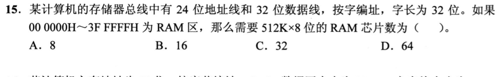

<details>
<summary>答案与解析</summary>

**答案：C。**

原题按字编址，每个地址对应32位。000000H—3FFFFFH 共4M个字地址。先用4片512K×8位芯片并联，组成512K×32位；再用8组扩为4M×32位，共32片。也可用总容量复核：4M个字×4B=16MiB，除以每片512KiB，仍为32片。

</details>

### 选择题2｜2022-17

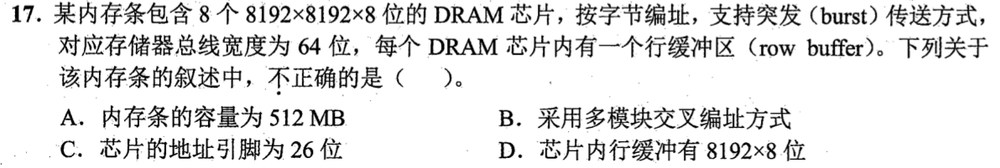

<details>
<summary>答案与解析</summary>

**答案：C。**

一片容量8192×8192×8位=64MiB，8片共512MiB；8片各给8位，合成64位突发传输。DRAM行列地址复用，8192=2¹³，地址引脚只需13根，不是把行、列相加成26根。行缓冲保存一整行，确为8192×8位。

</details>

### 选择题3｜2023-15

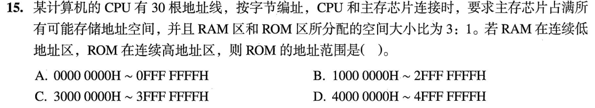

<details>
<summary>答案与解析</summary>

**答案：C。**

30 位字节地址共有 2^30 B，合法地址为 00000000H—3FFFFFFFH。ROM 占四分之一，即 2^28 B，位于最高的四分之一区域，所以范围为 30000000H—3FFFFFFFH。上端点是总容量减1，不是40000000H。

</details>

### 选择题4｜2026-15

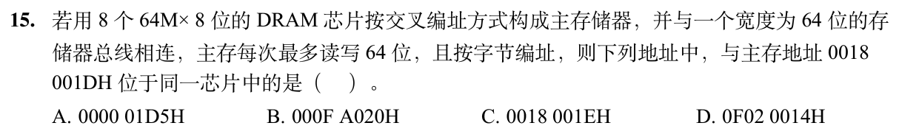

<details>
<summary>答案与解析</summary>

**答案：A。**

8片芯片、每片8位、总线64位，每次读取连续8字节组成一个64位字；按本题低位交叉编址，字节地址最低3位标识芯片。0018001DH 的低3位是101（芯片5）。A的000001D5H也以101结尾；B、C、D分别对应0、7、4，故选A。

</details>

## 选择题组2｜0904 · 计算机网络

[局域网转发：介质竞争、MAC与交换机](../src/0904.md) · 8道 · 首次。

### 选择题5｜2020-35

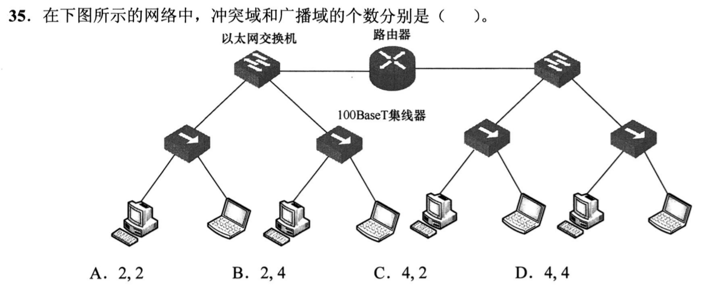

<details>
<summary>答案与解析</summary>

**答案：C。**

四个集线器各连到交换机独立端口，形成4个共享冲突域；中间路由器把左右分成2个广播域。按题目的统计口径，交换机与路由器间的点到点全双工链路不计为共享冲突域。

</details>

### 选择题6｜2020-37

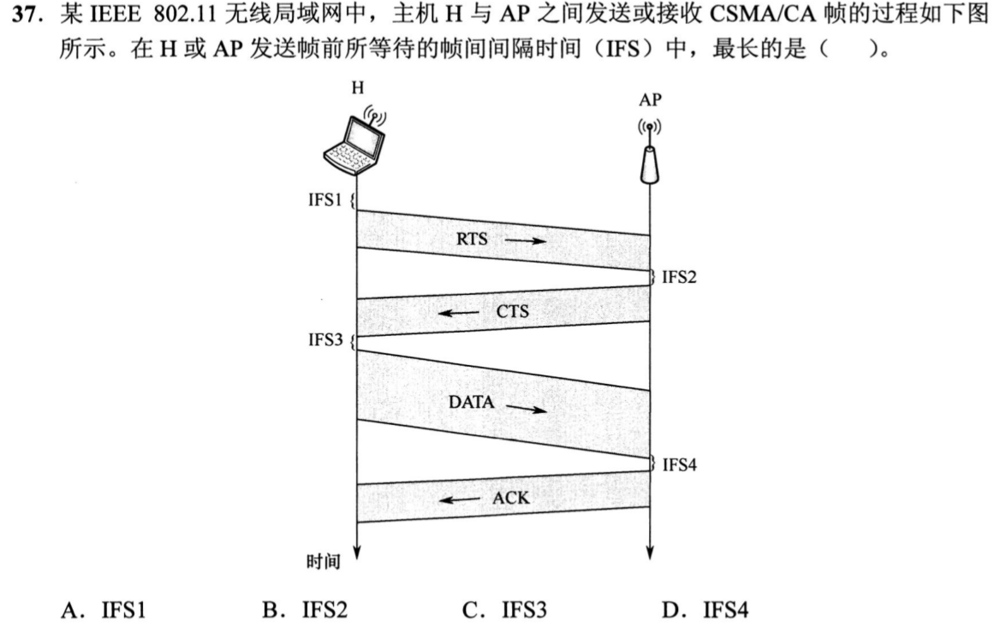

<details>
<summary>答案与解析</summary>

**答案：A。**

发送RTS前需按竞争接入等待DIFS；收到RTS回CTS、收到CTS发DATA、收到DATA回ACK，均等待较短的SIFS。故IFS1最长。后续三个短间隔用于让已取得信道的交换连续完成，不重新与其他站争用。

</details>

### 选择题7｜2022-37

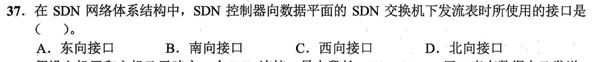

<details>
<summary>答案与解析</summary>

**答案：B。**

控制平面向数据平面下发流表用南向接口；北向连接应用与控制器。

</details>

### 选择题8｜2023-36

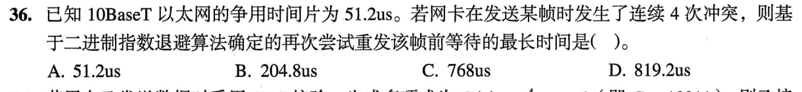

<details>
<summary>答案与解析</summary>

**答案：C。**

第4次冲突后，退避随机数从0～2⁴−1即0～15中选，最大等待15×51.2μs=768μs。不是等待4个时隙，也不能取16；上界2⁴不包含在可选范围内。

</details>

### 选择题9｜2024-35

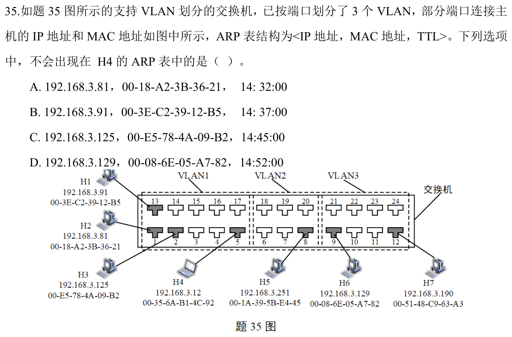

<details>
<summary>答案与解析</summary>

**答案：D。**

H4在VLAN1，能ARP解析同广播域的H1、H2、H3；H6在VLAN3，其MAC不会通过普通跨VLAN ARP出现在H4表。IP看似同网段也不能越过VLAN广播隔离。

</details>

### 选择题10｜2024-36

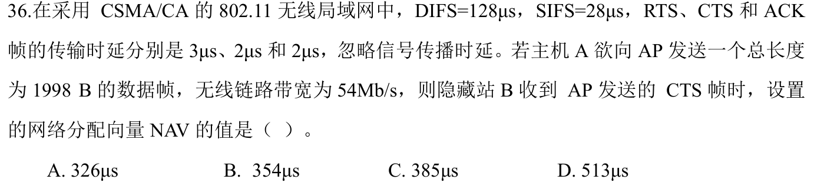

<details>
<summary>答案与解析</summary>

**答案：B。**

B收到CTS后，尚需等待SIFS、DATA、SIFS、ACK。DATA发送时延1998×8/54=296μs，因此NAV=28+296+28+2=354μs。RTS、CTS此前已发完，不再计入；DIFS是最初争用信道前的等待，也不在这段预约剩余时间中。

</details>

### 选择题11｜2025-35

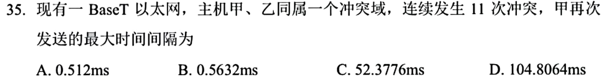

<details>
<summary>答案与解析</summary>

**答案：C。**

本题按10BaseT的51.2μs争用时隙计算。第11次冲突时退避指数截断为10，最大随机数2¹⁰−1=1023，最大退避1023×51.2μs=52.3776ms。不能继续取2¹¹−1。题图BaseT前的速率数字缺失，以上口径由选项对应10Mb/s确定；若是100Mb/s，时隙与结果都会缩为十分之一。

</details>

### 选择题12｜2026-36

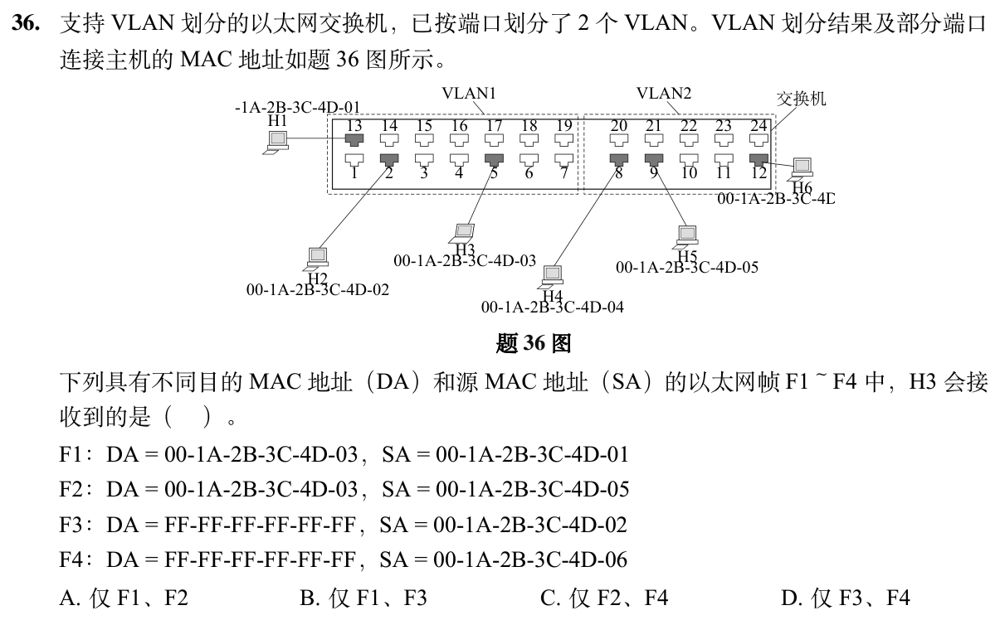

<details>
<summary>答案与解析</summary>

**答案：B。**

H3与H1、H2同属VLAN1，所以能收到H1发给自己的单播F1，以及H2发出的本VLAN广播F3。H5发出的F2虽目的MAC是H3，却来自VLAN2，交换机不会跨VLAN转发；H6的广播F4也只能留在VLAN2。广播域边界先于目的地址判断。

</details>

## 解答题

### 大题1｜2026-43

[原题单 0919｜表示到汇编：同一位模式在类型、指令与调用中怎样解释](../src/0919.md)

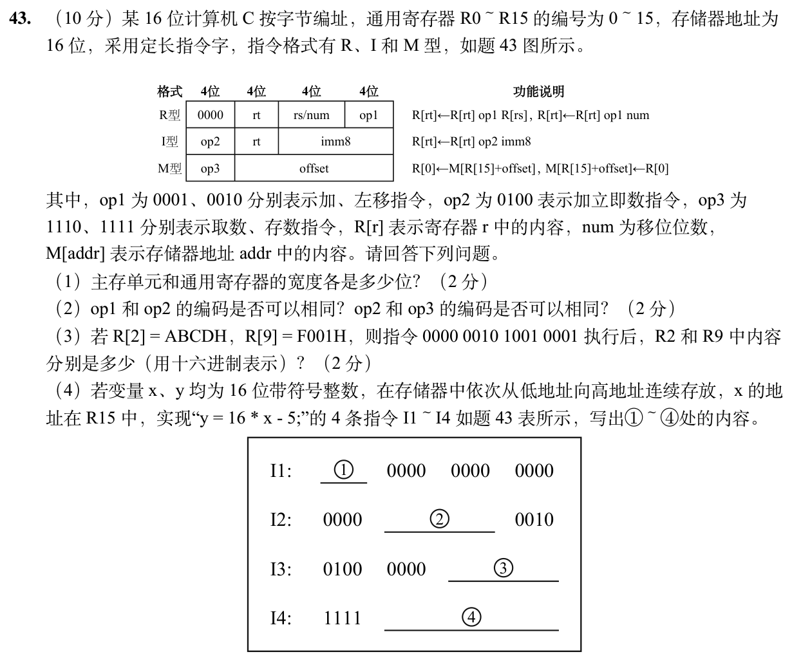

<details>
<summary>答案与解析</summary>

（1）按字节编址，主存可编址单元8位。通用寄存器16位。

（2）op1 在R型低4位，高4位已用0000识别R型，所以可以与op2重码。op2与op3都在高4位，用来区分指令及格式，不能重码。

（3）该指令做 R2←R2+R9，保留低16位。ABCDH+F001H=19BCEH，R2为9BCEH，R9仍为F001H。

（4）①1110，从R15+0取x到R0。②0000 0100，rt=0、左移4位。③1111 1011，为−5的8位补码。④0000 0000 0010，写回R15+2的y。

</details>

### 大题2｜2026-44

[原题单 0920｜指令落到数据通路：寄存器、部件与控制信号协同](../src/0920.md)

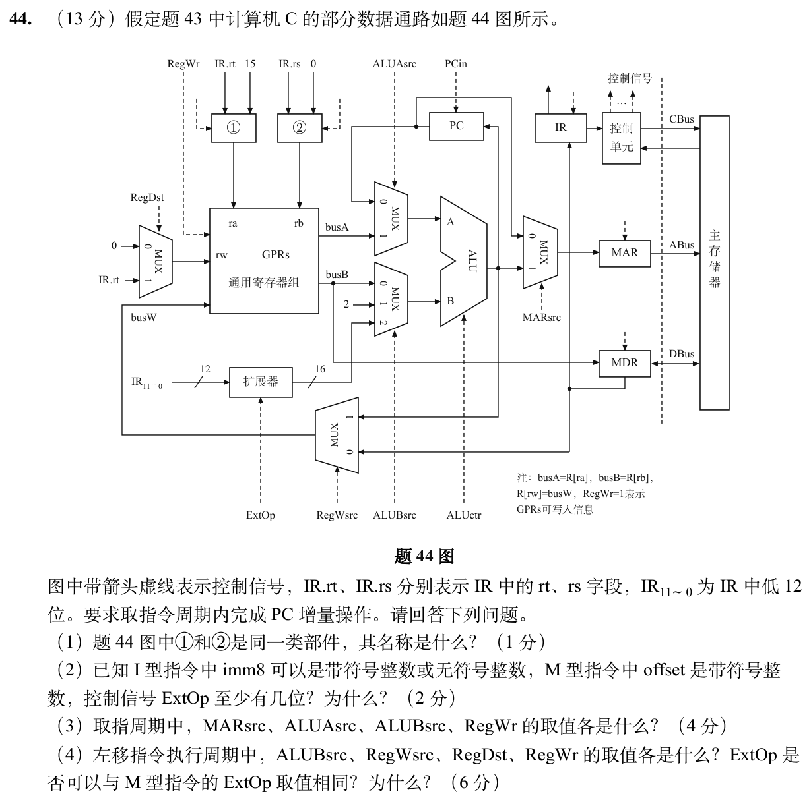

本题沿用本日43题的题干。

<details>
<summary>答案与解析</summary>

（1）①、②均为二选一多路选择器，分别选寄存器组读地址。

（2）至少2位。至少区分 imm8 零扩展、imm8 符号扩展、offset12 符号扩展三个模式。左移量 num 的提取也可用第四种模式编码。

（3）取指周期 MARsrc=0，使MAR接PC。ALUAsrc=0，ALUBsrc=1，用PC与常量2相加更新PC。RegWr=0，不写通用寄存器组。

（4）左移量来自扩展器，ALUBsrc=2。写回ALU，RegWsrc=1。目标是rt，RegDst=1，RegWr=1。ExtOp须与M型不同。左移仅取IR[7:4]的无符号 num，M型要对IR[11:0]整体符号扩展；若套用后者，rt和op1会一起混入移位操作数。

</details>

## 一行记录

```text
实际用时__；未完成或未核对的题号__；今天最容易混淆的是__
```
