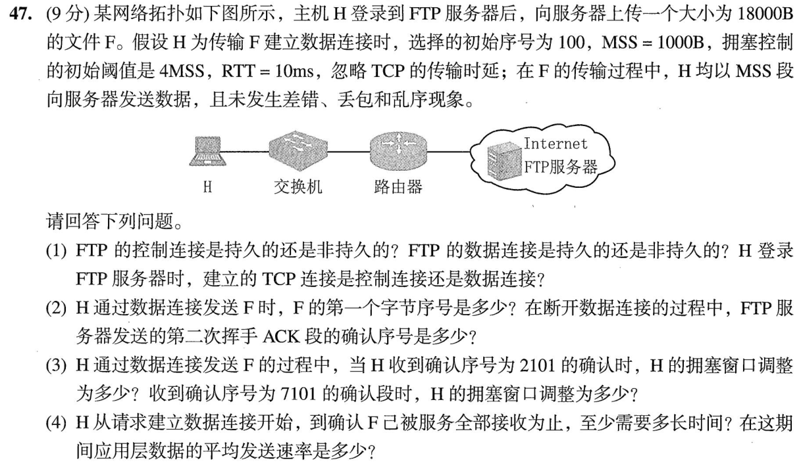
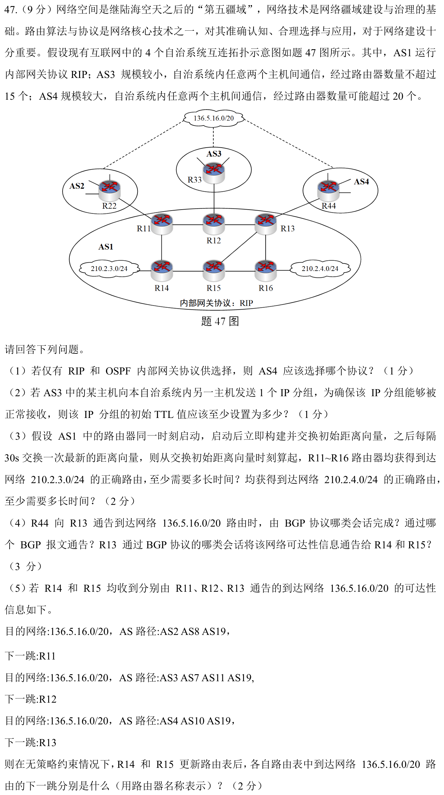
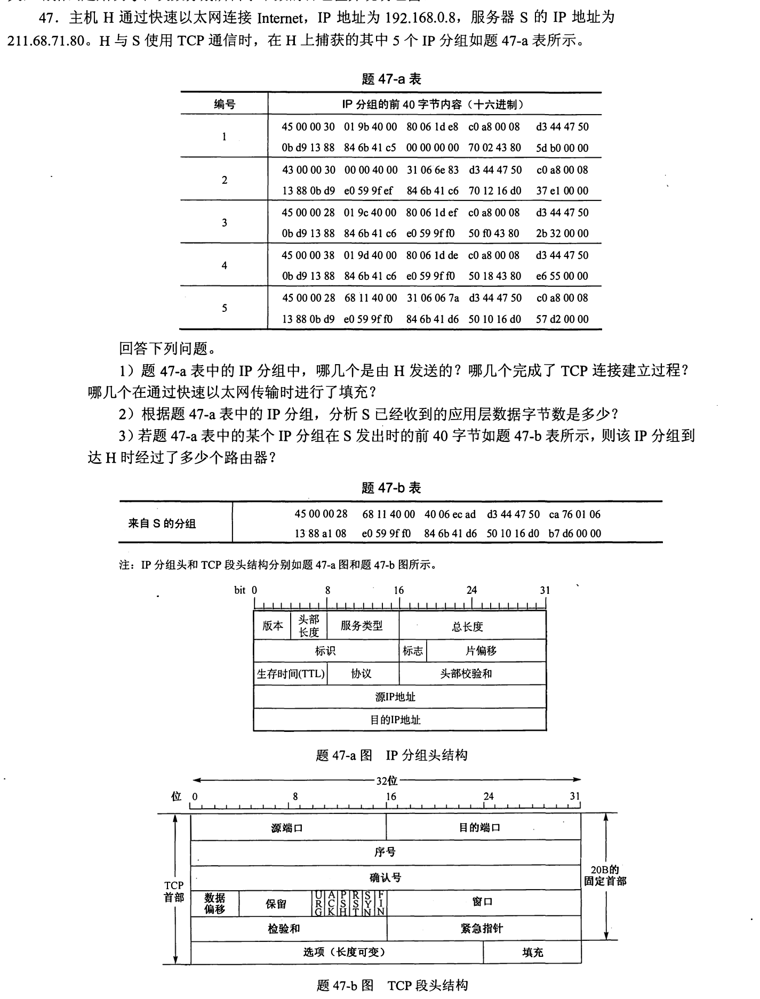
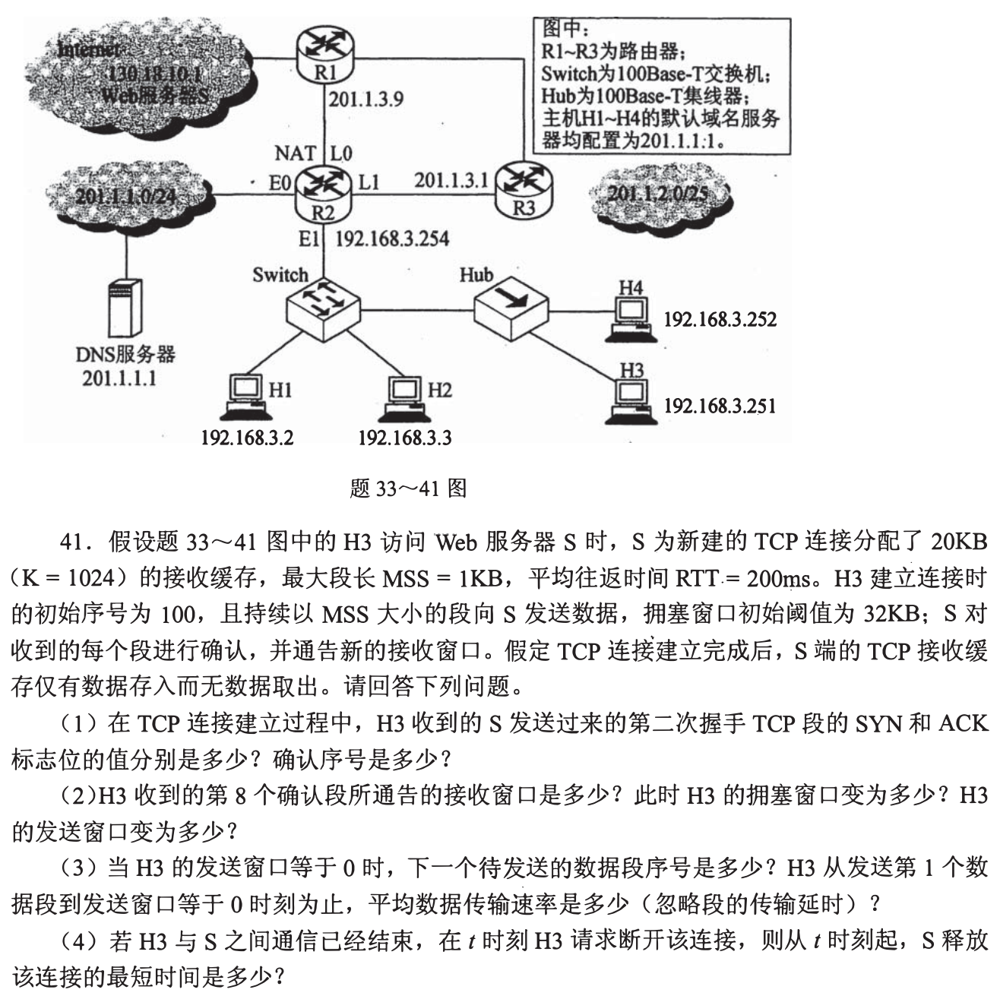

# Day 07｜2020—2026年题，以题带学

[← Day 06](day06.md) · [总入口](README.md) · [Day 08 →](day08.md)

> ### 🎯 本日攻坚目的
> 拿下【二叉树与森林遍历序列反推结构】与【银行家算法安全性检查】；拿下两道计网经典大题：FTP 会话中 TCP 序号计算与拥塞窗口拐点、RIP 路由距离向量传播轮次与 BGP 自治域出口选择。
>
> ### 📋 本日对应解决的 src 题单
> - [src/0803.md](../src/0803.md) 树的形状：遍历序列如何约束结构（共4题：`2022-04`、`2023-05`、`2024-03`、`2025-04`）$\to$ [进入在线自测](modules/0803.md)
> - [src/0827.md](../src/0827.md) 资源闭环：死锁、避免与检测（共1题：`2022-26`）$\to$ [进入在线自测](modules/0827.md)
> - [src/0930.md](../src/0930.md) 传输窗口大题（1题：`2023-47` FTP传输中TCP序号与拥塞窗口）
> - [src/0929.md](../src/0929.md) 寻址与路由大题（1题：`2024-47` RIP路由传播与BGP出口选择）

**当前选择题5道（原13道），配套大题2道，均为2020—2026年。** 原版每日材料在页末HTML注释中完整保留，暂不执行。这里只更新已有第1—8天，不新增后续每日页。

## 今天按这个顺序做

1. **回忆至多10分钟：** 只处理上次一处真实断点；第1天直接尝试首题。
2. **选择题及补学至多50分钟：** 共5题，先作答再展开讲解；做得少、耗时短时直接进入重做或下一环节，不为凑时间补入旧题。
   - [0803｜树形约束：计数公式与遍历位置](modules/0803.md)：4题。
   - [0827｜死锁与安全性：最坏占有和试运行](modules/0827.md)：1题。
3. **两道大题及补学至多50分钟：** 每题先独立尝试，再读折叠讲解，随后遮住重做；已能独立完成的不用耗满25分钟。
4. **闭卷检查至多10分钟：** 只留一处明天要修复的断点。

**120分钟是上限，不是必须用满的任务量，也不是已验证的完成时间。** 状态记I（独立完成）、H（引导后可重现）、U（仍不会）。时间到仍未完成，就记下真实题号和断点；不能靠继续加时把U写成完成。省下的时间用于当天错题重做，不自动增加新题。

## 大题1｜2023-47 · FTP传输中的序号与拥塞窗口

原题定位：[src/0930.md](../src/0930.md)，以年份题号2023-47定位。



<details>
<summary>没有入口时的第一步</summary>

控制连接与数据连接分开；SYN占一个序号。画出每轮发送段数，先核对已确认的连续数据量，再求窗口与总耗时。

</details>

<details>
<summary>完整解法与必要补学</summary>

（1）FTP控制连接在整个会话期间保持，属于持续连接；数据连接用于本次文件传输，传完关闭，属于非持续连接。登录时建立的是控制连接。

（2）数据连接初始序号100，SYN占一个序号，文件首字节序号为101。18000B传完后下一字节序号18101，H的FIN又占一个序号；服务器对H的FIN发出的第一次挥手ACK，确认号为18102。

（3）初始cwnd=1MSS。ACK1101确认第1段，窗口增为2MSS；随后ACK2101确认第2段，仍处慢开始，增为3MSS，即3000B。第一轮1段、第二轮2段后窗口达到门限4MSS。第三轮确认完第4—7段（ACK7101）后，按题目常用拥塞避免模型增为5MSS，即5000B。

（4）忽略发送时延，RTT=10ms，收到SYN+ACK后即可携带第三次握手ACK开始发数据：

| 从请求建连起 | 本轮发送段数 | 累计发送段数 |
|---|---:|---:|
| 10ms | 1 | 1 |
| 20ms | 2 | 3 |
| 30ms | 4 | 7 |
| 40ms | 5 | 12 |
| 50ms | 6 | 18 |
| 60ms | 收到最后一批确认 | 18 |

因此从请求建连到确认文件全部收到至少60ms，平均应用数据速率18000B/0.06s=300000B/s=2.4Mb/s。题目截止到文件确认，不再加断开连接耗时，也不能把FTP早已完成的登录再算一遍。

</details>

<details>
<summary>重做后检查</summary>

ACK2101不是确认“2101个字节”，而是期待下一个字节2101，已收2101−101=2000B。再核对1+2+4+5+6=18段。

</details>

## 大题2｜2024-47 · RIP传播轮次与BGP出口选择

原题定位：[src/0929.md](../src/0929.md)，以年份题号2024-47定位。



<details>
<summary>没有入口时的第一步</summary>

按原图画出AS1内部边：11—12、12—13、11—14、14—15、15—16、15—13、13—16。不要把图中交叉或AS边界误当连线。

</details>

<details>
<summary>完整解法与必要补学</summary>

（1）AS4选OSPF。RIP以16为不可达，不能支持题设可能超过20台路由器的路径。

（2）AS3最多经过15台路由器，每次转发TTL减1，要到目的主机时仍可交付，初始TTL至少16。

（3）初始向量在起始时刻立即交换，此后每30s一轮。210.2.3.0/24直连R14，t=0时R11、R15得知，t=30s时R12、R13、R16得知，全网至少30s。210.2.4.0/24直连R16，t=0时R13、R15得知，t=30s时R12、R14得知，t=60s时最远的R11得知，全网至少60s。不能把“初次立即交换”再额外记为30s。

（4）R44→R13为外部BGP（eBGP）会话，用UPDATE报文通告；R13向同一AS中的R14、R15通过内部BGP（iBGP）会话传播可达性。

（5）先比AS_PATH长度，R11与R13通告的路径均为3个AS，R12通告为4个AS，先排除R12。在题设无其他策略差异时，比较到出口的内部开销。R14到R11一跳，到R13两跳，选R11；R15到R13一跳，到R11两跳，选R13。先选外部路径属性，再用内部距离打破平局，不能一开始只看出口离自己多近。

</details>

<details>
<summary>重做后检查</summary>

从R16逐轮扩散：{R16}→{R13,R15}→{R12,R14}→{R11}。把初次交换记在t=0，就能独立复算60s。

</details>

## 最后闭卷检查

1. 安全状态与已经死锁是什么关系？
2. SYN占一个序号如何影响首字节序号与FIN的确认号？
3. RIP初次立即交换的时刻是0还是30秒？

不誊写整篇解答，只在纸上留一行：

```text
实际用时__分钟；选择题I__/H__/U__；大题1 I/H/U；大题2 I/H/U
未完成的题号__；明天只回看__；卡住的具体一步__
```

## 暂缓的原版材料

以下完整旧版仅在源文件注释中保存，其中旧年份题目暂不安排。

<!-- 暂缓：更新前的整份每日材料；原文保留，当前不安排。
# Day 07｜120分钟以题带学

[← Day 06](day06.md) · [总入口](README.md) · [Day 08 →](day08.md)

**总时间上限120分钟，补学、核对、纠错均含在内。** 任务是完成本日指定题，不是刷完整个原文件。状态只记独立完成I、引导后完成H、仍有断点U，不把看过或到时当掌握。

## 今天直接按这个顺序做

1. **0—10分钟：** 回忆昨天留下的一处断点；Day 1用于直接尝试首题，不先找课程。
2. **10—60分钟：** 做下面两个模块，共13道选择题。先尝试，遇到知识缺口在本页补学；模块时间按题数分配，读解答和纠错算在50分钟内。
   - [0803｜树形约束：计数公式与遍历位置](modules/0803.md)：8题。
   - [0827｜死锁与安全性：最坏占有和试运行](modules/0827.md)：5题。
3. **60—110分钟：** 完成下面两道大题，每题25分钟：读题与独立尝试5分钟，卡住读折叠解法7分钟，遮住后重写或重算10分钟，核对2分钟，标状态1分钟。已能独立完成时无需等到用满。
4. **110—120分钟：** 做文末检查，只记一处最值得明天回看的断点，停止当天训练。

**防止时间失控：** 选择题45—90秒没有入口就读本页讲解；不用先去搜视频或整理新笔记。独立做对且依据正确的题立即离开；引导后仍不会的保留U，次日开头处理。120分钟到时如仍未完成，记录真实未完成题号，不能勾成通关；这也是校准本计划工作量的依据。

## 大题1｜2012-47 · 十六进制抓包的TCP握手与确认

原题定位：[src/0930.md 第01题](../src/0930.md)。以年份题号为准，避免原计划题名错位。



<details>
<summary>没有入口时的第一步</summary>

先按IP头20字节确定源地址、总长度和TTL，再按TCP头读取序号、确认号、首部长度与标志。

</details>

<details>
<summary>完整解法与必要补学</summary>

**读包所需知识。** 45表示IPv4、头长5×4=20B；IP总长度包含IP头。TCP头长由数据偏移高4bit×4给出：70为28B，50为20B。SYN和FIN各消耗一个序号，纯ACK不消耗序号。

**(1)** 源地址c0 a8 00 08即192.168.0.8，所以H发送1、3、4号包。1号SYN=1，2号SYN=ACK=1，3号ACK完成握手，因此握手包1、2、3。以太网最小数据字段46B；3和5号IP包长度0x28=40B，需要补6B，1、2为0x30=48B不需，4为0x38=56B不需。

**(2)** 4号数据长度56−20−20=16B。H数据初始序号0x846b41c6，5号确认号0x846b41d6，相差0x10=16，说明S已按序收到16B应用数据。不能把握手SYN计入应用数据。

**(3)** 发出时TTL=0x40=64，H收到对应5号包时TTL=0x31=49，经过64−49=15个路由器。NAT会改地址端口，不因此额外减少一次TTL；按路由跳数计算。

</details>

<details>
<summary>重做后检查</summary>

用IP总长度−IP头长−TCP头长复核16B；再用确认号差复核，二者应一致。

</details>

## 大题2｜2016-41 · 拥塞窗口与接收缓冲区同时约束

原题定位：[src/0930.md 第02题](../src/0930.md)。以年份题号为准，避免原计划题名错位。



<details>
<summary>没有入口时的第一步</summary>

接收方不取走数据，rwnd会不断缩小；发送窗口取min(cwnd,rwnd)，不是只画慢开始指数曲线。

</details>

<details>
<summary>完整解法与必要补学</summary>

**(1)** 第二次握手SYN=1、ACK=1，确认号=100+1=101。

**(2)** 收到第8个数据确认，S已存8KiB，接收窗口20−8=12KiB。初始cwnd按教材模型为1MSS，慢开始每个新ACK增1MSS，8个ACK后cwnd=9KiB（未达32KiB阈值）。发送窗口min(9,12)=9KiB。

**(3)** 收满20KiB后rwnd=0，下一段序号=101+20×1024=20581。按RTT轮次发送1、2、4、8、5个MSS，分别在第1至第5个RTT末得到确认，5×200ms=1s后发方得知窗口为0。平均速率20KiB/1s=20480B/s=163840bit/s。题目忽略传输延迟，采用逐RTT的教材模型，不把握手时间再加进“发送第1段起”。

**(4)** H3在t发FIN，S最早t+RTT/2收到；S可立即发ACK与FIN（合并），H3在t+RTT收到并立即回ACK，S在t+3RTT/2收到末次ACK并关闭。最短300ms；2MSL的TIME_WAIT在主动关闭方H3，不加到S的最短释放时间。

</details>

<details>
<summary>重做后检查</summary>

把8个ACK后的cwnd=9KiB与“第4轮开始8KiB”区分；按ACK次数和按整轮次数不能混用。

</details>

## 最后10分钟：闭卷检查与交付

1. 树的后根遍历对应孩子兄弟二叉树的哪种遍历？
2. 安全状态与已经死锁是否是同一件事？
3. 接收方不取数据时，为何即使无丢包也会停发？

在纸上留一行即可，不抄解答、不另建整理任务：

```text
实际用时__分钟；选择题 I__/H__/U__；大题1 I/H/U；大题2 I/H/U
明天只回看：题号__；卡住的具体一步__
```

**完成与掌握分别记录。** 指定题均作答并核对、引导后能重现关键步骤，算本日执行完成；U仍存在就保留未通过项，不以此证明已掌握整个模块。扩展原题单的攻坚部分放到后续阶段；当天有余时也只在120分钟内追加。
-->
