# Day 08｜组成原理＋计算机网络

[← Day 07](day07.md) · [总入口](README.md) · [Day 09 →](day09.md)

**选择题：13道，来自两份完整src题单；大题：1道。** 先做选择题，再展开题下解析。组内题目沿用src顺序；标为复做的组，已会的快速通过，重点处理上次错题。

**预计用时：85—130分钟。** 选择题及核对约55—85分钟，大题约25—35分钟，最后用5—10分钟重做今天最值得记住的一道错题。约两小时是配题目标，不是必须耗满或到点强停；计算卡住时先保留题号，先完成其余选择题。

## 选择题组1｜0815 · 组成原理

[Cache访问：地址切分、局部性与替换](../src/0815.md) · 5道 · 首次。

### 选择题1｜2020-15


<details>
<summary>答案与解析</summary>

**答案：D。**

**直接法：** Cache一般用SRAM，TLB通常是相联查找结构，不能说两者都由DRAM组成。按本题模型，缺失后的下级信息位于主存，硬件可以处理查询。

</details>

### 选择题2｜2021-16

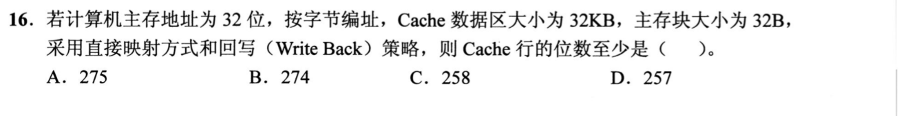

<details>
<summary>答案与解析</summary>

**参考答案：A（待逐题复核）。** 解析待补。

</details>

### 选择题3｜2022-16

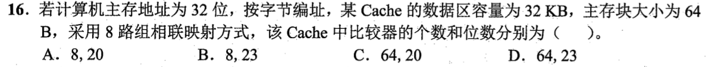

<details>
<summary>答案与解析</summary>

**答案：A。**

**直接法：** 32KiB/64B=512行，8路得64组，组号6位，偏移6位，tag=32−6−6=20位；8路需要8个20位比较器。

</details>

### 选择题4｜2024-16

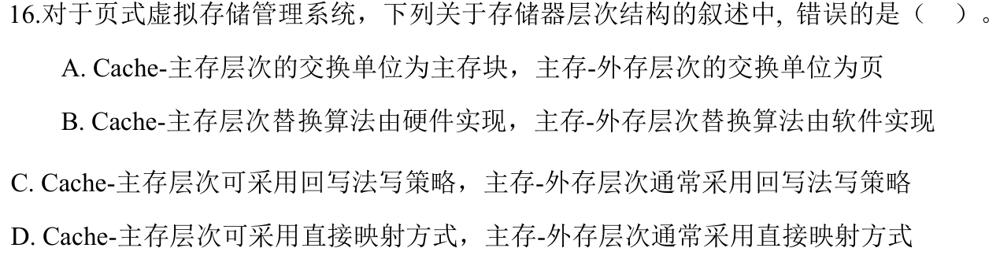

<details>
<summary>答案与解析</summary>

**答案：D。**

**直接法：** 主存页框不是虚拟页的固定直接映射槽位，虚拟页可装入可用页框。Cache可直接映射；主存—外存页面映射通常是全相联的灵活装入。

</details>

### 选择题5｜2026-18

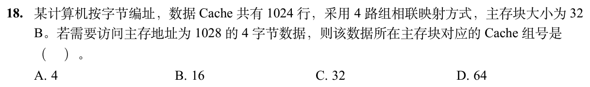

<details>
<summary>答案与解析</summary>

**答案与解析待补。**

</details>

## 选择题组2｜0905 · 计算机网络

[网络地址：子网、分片与可达范围](../src/0905.md) · 8道 · 首次。

### 选择题6｜2021-35

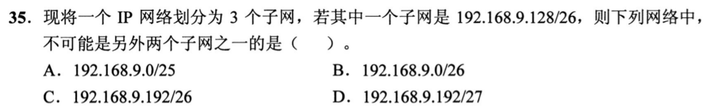

<details>
<summary>答案与解析</summary>

**参考答案：B（待逐题复核）。** 解析待补。

</details>

### 选择题7｜2022-35


<details>
<summary>答案与解析</summary>

**答案：B。**

**直接法：** 第三字节72与192按位与得64；第四字节与0得0，所以网络地址183.80.64.0（/18）。

</details>

### 选择题8｜2022-36

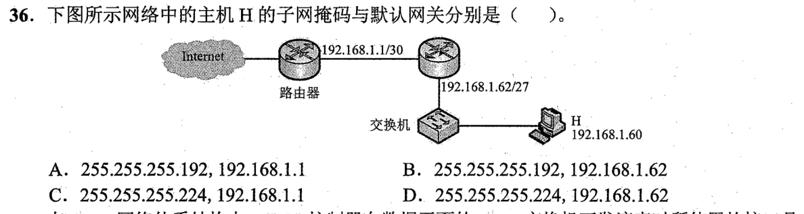

<details>
<summary>答案与解析</summary>

**参考答案：D（待逐题复核）。** 解析待补。

</details>

### 选择题9｜2023-38

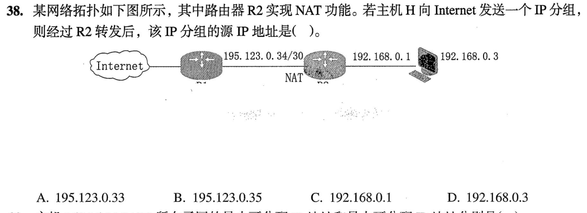

<details>
<summary>答案与解析</summary>

**答案：A。**

**直接法：** 图中公网链路195.123.0.32/30，可用.33、.34；R1已占.34，R2的公网出口只能是.33，故NAT后源地址195.123.0.33。

</details>

### 选择题10｜2023-39

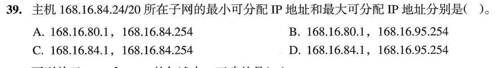

<details>
<summary>答案与解析</summary>

**参考答案：B（待逐题复核）。** 解析待补。

</details>

### 选择题11｜2023-40

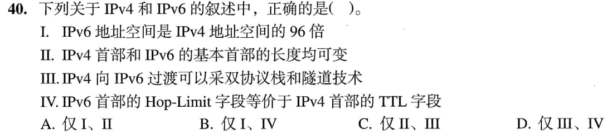

<details>
<summary>答案与解析</summary>

**答案：D。**

**直接法：** III双栈/隧道可过渡，IV Hop Limit等效TTL；地址空间比是2^(128−32)=2⁹⁶倍，不是96倍；IPv6基本首部固定，II错。

</details>

### 选择题12｜2025-36

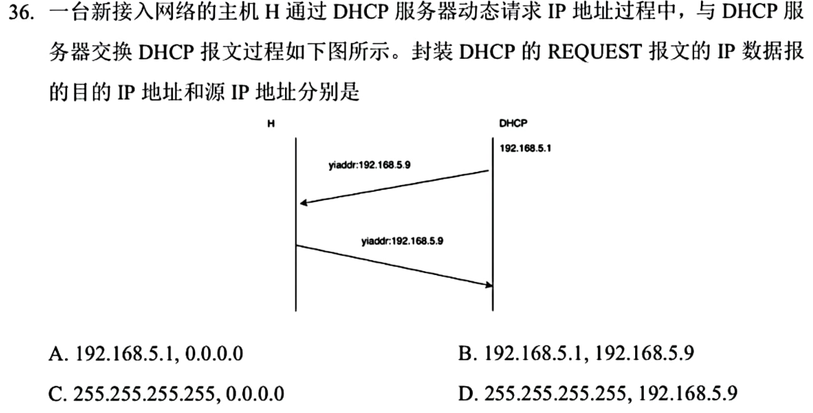

<details>
<summary>答案与解析</summary>

**答案：C。**

**直接法：** 新接入主机对OFFER发初次REQUEST时使用源0.0.0.0、目的255.255.255.255广播，通知各服务器选择结果。题目问目的在前、源在后，顺序别倒。

</details>

### 选择题13｜2026-39

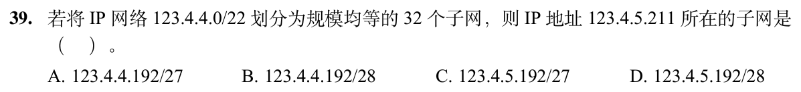

<details>
<summary>答案与解析</summary>

**答案与解析待补。**

</details>

## 解答题

### 大题1｜2022-41

[原题单 0915｜树的递归含义：路径、编码、表达式与存储形态](../src/0915.md)

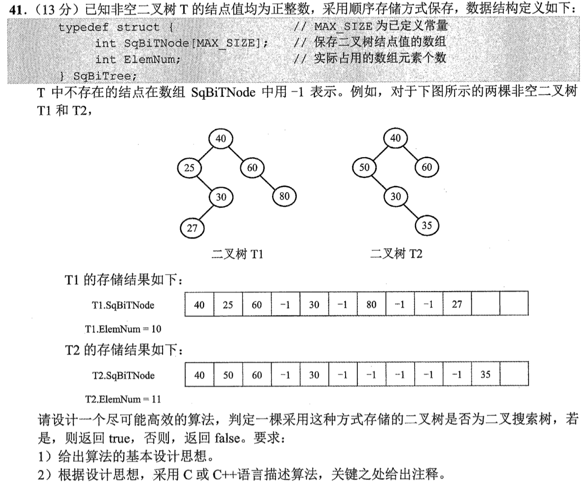

<details>
<summary>答案与解析</summary>

**思想。** 从根开始，为每棵子树携带允许的开区间(lo,hi)。当前值必须严格落在区间中；左子树收紧上界，右子树收紧下界。越过ElemNum或遇到−1表示空结点，直接返回真。

```c
#include <stdbool.h>
#include <limits.h>
bool checkBST(const SqBiTree *T, int i, long long lo, long long hi) {
    if (i >= T->ElemNum || T->SqBiTNode[i] == -1) return true;
    int x = T->SqBiTNode[i];
    if (x <= lo || x >= hi) return false;
    return checkBST(T, 2*i+1, lo, x)
        && checkBST(T, 2*i+2, x, hi);
}
bool IsBST(const SqBiTree *T) {
    return checkBST(T, 0, LLONG_MIN, LLONG_MAX);
}
```

按指针传入顺序存储结构，避免复制整个数组。只访问树中实际结点及其空孩子位置，时间O(v)，v为非空结点数，亦为数组使用长度n的O(n)上界；递归栈O(h)。也可按中序遍历检查严格递增，但不能直接扫描数组，因为数组是层序位置布局。原题只要求算法思想与实现，不虚构分项分值。

</details>

## 一行记录

```text
实际用时__；未完成或未核对的题号__；今天最容易混淆的是__
```
