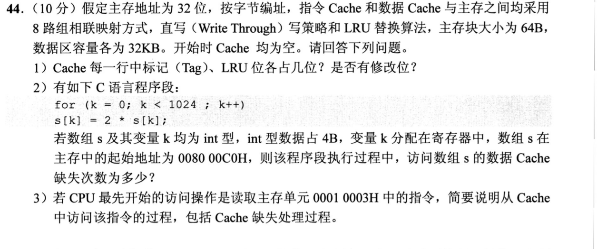
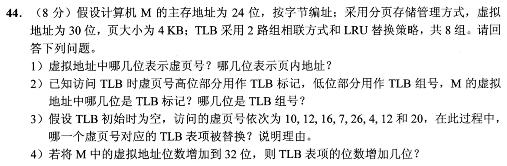
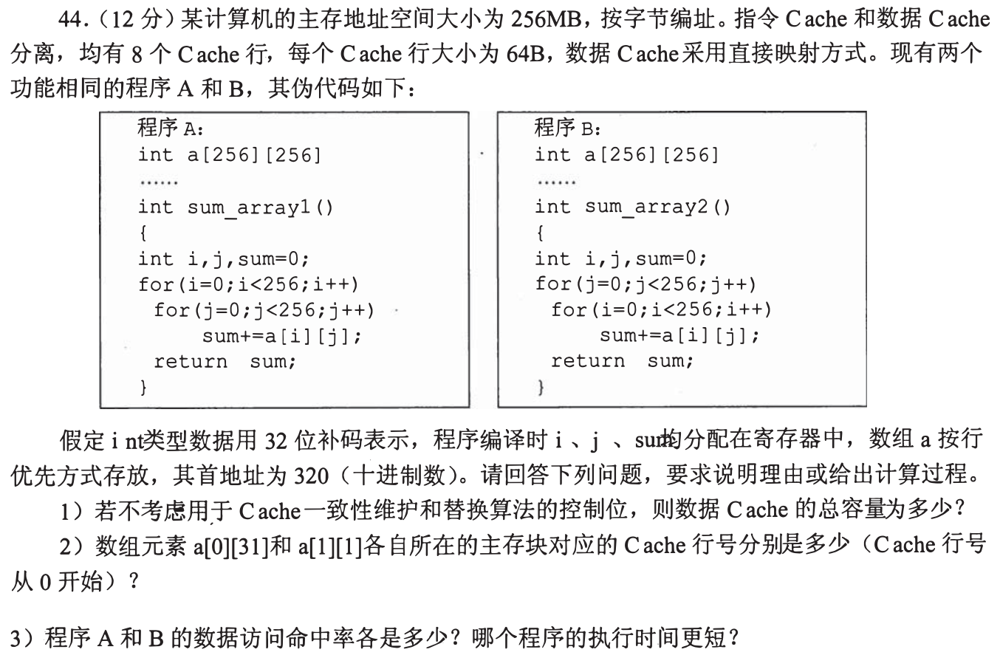
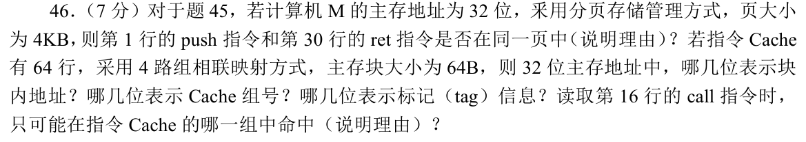
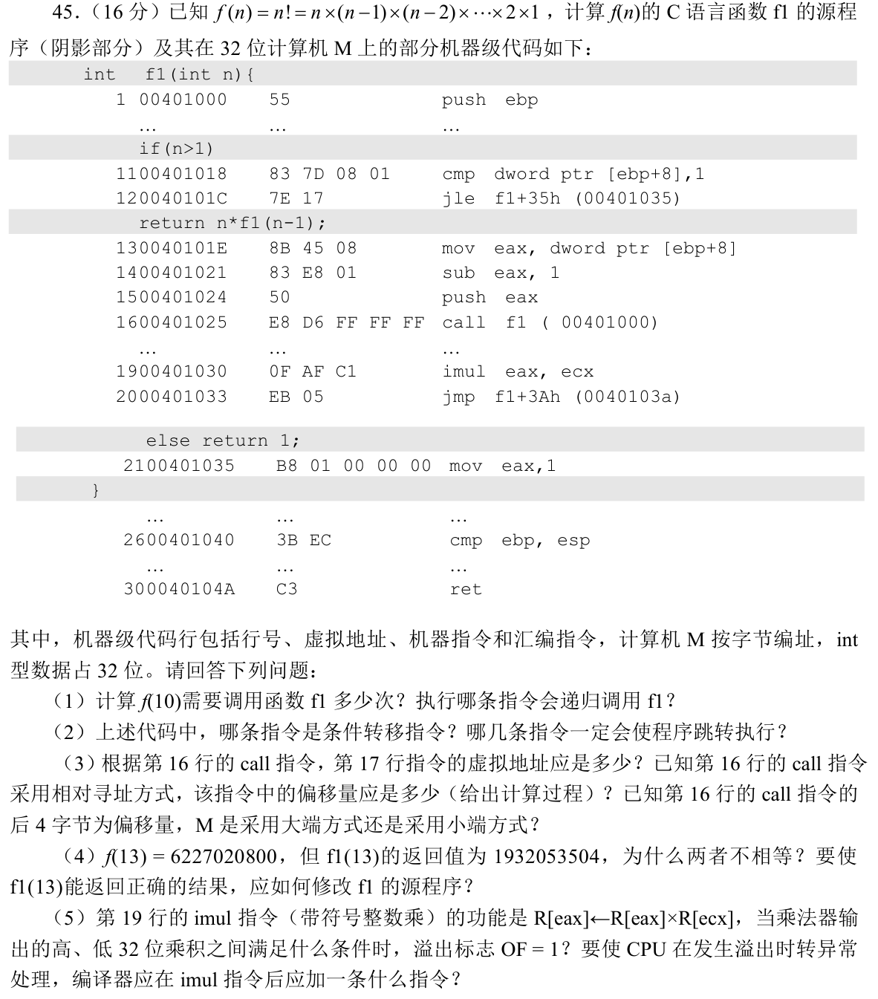

# Day 08｜2020—2026年题，以题带学

[← Day 07](day07.md) · [总入口](README.md) · [Day 09 →](day09.md)

> ### 🎯 本日攻坚目的
> 区分 TLB 与 Cache 的缺失处理，并判断冲突域、SDN 接口和 VLAN 中的 ARP。大题练 Cache 位数、缺失次数与 TLB 组内替换。
>
> ### 📋 本日对应解决的 src 题单
> - [src/0815.md](../src/0815.md) Cache访问：地址切分、局部性与替换（共3题：`2020-15`、`2022-16`、`2024-16`）$\to$ [进入在线自测](modules/0815.md)
> - [src/0904.md](../src/0904.md) 局域网转发：介质竞争、MAC与交换机（共3题：`2020-35`、`2022-37`、`2024-35`）$\to$ [进入在线自测](modules/0904.md)
> - [src/0923.md](../src/0923.md) Cache局部性大题（1题：`2020-44` 组相联Cache位数、缺失与查找）
> - [src/0924.md](../src/0924.md) 地址翻译链大题（1题：`2021-44` TLB地址拆分与组内LRU替换）

**当前选择题6道（原15道），配套大题2道，均为2020—2026年。** 原版每日材料在页末HTML注释中完整保留，暂不执行。

## 今天按这个顺序做

1. **回忆至多10分钟：** 只处理上次一处真实断点。
2. **选择题及补学至多50分钟：** 共6题，先作答再展开讲解；做得少、耗时短时直接进入重做或下一环节，不为凑时间补入旧题。
   - [0815｜Cache：先拆地址，再算命中](modules/0815.md)：3题。
   - [0904｜局域网：学习源地址，按目的地址转发](modules/0904.md)：3题。
3. **两道大题及补学至多50分钟：** 每题先独立尝试，再读折叠讲解，随后遮住重做；已能独立完成的不用耗满25分钟。
4. **闭卷检查至多10分钟：** 只留一处明天要修复的断点。

**120分钟是上限，不是必须用满的任务量，也不是已验证的完成时间。** 状态记I（独立完成）、H（引导后可重现）、U（仍不会）。时间到仍未完成，就记下真实题号和断点；不能靠继续加时把U写成完成。省下的时间用于当天错题重做，不自动增加新题。

## 大题1｜2020-44 · 组相联Cache的位数、缺失与查找

原题定位：[src/0923.md](../src/0923.md)，以年份题号2020-44定位。



<details>
<summary>没有入口时的第一步</summary>

先算行数和组数。只跟踪数组S，k在寄存器，不能把k的循环访问也记成数据Cache缺失。

</details>

<details>
<summary>完整解法与必要补学</summary>

（1）每个Cache的数据区32KiB，每块64B，共512行；8路得到64组。32位地址切为Tag20位、组号6位、块内偏移6位。每行用3位LRU序号区分组内8个位置；直写策略没有脏位（修改位），但仍需要有效位。

（2）S有1024个int，占4096B；起始008000C0H是64B整块边界，每块装16个int，共64块。每块第一次读取缺失，以后读取及对同一元素的写入均命中；按顺序访问且容量足够，缺失64次。直写表示命中写同时更新主存，不意味着每次写都是Cache缺失。

（3）00010003H：块内偏移3，组号0，Tag=00010H。访问指令Cache第0组，并行比较8路有效标记。初始Cache空，首次必缺失；从主存读入00010000H起的64B块到该组空行（若无空行才依LRU替换），置有效位、标记并更新LRU，然后按偏移3取指令内容。指令Cache和数据Cache分别管理，不混为一张表。

</details>

<details>
<summary>重做后检查</summary>

用32KiB÷64B÷8=64组复算；再算4096B÷64B=64块。两处“64”含义不同，前者是组数，后者是本次扫描涉及的数据块数。

</details>

## 大题2｜2021-44 · TLB地址拆分与LRU替换

原题定位：[src/0924.md](../src/0924.md)，以年份题号2021-44定位。



<details>
<summary>没有入口时的第一步</summary>

页内偏移不参与TLB查找；8组用虚页号低3位定位组，其余虚页号位作为标记。

</details>

<details>
<summary>完整解法与必要补学</summary>

（1）页大小4KiB=2^12B，虚拟地址低12位（11—0）为页内地址，高18位（29—12）为虚页号。

（2）TLB组号用虚页号低3位，即虚拟地址14—12位；TLB标记为虚拟地址29—15位，共15位。不能把24位物理地址用于切虚拟标记。

（3）按“虚页号mod8”分组。10、26在第2组，刚好占满两路，无替换；12、4、20在第4组。顺序访问12、4、12后，4最久未用，因此20到来时替换虚页4对应表项。16在第0组，7在第7组，互不争用。只有4被替换，不能在整张TLB上做全局LRU。

（4）虚拟地址增为32位，页大小、物理地址与组数不变，虚页号增加2位，TLB标记随之增加2位；页框号及其他状态字段不变，所以每个TLB表项增加2位。

</details>

<details>
<summary>重做后检查</summary>

第4组从旧到新的顺序：12→12,4→4,12→12,20。最后一步移除的是4；TLB命中12虽然不缺失，却会改变LRU次序。

</details>

## 最后闭卷检查

1. 直写没有脏位，是否表示写入不访问主存？
2. TLB组号来自虚页号还是物理页框号？
3. 第4组访问12、4、12、20，为什么替换4？

不誊写整篇解答，只在纸上留一行：

```text
实际用时__分钟；选择题I__/H__/U__；大题1 I/H/U；大题2 I/H/U
未完成的题号__；明天只回看__；卡住的具体一步__
```

## 暂缓的原版材料

以下完整旧版仅在源文件注释中保存，其中旧年份题目暂不安排。

<!-- 暂缓：更新前的整份每日材料；原文保留，当前不安排。
# Day 08｜120分钟以题带学

[← Day 07](day07.md) · [总入口](README.md)

**总时间上限120分钟，补学、核对、纠错均含在内。** 任务是完成本日指定题，不是刷完整个原文件。状态只记独立完成I、引导后完成H、仍有断点U，不把看过或到时当掌握。

## 今天直接按这个顺序做

1. **0—10分钟：** 回忆昨天留下的一处断点；Day 1用于直接尝试首题，不先找课程。
2. **10—60分钟：** 做下面两个模块，共15道选择题。先尝试，遇到知识缺口在本页补学；模块时间按题数分配，读解答和纠错算在50分钟内。
   - [0815｜Cache：先拆地址，再算命中](modules/0815.md)：5题。
   - [0904｜局域网：学习源地址，按目的地址转发](modules/0904.md)：10题。
3. **60—110分钟：** 完成下面两道大题，每题25分钟：读题与独立尝试5分钟，卡住读折叠解法7分钟，遮住后重写或重算10分钟，核对2分钟，标状态1分钟。已能独立完成时无需等到用满。
4. **110—120分钟：** 做文末检查，只记一处最值得明天回看的断点，停止当天训练。

**防止时间失控：** 选择题45—90秒没有入口就读本页讲解；不用先去搜视频或整理新笔记。独立做对且依据正确的题立即离开；引导后仍不会的保留U，次日开头处理。120分钟到时如仍未完成，记录真实未完成题号，不能勾成通关；这也是校准本计划工作量的依据。

## 大题1｜2010-44 · 数组访问顺序与直接映射Cache

原题定位：[src/0923.md 第01题](../src/0923.md)。以年份题号为准，避免原计划题名错位。



<details>
<summary>没有入口时的第一步</summary>

先统一成字节地址，再做“地址÷块长→块号，块号mod行数→行号”。

</details>

<details>
<summary>完整解法与必要补学</summary>

**(1)** 主存256MiB=2²⁸B，地址28位。块64B→偏移6位；8行→行号3位；tag=28−6−3=19位。每行数据512bit，另有tag19位和有效位1位，不计题目排除的一致性/替换控制位，总容量8×(512+19+1)=4256bit=532B。

**(2)** int为4B，按行优先，addr(a[i][j])=320+4(256i+j)。a[0][31]地址444，块号⌊444/64⌋=6，行号6；a[1][1]地址1348，块号21，行号21mod8=5。

**(3)** A按行扫描，每64B块含16个int，首次缺失后15次命中，命中率15/16=93.75%。B按列扫描，内层相邻两次地址相差1024B=16块，全映射到相同行并不断替换；回头访问同一块前早已被挤出，命中率0。A运行更快。数组首址320是64B对齐，不能擅自按不对齐再增加一次块访问。

</details>

<details>
<summary>重做后检查</summary>

a[0][0]块号5，a[1][0]块号21，也映射行5；这解释了按列扫描的冲突。

</details>

## 大题2｜2019-46 · 跨页判断与组相联地址拆分

原题定位：[src/0923.md 第02题](../src/0923.md)。以年份题号为准，避免原计划题名错位。



<details>
<summary>没有入口时的第一步</summary>

此题依赖2019-45的汇编地址，先读下面补充的公共题干，再计算。

</details>

<details>
<summary>完整解法与必要补学</summary>

公共题干来自2019-45，包含本题所需的push、call和ret地址：



**同页判断。** push地址00401000H，ret地址0040104AH；页4KiB=2¹²B，两者高20位均00401H，仅页内偏移000H与04AH不同，故在同一虚拟页。不要用是否跨Cache块代替是否跨页。

**Cache字段。** 64行、4路→16组，组号4bit；块64B→偏移6bit；32bit地址剩22bit为tag。因此从0起编号：块内地址位0—5，组号位6—9，tag位10—31。

**call所在组。** 第16行call起址00401025H，组号=(地址右移6位)mod16=0，只可能在第0组命中。该指令5B，字节偏移25H—29H，未跨64B块，不能说在多个组任意命中。

</details>

<details>
<summary>重做后检查</summary>

用地址00401025H & 3FFH=25H，再右移6位得0；32−6−4=22核对tag。

</details>

## 最后10分钟：闭卷检查与交付

1. 8路组相联为什么需要8个tag比较器？
2. 交换机学习源地址还是目的地址？
3. 跨页与跨Cache块分别比较哪些地址位？

在纸上留一行即可，不抄解答、不另建整理任务：

```text
实际用时__分钟；选择题 I__/H__/U__；大题1 I/H/U；大题2 I/H/U
明天只回看：题号__；卡住的具体一步__
```

**完成与掌握分别记录。** 指定题均作答并核对、引导后能重现关键步骤，算本日执行完成；U仍存在就保留未通过项，不以此证明已掌握整个模块。扩展原题单的攻坚部分放到后续阶段；当天有余时也只在120分钟内追加。
-->
