# Day 09｜数据结构＋操作系统

[← Day 08](day08.md) · [总入口](README.md) · [Day 10 →](day10.md)

**选择题：18道，来自两份完整src题单；大题：1道。** 先做选择题，再展开题下解析。组内题目沿用src顺序；标为复做的组，已会的快速通过，重点处理上次错题。

**预计用时：85—135分钟。** 选择题及核对约55—90分钟，大题约25—35分钟，最后用5—10分钟重做今天最值得记住的一道错题。约两小时是配题目标，不是必须耗满或到点强停；计算卡住时先保留题号，先完成其余选择题。

## 选择题组1｜0804 · 数据结构

[编码代价：哈夫曼树与前缀码](../src/0804.md) · 5道 · 首次。

### 选择题1｜2021-05

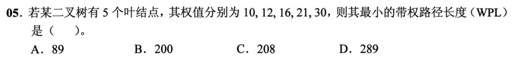

<details>
<summary>答案与解析</summary>

**答案：B。**

每次合并最小两权：10+12=22，16+21=37，22+30=52，37+52=89。哈夫曼树WPL等于各次合并值之和，22+37+52+89=200。89只是根权值，即所有叶权之和，不是带权路径长度。

</details>

### 选择题2｜2022-05

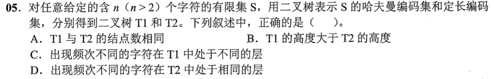

<details>
<summary>答案与解析</summary>

**答案：D。**

定长编码的所有字符都是同一深度，频次不同也不改变码长。哈夫曼树中频次不同的字符也可同层。两种树的高度可以相同；例如4个等频字符都用2位。结点数也未必相同，例如3个字符的定长码取00、01、10，按这三条路径建树有6个结点，而二叉哈夫曼树有5个。

</details>

### 选择题3｜2023-04

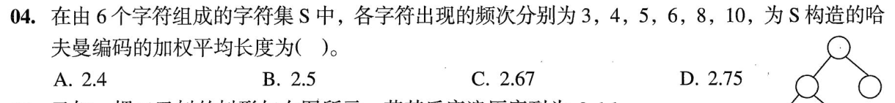

<details>
<summary>答案与解析</summary>

**答案：B。**

依次合并3+4=7、5+6=11、7+8=15、10+11=21、15+21=36，WPL=7+11+15+21+36=90。频次总和36，所以加权平均码长90/36=2.5。不能用WPL除以字符种类数6。

</details>

### 选择题4｜2025-05

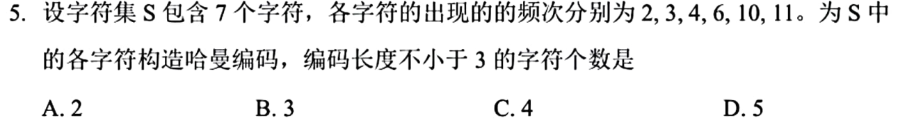

**题面缺项：** 图中称7个字符却只列6个频次。本页给出按现有数据的结果，不擅自补数；详见折叠解析。

<details>
<summary>答案与解析</summary>

**答案：按图列出的6个频次选B；题面的“7个字符”与数据不符。**

题图及仓内PDF均只列2、3、4、6、10、11，共6个频次，不能擅自补出第7个。先按这6个数计算：2+3=5，4+5=9，6+9=15，10+11=21，15+21=36。权10、11、6的码长为2，权4为3，权2、3为4，故码长不少于3的有3个，对应B。若原题确为7个字符，必须先补回缺失频次，才能判定该版本；原有参考字母D不能替代缺失题设，也不能反推并编造第7个频次。

</details>

### 选择题5｜2026-05

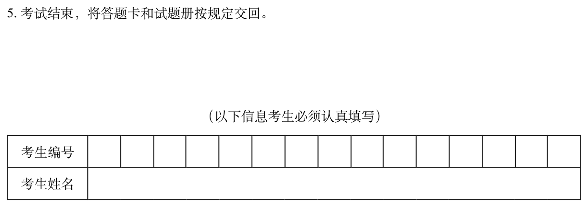

<details>
<summary>答案与解析</summary>

**答案：D。**

原图七个权值依次为1、2、4、5、8、10、12。按最小两权合并：1+2=3，3+4=7，5+7=12，8+10=18，12+12=24，18+24=42。e的权8与f的权10在子树18中，深度均为2；g的权12在子树24中，深度也为2。因此与e同深度的叶子恰为f、g。合并生成的权3不是原字符c的权值，不能把它混进原始七个叶权。

</details>

## 选择题组2｜0825 · 操作系统

[执行生命线：进程、线程、状态与调度](../src/0825.md) · 13道 · 首次。

### 选择题6｜2020-26

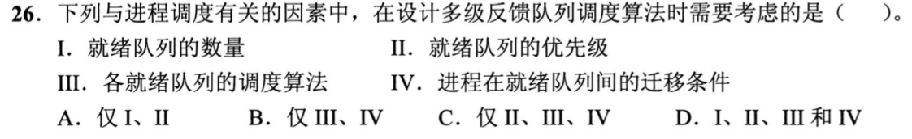

<details>
<summary>答案与解析</summary>

**答案：D。**

多级反馈队列要先确定有几级、各级优先级及内部算法，还要规定新进程进入哪一级、用完时间片或长时间等待后怎样迁移。四项都是调度规则的一部分；只设置队列优先级而不定义迁移，就没有形成反馈机制。

</details>

### 选择题7｜2020-29

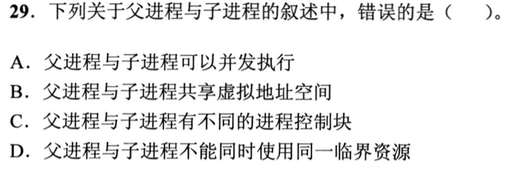

<details>
<summary>答案与解析</summary>

**答案：B。**

父子是两个进程，各有自己的虚拟地址空间和PCB，B错误。创建时可以复制映射并用写时复制共享物理页，但不等于共用同一个虚拟地址空间。它们可并发执行；若访问同一临界资源，仍须遵守互斥，亲子关系不豁免同步要求。

</details>

### 选择题8｜2021-24

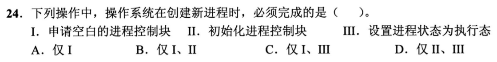

<details>
<summary>答案与解析</summary>

**答案：B。**

创建进程必须先申请PCB并初始化身份、状态、资源等信息，Ⅰ、Ⅱ成立。创建完成通常进入就绪队列，何时执行由调度决定，并不必须立即设为执行态，Ⅲ不成立。就绪与执行之间还差一次CPU分配。

</details>

### 选择题9｜2021-25

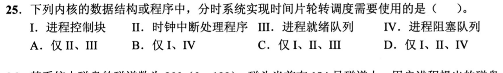

<details>
<summary>答案与解析</summary>

**答案：C。**

时间片轮转需PCB记录上下文、时钟中断计时、就绪队列轮换；不因采用轮转就必须用阻塞队列，选I、II、III。

</details>

### 选择题10｜2021-27

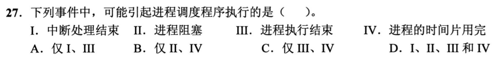

<details>
<summary>答案与解析</summary>

**答案：D。**

阻塞、结束、时间片用完都会使当前进程让出CPU，需要调度。中断处理结束时也可能出现新唤醒的高优先级进程，触发重新调度，因此Ⅰ同样可能。题目问“可能”，不要求每次中断结束都发生进程切换。

</details>

### 选择题11｜2022-23

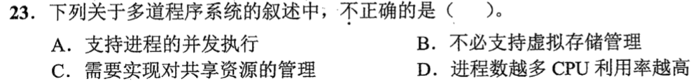

<details>
<summary>答案与解析</summary>

**答案：D。**

多道程序允许进程并发并由系统管理共享资源，但进程过多会增加切换、竞争和内存压力，CPU利用率不会无限提高，D错误。多道程序并不以请求分页等虚拟存储机制为必需条件；没有虚拟存储也能在内存装入多道程序。

</details>

### 选择题12｜2022-25

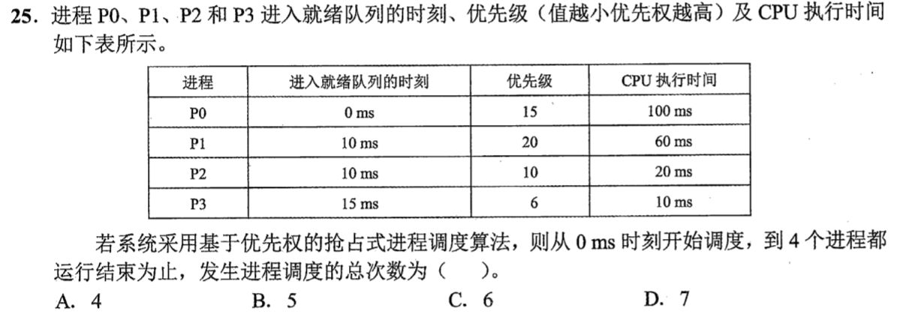

<details>
<summary>答案与解析</summary>

**答案：C。**

优先级数值越小越高。执行顺序为P0(0～10)、P2(10～15)、P3(15～25)、P2(25～40)、P0(40～130)、P1(130～190)，共6次调度，含0ms首次选中P0。仅有进程到达却未改变CPU归属，不另计调度；全部完成后的空闲不再计一次。

</details>

### 选择题13｜2022-28


<details>
<summary>答案与解析</summary>

**答案：D。**

读文件、申请外设和P操作都可能等待而阻塞；时间片用完转就绪，不转阻塞。选I、III、IV。

</details>

### 选择题14｜2023-27

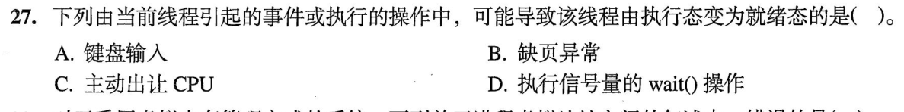

<details>
<summary>答案与解析</summary>

**答案：C。**

主动让出CPU时，线程还具备运行条件，只是放弃当前CPU，转入就绪态。缺页或wait条件不满足通常转阻塞态，等待输入也属于等待事件；不能把所有离开执行态的情况都归为就绪。键盘输入完成可能唤醒别的线程，不是当前线程主动让出的操作。

</details>

### 选择题15｜2023-29

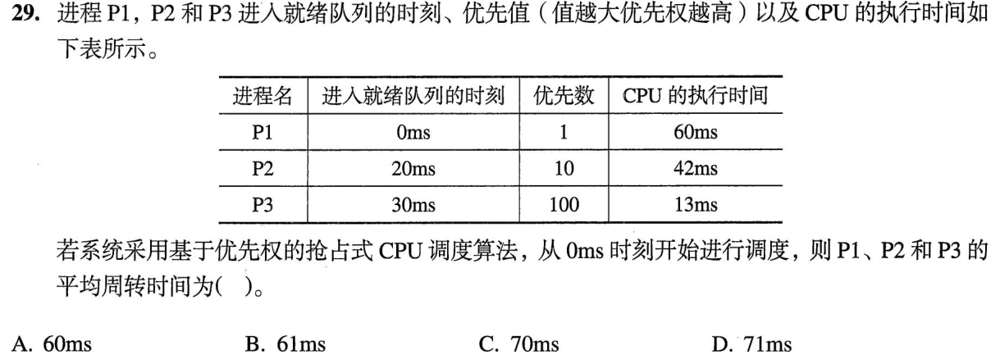

<details>
<summary>答案与解析</summary>

**答案：B。**

执行顺序P1：0～20，P2：20～30，P3：30～43，P2：43～75，P1：75～115。完成时刻分别115、75、43，减去到达时刻0、20、30，周转时间为115、55、13，平均183/3=61ms。不能把完成时刻直接求平均，也不能只算排队等待。

</details>

### 选择题16｜2024-24

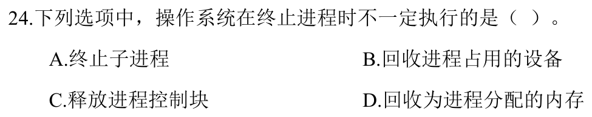

<details>
<summary>答案与解析</summary>

**答案：A。**

终止父进程不一定连带终止子进程，系统可以让子进程继续运行并重新指定其父进程。父进程自己的设备、地址空间和PCB则要在退出清理过程中回收。这里问的是是否必须终止子进程，不是某一系统能否采用级联终止策略。

</details>

### 选择题17｜2025-25

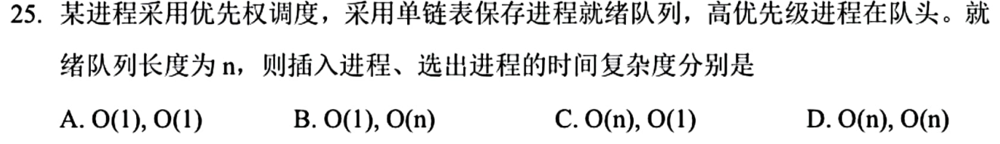

<details>
<summary>答案与解析</summary>

**答案：C。**

队列已按优先级排好，插入新进程最坏要沿单链表找位置，O(n)；选取最高优先级进程直接摘队头，O(1)。插入时修改指针本身虽为常数时间，找到该插入位置的扫描不能省掉。

</details>

### 选择题18｜2026-25

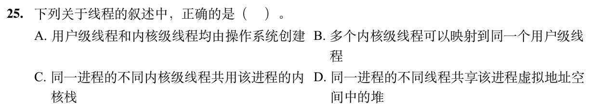

<details>
<summary>答案与解析</summary>

**答案：D。**

进程堆属于共同虚拟地址空间，同进程线程共享，D正确。用户级线程由用户线程库管理，不都由内核创建；常见映射是多个用户线程对应一个或多个内核线程，不是给一个用户线程配多个内核执行实体；不同内核线程各有自己的内核栈，C错。

</details>

## 解答题

### 大题1｜2021-41

[原题单 0916｜图的结构判定：从邻接信息恢复全局性质](../src/0916.md)

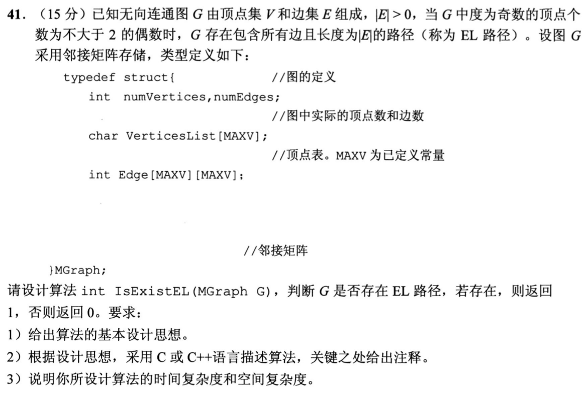

<details>
<summary>答案与解析</summary>

**思想。** 对邻接矩阵逐行求和得到各顶点度数；奇数度顶点数为0或2时返回1，否则返回0。连通性是题设，不能多添一次不必要的图遍历；若换成一般输入，才须额外核验所有有边顶点连通。

```c
int IsExistEL(MGraph G) {
    int odd = 0;
    for (int i = 0; i < G.numVertices; ++i) {
        int degree = 0;
        for (int j = 0; j < G.numVertices; ++j)
            degree += G.Edge[i][j];
        if (degree % 2 != 0) ++odd;
    }
    return odd == 0 || odd == 2;
}
```

共检查V²个矩阵元素，时间O(V²)，辅助空间O(1)。这是判定题，无须写输出路径的算法。代码沿用原题无向图邻接矩阵的0/1表示。

</details>

## 一行记录

```text
实际用时__；未完成或未核对的题号__；今天最容易混淆的是__
```
