# Day 10｜组成原理＋计算机网络

[← Day 09](day09.md) · [总入口](README.md) · [Day 11 →](day11.md)

**选择题：12道，来自两份完整src题单；大题：1道。** 先做选择题，再展开题下解析。组内题目沿用src顺序；标为复做的组，已会的快速通过，重点处理上次错题。

**预计用时：80—125分钟。** 选择题及核对约50—80分钟，大题约25—35分钟，最后用5—10分钟重做今天最值得记住的一道错题。约两小时是配题目标，不是必须耗满或到点强停；计算卡住时先保留题号，先完成其余选择题。

## 选择题组1｜0816 · 组成原理

[地址翻译链：虚拟地址怎样到达数据](../src/0816.md) · 5道 · 首次。

### 选择题1｜2020-15


<details>
<summary>答案与解析</summary>

**答案：D。**

- **核心判据**：
  TLB（Translation Lookaside Buffer，快表）与 Cache 均是为弥合 CPU 极高主频与主存慢速访问之间的延迟代差而设立的**高速硬件缓冲部件**。DRAM（动态随机存取存储器）依靠电容存储电荷，必须周期性动态刷新，读写延迟高达数十纳秒，根本无法满足 CPU 核心流水线内单周期或数周期的访问需求。因此，TLB 与 Cache 在物理介质上均由**静态存储器（SRAM）**或相联存储电路（CAM）组成，绝不可能由 DRAM 构成。

- **正选推导**：
  D 项断言两者“都由 DRAM 存储器组成”彻底颠倒了存储层次的硬件物理介质：
  - TLB 位于 CPU 内部 MMU 中，采用按内容寻址的高速相联检索电路/SRAM；
  - Cache 位于 CPU 片内或紧密总线上，采用高速 SRAM；
  - 只有下层的主存才主要采用高密度的 DRAM 芯片。
  故 D 项叙述错误，正选。

- **干扰项击穿**：
  - **A 项正确**：TLB 缓存虚拟页号到物理页框号的映射，利用了空间局部性（连续访问同一页面内的指令或数据）和时间局部性（循环执行相同代码段）；Cache 缓存主存物理块，同样依赖程序局部性原理以提升命中率。
  - **B 项正确**：TLB 缺失意味着快表中无该页映射项，必须访问存放在主存中的页表（慢表）；Cache 缺失意味着数据不在缓存中，必须向主存发起总线事务调入数据块。
  - **C 项正确**：Cache 缺失处理全程由专用的硬件 Cache 控制器完成，对软件透明；TLB 缺失在绝大多数现代主流处理器架构（如 x86 的硬件 Page Miss Handler / MMU Page Walk）也是由纯硬件自动遍历多级页表，在少数精简架构（如早期 MIPS）则支持由操作系统内核的中断/异常处理程序软遍历，因此“都可以由硬件实现”表述严谨正确。

</details>

### 选择题2｜2022-15

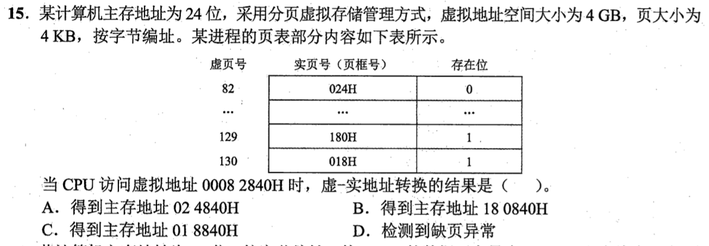

<details>
<summary>答案与解析</summary>

**答案：C。**

4KiB页使页内偏移为低12位。00082840H分成虚页号82H=130和偏移840H；虚页130存在位为1、页框018H，拼接得018840H。表中的82是十进制虚页号，不是本次的82H，不能误查其存在位0。

</details>

### 选择题3｜2024-17

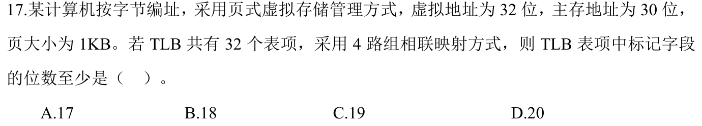

<details>
<summary>答案与解析</summary>

**答案：C。**

页大小1KiB，偏移10位，虚页号32−10=22位。TLB为32项、4路，共8组，组号占3位，Tag至少22−3=19位。TLB按虚页号查找，不能拿30位物理地址减字段；页内偏移也不存进Tag。

</details>

### 选择题4｜2024-18


<details>
<summary>答案与解析</summary>

**答案：B。**

MMU检测翻译和保护相关的TLB缺失、页面缺失、越权；Cache缺失由Cache访问与标记比较检测，不是MMU翻译的职责。

</details>

### 选择题5｜2026-19

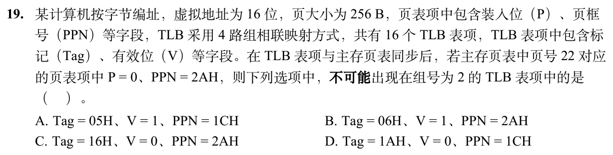

<details>
<summary>答案与解析</summary>

**答案：A。**

16项、4路即4组，虚页22=16H的组号为2，Tag=22÷4的整数商=05H。主存页表P=0意味着该页不在内存，同步后不能有Tag05H且V=1的有效TLB映射，故A不可能。B的Tag06H对应另一虚页；C、D的V=0，失效项中的旧Tag与PPN无需代表当前映射。

</details>

## 选择题组2｜0902 · 计算机网络

[信号与速率：带宽怎样限制可传数据](../src/0902.md) · 7道 · 首次。

### 选择题6｜2020-34

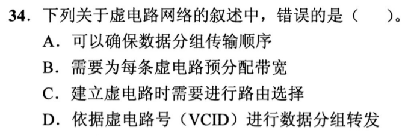

<details>
<summary>答案与解析</summary>

**答案：B。**

虚电路先建立路径，再按VCID沿这条路径转发，通常保证分组按序到达，A、C、D成立。但它仍是分组交换，不要求像电路交换那样为每条连接预先独占固定带宽，B把两者混淆了。支持带宽预留不等于每条虚电路都必须预留。

</details>

### 选择题7｜2021-34

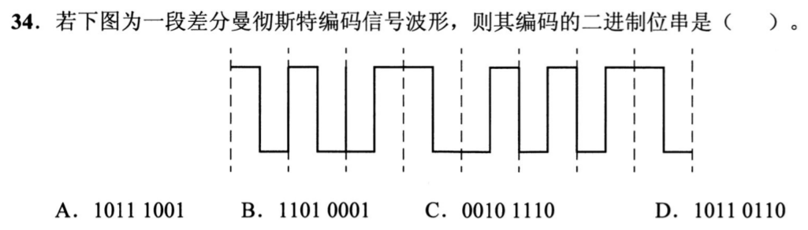

<details>
<summary>答案与解析</summary>

**答案：A。**

差分曼彻斯特看每个位起点是否跳变，而非中点方向。由图逐位判得10111001；每位中点的必有跳变只用于时钟同步。

</details>

### 选择题8｜2022-34

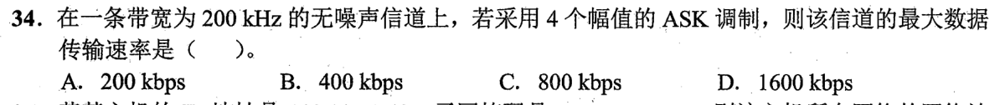

<details>
<summary>答案与解析</summary>

**答案：C。**

无噪声信道用奈奎斯特公式：最大码元速率2×200k=400kBaud；4个幅值可表示log₂4=2bit/码元，所以最大数据率800kb/s。不能把4个幅值直接乘4，也不需要套含信噪比的香农公式。

</details>

### 选择题9｜2023-34

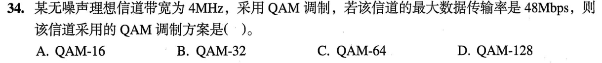

<details>
<summary>答案与解析</summary>

**答案：C。**

无噪声理想信道满足48=2×4×log₂M，得log₂M=6、M=64，即QAM-64。这里每码元承载6bit，64是可区分的调制状态总数，不是每秒码元数。

</details>

### 选择题10｜2024-34

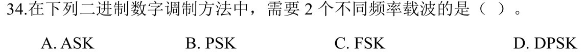

<details>
<summary>答案与解析</summary>

**答案：C。**

FSK用不同频率表示0和1；ASK改变幅度，PSK改变相位，DPSK用相邻码元相位差。

</details>

### 选择题11｜2025-34

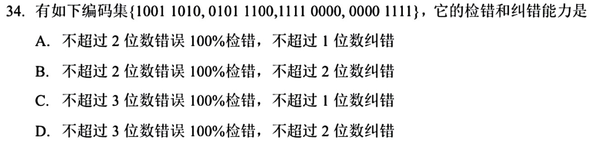

<details>
<summary>答案与解析</summary>

**答案：C。**

逐对异或：最小汉明距离为4。因此最多保证检出3位错，最多纠正1位错；两位错的纠错球会重叠，不能保证纠2位。

</details>

### 选择题12｜2026-34

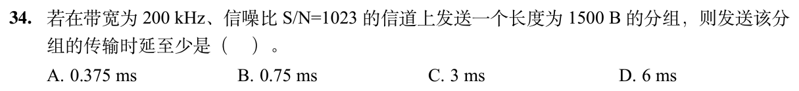

<details>
<summary>答案与解析</summary>

**答案：D。**

香农容量=200kHz×log₂(1+1023)=2Mb/s。1500B=12000bit，传输时延至少为12000÷2000000=0.006s=6ms。

先把字节乘8变成bit；再用分组比特数除以信道容量。这里求传输时延，不另外加传播时延。

</details>

## 解答题

### 大题1｜2026-42

[原题单 0916｜图的结构判定：从邻接信息恢复全局性质](../src/0916.md)

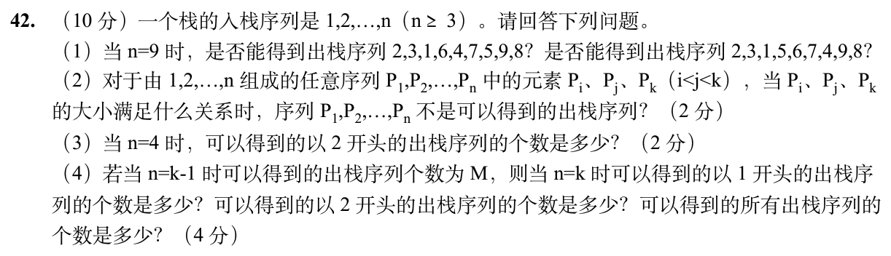

<details>
<summary>答案与解析</summary>

（1）第一列不行。输出6前需压入4、5、6，弹出6后5挡在4上方。第二列可行。依次输出2、3、1，再压入4和5输出5，之后输出6、7、4，再输出9、8。

（2）若 i<j<k 且 Pᵢ>Pₖ>Pⱼ，Pᵢ 出栈时后两者都已入栈，较大的 Pₖ 在较小的 Pⱼ 上面，却被要求更晚出栈，矛盾。反过来，按目标需要才继续压栈，如果已入栈的目标被一个更大的值挡住，一定是更早的某次输出更大的值迫使挡住者先入栈，三者构成同一禁形。

（3）首个输出2后，1已压在栈里，3、4尚未压入。剩余的有效序列为134、143、314、341、431，一共5种。

（4）首项为1时，删掉这次立即入栈出栈，余下 k−1 个数的方案是 M。首项为2时，删掉2的入栈出栈，余下 1、3、…、k 等价于 k−1 个数，且第一次操作本来就必须先压入1，因此也是 M。全部方案数为 Catalan 数 Cₖ。合法操作是 k 次入栈、k 次出栈且任一前缀出栈不多于入栈，故 Cₖ=binom(2k,k)/(k+1)=[(4k−2)/(k+1)]M。

</details>

## 一行记录

```text
实际用时__；未完成或未核对的题号__；今天最容易混淆的是__
```
