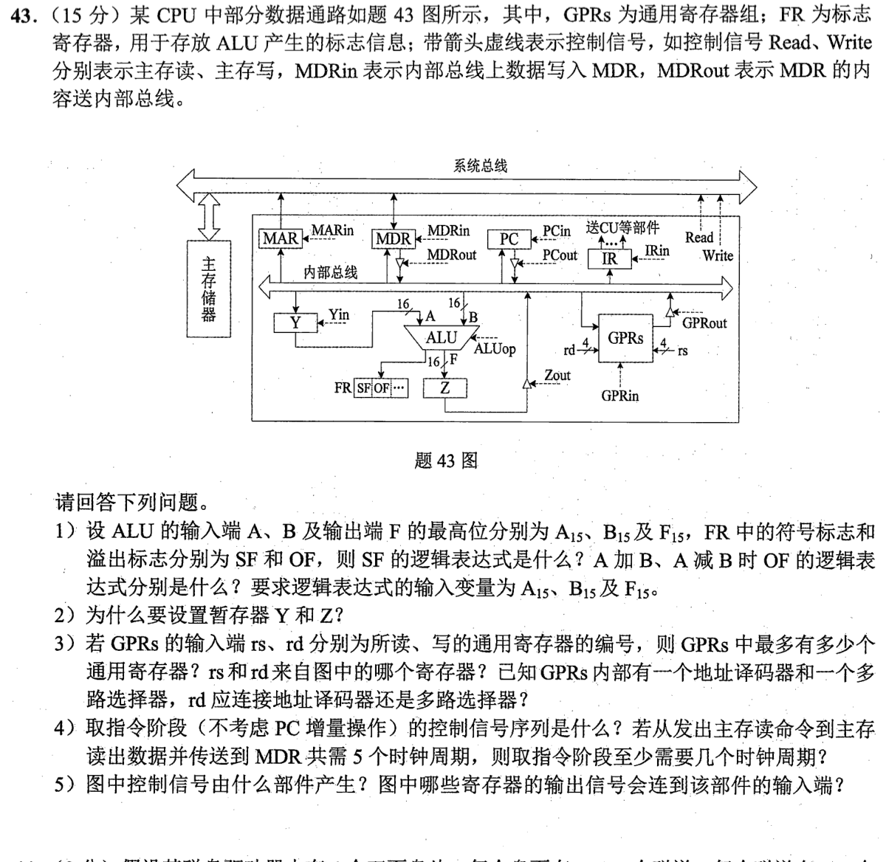
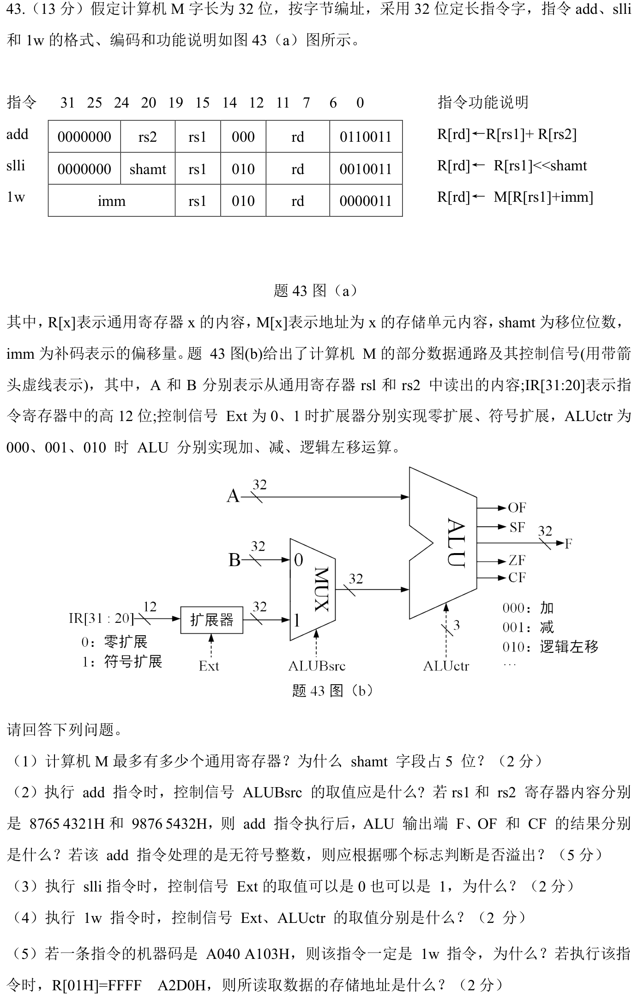

# Day 10｜地址翻译、子网与数据通路

[← Day 09](day09.md) · [总入口](README.md) · [Day 11 →](day11.md)

## 今天按这个顺序做

1. **回忆至多10分钟。** 闭卷重做昨天留的一处断点。
2. **选择题及补学至多50分钟。** 共6道指定题，先作答再展开。
   - [0816｜地址翻译：TLB、页表与Cache分工](modules/0816.md) · [原题单](../src/0816.md) · `2020-15`、`2024-18`
   - [0905｜网络地址：掩码、广播与NAT](modules/0905.md) · [原题单](../src/0905.md) · `2022-35`、`2023-38`、`2023-40`、`2025-36`
3. **两道大题及补学至多50分钟。** 单题先独立尝试5分钟，卡住才打开提示。两题都先动笔，剩余时间用于遮住解法重做。
4. **闭卷检查至多10分钟。** 到120分钟收笔，按 I／H／U 记真实状态。

## 大题1｜2022-43 · 单总线取指与标志位

[原题单 0920](../src/0920.md)

没有入口时的第一步

从图上沿箭头描一遍 PC → MAR、主存 → MDR、MDR → IR。分清内部总线与系统总线。

完整解法与必要补学

（1）SF=F₁₅。设 a、b、f 分别为 A₁₅、B₁₅、F₁₅。加法的 OF=(¬a∧¬b∧f)∨(a∧b∧¬f)，同号相加变号。减法的 OF=(¬a∧b∧f)∨(a∧¬b∧¬f)，异号相减且结果与被减数异号。

（2）内部总线一个时刻只允许一个部件驱动。先把第一个操作数送到Y，再用总线送第二个操作数到B。ALU结果先存Z，之后由Z占用总线送回目的寄存器，避免与第二操作数争用总线。

（3）rs 和 rd 都是4位，可编号16个通用寄存器。两字段来自IR。rd用于把写使能送给选中的寄存器，接地址译码器；rs 用于从多个寄存器中选择一个读出，接多路选择器。

（4）PCout、MARin 同拍，接下来 Read，主存经系统总线把字送到MDR。最后 MDRout、IRin 同拍。依题给出的读命令至MDR共5拍，取指至少 1+5+1=7 拍。

（5）控制信号由控制器CU产生。IR给出指令信息，FR给出ALU标志，后者供条件执行或控制时序使用。

重做后检查

从总线冲突反推Y、Z各隔开哪两段。若主存到MDR改为3拍，其余不变，总计5拍。

## 大题2｜2024-43 · 寄存器运算、移位与取数的控制信号

[原题单 0920](../src/0920.md)

没有入口时的第一步

先按功能说明决定ALU两个输入从哪来，再查图中MUX、扩展和运算编号。

完整解法与必要补学

（1）寄存器编号5位，最多32个。32位字合法左移量为0～31，故 shamt 为5位。

（2）add 取寄存器B，ALUBsrc=0。完整和为 1 1FDB 9753H，32位 F=1FDB 9753H。两个最高位均为1的补码相加得到正数，OF=1。最高位向外进位，CF=1。无符号加法用 CF 判断溢出。

（3）slli 的 IR[31:25] 全为0，扩展输入最高位为0。零扩展与符号扩展都补0，所以Ext任取。

（4）lw 的 imm 是补码位移，Ext=1。有效地址做加法，ALUctr=000，同时 ALUBsrc=1。

（5）A040 A103H 的低7位是0000011，且位14～12为010，与表内 lw 相符。rs1=01H，imm=A04H，符号扩展为 FFFF FA04H（−1532）。地址是 FFFF A2D0H−05FCH=FFFF 9CD4H。

重做后检查

把低7位与位14～12分别掩码提取。用 A04H−1000H=−05FCH 复核符号扩展。

## 最后闭卷检查

1. 虚拟地址和物理地址的哪一段保持一致？
2. 32位补码加法如何区分 CF 与 OF？
3. 为什么 lw 必须根据 imm 的最高位决定扩展方式？

检查答案

1. 页内偏移。2. CF看最高位向外的进位，OF看补码结果是否超出有符号范围。3. 负位移必须补1才保留原来的数值。

记录：实际用时__；选择 I__/H__/U__；大题1__、大题2__；下次先修的题号与卡点__。
