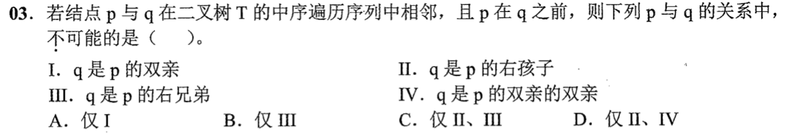
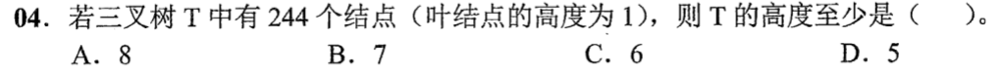
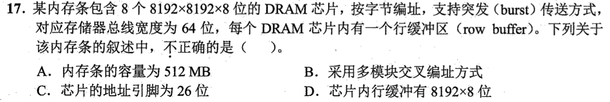
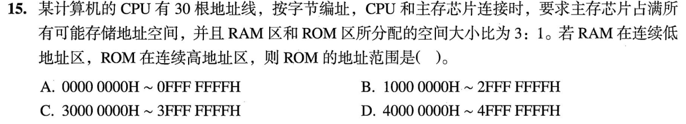
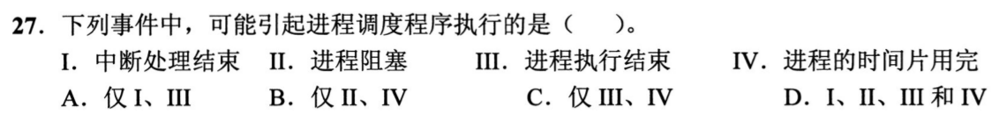
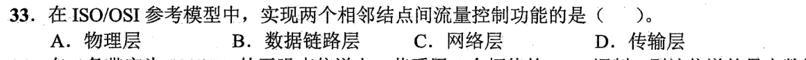
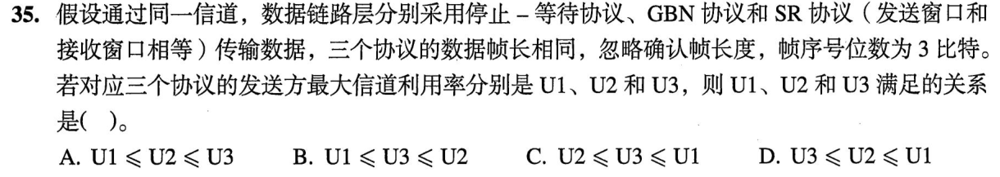

# Day 11｜选择题主线，全量覆盖

[← Day 10](day10.md) · [总入口](README.md) · [Day 12 →](day12.md)

**本日新题：选择题7道，大题1道。** 选择题先做；同一题号只在一天计为首次覆盖。原有讲解按需展开，不再额外执行旧版每日页的两道大题和复盘排期。

## 今天按这个顺序做

1. **0–75分钟｜选择题及核对。** 按下方七题逐题作答，写选项和一句依据；单题独立尝试至多2分钟，无入口先标U，再补概念。核对和遮住重做包含在本段，避免一道难题拖住整组。
2. **75–110分钟｜大题针对训练。** 这一道最多35分钟；保留整题及所有小问，先写能确定的部分。无入口5分钟后再看已有讲解；优先练会建模、公式、状态表或代码的第一步，不为誊写长解挤占选择题。
3. **110–120分钟｜闭卷回收。** 从今天错误的选择题中选一题遮住重做；若七题均独立正确，再回收大题的一处断点。记录实际完成题号，未完成保留U。

**120分钟为预算上限，不保证每个人都能做完。** 题量已排齐不等于已完成；到点停止，用下方记录保留未做和待核对项。

## 选择题｜本日必做7题

### 选择题1｜2022-03 · 数据结构

[原题单 0803｜树的形状：遍历序列如何约束结构](../src/0803.md)



<details>
<summary>作答后展开核对与补学入口</summary>

**仓内参考答案：B。** 来自[原有答案PDF抽取键](../data/reference/answers/2022.txt)，本轮未重新逐图复核。

本题已补入全量训练，**尚无Sprint40独立解析**。若无法解释选项依据，记U；不要把看见参考字母记为掌握。

</details>

### 选择题2｜2022-04 · 数据结构

[原题单 0803｜树的形状：遍历序列如何约束结构](../src/0803.md)



<details>
<summary>作答后展开核对与补学入口</summary>

[本题已有讲解](modules/0803.md)。按年份题号 2022-04 定位，只读本题；读后遮住重做。

</details>

### 选择题3｜2022-17 · 组成原理

[原题单 0814｜存储器拼装：容量、长宽与片选](../src/0814.md)



<details>
<summary>作答后展开核对与补学入口</summary>

**仓内参考答案：C。** 来自[原有答案PDF抽取键](../data/reference/answers/2022.txt)，本轮未重新逐图复核。

本题已补入全量训练，**尚无Sprint40独立解析**。若无法解释选项依据，记U；不要把看见参考字母记为掌握。

</details>

### 选择题4｜2023-15 · 组成原理

[原题单 0814｜存储器拼装：容量、长宽与片选](../src/0814.md)



<details>
<summary>作答后展开核对与补学入口</summary>

[本题已有讲解](modules/0814.md)。按年份题号 2023-15 定位，只读本题；读后遮住重做。

</details>

### 选择题5｜2021-27 · 操作系统

[原题单 0825｜执行生命线：进程、线程、状态与调度](../src/0825.md)



<details>
<summary>作答后展开核对与补学入口</summary>

**仓内参考答案：D。** 来自[原有答案PDF抽取键](../data/reference/answers/2021.txt)，本轮未重新逐图复核。

本题已补入全量训练，**尚无Sprint40独立解析**。若无法解释选项依据，记U；不要把看见参考字母记为掌握。

</details>

### 选择题6｜2022-33 · 计算机网络

[原题单 0903｜链路可靠性：帧、窗口与重传状态](../src/0903.md)



<details>
<summary>作答后展开核对与补学入口</summary>

[本题已有讲解](modules/0903.md)。按年份题号 2022-33 定位，只读本题；读后遮住重做。

</details>

### 选择题7｜2023-35 · 计算机网络

[原题单 0903｜链路可靠性：帧、窗口与重传状态](../src/0903.md)



<details>
<summary>作答后展开核对与补学入口</summary>

**仓内参考答案：B。** 来自[原有答案PDF抽取键](../data/reference/answers/2023.txt)，本轮未重新逐图复核。

本题已补入全量训练，**尚无Sprint40独立解析**。若无法解释选项依据，记U；不要把看见参考字母记为掌握。

</details>

## 大题｜整题作答，针对断点

### 大题1｜2025-42 · 数据结构

[原题单 0917｜图上的最优推进：最短路、生成树与关键路径](../src/0917.md)


**本轮补入的遗漏整题；独立解析待补。** 先写清输入、已知条件、所求结果，再逐小问作答；保留未完成小问，不能用已安排替代已核对。

## 今日记录

```text
实际用时__；选择题已作答__/7，已核对__/7，I__/H__/U__
大题实际完成的小问__；未做或未核对的题号__
下一次先回收的选择题__；错误发生在__
```
