# Day 11｜数据结构＋操作系统

[← Day 10](day10.md) · [总入口](README.md) · [Day 12 →](day12.md)

**选择题：13道，来自两份完整src题单；大题：1道。** 先做选择题，再展开题下解析。组内题目沿用src顺序；标为复做的组，已会的快速通过，重点处理上次错题。

**预计用时：65—100分钟。** 选择题及核对约35—55分钟，大题约25—35分钟，最后用5—10分钟重做今天最值得记住的一道错题。约两小时是配题目标，不是必须耗满或到点强停；计算卡住时先保留题号，先完成其余选择题。

## 选择题组1｜0805 · 数据结构

[有序树：从局部旋转到多路分裂](../src/0805.md) · 9道 · 首次。

### 选择题1｜2020-05

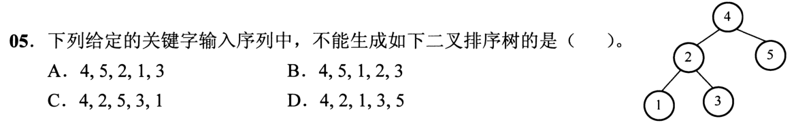

<details>
<summary>答案与解析</summary>

**答案：B。**

目标左子树根是2，故2必须在1、3之前插入。B先插1再插2，会把1变成4的左孩子，不能得到题图。

</details>

### 选择题2｜2020-10

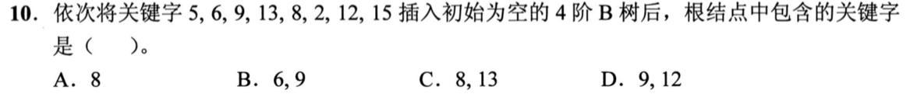

<details>
<summary>答案与解析</summary>

**答案：B。**

4阶B树每结点至多3个关键字，插入第4个时分裂。插到13时根分裂并提升6；再插8、2后，插12使右叶[8,9,12,13]分裂，提升9到根；最后15进入右叶。根最终为[6,9]。分裂时提升中间关键字，不能把新插入值直接当提升值。

</details>

### 选择题3｜2021-06

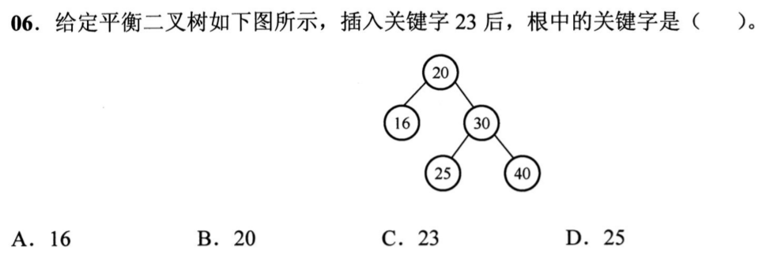

<details>
<summary>答案与解析</summary>

**答案：D。**

23按查找路径20→30→25插入25左侧。最低失衡结点是20，新增结点落在其右孩子30的左子树，属RL型：先右旋30，再左旋20，新根为25。23只是新叶结点；旋转提升的是中间结点25。

</details>

### 选择题4｜2021-09

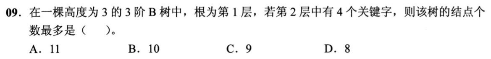

<details>
<summary>答案与解析</summary>

**答案：A。**

3阶B树每结点最多2个关键字。第二层总共4个关键字，要使结点数最多就分成3个结点，各含1、1、2个关键字，根相应含2个关键字。第二层孩子总数为(1+1)+(1+1)+(2+1)=7，第三层最多7个结点。总数1+3+7=11，别把第二层的关键字数4当成结点数4。

</details>

### 选择题5｜2022-08

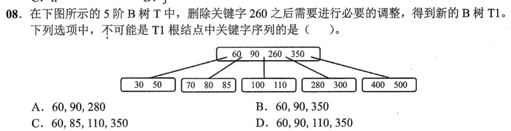

<details>
<summary>答案与解析</summary>

**答案：D。**

5阶B树非根结点至少2个关键字。若以左子树前驱110替换260，原叶[100,110]删后仅[100]，必须调整；左兄弟[70,80,85]可借，85上移、90下移，根变为[60,85,110,350]，对应C。D虽把260替换成110，却保留其余根关键字，漏了下溢调整。A、B可由后继替换后合并或直接合并得到。

</details>

### 选择题6｜2023-07

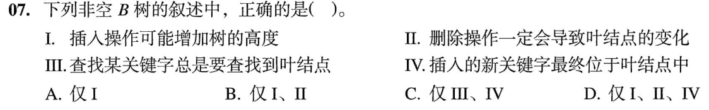

<details>
<summary>答案与解析</summary>

**答案：B。**

I插入根分裂可增高；II删除最终在叶层移除或调整关键字，会改变叶；III错，B树可在内部命中；IV错，插入关键字可分裂提升。选I、II。

</details>

### 选择题7｜2024-07

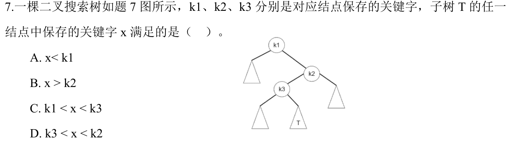

<details>
<summary>答案与解析</summary>

**答案：D。**

T在k3右侧且在k2左侧，所有x满足k3<x<k2，同时继承k1<x。D给出有效的更紧区间。

</details>

### 选择题8｜2025-08

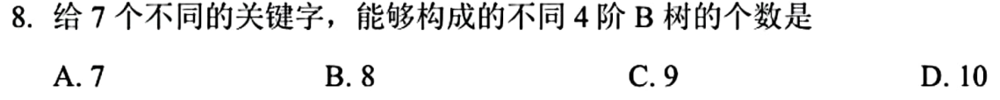

<details>
<summary>答案与解析</summary>

**答案：C。**

4阶B树每结点1～3个关键字，非根至少1个。高2层时：根含1个关键字，两叶共6个，只能3+3，1种；根含2个，三叶共5个，分配为3+1+1或2+2+1的排列，共6种；根含3个，四叶各1个，1种。高3层最少正好7个关键字，根、两子结点、四叶均各1个，另1种。总计1+6+1+1=9；关键字有序后，各结点内容由这些数量唯一确定。

</details>

### 选择题9｜2026-08

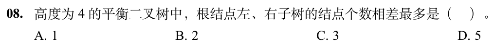

<details>
<summary>答案与解析</summary>

**答案：D。**

根的子树最大高度为3，AVL要求另一子树高度至少2。让高3的子树满，共7个结点；让高2的子树最稀疏，仅2个结点，差7−2=5。AVL限制的是高度差，不是结点数量差；高3的稀疏子树反而不能让数量差最大。

</details>

## 选择题组2｜0828 · 操作系统

[内存边界：分配、回收与保护](../src/0828.md) · 4道 · 首次。

### 选择题10｜2020-24

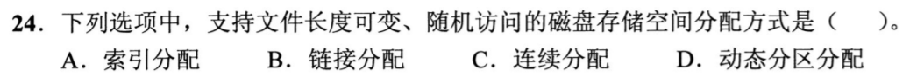

<details>
<summary>答案与解析</summary>

**答案：A。**

索引分配通过索引表直接定位任意逻辑块，文件增长时再分配数据块并增加索引，兼顾可变长度和随机访问。链接分配逐块追链，不便随机定位；连续分配随机访问快，但扩展受相邻空闲空间限制；动态分区分配是内存管理概念。

</details>

### 选择题11｜2023-30

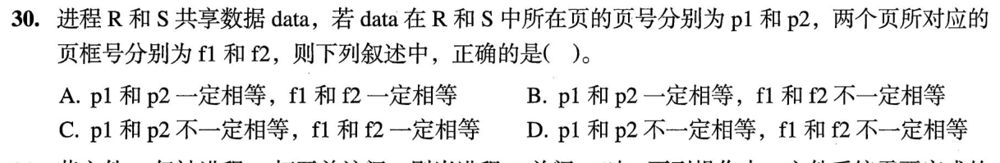

<details>
<summary>答案与解析</summary>

**答案：C。**

R与S可用不同虚拟页号p1、p2映射共享数据，但共享同一物理页框，f1=f2。别把各自地址空间的编号当成全局编号。

</details>

### 选择题12｜2024-27

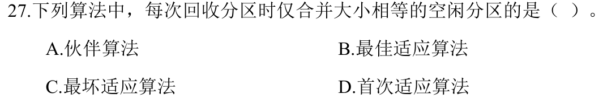

<details>
<summary>答案与解析</summary>

**答案：A。**

伙伴系统按2的幂拆分空间，回收时只合并大小相同、地址上互为伙伴的两块，合并后还可向上继续。其余适应算法按空闲区大小或地址选择空间，回收时相邻就可合并，不要求两区等大。等大只是伙伴合并的必要条件，不是任意等大块都能合并。

</details>

### 选择题13｜2026-28

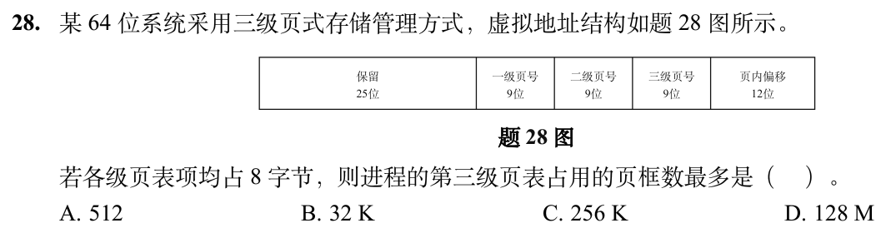

<details>
<summary>答案与解析</summary>

**答案：C。**

每页2¹²B，每个表项8B，一张第三级表含2⁹项，正好占1页框。前两级页号各9位，最多有2⁹×2⁹张第三级表，因此占2¹⁸=256K个页框。题目问的是所有第三级页表，不是单张表，也不是其映射的数据页总数。

</details>

## 解答题

### 大题1｜2025-42

[原题单 0917｜图上的最优推进：最短路、生成树与关键路径](../src/0917.md)

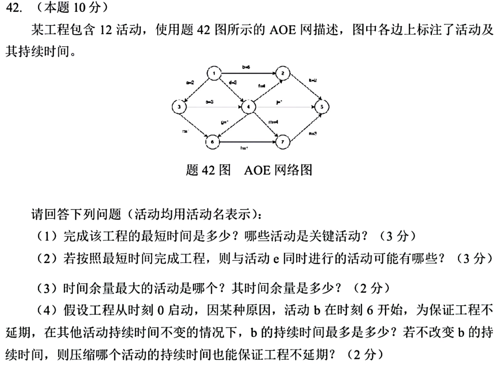

<details>
<summary>答案与解析</summary>

**解析待补。**

</details>

## 一行记录

```text
实际用时__；未完成或未核对的题号__；今天最容易混淆的是__
```
