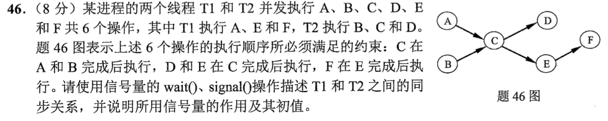
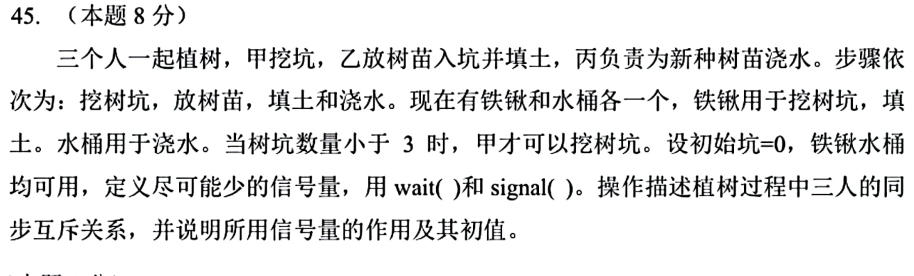

# Day 12｜有效地址、路由转发与信号量同步

[← Day 11](day11.md) · [总入口](README.md)

## 今天按这个顺序做

1. **回忆至多10分钟。** 闭卷重做昨天留的一处断点。
2. **选择题及补学至多50分钟。** 共3道指定题，先作答再展开。
   - [0817｜寻址：先找有效地址，再取数据](modules/0817.md) · [原题单](../src/0817.md) · `2023-17`
   - [0906｜控制转发：协议承载与NAT字段](modules/0906.md) · [原题单](../src/0906.md) · `2025-37`、`2026-38`
3. **两道大题及补学至多50分钟。** 单题先独立尝试5分钟，卡住才打开提示。两题都先动笔，剩余时间用于遮住解法重做。
4. **闭卷检查至多10分钟。** 到120分钟收笔，按 I／H／U 记真实状态。

## 大题1｜2022-46 · 两个线程的最小前趋同步

[原题单 0925](../src/0925.md)



<details>
<summary>没有入口时的第一步</summary>

把操作分到各自线程，圈出跨线程的箭头。线程内按程序顺序写即可。

</details>

<details>
<summary>完整解法与必要补学</summary>

设 aDone、cDone 初值均为0，分别表示 A 完成与 C 完成。

```text
T1: A; signal(aDone); wait(cDone); E; F
T2: B; wait(aDone); C; signal(cDone); D
```

T2 的 C 由程序顺序保证在 B 后，再由 wait(aDone) 保证在 A 后。T1 通过 wait(cDone) 在 C 后执行 E，其后才是 F。T2 内 D 写在 C 后。D 与 E 之间没有额外顺序要求。

</details>

<details>
<summary>重做后检查</summary>

让T2最早运行，走到C前必须等待。让T1最早运行，走到E前必须等待。两个次序均能继续。

</details>

## 大题2｜2025-45 · 植树的容量、工序和铁锹互斥

[原题单 0925](../src/0925.md)



<details>
<summary>没有入口时的第一步</summary>

画出两条数量线。一条数空闲坑配额，一条数已挖未填的坑。填完坑后才能返还配额。

</details>

<details>
<summary>完整解法与必要补学</summary>

四个信号量：slots=3 表示还能挖的坑配额，dug=0 表示可供乙种植的空坑，planted=0 表示可浇的树，spade=1 表示铁锹可用。

```text
甲重复：
    wait(slots)
    wait(spade)
    挖坑
    signal(spade)
    signal(dug)

乙重复：
    wait(dug)
    放树苗
    wait(spade)
    填土
    signal(spade)
    signal(slots)
    signal(planted)

丙重复：
    wait(planted)
    浇水
```

甲在动工前预扣坑配额，乙在填土后归还，因此未填满的坑最多三个。乙须等甲挖完，丙须等乙填完。铁锹只覆盖挖坑、填土，不持有铁锹等待坑位或空坑。水桶只有丙一个使用者，丙顺序执行即可。

</details>

<details>
<summary>重做后检查</summary>

若甲已经挖满3个坑，它等待slots时手上没有铁锹，乙仍能取得铁锹填土并归还配额。

</details>

## 最后闭卷检查

1. 间接寻址中，给出的地址指向最终操作数还是有效地址？
2. 目的地址同时匹配两条路由，先比较什么？
3. 信号量初值为0与1在植树题中各控制什么？

<details>
<summary>检查答案</summary>

1. 它指向保存有效地址的位置，继续取数得到操作数。2. 先看前缀长度，最长匹配优先。3. 0用于等待工序产出，1用于铁锹互斥。

</details>

记录：实际用时__；选择 I__/H__/U__；大题1__、大题2__；下次先修的题号与卡点__。
