# Day 12｜组成原理＋计算机网络

[← Day 11](day11.md) · [总入口](README.md) · [Day 13 →](day13.md)

**选择题：10道，来自两份完整src题单；大题：2道。** 先做选择题，再展开题下解析。组内题目沿用src顺序；标为复做的组，已会的快速通过，重点处理上次错题。

**预计用时：85—135分钟。** 选择题及核对约40—70分钟，大题约40—55分钟，最后用5—10分钟重做今天最值得记住的一道错题。约两小时是配题目标，不是必须耗满或到点强停；计算卡住时先保留题号，先完成其余选择题。

## 选择题组1｜0817 · 组成原理

[指令取数：格式、寻址与有效地址](../src/0817.md) · 4道 · 首次。

### 选择题1｜2020-16

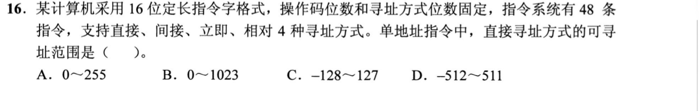

<details>
<summary>答案与解析</summary>

**答案：A。**

- **核心判据**：
  定长指令字各字段的刚性划分公式：
  $$\text{指令字长} = \text{操作码字段 OP} + \text{寻址方式特征位 Mode} + \text{形式地址码 A}$$
  - **直接寻址（Direct Addressing）**的有效地址等于形式地址码本身（$EA = A$）。在计算机底层，主存物理地址恒为**非负无符号整数**，因此 $k$ 位形式地址码在直接寻址下的寻址范围是无符号的 $[0, 2^k - 1]$。

- **正选推导**：
  1. 计算操作码位数：48 条指令 $\implies$ 操作码位数 $\ge \lceil \log_2 48 \rceil = 6$ 位；
  2. 计算寻址方式位数：4 种寻址方式 $\implies$ 寻址特征位 $\ge \lceil \log_2 4 \rceil = 2$ 位；
  3. 形式地址码字段位数：$16 - 6 - 2 = 8$ 位；
  4. 直接寻址将这 8 位形式地址直接作为无符号的主存单元地址，可寻址范围为：
     $$0 \sim 2^8 - 1 = \mathbf{0 \sim 255}$$
     选 A。

- **干扰项击穿**：
  - **C（-128～127）**：混淆了直接寻址与**相对寻址（Relative Addressing）**。相对寻址中地址码作为有符号补码位移量加到 PC 上，才会有负数偏移；直接寻址是主存物理绝对地址，绝无负数地址。
  - **B、D（0～1023 / -512～511）**：漏算了 2 位寻址方式特征位（误以为地址码占 $16 - 6 = 10$ 位）。

</details>

### 选择题2｜2022-19

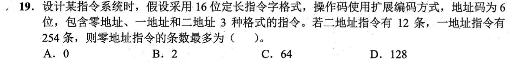

<details>
<summary>答案与解析</summary>

**答案：D。**

- **核心判据**：
  操作码扩展编码（Huffman 思想扩展码）的核心物理原则：
  - 高级（地址数多）指令的操作码作为低级（地址数少）指令的操作码**前缀**；
  - 某级指令未用满的操作码状态，可以通过吸收随后一个 6 位地址码字段，裂变扩展出 $2^6 = 64$ 倍的新状态。

- **正选推导**：
  1. **二地址指令分析**：
     - 指令字长 16 位，两个地址码各占 6 位（共 12 位），留给操作码的位数为 $16 - 12 = 4$ 位。
     - 4 位操作码最多有 $2^4 = 16$ 种编码状态；
     - 二地址指令占用了 12 条，留给一地址指令扩展的前缀数为：
       $$16 - 12 = 4\text{ 个前缀}$$
  2. **一地址指令分析**：
     - 一地址指令吸收一个 6 位地址字段作为操作码扩展，总操作码位数为 $4 + 6 = 10$ 位；
     - 4 个可用前缀能够派生出的一地址指令最大容量为：
       $$4 \times 2^6 = 4 \times 64 = 256\text{ 种状态}$$
     - 一地址指令实际占用了 254 条，留给零地址指令扩展的前缀数为：
       $$256 - 254 = 2\text{ 个前缀}$$
  3. **零地址指令分析**：
     - 零地址指令再吸收最后一个 6 位地址字段作为操作码，总操作码占满 16 位；
     - 2 个剩余前缀可裂变出的零地址指令条数最多为：
       $$2 \times 2^6 = 2 \times 64 = \mathbf{128\text{ 条}}$$
     - 选 D。

- **干扰项击穿**：
  - **B（2 条）**：典型致命误解！误以为一地址剩 2 个前缀，零地址就只能有 2 条。忽略了零地址指令会彻底吞并第二个 6 位地址码，每个前缀都能衍生出 64 条零地址指令！
  - **C（64 条）**：只将 1 个前缀进行了扩展，遗漏了剩余的另一个前缀。

</details>

### 选择题3｜2023-17

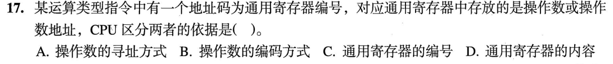

<details>
<summary>答案与解析</summary>

**答案：A。**

- **核心判据**：
  冯·诺依曼计算机的硬件控制逻辑本质：
  - 寄存器是通用的位存储单元，内部存放的 0/1 位串没有任何硬件标签或自解释属性，无法从内容本身判定其属于数据还是地址（排除 D）；
  - 通用寄存器编号（如 R0~R15）仅供译码器进行多路物理选通，与存放内容的逻辑语义无关（排除 C）；
  - **CPU 解释寄存器内容的唯一依据是指令中规定的寻址方式（Addressing Mode）**：
    - **寄存器直接寻址**：指令规定寄存器内容直接作为操作数，送入 ALU 进行运算；
    - **寄存器间接寻址**：指令规定寄存器内容作为内存地址，送入 MAR 访问主存读取操作数。

- **正选推导**：
  CPU 区分通用寄存器中存放的是操作数还是操作数地址，依据的是**操作数的寻址方式**。选 A。

</details>

### 选择题4｜2026-17

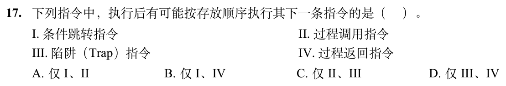

<details>
<summary>答案与解析</summary>

**答案：B。**

- **核心判据**：
  控制流转移指令执行后程序计数器（PC）的更新机制：
  - “按存放顺序执行其下一条指令”即执行时硬件满足：$\text{PC} \leftarrow \text{PC} + \text{指令长度}$。
  - 题干考查的是“**有可能**”成立的指令类型。

- **正选推导**：
  - **I 条件跳转指令（Branch）**：当测试条件不满足时，不发生跳转，硬件直接执行 $\text{PC} \leftarrow \text{PC} + 4$，**顺理成章执行下一条指令**（I 成立）。
  - **II 过程调用指令（Call）**：其无条件语义是跳转至子程序入口，并压栈保存返回地址，必定离开当前代码段，绝不会顺序执行下一条。
  - **III 陷阱指令（Trap）**：属于软中断，强制修改 PC 跳转至操作系统内核的中断向量入口，绝不可能就地顺序执行下一条。
  - **IV 过程返回指令（Return）**：执行 $\text{PC} \leftarrow \text{Pop()}$。**如果之前保存的返回地址碰巧就是当前返回指令的下一条物理存放地址**（例如递归、动态计算返回点、或者子程序在特定调用流下返回），硬件加载该地址后完全**有可能**执行下一条指令。由于设问限定“有可能”，IV 成立。
  故可能按存放顺序执行下一条指令的是 I、IV，选 B。

</details>

## 选择题组2｜0903 · 计算机网络

[链路可靠性：帧、窗口与重传状态](../src/0903.md) · 6道 · 首次。

### 选择题5｜2020-36

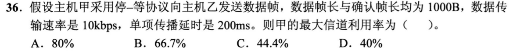

<details>
<summary>答案与解析</summary>

**答案：D。**

- **核心判据**：
  停-等协议（Stop-and-Wait）的信道利用率定义式：
  $$U = \frac{t_{\text{data}}}{t_{\text{cycle}}} = \frac{t_{\text{data}}}{t_{\text{data}} + \tau + t_{\text{ack}} + \tau} = \frac{t_{\text{data}}}{t_{\text{data}} + t_{\text{ack}} + 2\tau}$$
  （注意：本题中**确认帧长达 1000B**，与数据帧完全等长，绝不能当作零时延忽略！）。

- **正选推导**：
  1. 计算数据帧发送时延：
     $$t_{\text{data}} = \frac{1000\text{ B} \times 8\text{ bit/B}}{10\text{ kbps}} = \frac{8000\text{ bit}}{10000\text{ bit/s}} = 0.8\text{ s}$$
  2. 计算确认帧 ACK 发送时延：
     $$t_{\text{ack}} = \frac{1000\text{ B} \times 8\text{ bit/B}}{10\text{ kbps}} = 0.8\text{ s}$$
  3. 往返传播时延：
     $$RTT = 2\tau = 2 \times 200\text{ ms} = 0.4\text{ s}$$
  4. 完整停等周期总耗时：
     $$t_{\text{cycle}} = 0.8\text{ s} (\text{数据发送}) + 0.2\text{ s} (\text{前向传播}) + 0.8\text{ s} (\text{ACK发送}) + 0.2\text{ s} (\text{反向传播}) = \mathbf{2.0\text{ s}}$$
  5. 最大信道利用率：
     $$U = \frac{t_{\text{data}}}{t_{\text{cycle}}} = \frac{0.8\text{ s}}{2.0\text{ s}} = \mathbf{40\%}$$
     选 D。

- **干扰项击穿**：
  - **B（66.7%）**：机械套用课本通常“忽略 ACK 发送时延”的特例，算成 $\frac{0.8}{0.8 + 0.4} = \frac{0.8}{1.2} \approx 66.7\%$，掉入题干特意设定的“确认帧长 1000B”的陷阱中。
  - **C（44.4%）**：误将单向传播延时 0.2s 当成 RTT 进行除算。

</details>

### 选择题6｜2022-33

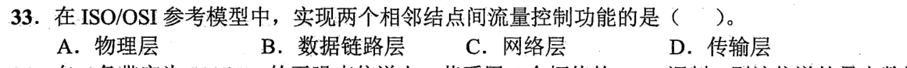

<details>
<summary>答案与解析</summary>

**答案：B。**

- **核心判据**：
  分层体系结构的流量控制范围划分：
  - **数据链路层**：负责**相邻结点之间（Node-to-Node / 点到点直连链路）**的流量控制，防止发送方淹没接收方的物理帧缓冲区；
  - **传输层**：负责**端到端进程之间（End-to-End）**的流量控制（如 TCP 滑动窗口），跨越整个中间互联网络；
  - **物理层**：仅传输透明比特流，无任何缓冲协商机制与流量控制功能。

- **正选推导**：
  题干明确限定在“两个相邻结点间”实现流量控制，属于数据链路层的标准定义职能。选 B。

</details>

### 选择题7｜2023-35

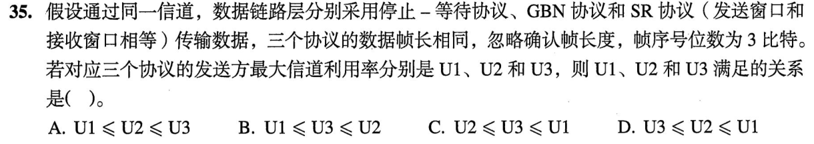

<details>
<summary>答案与解析</summary>

**答案：B。**

- **核心判据**：
  在相同帧序号位数 $n=3$ 下（序号空间 $N = 2^3 = 8$），各协议所允许的**最大发送窗口 $W_T$ 物理极限**：
  - **停止-等待协议**：发送窗口 $W_1 = 1$；
  - **GBN 协议（后退 N 帧）**：接收窗口 $W_R = 1$。为避免新旧帧序号重叠混淆，最大发送窗口为：
    $$W_2 = 2^n - 1 = 8 - 1 = \mathbf{7}$$
  - **SR 协议（选择重传）**：题设发送窗口等于接收窗口（$W_T = W_R$）。为保证接收窗口与旧序号不冲突，必须满足 $W_T + W_R \le 2^n \implies 2W_3 \le 8 \implies W_3 \le \mathbf{4}$，最大发送窗口为 **4**。

- **正选推导**：
  在信道条件相同且忽略 ACK 时，发送方的最大信道利用率直接正比于其允许连续发送的最大数据帧数（即发送窗口容量 $W_T$），最大饱和上限为 100%。
  由于三者的最大发送窗口严格满足：
  $$W_1 (1) \le W_3 (4) \le W_2 (7)$$
  故其最大信道利用率必满足：
  $$U_1 \le U_3 \le U_2$$
  选 B。

- **干扰项击穿**：
  - **A（$U_1 \le U_2 \le U_3$）**：经验主义错觉，误以为“SR 协议技术更复杂，所以信道利用率必然高于 GBN”。由于 SR 接收端需要乱序缓存，为了防重叠窗口被腰斩为 4；而 GBN 发送窗口可充分利用到 7，因此在无差错饱和大带宽时 GBN 连续发帧能力强于 SR。

</details>

### 选择题8｜2023-37

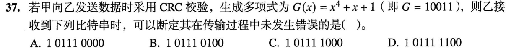

<details>
<summary>答案与解析</summary>

**答案：D。**

- **核心判据**：
  CRC 循环冗余校验判错物理规则：
  接收端收到包含校验位的完整比特串后，使用约定好的生成多项式 $G(x)$ 对应的二进制除数进行**模 2 除法（按位异或，不进位不借位）**。**当且仅当模 2 除法的余数为全 0 时，判定未发生传输错误**。

- **正选推导**：
  除数 $G = 10011$。
  观察四个选项，前 5 位全部为 `1 0111`，仅后 4 位不同。
  1. 前 5 位进行第一步模 2 除法：
     $$10111 \oplus 10011 = 00100$$
  2. 移入后续比特，当前有效被除数高位为 `100`，追加各选项末尾 4 位构成 7 位序列 `100xxxx`：
     - 若要整除（余数为 0000），则 `100xxxx` 必须与除数 `10011` 异或后全为 0：
       $$100xxxx \oplus 1001100 = 0000 \implies xxxx = \mathbf{1100}$$
  3. 检验各选项末尾 4 位：
     - A 项末尾为 0000；
     - B 项末尾为 0100；
     - C 项末尾为 1000；
     - D 项末尾为 **1100**。
  故 D 项模 2 除法余数恰好为 0000，断定未发生错误。选 D。

</details>

### 选择题9｜2024-37

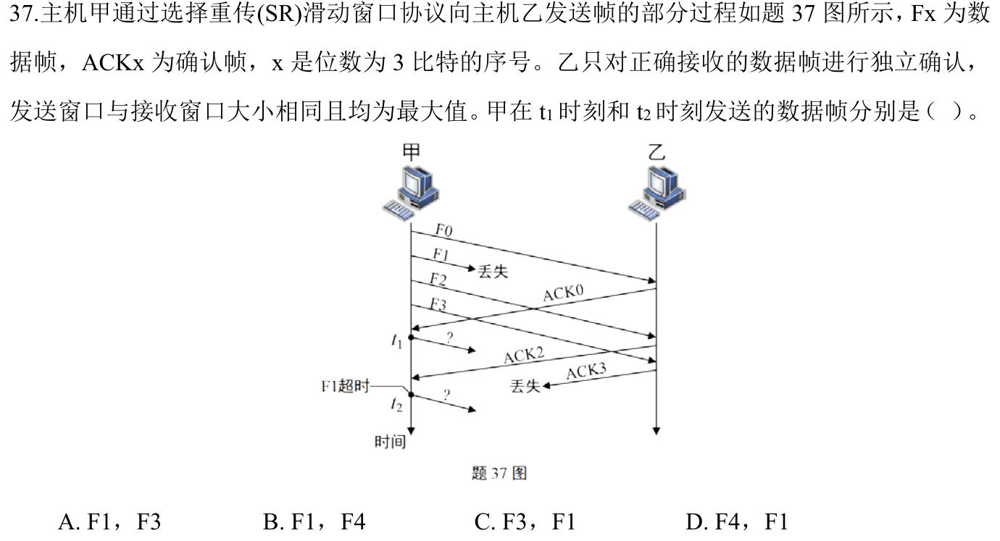

<details>
<summary>答案与解析</summary>

**答案：D。**

- **核心判据**：
  选择重传（SR）协议的窗口滑动与重传机制：
  1. 3 比特序号，最大发送窗口 $W_T = 2^{3-1} = 4$。初始窗口为 $[0, 1, 2, 3]$。
  2. **收到窗口左沿确认**：当收到当前发送窗口最左端序号的 ACK 时，窗口向前滑动，露出新的可用序号。
  3. **独立确认与单帧重传**：SR 协议的 ACK 仅代表单帧接收成功，不具备累积确认语义。某帧定时器超时后，**仅重传该单帧**，绝不连带重发已确认帧。

- **正选推导**：
  1. **分析 $t_1$ 时刻**：
     - 初始甲发送了 F0, F1, F2, F3，窗口占满；
     - 在 $t_1$ 时刻，甲收到了 $\text{ACK}_0$。因为 F0 恰好是窗口左沿，收到确认后**窗口向前滑动 1 格，新窗口变为 $[1, 2, 3, 4]$**；
     - 序号 4 变为可用，甲立即向信道发送新数据帧 **F4**。
  2. **分析 $t_2$ 时刻**：
     - 随后甲虽然收到了 $\text{ACK}_2$，但由于 F1 途中丢失，乙从未发出 $\text{ACK}_1$；
     - F1 的超时定时器到期，触发超时重传；
     - SR 协议精准单帧重传，甲在 $t_2$ 时刻只重传丢失的 **F1**。
  综上，甲在 $t_1$ 和 $t_2$ 发送的数据帧分别为 **F4、F1**。选 D。

- **干扰项击穿**：
  - **B（F1, F4）**：颠倒了时间先后顺序。
  - **A、C（F3）**：F3 早在初始窗口中已发送，无需在此重复发出。

</details>

### 选择题10｜2026-35

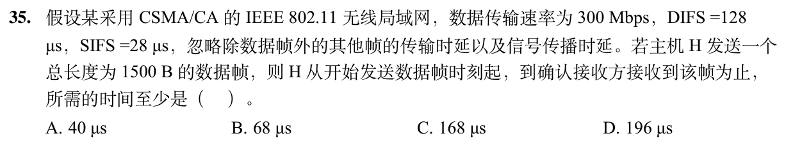

<details>
<summary>答案与解析</summary>

**答案：B。**

- **核心判据**：
  802.11 CSMA/CA 协议成功通信的严格时间轴划分：
  $$\text{总耗时} = t_{\text{frame}} (\text{数据帧发送时延}) + \text{SIFS} + t_{\text{ack}} (\text{确认帧发送}) + \tau (\text{传播时延})$$
  - **审题核心避坑点**：题干明确指出“**从开始发送数据帧时刻起**，到确认接收方接收到该帧为止”！
    因此，发送前争用信道的 **DIFS（128 $\mu$s）与退避退让时间早已执行完毕，绝对不能重复计入！**

- **正选推导**：
  1. 数据帧发送时延：
     $$t_{\text{frame}} = \frac{1500\text{ B} \times 8\text{ bit/B}}{300\text{ Mbps}} = \frac{12000\text{ bit}}{300 \times 10^6\text{ bit/s}} = 40 \times 10^{-6}\text{ s} = 40\ \mu\text{s}$$
  2. 接收方在完整接收数据帧后，必须等待一个短帧间间隔 SIFS 才能返回 ACK：
     $$\text{SIFS} = 28\ \mu\text{s}$$
  3. 题干明确“忽略除数据帧外的其他帧传输时延及信号传播时延”，因此从发送时刻起到确认收到 ACK 的时间至少为：
     $$t = 40\ \mu\text{s} + 28\ \mu\text{s} = \mathbf{68\ \mu s}$$
     选 B。

- **干扰项击穿**：
  - **D（196 $\mu$s）**：机械套用全流程公式，硬生生把发送前已经过期的 $\text{DIFS} = 128\ \mu\text{s}$ 加了进去（$40 + 28 + 128 = 196$）。
  - **A（40 $\mu$s）**：仅计算了数据帧自身发送完毕的耗时，忽略了必须收到 ACK 才算“确认接收方接收到该帧”。

</details>

## 解答题

### 大题1｜2020-43

[原题单 0920｜指令落到数据通路：寄存器、部件与控制信号协同](../src/0920.md)

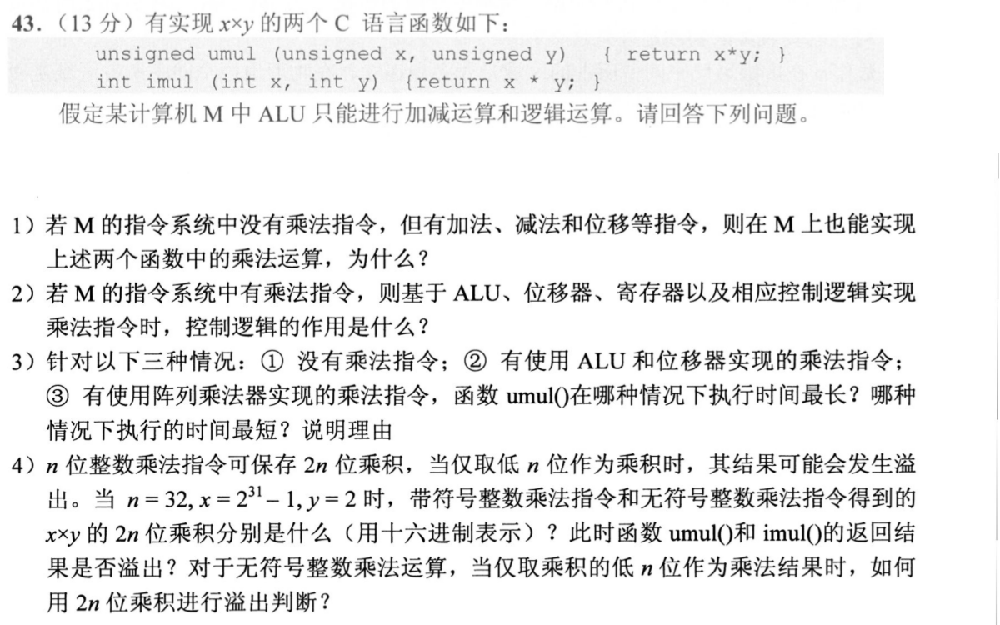

<details>
<summary>答案与解析</summary>

**（1）没有乘法指令时实现乘法的物理机理**：
- 能实现。
- **原因**：二进制乘法在数学和硬件上可以完全分解为**循环迭代的“移位”与“累加”操作**。无符号数乘法通过测试乘数当前位决定是否加上被乘数并右移；有符号数可先通过逻辑运算与减法提取符号并转换为绝对值相乘，最后依据符号异或结果修正补码（或采用 Booth 乘法算法由加、减、算术右移组合实现）。因此，只需加法、减法和移位指令即可用纯软件程序完整实现乘法。

**（2）控制逻辑在硬件乘法实现中的作用**：
- 控制逻辑充当乘法执行状态机的大脑，负责全流程时序协同：
  1. 根据乘数寄存器当前最低位（或 Booth 编码位）的状态，向 ALU 发出“加/减/保持”的控制命令；
  2. 控制暂存器、累加器与乘数寄存器的同步移位；
  3. 控制循环计数器递减并在计数满 $n$ 步后发出结束信号，通知 CPU 乘法完成。

**（3）三种情况执行时间对比及理由**：
- **执行时间最长：①；执行时间最短：③**。
- **理由**：
  - **①没有乘法指令（软件模拟）最长**：每次循环都需要经过指令取指、译码、执行、分支跳转等多条机器指令开销，完成一次乘法需消耗数百个时钟周期；
  - **②复用 ALU 和移位器的乘法指令居中**：在硬件单条指令内部由微操作状态机自动驱动，省去了大量指令级的取指与分支开销，但仍需按时钟周期进行 $n$ 步串行迭代（约耗费数十个周期）；
  - **③阵列乘法器最短**：采用全硬件组合逻辑树（如 Wallace 树结合并行加法器），所有部分积并行生成并快速归约，可以在单个或极少数时钟周期内完成。

**（4）乘积计算与溢出判定**：
- **1. $2n$ 位乘积计算**：
  - $n = 32$，操作数为 $x = 2^{31} - 1 = \text{7FFFFFFFH}$（符号位为 0，有符号与无符号真值均为正数），$y = 2 = \text{00000002H}$。
  - 数学真值乘积：
    $$x \times y = 2 \times (2^{31} - 1) = 2^{32} - 2$$
  - $2n = 64$ 位无符号乘积：
    $$2^{32} - 2 = 1\ 0000\ 0000\text{H} - 2 = \mathbf{00000000\ FFFFFFFEH}$$
  - $2n = 64$ 位带符号乘积：因两正数相乘结果为正数，符号扩展高 32 位全为 0，十六进制表示同为 **`00000000 FFFFFFFEH`**。
- **2. 溢出判断**：
  - 函数仅返回低 32 位：截断结果均为 **`FFFFFFFEH`**。
  - **`umul()` 无符号乘法**：截断低 32 位 `FFFFFFFEH` 的无符号真值正是 $2^{32} - 2$，精确等于数学乘积，**不溢出**。
  - **`imul()` 带符号乘法**：截断低 32 位 `FFFFFFFEH` 的最高位为 1，在有符号数补码规则下被解释为负数 **$-2$**，与数学正数乘积不符，**发生溢出**。
- **3. 无符号乘法溢出硬件判据**：
  当且仅当 **$2n$ 位乘积的高 $n$ 位不全为 0 时**，截断低 $n$ 位发生溢出。

</details>

### 大题2｜2022-43

[原题单 0920｜指令落到数据通路：寄存器、部件与控制信号协同](../src/0920.md)

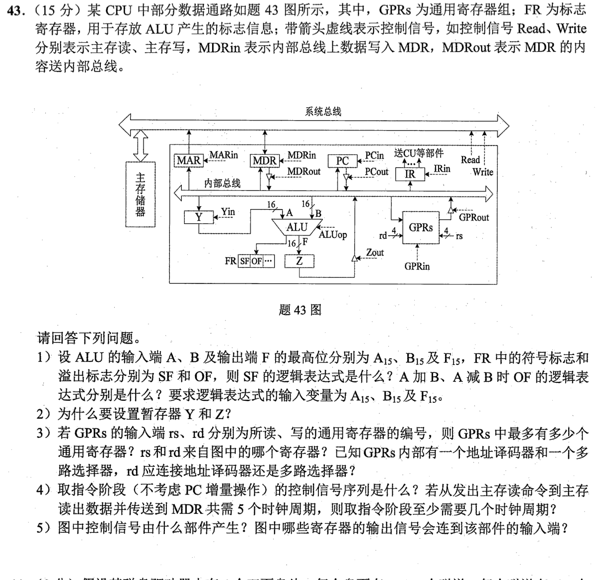

<details>
<summary>答案与解析</summary>

**（1）SF 和 OF 的逻辑表达式**：
- **符号标志 SF**：直接反映运算结果的最高位符号位：
  $$\mathbf{SF = F_{15}}$$
- **加法 $A + B$ 的溢出标志 OF**：只有同号相加结果变号时才溢出：
  $$\mathbf{OF = (\overline{A_{15}} \cdot \overline{B_{15}} \cdot F_{15}) + (A_{15} \cdot B_{15} \cdot \overline{F_{15}})}$$
- **减法 $A - B$ 的溢出标志 OF**：只有正数减负数得负数、或负数减正数得正数时溢出：
  $$\mathbf{OF = (\overline{A_{15}} \cdot B_{15} \cdot F_{15}) + (A_{15} \cdot \overline{B_{15}} \cdot \overline{F_{15}})}$$

**（2）设置暂存器 Y 和 Z 的物理原因**：
- 该 CPU 采用**单内部总线结构**，任何一个时钟周期内内部总线只能传输一个有效数据。
  - **设置暂存器 Y**：ALU 是双输入组合逻辑部件，执行运算时两输入端必须同时稳定提供数据。设置 Y 是为了在第一拍先将操作数 A 从总线锁存至 Y 中，从而释放总线供第二拍传输操作数 B，使两数能同时输入 ALU。
  - **设置暂存器 Z**：ALU 的输出不能直接连回正在传输输入数据的内部总线，否则会引起严重的输出反馈自激震荡与总线竞争冲突。设置 Z 用于在时钟边缘锁存运算结果，之后再在独立节拍驱动送回目的寄存器。

**（3）通用寄存器组 GPRs 的连接机制**：
- **通用寄存器个数**：地址输入端为 4 位，最多可独立寻址 $2^4 = \mathbf{16}$ 个通用寄存器。
- **来源**：$rs$ 和 $rd$ 来自**指令寄存器 IR**（指令中的源操作数和目的操作数寄存器编号字段）。
- **连接判定**：$rd$ 用于指定写入的目标寄存器，必须将写入脉冲唯一定向选通到目标寄存器，故 $rd$ 应连接**地址译码器**（而读出的 $rs$ 端连接多路选择器）。

**（4）取指阶段控制信号序列与周期数**：
- **控制信号序列**：
  1. 拍 1：$\text{PC}_{\text{out}}, \text{MAR}_{\text{in}}$（将当前指令地址送往 MAR）
  2. 拍 2～6：发出主存读命令 $\text{Read}$，等待主存数据返回并载入 MDR（共耗时 5 个时钟周期）
  3. 拍 7：$\text{MDR}_{\text{out}}, \text{IR}_{\text{in}}$（将指令送入 IR 译码）
- **总时钟周期数**：
  取指阶段至少需要：
  $$1 (\text{送地址}) + 5 (\text{主存读}) + 1 (\text{送IR}) = \mathbf{7\text{ 个时钟周期}}$$

**（5）控制信号产生部件及输入连接**：
- 图中所有控制信号均由**控制单元（CU / 控制器）**产生。
- 连接到 CU 输入端的寄存器有：
  1. **指令寄存器 IR**：向 CU 提供当前指令的操作码字段，用于微指令译码；
  2. **标志寄存器 FR**：向 CU 提供 ALU 状态标志（如 SF、OF、ZF、CF），用于条件转移与分支判断。

</details>

## 一行记录

```text
实际用时__；未完成或未核对的题号__；今天最容易混淆的是__
```
