# Day 13｜数据结构＋操作系统

[← Day 12](day12.md) · [总入口](README.md) · [Day 14 →](day14.md)

**选择题：19道，来自两份完整src题单；大题：1道。** 先做选择题，再展开题下解析。组内题目沿用src顺序；标为复做的组，已会的快速通过，重点处理上次错题。

**预计用时：100—160分钟。** 选择题及核对约70—115分钟，大题约25—35分钟，最后用5—10分钟重做今天最值得记住的一道错题。约两小时是配题目标，不是必须耗满或到点强停；计算卡住时先保留题号，先完成其余选择题。

## 选择题组1｜0806 · 数据结构

[图的骨架：表示、遍历与连通](../src/0806.md) · 6道 · 首次。

### 选择题1｜2020-06

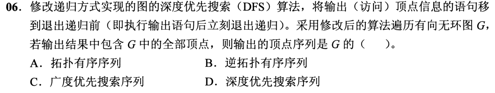

<details>
<summary>答案与解析</summary>

**答案：B。**

把输出移到递归返回前，就按DFS完成时间从早到晚输出。对DAG的每条边u→v，v会在u之前完成并输出，因此输出顺序为逆拓扑序。普通DFS序列是在首次发现时输出；拓扑序需要把这里的结果反转。

</details>

### 选择题2｜2022-06

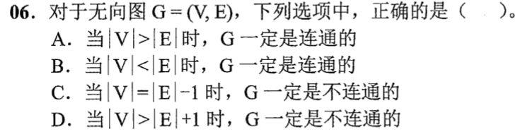

<details>
<summary>答案与解析</summary>

**答案：D。**

连通图有生成树，至少有 |V|−1 条边。边数达到下界仍可能不连通，例如三角形加一个孤点。

</details>

### 选择题3｜2023-06


<details>
<summary>答案与解析</summary>

**答案：B。**

各边权均为1，路径权重就是边数。BFS按距离一层层扩展，第一次到达顶点就得到最少边数路径。Prim、Kruskal最小化生成树所有边的总权，不保证树根到每个顶点的路最短；所有边等权时，任意生成树都是MST，更不能保证路径。

</details>

### 选择题4｜2024-04

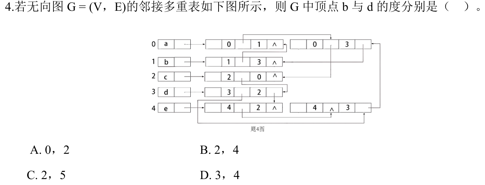

<details>
<summary>答案与解析</summary>

**答案：B。**

b 关联 (0,1)、(1,3) 两条边；d 关联 (0,3)、(1,3)、(3,2)、(4,3) 四条边。追踪每条边时按所求端点位于 i 还是 j，选对应的链接。

</details>

### 选择题5｜2025-06

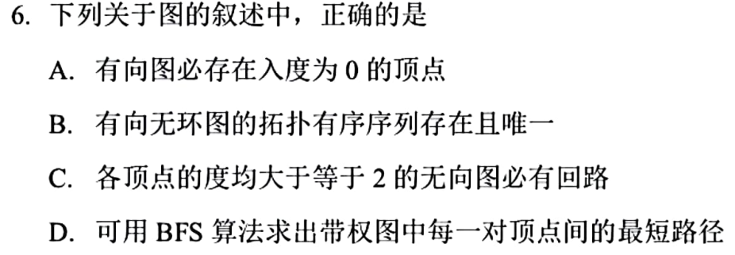

<details>
<summary>答案与解析</summary>

**答案：C。**

有限无向图若无回路，其非平凡树分量必有度1的叶结点，孤立点度为0，因此所有顶点度都至少2时必有回路。A可用有向环反驳；DAG有拓扑序但未必唯一，B错；BFS求一般带权最短路不成立，D错，它按边数分层而非按权值。

</details>

### 选择题6｜2026-06

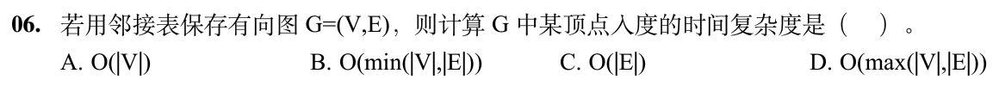

<details>
<summary>答案与解析</summary>

**答案：D。**

普通邻接表记录出边，求一个顶点的入度要扫描所有顶点的表头及全部边结点，计数有多少边指向它，耗时O(|V|+|E|)，等价于O(max(|V|,|E|))。稀疏甚至无边时也要检查表头，所以不能只写O(|E|)。若额外维护入度数组，才可直接读取。

</details>

## 选择题组2｜0829 · 操作系统

[页面驻留：置换、工作集与缺页代价](../src/0829.md) · 13道 · 首次。

### 选择题7｜2020-28

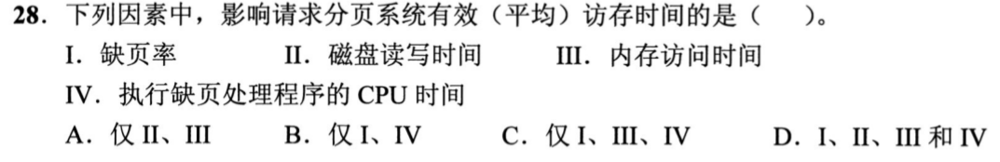

<details>
<summary>答案与解析</summary>

**答案：D。**

缺页率决定走慢路径概率；磁盘读写、内存访存、CPU处理异常均贡献耗时，I—IV都影响。

</details>

### 选择题8｜2021-28

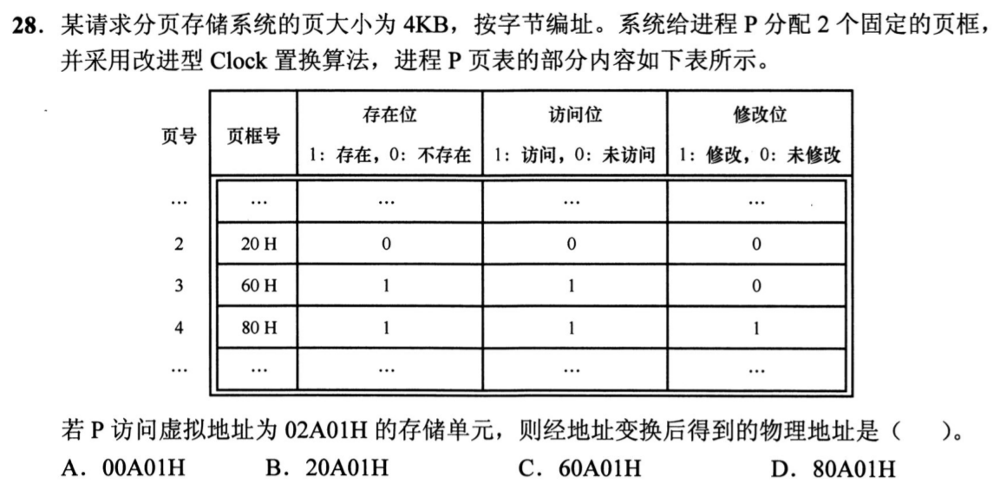

<details>
<summary>答案与解析</summary>

**答案：C。**

02A01H的虚页号为2、页内偏移A01H。页2不在内存，两个固定页框已满；改进Clock先清访问位后，优先淘汰未修改的页3，而非需要写回的页4。页2装入页3原占页框60H，物理地址60A01H。页2原表项里的20H在存在位0时不能直接使用。

</details>

### 选择题9｜2021-29

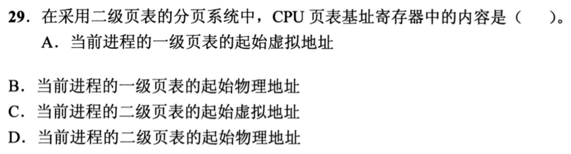

<details>
<summary>答案与解析</summary>

**答案：B。**

页表基址寄存器指向当前进程的一级页表物理起址，硬件从这里开始查一级项，再找到二级表。它不能存待转换的虚拟地址，否则第一次访表就仍需一次地址转换；也不能只指向某张二级表，因为不同一级索引对应不同二级表。

</details>

### 选择题10｜2022-29

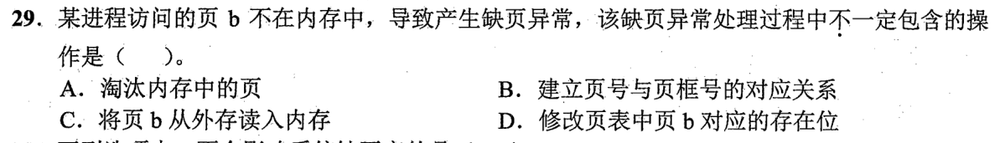

<details>
<summary>答案与解析</summary>

**答案：A。**

若还有空闲页框，可直接把b读入其中，不必淘汰任何驻留页。无论是否置换，都要读入b、建立页号到页框号映射，并把存在位设为1。缺页意味着所需页未驻留，不等于内存已经用满。

</details>

### 选择题11｜2022-30

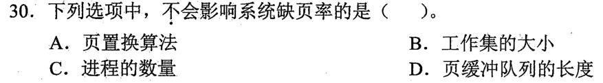

<details>
<summary>答案与解析</summary>

**答案：D。**

缺页率取决于访问局部性、工作集与分配页框、置换算法；进程多会争用页框，也可能改变缺页率。页缓冲队列保留已被换出页的内容，能减少再次访问时的磁盘I/O，但该页若已不在进程驻留集中，访问仍会触发缺页，所以不以队列长度直接改变缺页次数。

</details>

### 选择题12｜2023-25

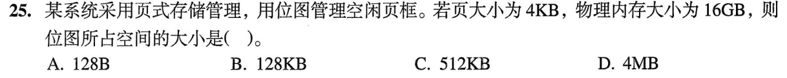

<details>
<summary>答案与解析</summary>

**答案：C。**

16GiB÷4KiB=2²²个页框，每框用1bit表示状态；位图占2²²bit÷8=2¹⁹B=512KiB。

D的4MB漏了bit转Byte的除8。位图不是每页框存一个字节。

</details>

### 选择题13｜2023-28

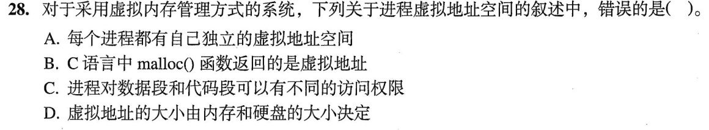

<details>
<summary>答案与解析</summary>

**答案：D。**

虚拟地址空间的范围由地址位数和体系结构约定决定，内存与硬盘容量限制可实际承载的内容，不决定虚拟地址数值范围，D错误。各进程有自己的地址空间，malloc返回其中的虚拟地址；页表权限可以把代码设为只读、数据设为可写，A、B、C成立。

</details>

### 选择题14｜2024-25

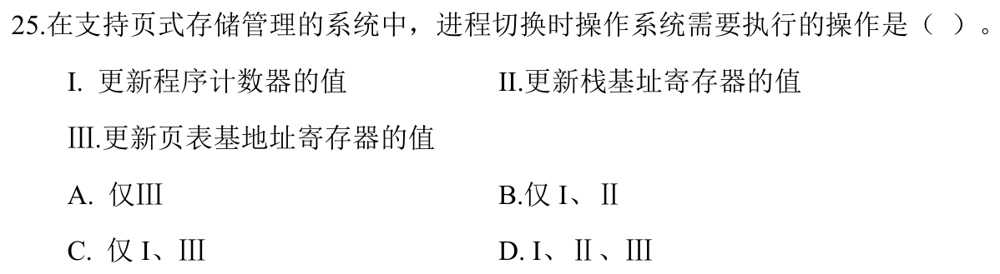

<details>
<summary>答案与解析</summary>

**答案：D。**

切换到另一进程要恢复其执行位置PC、栈基址等现场，并切换页表基址以使用它的地址空间，三项都需更新。线程切换可能仍共用页表，而本题明确是进程切换；不能把“只切换地址转换信息”当成全部现场恢复。

</details>

### 选择题15｜2025-26

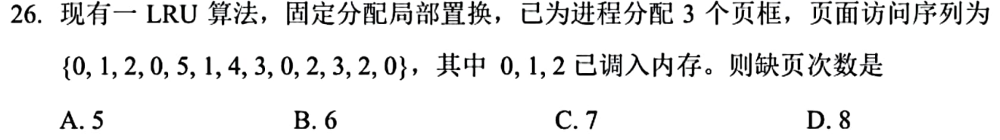

<details>
<summary>答案与解析</summary>

**答案：B。**

最初0、1、2已驻留，不重复计调入缺页。前三次访问后最近顺序为0、1、2，再访问0更新为1、2、0（从旧到新）。随后5、1、4、3、0、2各缺页一次，依次淘汰1、2、0、5、1、4；最后3、2、0均命中，共6次。命中也要更新LRU顺序，不能只在缺页时调队列。

</details>

### 选择题16｜2025-27

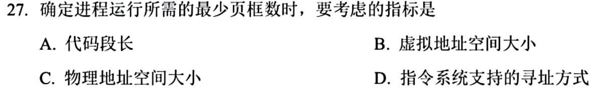

<details>
<summary>答案与解析</summary>

**答案：D。**

最少页框要保证一条指令能完成：指令本身和各次间接寻址、操作数访问可能落在不同页，因而取决于指令系统支持的寻址方式。虚拟空间或物理空间总大小决定总体规模，代码段长度决定全部代码多少页，都不直接决定这条指令需要同时驻留的最少页数。

</details>

### 选择题17｜2025-30

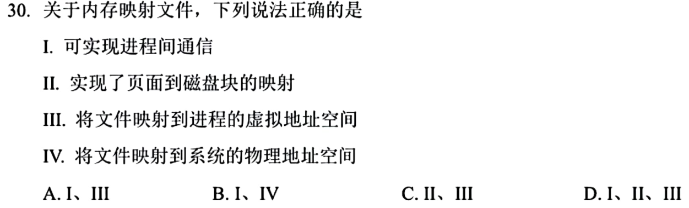

<details>
<summary>答案与解析</summary>

**答案：D。**

映射把文件区间关联到进程虚拟页，并记录这些页对应的文件偏移和磁盘后备内容，Ⅱ、Ⅲ成立。多个进程共享映射同一文件即可通信，Ⅰ成立。映射时不要求把整个文件立即装入物理内存，更不是把文件直接映射成固定物理地址区间，Ⅳ不选。

</details>

### 选择题18｜2026-29

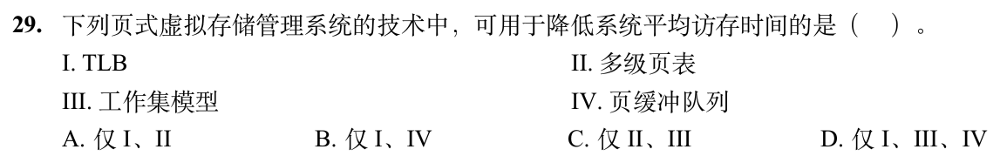

<details>
<summary>答案与解析</summary>

**答案：D。**

TLB减少查页表的访存；工作集模型尽量让近期所需页驻留，降低抖动与缺页代价；页缓冲保留被换出内容，减少重新读盘，Ⅰ、Ⅲ、Ⅳ均可降低平均访存时间。多级页表主要节省页表空间，未命中TLB时反而可能增加访表次数，Ⅱ不选。

</details>

### 选择题19｜2026-30

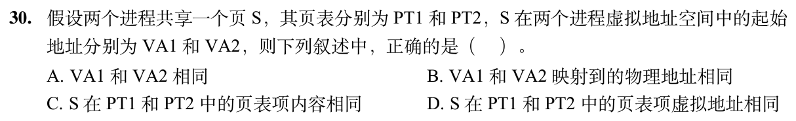

<details>
<summary>答案与解析</summary>

**答案：B。**

共享同一页意味着两个进程所见数据映射到同一物理页；虚拟起址可不同，页表项权限等内容可不同，页表项自身的存放地址也不必相同。

</details>

## 解答题

### 大题1｜2021-42

[原题单 0918｜查找与排序：让分布、权重和内存边界决定代价](../src/0918.md)

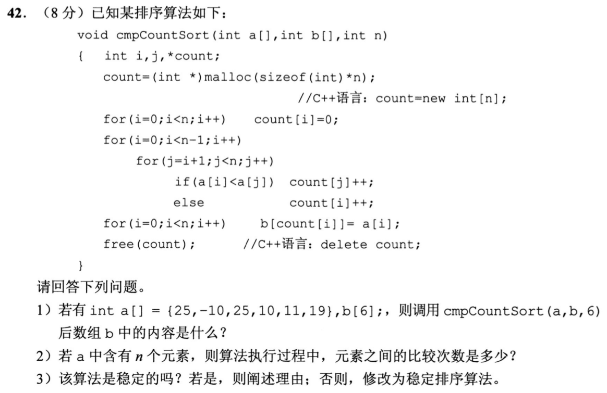

<details>
<summary>答案与解析</summary>

（1）b最终为`[-10, 10, 11, 19, 25, 25]`。为检查稳定性，把原先两个25记为25a、25b，实际顺序为`[-10,10,11,19,25b,25a]`。

（2）内层分别执行n−1、n−2、…、1次，元素比较总数n(n−1)/2；本题n=6时为15次。时间O(n²)，辅助数组count占O(n)。

（3）原算法不稳定。当i<j且a[i]==a[j]，会进入else令count[i]++，使较早出现的相等元素排在后面。只需把比较改为：

```c
if (a[i] <= a[j]) ++count[j];
else ++count[i];
```

使相等时较晚元素的排名加1，即可保留原先次序；不同元素的大小关系不变。不能因为最后两个整数都显示25，就认为稳定性无从讨论。

</details>

## 一行记录

```text
实际用时__；未完成或未核对的题号__；今天最容易混淆的是__
```
