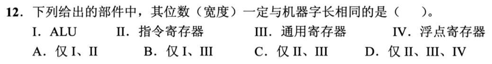
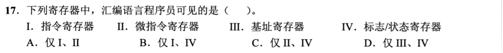
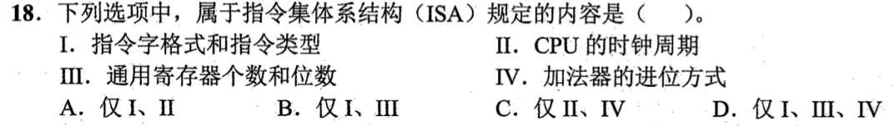
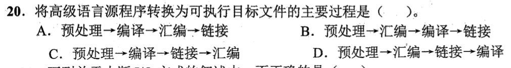
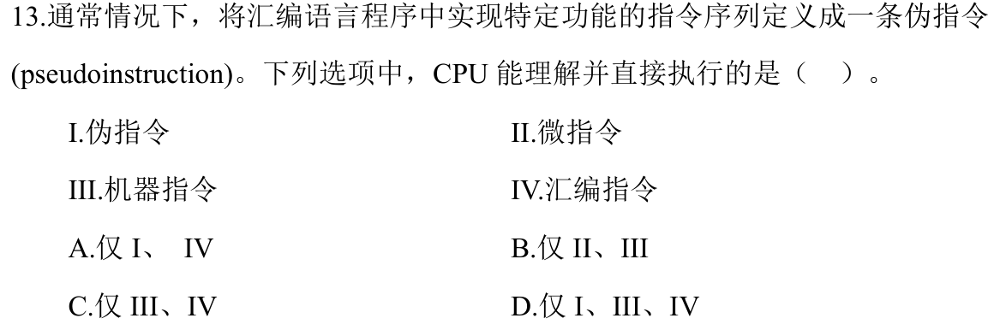
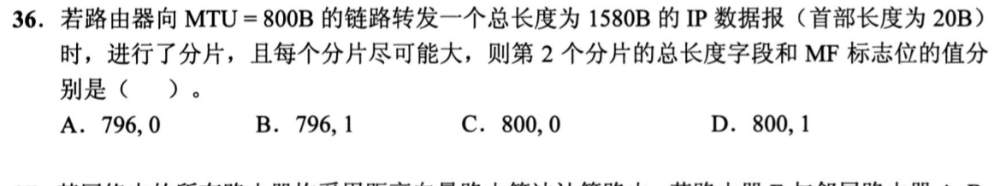
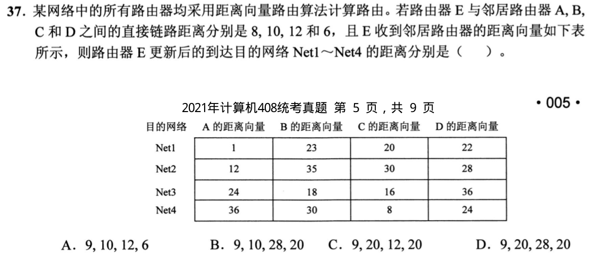
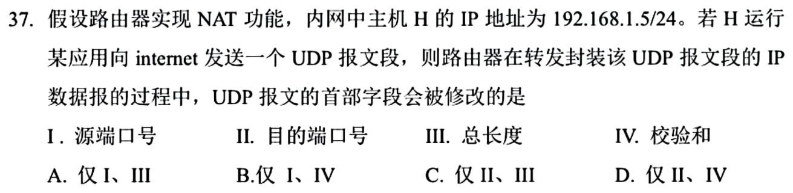
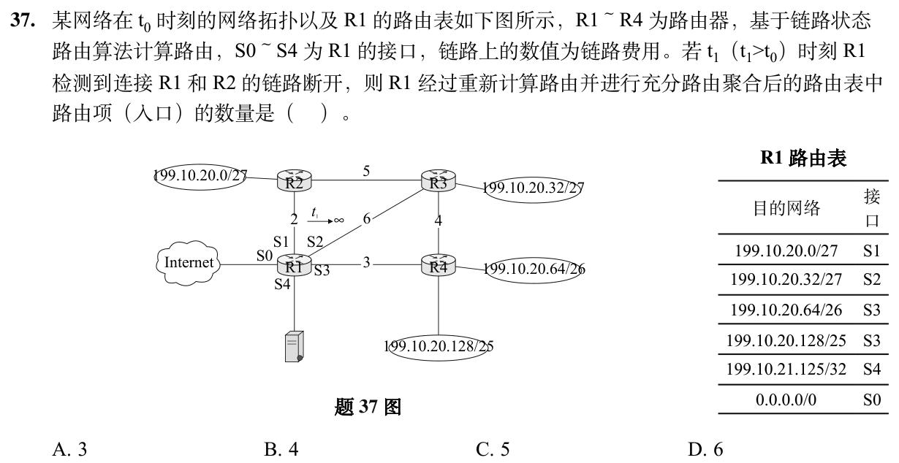
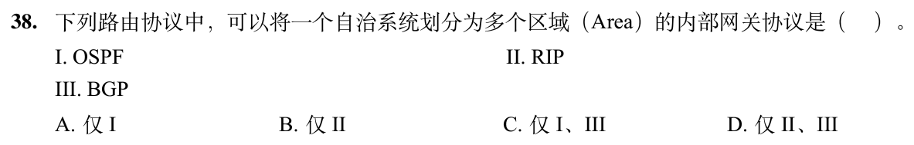

# Day 14｜组成原理＋计算机网络

[← Day 13](day13.md) · [总入口](README.md) · [Day 15 →](day15.md)

**选择题：14道，来自两份完整src题单；大题：1道。** 先做选择题，再展开题下解析。组内题目沿用src顺序；标为复做的组，已会的快速通过，重点处理上次错题。

**预计用时：65—105分钟。** 选择题及核对约35—60分钟，大题约25—35分钟，最后用5—10分钟重做今天最值得记住的一道错题。约两小时是配题目标，不是必须耗满或到点强停；计算卡住时先保留题号，先完成其余选择题。

## 选择题组1｜0818 · 组成原理

[程序层级：从源程序到CPU真正执行的对象](../src/0818.md) · 9道 · 首次。

### 选择题1｜2020-12



<details>
<summary>答案与解析</summary>

**答案：B。**

* **核心判据**：机器字长（Machine Word Length）的硬件体系结构定义：
  * **机器字长**是指 CPU 内部**定点运算器（ALU）单次能直接进行整数运算的二进制数据位宽**；
  * 数据通路中的基本定点数据寄存器——即**通用寄存器（GPR）的位数**，必须与定点 **ALU 的处理宽度**保持严格一致，以此决定整机的数据表示与运算精度基准（例如 32 位机器的通用寄存器和整数 ALU 均为 32 位；64 位机器均为 64 位）；
  * 因此，ALU（I）和通用寄存器（III）的宽度必然与机器字长相同。
* **正选推导**：
  * 定点运算通路中，操作数从通用寄存器经总线送入 ALU，ALU 输出再写回通用寄存器，二者物理位宽必须严格匹配，共同定义了机器字长，选 B。
* **干扰项击穿**：
  * **II（指令寄存器 IR）**：IR 的宽度取决于**指令字长（Instruction Length）**。指令字长完全由 ISA 格式决定，可等于机器字长，也可为半字长、双字长或变长（如 CISC 体系中指令长度 1~15 字节不等，IR 取指缓冲并不等同于固定机器字长）。
  * **IV（浮点寄存器）**：浮点寄存器的位宽由浮点数表示规范（如 IEEE 754 单精度 32 位、双精度 64 位、扩展精度 80/128 位）决定。在 32 位整数机器字长的系统中，浮点寄存器通常为 64 位甚至 128 位，二者不必相同。

</details>

### 选择题2｜2021-17



<details>
<summary>答案与解析</summary>

**答案：D。**

* **核心判据**：“汇编程序员可见（Architectural Visibility）”的硬件边界：
  * 某个寄存器是否对汇编程序员可见，充要判据是：**指令集体系结构（ISA）中是否存在能够显式或隐式读取、修改其内容的操作指令**；
  * **可见寄存器（体系结构状态）**：通用寄存器、程序计数器 PC、基址寄存器（参与基址寻址计算有效地址）、变址寄存器、堆栈指针寄存器 SP、标志/程序状态字寄存器 PSW（反映运算标志与控制流）；
  * **透明寄存器（微架构内部状态）**：属于硬件数据通路与控制器的专用物理缓冲部件，指令无法直接指定和读写，包括指令寄存器 IR、存储器地址寄存器 MAR、存储器数据寄存器 MDR、微指令寄存器 $\mu\text{IR}$、微程序计数器 $\mu\text{PC}$（ROAR）等。
* **正选推导**：
  * **III（基址寄存器）**：汇编语言通过基址寻址指令直接引用基址寄存器计算有效地址（$\text{EA} = (\text{BR}) + A$），程序员可自由指定或修改其内容，可见；
  * **IV（标志/状态寄存器）**：保存条件标志（ZF、CF、SF、OF）和中断屏蔽位，汇编程序员通过条件跳转指令（`JE`、`JNE` 等）、进位操作或专门的状态字指令直接感知并控制程序流，可见；
  * 故汇编语言程序员可见的是 III、IV，选 D。
* **干扰项击穿**：
  * **I（指令寄存器 IR）**：存放从内存取出的当前机器指令二进制代码，由 CPU 控制逻辑在取指周期自动写入并送入译码器，汇编指令无法将其作为操作数读写，对软件完全透明；
  * **II（微指令寄存器）**：位于微程序控制器内部，存放从控制存储器（CS）读出的当前微指令，属于 CPU 芯片微架构的最底层硬件控制信号发生器，软件程序员无法访问。

</details>

### 选择题3｜2022-18



<details>
<summary>答案与解析</summary>

**答案：B。**

* **核心判据**：指令集体系结构（ISA）规范 vs 微架构（Microarchitecture）硬件实现：
  * **ISA 规定的核心内容**：软件与硬件之间的标准化抽象接口，即**编译器和汇编程序员为了生成正确二进制代码所必须获知的机器属性**。包括：指令系统（操作码语义、指令格式、指令类型）、操作数寻址方式、数据类型表示、通用寄存器的个数与位数、内存编址与虚拟存储体系、中断与异常模型；
  * **微架构实现内容**：芯片设计者为实现该 ISA 规范所采取的具体硬件工程方案。软件二进制代码完全不可见。包括：时钟频率与周期、流水线级数与拓扑结构、Cache 层次与替换策略、分支预测算法、运算器内部电路（如加法器进位逻辑）。
* **正选推导**：
  * I（指令字格式和指令类型）：直接决定机器码的二进制编码与译码规则，属于 ISA 核心规定；
  * III（通用寄存器个数和位数）：指令中操作数寻址字段的位宽（例如 32 个寄存器需 5 位编码）及数据精度完全由其决定，属于 ISA 核心规定；
  * 因此属于 ISA 规定的是 I、III，选 B。
* **干扰项击穿**：
  * **II（CPU 的时钟周期）**：时钟周期取决于芯片制程与门电路关键路径延迟。同一套 ISA（如 x86 或 ARM）可以实现为 2.0GHz、3.5GHz 或 5.0GHz 的芯片，ISA 绝不过问具体频率；
  * **IV（加法器的进位方式）**：加法器是采用超前进位（Carry Lookahead）还是行波进位（Ripple Carry），纯属数字逻辑电路的底层门级实现，对上层指令加法结果分毫不差，对软件完全透明。

</details>

### 选择题4｜2022-20



<details>
<summary>答案与解析</summary>

**答案：A。**

* **核心判据**：高级语言到可执行二进制文件的工具链流水线物理因果时序：
  1. **预处理（Pre-processing, `cpp`）**：宏替换、头文件展开、条件编译，处理文本源文件生成纯高级语言文本（`.i`）；
  2. **编译（Compilation, `ccl`）**：词法/语法/语义分析、中间代码生成与代码优化，将高级语言文本翻译为**汇编语言程序文本（`.s`）**；
  3. **汇编（Assembly, `as`）**：汇编器将汇编助记符翻译为机器指令二进制编码，生成**可重定位二进制目标文件（`.o` / `.obj`）**；
  4. **链接（Linking, `ld`）**：链接器将多个目标文件和静态库/动态库合并，进行符号解析与全局虚拟地址重定位，生成操作系统可执行目标文件（ELF / PE）。
* **正选推导**：
  * 物理因果链不可逆：高级源码 $\to$ 预处理 $\to$ 编译 $\to$ 汇编 $\to$ 链接 $\to$ 可执行文件，选 A。
* **干扰项击穿**：
  * **颠倒编译与汇编（B/D项）**：编译器的输入是高级语言代码，输出才是汇编代码；汇编器接收汇编代码输出二进制机器码。汇编绝不可能发生在编译之前。
  * **颠倒汇编与链接（C项）**：链接器处理的是已经翻译好的二进制目标模块及其符号表，必须先由汇编器将汇编指令逐一编译成目标二进制模块后才能进行跨模块符号链接。

</details>

### 选择题5｜2024-13



<details>
<summary>答案与解析</summary>

**答案：B。**

* **核心判据**：“CPU 能理解并直接执行”的硬件电气与微架构控制边界：
  * **CPU 硬件能直接执行的级别**：
    1. **机器指令（III）**：二进制 0/1 机器代码序列，取指部件直接加载到 IR 中，由硬件指令译码器直接解码生成执行控制信号；
    2. **微指令（II）**：在微程序控制器中，微指令由微控制硬件直接从控制存储器（CS）中读出并存入微指令寄存器，其控制字段的高低电平直接输出到硬件执行通路的各个门电路和功能部件；
  * **软件符号层级（CPU 硬件完全不可见）**：
    * **汇编指令（IV）**：是面向人类的助记符文本（如 `ADD R1, R2`），CPU 硬件无法直接识别字符文本，必须经过汇编器软件翻译成机器指令二进制编码；
    * **伪指令（I）**：是汇编器提供的宏指令或控制伪代码（如 RISC-V 中的 `li`、`nop`，或 `.data`、`.word`），没有直接对应的单条硬件执行逻辑，汇编器在汇编阶段将其展开为一条或多条实际机器指令，CPU 硬件根本无法直接感知或执行伪指令。
* **正选推导**：
  * CPU 能理解并直接执行的是机器指令（III）与微程序控制器的微指令（II），选 B。
* **干扰项击穿**：
  * **误选含 IV 或 I 的选项（A、C、D）**：混淆了“程序员编写汇编指令”与“CPU 执行机器二进制”。CPU 是由门电路构成的物理硬件，只认电平信号和二进制机器码/微指令，绝无可能在硬件流水线上直接“执行”文本格式的汇编指令或伪指令。

</details>

### 选择题6｜2025-16


<details>
<summary>答案与解析</summary>

**答案：B。**

* **核心判据**：ISA（软件可见接口规范）vs 微架构（底层硬件实现方案）：
  * **ISA 规定范围**：决定软件机器码格式、执行语义与二进制兼容性。凡是改变后会导致原有二进制机器码无法被正确译码或执行的内容，均属于 ISA；
  * **微架构实现范围**：在保持 ISA 二进制兼容的前提下，硬件工程师自由采用的内部电路拓扑、控制方式与算术单元结构。
* **正选推导**：
  * **B（是否采用定长指令字格式）**：指令字长是定长（如 RISC-V 32位）还是变长（如 x86 1~15字节），直接决定了取指步长、指令译码器切分规则以及编译器生成二进制码的排布格式，是 ISA 的核心规范，选 B。
* **干扰项击穿**：
  * **A（是否采用阵列乘法器）**：乘法指令 `mul` 在硬件上无论是采用低成本的加法移位串行乘法器、还是高速阵列乘法器（Wallace 树），对外部程序员而言只是执行周期数不同，软件接口与运算结果完全一致，属于微架构算术单元实现；
  * **C（是否采用微程序控制器）**：控制器是采用硬连线组合逻辑还是微程序控存，是微架构控制器的内部选型（如同一 x86 指令集可以用微码实现，也可以硬连线实现）；
  * **D（是否采用单总线数据通路）**：CPU 内部是单总线、三总线还是专用点对点旁路互联，属于微架构数据通路组织。

</details>

### 选择题7｜2025-17


<details>
<summary>答案与解析</summary>

**答案：C。**

* **核心判据**：RISC（精简指令集计算机）的设计核心哲学与流水线亲和性：
  * RISC 的创立宗旨就是**为了彻底消除 CISC 复杂微指令的控制瓶颈，使绝大多数指令能够在一个时钟周期内流水化高效执行（CPI $\approx$ 1）**；
  * **RISC 极致亲和流水线的四大物理基石**：
    1. **指令字定长且格式规整**：取指和译码段可以在固定时间步内瞬间完成；
    2. **严格的 Load/Store 内存访问模型（B 正确）**：只有专属访存指令才能访问内存，所有算术逻辑指令只能操作寄存器，消除了内存寻址与 ALU 运算的复合阶段，使各个流水段物理延迟高度均衡；
    3. **硬连线控制器（A 正确）**：指令简单，纯组合逻辑极速译码，单周期生成控制信号；
    4. **大量通用寄存器堆（D 正确）**：优先使用寄存器传递函数过程调用的参数与返回值，极大地减少了内存栈访存开销。
  * **结论**：RISC 是**天生为了流水线而诞生、最适合采用流水线数据通路**的体系结构，“难以采用流水线”纯属颠倒黑白。
* **正选推导**：
  * 题目要求选出“错误的是”，C 选项说法完全错误，选 C。
* **干扰项击穿**：
  * A、B、D 均为 RISC 架构的标准教科书特征：硬布线控制确保速度极快，Load/Store 隔离访存，寄存器传参降低访存频次。

</details>

### 选择题8｜2026-12


<details>
<summary>答案与解析</summary>

**答案：C。**

* **核心判据**：计算机系统分层模型中“逻辑设计层（微架构）”与“物理实现层（物理封装与器件）”的严格区分：
  * 计算机系统层次结构自顶向下为：
    1. 应用软件层；
    2. 系统软件层（操作系统/编译器）；
    3. **指令集体系结构（ISA）层**（软硬件统一抽象接口）；
    4. **微架构/计算机组成层（Logical Architecture）**：流水线、数据通路、寄存器堆、Cache 组织及控制器等**逻辑结构设计**；
    5. **物理实现层（Physical Implementation）**：门级逻辑电路、晶体管器件物理特性、半导体光刻工艺（如 3nm 制程）、版图布线与物理封装。
  * **微架构属于 ISA 的逻辑实现（Logical Realization），绝不属于物理实现层**。
* **正选推导**：
  * 题目要求选出“错误的是”：
    * C 项将微架构错误归入“物理实现层”，混淆了逻辑组织设计与半导体物理制造两个不同抽象层，符合题意，选 C。
* **干扰项击穿**：
  * **A项正确**：最上层面向用户业务应用，最底层落实在物理芯片材料与封装；
  * **B项正确**：ISA 是软件编译器与硬件执行部件之间必须遵守的契约，不可或缺；
  * **D项正确**：操作系统通过 ISA 暴露的特权级、中断向量、MMU 寄存器等机制对底层裸机进行管理与抽象，向上提供统一的系统调用与运行时环境。

</details>

### 选择题9｜2026-16


<details>
<summary>答案与解析</summary>

**答案：D。**

* **核心判据**：ISA 体系结构规约 vs 微架构流水线加速技术：
  * **ISA 规定的核心内容**：任何影响软件编写、编译器代码生成或操作系统内核底层驱动接口的软硬件规范。包括：指令种类（I/O 指令）、中断异常响应模型、虚存地址映射机制；
  * **微架构技术的范畴**：在保持 ISA 规范完全不变的前提下，通过硬件工程手段压榨性能的内部设计。包括**流水线深度（超级流水线技术 Super-pipelining）**、超标量多发射（Superscalar）、分支预测器算法、动态乱序调度（Out-of-Order）等。
* **正选推导**：
  * **D（指令流水线是否采用超级流水线技术）**：超级流水线将执行阶段进一步细切为更多流水段以拉高主频（例如 Intel NetBurst 架构深达 20~31 级流水），属于纯粹的微架构内部实现。软件二进制代码完全不需要感知流水线级数，同一套 x86 ISA 可以在 5 级流水或 20 级流水线上透明运行，因此不属于 ISA 规定，选 D。
* **干扰项击穿**：
  * **A（指令集中是否包含输入和输出指令）**：直接决定了外设采用独立编址（需专门的 `IN`/`OUT` 指令）还是统一内存映射编址（直接用访存指令），是 ISA 指令系统的核心组成；
  * **B（采用向量中断还是非向量中断方式）**：中断服务程序入口是由硬件通过向量地址自动跳转、还是由软件查询中断状态寄存器跳转，直接决定了 OS 内核中断向量表与汇编驱动的编写方式，属于 ISA 体系结构定义；
  * **C（采用段式还是页式虚拟存储管理方式）**：直接定义了逻辑地址切分格式、页表/段表表项结构以及 MMU 控制寄存器规范，是系统级 ISA 的法定契约。

</details>

## 选择题组2｜0906 · 计算机网络

[控制转发路径：ARP、路由协议与下一跳](../src/0906.md) · 5道 · 首次。

### 选择题10｜2021-36



<details>
<summary>答案与解析</summary>

**答案：B。**

* **核心判据**：IP 分片的 8 字节对齐物理硬约束与分片字段语义：
  1. 每个 IP 分片均需封装独立的 **20 字节基本首部**；
  2. 链路层 MTU 限制分片总长度：$\text{MTU} = 800\text{B}$ $\implies$ 每个分片能够承载的数据载荷最大上限为 $800 - 20 = 780\text{B}$；
  3. **8 字节对齐法则（RFC 791 物理硬约束）**：由于 IP 首部中的“片偏移（Fragment Offset）”字段以 **8 字节（8B）为基本度量单位**，因此**所有非末尾分片的数据载荷长度必须严格向下取整到 8 的整数倍**：
     $$\lfloor 780 / 8 \rfloor \times 8 = 97 \times 8 = 776\text{B}$$
  4. **MF（More Fragments）标志位**：若当前分片之后还有属于原数据报的后续分片，则 $\text{MF} = 1$；若为原数据报的最后一个分片，则 $\text{MF} = 0$。
* **正选推导**：
  * 原始 IP 数据报：总长度 1580B，首部 20B $\implies$ 待发送原始数据载荷总长 $1580 - 20 = 1560\text{B}$。
  * **逐片切分演算**：
    * **第 1 分片**：载荷取最大 8B 整数倍 $776\text{B}$。总长度 $= 776 + 20 = 796\text{B}$，片偏移 $= 0/8 = 0$，$\text{MF} = 1$；
      * 剩余待切分载荷：$1560 - 776 = 784\text{B}$；
    * **第 2 分片**：剩余 784B 超过单个分片容量上限，必须继续切分：
      * 载荷取最大 8B 整数倍 $776\text{B}$；
      * **总长度字段** $= 776 + 20 = \mathbf{796\text{B}}$；
      * 片偏移 $= 776 / 8 = 97$；
      * 剩余待切分载荷：$784 - 776 = 8\text{B}$，说明后续还有第 3 分片，因此 **$\text{MF} = \mathbf{1}$**；
    * **第 3 分片**：载荷为最后剩余的 $8\text{B}$。总长度 $= 8 + 20 = 28\text{B}$，片偏移 $= (776 + 776)/8 = 194$，$\text{MF} = 0$。
  * 题目询问第 2 个分片的总长度字段和 MF 标志位，分别为 796 和 1，选 B。
* **干扰项击穿**：
  * **C/D项（800）**：致命粗心！误以为数据载荷可以直接填满 $800 - 20 = 780\text{B}$。由于 $780$ 不能被 8 整除（$780 / 8 = 97.5$），将导致第 2 个分片的片偏移无法在首部中用整数表示，违背 IP 协议物理设计规范；
  * **A项（796, 0）**：误以为分成 2 片后第 2 片就是末尾分片（忽略了 $776 \times 2 = 1552 < 1560$，末尾还有 8B 构成第 3 片），错误将 MF 标为 0。

</details>

### 选择题11｜2021-37



<details>
<summary>答案与解析</summary>

**答案：D。**

* **核心判据**：Bellman-Ford 距离向量（Distance Vector）更新方程：
  $$D_E(\text{Net}_x) = \min_{v \in \{A, B, C, D\}} \left\{ c(E, v) + D_v(\text{Net}_x) \right\}$$
  * 其中 $c(E, v)$ 为路由器 E 到直连邻居 $v$ 的链路开销：
    * $c(E, A) = 8$
    * $c(E, B) = 10$
    * $c(E, C) = 12$
    * $c(E, D) = 6$
  * 路由器 E 在收到各邻居通告的距离向量后，必须**将各邻居通告的距离加上自身到该邻居的直接链路开销**，再对每个目的网络横向比对取最小值。
* **正选推导**：
  * **目的网络 Net1**：
    * 经 A：$8 + 1 = 9$
    * 经 B：$10 + 23 = 33$
    * 经 C：$12 + 20 = 32$
    * 经 D：$6 + 22 = 28$
    * 最小值：$\min\{9, 33, 32, 28\} = \mathbf{9}$（下一跳 A）；
  * **目的网络 Net2**：
    * 经 A：$8 + 12 = 20$
    * 经 B：$10 + 35 = 45$
    * 经 C：$12 + 30 = 42$
    * 经 D：$6 + 28 = 34$
    * 最小值：$\min\{20, 45, 42, 34\} = \mathbf{20}$（下一跳 A）；
  * **目的网络 Net3**：
    * 经 A：$8 + 24 = 32$
    * 经 B：$10 + 18 = 28$
    * 经 C：$12 + 16 = 28$
    * 经 D：$6 + 36 = 42$
    * 最小值：$\min\{32, 28, 28, 42\} = \mathbf{28}$（下一跳 B 或 C）；
  * **目的网络 Net4**：
    * 经 A：$8 + 36 = 44$
    * 经 B：$10 + 30 = 40$
    * 经 C：$12 + 8 = 20$
    * 经 D：$6 + 24 = 30$
    * 最小值：$\min\{44, 40, 20, 30\} = \mathbf{20}$（下一跳 C）；
  * E 更新后的距离序列为：`9, 20, 28, 20`，选 D。
* **干扰项击穿**：
  * **误选 A（9, 10, 12, 6）**：漏算了 E 到邻居自身链路的开销，直接将邻居通告的最小距离或直接链路距离混杂罗列；
  * **Net2 误算为 10（B项）**：将直连链路 $c(E, B)=10$ 误填入 Net2；
  * **Net3 误算为 12（C项）**：将直连链路 $c(E, C)=12$ 误填入 Net3。

</details>

### 选择题12｜2025-37



<details>
<summary>答案与解析</summary>

**答案：B。**

* **核心判据**：NAPT（网络地址端口转换）跨层转发机制与 UDP 首部字段物理变化：
  * **IP 协议首部变化**：内网私有源 IP（`192.168.1.5`）被替换为 NAT 路由器的公网出口 IP（SNAT），IP 首部校验和重新计算；目的 IP 保持公网服务器 IP 不变；
  * **UDP 协议首部变化**：
    1. **源端口号（I 必改）**：为了支持局域网内多个主机多进程并发访问公网，NAT 路由器将内网源端口号映射为路由器公网 IP 的一个空闲临时端口号（NAPT 端口复用）；
    2. **校验和字段（IV 必改）**：**UDP 校验和的计算范围不仅包括 UDP 首部和数据，还强制涵盖了 12 字节的“伪首部”（Pseudo Header，包含源 IP、目的 IP、协议号 17、UDP 长度）**！由于路由器修改了 IP 层的**源 IP 地址**并修改了 UDP 首部的**源端口号**，伪首部与 UDP 首部数据均发生改变，NAT 路由器必须重新计算 UDP 校验和并填入，否则目的主机收到后校验必败直接丢弃；
    3. **目的端口号（II 不变）**：目的端口对应公网服务器的应用服务类型（如 DNS 53，HTTP 80），路由器绝不能修改目的端口，否则数据无法送达目标服务；
    4. **总长度（III 不变）**：地址和端口转换只是字段数值替换，UDP 数据载荷大小完全未发生改变，UDP 长度字段严格保持不变。
* **正选推导**：
  * 路由器在转发过程中修改的 UDP 首部字段为**源端口号（I）**和**校验和（IV）**，选 B。
* **干扰项击穿**：
  * **最严重陷阱（漏选 IV）**：初学者容易仅将目光停留在 UDP 首部本身的 8 个字节（源端口、目的端口、长度、校验和），误以为“改了源端口，只要不改数据就不用重算校验和，或者以为校验和只管应用数据”。遗忘了 UDP/TCP 最具特色的**伪首部校验机制**（深度绑定 IP 层的源 IP 与目的 IP）。源 IP 一旦被 NAT 替换，伪首部校验和全盘改变，必须重算；
  * **误选 II（目的端口号）**：只有外网向内网提供服务（DNAT / 端口转发发布）时才会改目的端口；内网主动发起访问 internet 只能修改源端口。

</details>

### 选择题13｜2026-37



<details>
<summary>答案与解析</summary>

**答案：B。**

* **核心判据**：链路状态路由计算（Dijkstra）与 CIDR 最长前缀匹配充分聚合准则：
  1. 链路 $R1-R2$ 中断后，R1 到各路由器的最新最短路径（Dijkstra）：
     * 到 R2：走 S2 经 R3（费用 $6+5=11$）优于走 S3 经 R4（费用 $3+4+5=12$），因此到 R2 的下一跳接口切换为 **S2**；
     * 到 R3：走 S2 直达（费用 6）优于走 S3 绕 R4（费用 $3+4=7$），下一跳为 **S2**；
     * 到 R4：走 S3 直达（费用 3），下一跳为 **S3**；
  2. 梳理各目的网段的最短路径出接口：
     * `199.10.20.0/27`（挂在 R2）：下一跳 **S2**
     * `199.10.20.32/27`（挂在 R3）：下一跳 **S2**
     * `199.10.20.64/26`（挂在 R4）：下一跳 **S3**
     * `199.10.20.128/25`（挂在 R4）：下一跳 **S3**
     * `199.10.21.125/32`（独立服务器）：下一跳 **S4**
     * `0.0.0.0/0`（Internet 默认路由）：下一跳 **S0**
  3. **充分路由聚合（CIDR Aggregation）演算**：
     * **S2 接口聚合**：
       * `199.10.20.0/27`（范围 0~31）与 `199.10.20.32/27`（范围 32~63）为相邻前缀，前 26 位完全相同，聚合成：
         $$\mathbf{199.10.20.0/26} \to \text{S2}$$
     * **S3 接口聚合（结合最长前缀匹配覆盖）**：
       * `199.10.20.64/26`（范围 64~127）与 `199.10.20.128/25`（范围 128~255）覆盖了 64~255 的全部区间；
       * 此时若将整个 C 类网段聚合成一个超网路由：
         $$\mathbf{199.10.20.0/24} \to \text{S3}$$
       * 根据**最长前缀匹配原则（Longest Prefix Match）**：当数据报目的 IP 落在 0~63 范围时，因 `/26` 比 `/24` 拥有更长的前缀掩码，优先匹配 S2 转发；而当目的 IP 落在 64~255 范围时，由于不满足 `/26`，命中 `/24` 经 S3 转发！这一聚合完美保持了转发逻辑的一致性，消除了 S3 上的多个细分条目；
     * **其余不可聚合项**：
       * 主机路由：$\mathbf{199.10.21.125/32} \to \text{S4}$
       * 默认路由：$\mathbf{0.0.0.0/0} \to \text{S0}$
* **正选推导**：
  * 聚合后的 R1 路由表项最终包含：
    1. `199.10.20.0/26`（接口 S2）
    2. `199.10.20.0/24`（接口 S3）
    3. `199.10.21.125/32`（接口 S4）
    4. `0.0.0.0/0`（接口 S0）
  * 路由项总数量恰好为 **4**，选 B。
* **干扰项击穿**：
  * **误选 C（5项）**：若认为 S3 上的 `.64/26` 和 `.128/25` 掩码长度不同无法直接 2 合 1，从而保留了 S3 上的 2 个条目（`.0/26`、`.64/26`、`.128/25`、`/32`、`/0` 共 5 项）。题目明确要求“充分路由聚合”，在支持最长匹配的 CIDR 路由器中，超网覆盖是极其标准的聚合手段；
  * **误选 D（6项）**：完全不做任何路由聚合，直接保留断链重新计算后的原始 6 个条目。

</details>

### 选择题14｜2026-38



<details>
<summary>答案与解析</summary>

**答案：A。**

* **核心判据**：路由协议层级分类与层次化区域（Area）架构设计：
  * **内部网关协议（IGP）vs 外部网关协议（EGP）**：
    * IGP 运行于**单一自治系统（AS）内部**，负责域内路由计算（如 OSPF、RIP、IS-IS）；
    * EGP 运行于**不同自治系统之间**，负责跨域策略路由传递（如 BGP-4）；因此 BGP 属于 EGP，首先被题干“内部网关协议”排除；
  * **区域（Area）分层架构能力**：
    * **OSPF（I）**：为了解决大规模网络中链路状态通告（LSA）泛洪导致的网络风暴以及每个路由器 LSDB 库膨胀、SPF 计算开销剧增的痛点，引入了**层次化多区域体系**（主干区域 Area 0 与多个非主干区域 Area 1, 2, ...），LSA 洪泛被严格限制在区域内部，区域间由 ABR 进行路由汇总；
    * **RIP（II）**：采用简单的距离向量算法，全网扁平化，最大跳数仅为 15，完全不支持区域划分机制。
* **正选推导**：
  * 既属于内部网关协议（IGP），又支持将自治系统划分为多个区域的只有 **OSPF（I）**，选 A。
* **干扰项击穿**：
  * **排除 III（BGP）**：BGP 是外部网关协议（EGP），虽然 BGP 内部有 AS 联盟（AS Confederations）机制，但它绝非自治系统内部网关协议；
  * **排除 II（RIP）**：RIP 基于 UDP 广播/组播定期向直连邻居全量发送距离向量，结构简单原始，根本不具备层次化 Area 划分的概念。

</details>

## 解答题

### 大题1｜2023-42

[原题单 0918｜查找与排序：让分布、权重和内存边界决定代价](../src/0918.md)


<details>
<summary>答案与解析</summary>

**答案与解析**：

**（1）置换-选择排序全过程单步推演与初始归并段生成**：
* **核心机制规则**：
  * 工作区容量 $m=4$；
  * 从工作区当前所有**未冻结（活跃）**的记录中，选出关键字**最小且 $\ge$ 上一次输出关键字**的记录输出；
  * 从输入文件中读入下一个记录填补空位：
    * 若新记录的关键字 $\ge$ 刚输出的关键字，则该记录属于当前归并段，处于活跃状态；
    * 若新记录的关键字 $<$ 刚输出的关键字，则该记录**被冻结**，归入下一个归并段，当前归并段中不能被选取；
  * 当工作区内全部 $m$ 个记录都被冻结时，当前初始归并段结束！解冻所有记录，开启下一个归并段。

* **单步推演详细过程**：
  * **初始装填工作区**：前 4 个记录进入工作区，工作区状态为：`[51, 94, 37, 92]`，待输入序列：`[14, 63, 15, 99, 48, 56, 23, 60, 31, 17, 43, 8, 90, 166, 100]`。
  * **生成第 1 归并段（Run 1）**：
    1. 工作区 `[51, 94, 37, 92]` 中最小为 **37** $\to$ **输出 37**；读入 14，因 $14 < 37$，**14 冻结**。工作区：`[51, 94, (14), 92]`；
    2. 活跃元素 `[51, 94, 92]` 中最小为 **51** $\to$ **输出 51**；读入 63，因 $63 \ge 51$，63 活跃。工作区：`[63, 94, (14), 92]`；
    3. 活跃元素 `[63, 94, 92]` 中最小为 **63** $\to$ **输出 63**；读入 15，因 $15 < 63$，**15 冻结**。工作区：`[(15), 94, (14), 92]`；
    4. 活跃元素 `[94, 92]` 中最小为 **92** $\to$ **输出 92**；读入 99，因 $99 \ge 92$，99 活跃。工作区：`[(15), 94, (14), 99]`；
    5. 活跃元素 `[94, 99]` 中最小为 **94** $\to$ **输出 94**；读入 48，因 $48 < 94$，**48 冻结**。工作区：`[(15), (48), (14), 99]`；
    6. 活跃元素 `[99]` $\to$ **输出 99**；读入 56，因 $56 < 99$，**56 冻结**。工作区：`[(15), (48), (14), (56)]`；
    * 此时工作区内全部 4 个记录均被冻结，**第 1 归并段结束**！
    * **第 1 归并段内容**：`[37, 51, 63, 92, 94, 99]`（长度为 6）。

  * **生成第 2 归并段（Run 2）**：
    * 解冻工作区，当前工作区：`[15, 48, 14, 56]`，待输入序列剩余：`[23, 60, 31, 17, 43, 8, 90, 166, 100]`。
    1. 最小为 **14** $\to$ **输出 14**；读入 23，因 $23 \ge 14$，23 活跃。工作区：`[15, 48, 23, 56]`；
    2. 最小为 **15** $\to$ **输出 15**；读入 60，因 $60 \ge 15$，60 活跃。工作区：`[60, 48, 23, 56]`；
    3. 最小为 **23** $\to$ **输出 23**；读入 31，因 $31 \ge 23$，31 活跃。工作区：`[60, 48, 31, 56]`；
    4. 最小为 **31** $\to$ **输出 31**；读入 17，因 $17 < 31$，**17 冻结**。工作区：`[60, 48, (17), 56]`；
    5. 活跃元素 `[60, 48, 56]` 最小为 **48** $\to$ **输出 48**；读入 43，因 $43 < 48$，**43 冻结**。工作区：`[60, (43), (17), 56]`；
    6. 活跃元素 `[60, 56]` 最小为 **56** $\to$ **输出 56**；读入 8，因 $8 < 56$，**8 冻结**。工作区：`[60, (43), (17), (8)]`；
    7. 活跃元素 `[60]` $\to$ **输出 60**；读入 90，因 $90 \ge 60$，90 活跃。工作区：`[90, (43), (17), (8)]`；
    8. 活跃元素 `[90]` $\to$ **输出 90**；读入 166，因 $166 \ge 90$，166 活跃。工作区：`[166, (43), (17), (8)]`；
    9. 活跃元素 `[166]` $\to$ **输出 166**；读入 100，因 $100 < 166$，**100 冻结**。工作区：`[(100), (43), (17), (8)]`；
    * 此时工作区内全部 4 个记录均被冻结，输入文件读空，**第 2 归并段结束**！
    * **第 2 归并段内容**：`[14, 15, 23, 31, 48, 56, 60, 90, 166]`（长度为 9）。

  * **生成第 3 归并段（Run 3）**：
    * 解冻工作区，当前工作区：`[100, 43, 17, 8]`，输入文件已无剩余记录。
    * 对工作区剩余 4 个记录按升序直接依次输出：
      1. 最小为 **8** $\to$ **输出 8**；
      2. 最小为 **17** $\to$ **输出 17**；
      3. 最小为 **43** $\to$ **输出 43**；
      4. 最小为 **100** $\to$ **输出 100**。
    * **第 3 归并段内容**：`[8, 17, 43, 100]`（长度为 4）。

* **第（1）问结论**：
  * 总共生成 **3 个**初始归并段：
    * **第 1 归并段**：`37, 51, 63, 92, 94, 99`
    * **第 2 归并段**：`14, 15, 23, 31, 48, 56, 60, 90, 166`
    * **第 3 归并段**：`8, 17, 43, 100`

---

**（2）第一个初始归并段长度的最大值与最小值**：
* **最大值**：**$n$**
  * **极限物理条件**：当输入文件中的 $n$ 个记录关键字原本就已经呈现**单调递增（非递减）有序**排列时；
  * 每次从工作区输出当前最小值后，读入的新记录关键字必然大于等于刚输出的关键字，因此读入的新记录**永远不会被冻结**；
  * 算法将连续不断地选取并输出，直至将输入文件全部 $n$ 个记录一次性输出完毕，生成一个长度为 $n$ 的单一归并段。
* **最小值**：**$m$**
  * **极限物理条件**：当输入文件中的记录关键字呈现**严格单调递减（逆序）**排列时；
  * 算法初始装入前 $m$ 个记录后，输出其中的最小值（即第 $m$ 个进入的记录）；
  * 随后每次读入的新记录，其关键字均严格小于前面所有的记录，导致每次读入的新记录**立即被冻结**；
  * 当初始装入工作区的 $m$ 个记录全部输出完毕后，工作区内全部 $m$ 个新填入的记录均处于冻结状态，当前归并段被迫立即终止；
  * 因此，生成的第一个归并段的最短长度即为工作区容量 $m$。

</details>

## 一行记录

```text
实际用时__；未完成或未核对的题号__；今天最容易混淆的是__
```
