# Day 15｜数据结构＋操作系统

[← Day 14](day14.md) · [总入口](README.md) · [Day 16 →](day16.md)

**选择题：10道，来自两份完整src题单；大题：2道。** 先做选择题，再展开题下解析。组内题目沿用src顺序；标为复做的组，已会的快速通过，重点处理上次错题。

**预计用时：75—115分钟。** 选择题及核对约30—50分钟，大题约40—55分钟，最后用5—10分钟重做今天最值得记住的一道错题。约两小时是配题目标，不是必须耗满或到点强停；计算卡住时先保留题号，先完成其余选择题。

## 选择题组1｜0807 · 数据结构

[图上的推进：拓扑、最短路与关键路径](../src/0807.md) · 7道 · 首次。

### 选择题1｜2020-07

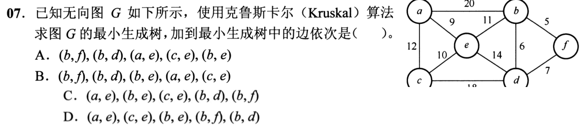

<details>
<summary>答案与解析</summary>

**答案：A。**

* **核心判据**：Kruskal 算法基于全局边权升序的贪心收录原则：
  1. 将图中所有边按权值升序排列；
  2. 从权值最小的边开始依次选取：若该边连接的两个顶点属于不同的连通分量（用并查集判断，不构成回路），则将该边加入生成树边集；若两端点已连通则跳过舍弃；
  3. 当累计选出 $|V|-1$ 条边时算法结束。
* **正选推导**：
  * 全图包含 6 个顶点，生成树需要恰好选出 $6 - 1 = 5$ 条边。
  * 将全图边按权值从小到大排序：
    * $(b, f): 5$
    * $(b, d): 6$
    * $(d, f): 7$
    * $(a, e): 9$
    * $(c, e): 10$
    * $(b, e): 11$
    * $(a, c): 12$
    * $(e, d): 14$
    * $(c, d): 18$
    * $(a, b): 20$
  * 逐步考察：
    1. 选权值 5 的 $(b, f)$：两端点未连通，加入生成树，连通块为 $\{b, f\}$；
    2. 选权值 6 的 $(b, d)$：两端点未连通，加入生成树，连通块为 $\{b, d, f\}$；
    3. 考察权值 7 的 $(d, f)$：$d$ 与 $f$ 已在同一连通块中，加入将构成环路 $(b-d-f-b)$，**舍弃跳过**；
    4. 选权值 9 的 $(a, e)$：两端点未连通，加入生成树，连通块为 $\{a, e\}$；
    5. 选权值 10 的 $(c, e)$：两端点未连通，加入生成树，连通块为 $\{a, c, e\}$；
    6. 选权值 11 的 $(b, e)$：连接 $\{a, c, e\}$ 与 $\{b, d, f\}$，无环，加入生成树！
  * 累计加入 5 条边，生成树构建完成。选边次序严格为：$(b, f), (b, d), (a, e), (c, e), (b, e)$，选 A。
* **干扰项击穿**：
  * **B项错误**：在加入 $(b, d)$（权值 6）之后直接跳去选 $(b, e)$（权值 11），跳过了权值为 9 和 10 的边，违背全局贪心按边权升序选边的定义；
  * **C/D项错误**：以 $(a, e)$ 开头，这是 Prim 算法从顶点 $a$ 或 $e$ 出发的按点扩展顺序，混淆了 Kruskal 与 Prim 的算法骨架。

</details>

### 选择题2｜2020-08

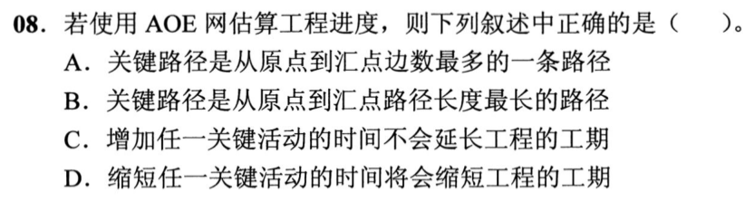

<details>
<summary>答案与解析</summary>

**答案：B。**

* **核心判据**：AOE 网关键路径的物理与工程数学定义：
  * 在 AOE（Activity on Edge）网中，有向边表示活动，边权表示持续时间，顶点表示事件；
  * 事件只有在指向它的所有前序活动全部完工后才能发生。因此，整个工程从源点到汇点完成的**最短总工期**，严格取决于**从源点到汇点具有最大持续时间总和（路径长度最长）的路径**，定义为**关键路径（Critical Path）**。
* **正选推导**：
  * “路径长度”在带权图中定义为路径上所有边权值的代数和。关键路径正是从源点到汇点路径长度最长（总耗时最大）的路径，选 B。
* **干扰项击穿**：
  * **A项错误**：边数最多不等于路径长度最长（如 5 条持续时间各为 1 天的边总长 5 天，而 1 条持续时间为 10 天的边总长 10 天，关键路径取决于后者）；
  * **C项错误**：关键活动的时差余量为 0，没有任何缓冲空间。增加任何一个关键活动的时间，必然导致关键路径被拉长，从而**必然延长整个工程的工期**；
  * **D项错误（经典陷阱）**：当网络中存在**多条并列的关键路径**时，仅缩短其中一条关键路径上的活动时间，工程总工期仍然被其他并列的关键路径制约，总工期并不一定会缩短。只有缩短所有关键路径共有（或同时缩短各条关键路径）的关键活动，工期才会缩短。

</details>

### 选择题3｜2021-07

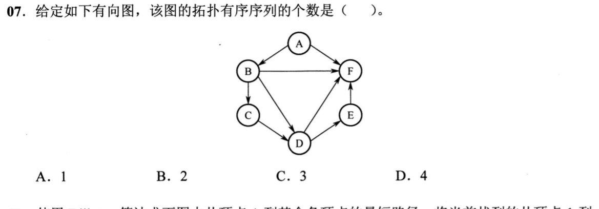

<details>
<summary>答案与解析</summary>

**答案：A。**

* **核心判据**：有向无环图的全序约束与唯一拓扑序列充要定理：
  * 若一个 DAG 存在一条贯穿所有顶点的**哈密顿路径（包含 $|V|-1$ 条先后相接的有向边）**，则图中所有顶点之间的先后偏序关系被完全确定为唯一的全序链；
  * 此时，在拓扑排序的每一步中，**入度为 0 的候选顶点始终唯一**，因此全图存在且仅存在 1 个拓扑有序序列。
* **正选推导**：
  * 审视题图的拓扑依赖链：
    $$A \to B \to C \to D \to E \to F$$
    1. 起始入度为 0 的顶点只有 $A$ $\implies$ 必须首先输出 $A$；
    2. 删去 $A$ 后，入度为 0 的顶点只有 $B$（$F$ 还依赖 $B, D, E$） $\implies$ 必须输出 $B$；
    3. 删去 $B$ 后，入度为 0 的顶点只有 $C$（$D$ 还依赖 $C$） $\implies$ 必须输出 $C$；
    4. 删去 $C$ 后，入度为 0 的顶点只有 $D$ $\implies$ 必须输出 $D$；
    5. 删去 $D$ 后，入度为 0 的顶点只有 $E$（$F$ 还依赖 $E$） $\implies$ 必须输出 $E$；
    6. 删去 $E$ 后，最后输出 $F$。
  * 每一步选择均毫无二义性，全图唯一的拓扑序列就是 `A, B, C, D, E, F`，序列总数为 **1**，选 A。
* **干扰项击穿**：
  * 初学者看到图中存在跨越边（如 $A \to F$、$B \to D$、$B \to F$、$D \to F$），误以为多条路径意味着可以产生多种拓扑序列。
  * 实际上，跨越边是加强先后依赖的**冗余传递约束**，它们不仅没有增加自由度，反而进一步锁死了各顶点的排布顺序。

</details>

### 选择题4｜2021-08

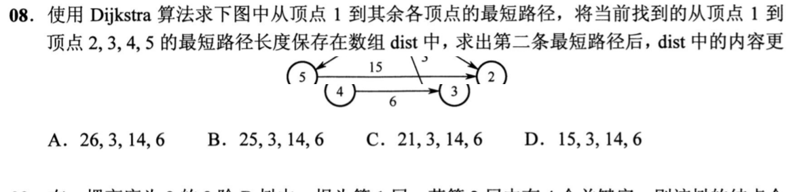

<details>
<summary>答案与解析</summary>

**答案：C。**

* **核心判据**：Dijkstra 算法的单步确定集 $S$ 与局部松弛状态机：
  * 算法维护已确定最短路径的集合 $S$，以及源点到其余顶点的当前最短估计数组 `dist`；
  * **每一步迭代两要素**：
    1. 从 $V \setminus S$ 中贪心选取当前 `dist` 值最小的顶点 $u$ 加入 $S$；
    2. 仅利用顶点 $u$ 出发的有向出边，对所有尚未确定的邻接点 $v$ 进行距离松弛：$\text{dist}[v] = \min(\text{dist}[v], \text{dist}[u] + w(u, v))$。
* **正选推导**：
  * 初始状态（以顶点 1 为源点）：
    * $S = \{1\}$；
    * 从 1 出发的直连边初始化：$1 \to 2: 26, 1 \to 3: 3, 1 \to 4: \infty, 1 \to 5: 6$；
    * 初始 `dist`（对应顶点 2, 3, 4, 5）：`[26, 3, ∞, 6]`。
  * **求出第一条最短路径**：
    * 未确定集合中最小为顶点 3（距离 3），将 3 选入 $S$（$S = \{1, 3\}$）；
    * 用顶点 3 的出边松弛：边 $3 \to 2$（权值 22），更新 $\text{dist}[2] = \min(26, 3 + 22) = 25$；
    * 此时 `dist` 数组为：`[25, 3, ∞, 6]`。
  * **求出第二条最短路径**：
    * 当前未确定集合 $\{2, 4, 5\}$ 中距离最小的顶点是**顶点 5**（距离 6），将 5 选入 $S$（$S = \{1, 3, 5\}$）；
    * 用顶点 5 的出边进行松弛：
      * 边 $5 \to 2$（权值 15）：$\text{dist}[2] = \min(25, 6 + 15) = \mathbf{21}$；
      * 边 $5 \to 4$（权值 8）：$\text{dist}[4] = \min(\infty, 6 + 8) = \mathbf{14}$；
      * 边 $5 \to 3$（权值 6）：3 已在 $S$ 中，不更新；
  * 第二条最短路径求出并松弛后，`dist` 数组内容严格更新为：`21, 3, 14, 6`，选 C。
* **干扰项击穿**：
  * **D项（15, 3, 14, 6）**：这是后续将顶点 4 也选入 $S$ 之后、通过边 $4 \to 2$（权值 1）将顶点 2 进一步松弛为 $14+1=15$ 的结果。题目明确问的是“求出第二条最短路径后”，此时顶点 4 尚未加入 $S$，其出边绝不能提前生效！
  * **B项（25, 3, 14, 6）**：漏掉了顶点 5 对顶点 2 的松弛（$6+15=21 < 25$）。

</details>

### 选择题5｜2022-07

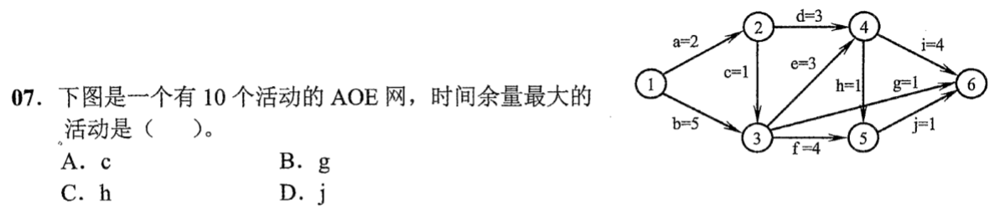

<details>
<summary>答案与解析</summary>

**答案：B。**

* **核心判据**：AOE 网事件最早/最迟时间递推与活动总时差（时间余量）公式：
  * 活动 $a_k = \langle u, v \rangle$，持续时间为 $w$：
    * 活动最早开始时间：$e(k) = ve(u)$
    * 活动最迟开始时间：$l(k) = vl(v) - w$
    * **时间余量（Total Float）**：$\Delta(k) = l(k) - e(k) = vl(v) - ve(u) - w$
* **正选推导**：
  * **第一步：前向拓扑递推各事件最早发生时间 $ve$**：
    * $ve(1) = 0$
    * $ve(2) = ve(1) + 2 = 2$
    * $ve(3) = \max(ve(1) + 5, ve(2) + 1) = \max(5, 2 + 1) = 5$
    * $ve(4) = \max(ve(2) + 3, ve(3) + 3) = \max(2 + 3, 5 + 3) = 8$
    * $ve(5) = \max(ve(3) + 4, ve(4) + 1) = \max(5 + 4, 8 + 1) = 9$
    * $ve(6) = \max(ve(3) + 1, ve(4) + 4, ve(5) + 1) = \max(6, 12, 10) = 12$
    * 工程最短工期（关键路径长度）为 12。
  * **第二步：逆向拓扑递推各事件最迟发生时间 $vl$（令 $vl(6) = 12$）**：
    * $vl(6) = 12$
    * $vl(5) = vl(6) - 1 = 11$
    * $vl(4) = \min(vl(6) - 4, vl(5) - 1) = \min(8, 10) = 8$
    * $vl(3) = \min(vl(4) - 3, vl(5) - 4, vl(6) - 1) = \min(5, 7, 11) = 5$
    * $vl(2) = \min(vl(3) - 1, vl(4) - 3) = \min(4, 5) = 4$
  * **第三步：计算四个选项活动的时间余量**：
    * **活动 c**（$2 \to 3, w=1$）：$\Delta(c) = vl(3) - ve(2) - 1 = 5 - 2 - 1 = 2$
    * **活动 g**（$3 \to 6, w=1$）：$\Delta(g) = vl(6) - ve(3) - 1 = 12 - 5 - 1 = \mathbf{6}$
    * **活动 h**（$4 \to 5, w=1$）：$\Delta(h) = vl(5) - ve(4) - 1 = 11 - 8 - 1 = 2$
    * **活动 j**（$5 \to 6, w=1$）：$\Delta(j) = vl(6) - ve(5) - 1 = 12 - 9 - 1 = 2$
  * 时间余量最大的活动为 **g**（余量为 6），选 B。
* **干扰项击穿**：
  * c、h、j 的时间余量均为 2，而活动 g 直接从事件 3（$ve(3)=5$）跨接到汇点 6（$vl(6)=12$），其自身工期仅为 1，享有多达 6 个单位时间的松弛浮动区间。

</details>

### 选择题6｜2023-06


<details>
<summary>答案与解析</summary>

**答案：B。**

* **核心判据**：最小生成树（MST）与单源最短路径（SPT）的目标泛函根本差异：
  * **生成树目标**：最小化全图所有边的**总权值和**（$\min \sum_{e \in T} w(e)$），它对特定源点到各顶点的单条路径长度没有任何保证；
  * **等权图的特殊性质**：当全图所有边权值均为 1 时，任意一棵包含 $|V|-1$ 条边的生成树其总权值均为 $|V|-1$。这意味着**原图中的任意生成树都是最小生成树**！显然，随意挑选的一棵生成树根本无法保证源点到目标顶点的路径长度最短；
  * **BFS 的最短路径特性**：广度优先搜索依赖 FIFO 队列推进，每次按边数层次递增。当边权全为 1 时，路径权值和即为边数，顶点**首次被访问出队时的路径必然是边数最少的最短路径**。
* **正选推导**：
  * 在所有边权均为 1 的图中：
    * 路径权值等于路径所含边数；
    * BFS 算法从源点出发，距离为 1 的顶点最先入队并访问，接着是距离为 2 的顶点……满足单调性与无权最短路径充要条件，时间复杂度为最优的 $O(|V|+|E|)$，III 必然正确。选 B。
* **干扰项击穿**：
  * **反例击穿 Prim 与 Kruskal（I、II 错误）**：
    * 构造 4 个顶点构成的环形加弦图：顶点 $A, B, C, D$，边为 $(A, B), (B, C), (C, D), (D, A)$ 以及直连对角弦 $(A, C)$，所有边权均为 1；
    * 求从源点 $A$ 到 $C$ 的最短路径：原图中直连边 $(A, C)$ 长度为 1；
    * 运行 Prim 或 Kruskal 算法时，由于所有边权均为 1，选边完全由遍历顺序决定。若算法选择生成树边为 $(A, B), (B, C), (C, D)$（总权值为 3，是一棵合法的最小生成树）；
    * 此时在生成树上，从 $A$ 到 $C$ 的唯一路径是 $A \to B \to C$，路径权值为 2 $\ne$ 最短距离 1！
    * 证明 MST 树上路径不能保证为原图单源最短路径。

</details>

### 选择题7｜2026-07

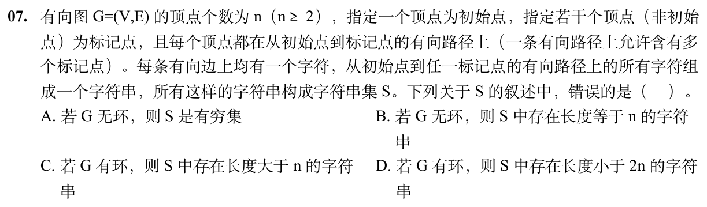

<details>
<summary>答案与解析</summary>

**答案：B。**

* **核心判据**：有限有向图简单路径边数上限与鸽巢原理：
  * 字符串的长度等于从初始点到标记点的**有向路径所包含的有向边数**；
  * 在一个拥有 $n$ 个顶点的图中，任意一条**不含环的简单路径**最多只能访问 $n$ 个顶点，因此**最多只能包含 $n - 1$ 条边**；
  * 若一条路径包含 $n$ 条有向边，则该路径必须依次经过 $n + 1$ 个顶点。根据鸽巢原理（抽屉原理），这 $n + 1$ 个顶点中必然至少有 2 个顶点是同一个顶点，从而**该路径必然包含至少一个回路**；
  * **结论**：若图 $G$ 无环，则图中**绝对不可能存在边数等于 $n$ 的路径**，集合 $S$ 中字符串长度的最大上限为 $n - 1$，“存在长度等于 n 的字符串”在数学上必然为假命题！
* **正选推导**：
  * 题目要求选出“叙述错误的是”，B 项彻底违背无环图路径长度极限，符合题意，选 B。
* **干扰项击穿**：
  * **A项为真**：若 $G$ 无环，图为有向无环图（DAG），从初始点到标记点的简单路径数是有限的，路径长度不超过 $n-1$，因此 $S$ 必为有穷集；
  * **C项为真**：若 $G$ 有环，且题设说明每个顶点均在可达路径上，该环可被初始点到达并可通往某个标记点，绕环任意 $k$ 圈可生成任意长（$> n$）的字符串；
  * **D项为真**：取从初始点到某标记点的一条不绕环的简单最短路径，其边数必定 $\le n - 1 < 2n$，因此 $S$ 中必然存在长度小于 $2n$ 的字符串。

</details>

## 选择题组2｜0827 · 操作系统

[资源闭环：死锁、避免与检测](../src/0827.md) · 3道 · 首次。

### 选择题8｜2020-27

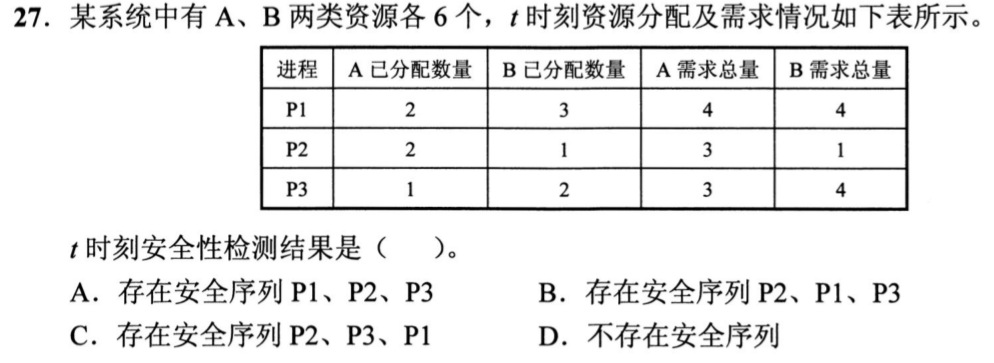

<details>
<summary>答案与解析</summary>

**答案：B。**

* **核心判据**：银行家算法（Banker's Algorithm）安全性状态演进机理：
  1. 计算系统当前可用资源向量：$\text{Available} = \text{Total} - \sum \text{Allocation}$；
  2. 计算各进程尚需资源矩阵：$\text{Need} = \text{Max} - \text{Allocation}$；
  3. 推进循环：在未完成集合中寻找满足 $\text{Need}_i \le \text{Work}$ 的进程，执行完毕后将其已分配的资源全部回收入库 $\text{Work} = \text{Work} + \text{Allocation}_i$；若能使所有进程全部完成，则存在安全序列。
* **正选推导**：
  * **资源现状计算**：
    * A 已分配总量：$2 + 2 + 1 = 5 \implies \text{Available}[A] = 6 - 5 = 1$；
    * B 已分配总量：$3 + 1 + 2 = 6 \implies \text{Available}[B] = 6 - 6 = 0$；
    * 当前系统空闲资源向量：$\text{Work} = (1, 0)$。
  * **尚需资源 Need 计算**：
    * P1: $(4-2, 4-3) = (2, 1)$
    * P2: $(3-2, 1-1) = (1, 0)$
    * P3: $(3-1, 4-2) = (2, 2)$
  * **安全性单步推演**：
    * 初始 $\text{Work} = (1, 0)$：
      * P1 需 $(2, 1) \not\le (1, 0)$；P3 需 $(2, 2) \not\le (1, 0)$；
      * 唯有 P2 需 $(1, 0) \le (1, 0)$ 能够被满足，**第 1 步必须且只能调度 P2**！
    * P2 运行结束，释放其占有的 $(2, 1)$：
      * $\text{Work} = (1, 0) + (2, 1) = (3, 1)$；
    * 此时考察剩余的 P1 与 P3：
      * P1 需 $(2, 1) \le (3, 1)$，资源满足！
      * P3 需 $(2, 2) \not\le (3, 1)$（B 类仅有 1 个，不足 2 个），无法满足！
      * 因此**第 2 步必须调度 P1**！
    * P1 运行结束，释放其占有的 $(2, 3)$：
      * $\text{Work} = (3, 1) + (2, 3) = (5, 4)$；
    * 最后调度 P3：$\text{Need} = (2, 2) \le (5, 4)$，满足完成。
  * 唯一合法安全序列为：**P2、P1、P3**，选 B。
* **干扰项击穿**：
  * **A项（P1开头）**：初始空闲仅有 $(1, 0)$，而 P1 需要 $(2, 1)$，无法启动；
  * **C项（P2、P3、P1）**：P2 释放后空闲为 $(3, 1)$，而 P3 需要 2 个 B 类资源，若贸然先调度 P3 会立刻导致资源耗尽死锁。

</details>

### 选择题9｜2021-31

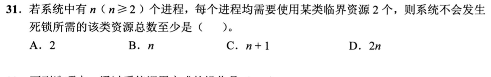

<details>
<summary>答案与解析</summary>

**答案：C。**

* **核心判据**：打破“请求并保持”的极值鸽巢原理：
  * 设系统中有 $n$ 个并发进程，每个进程最大需求为 $m$ 个独占资源（本题 $m=2$）；
  * **临界死锁悬崖极限状态**：假设每个进程都拿到了自身最大需求减 1 个资源（即每个进程各持有 $m-1 = 1$ 个资源），且此时系统可用资源被全部榨干（$\text{Available} = 0$）。此时所有进程都在挂起等待对方释放最后一个资源，陷入死锁僵局；
  * 处于该最坏死锁状态时，系统被占用的资源总量为：
    $$R_{\text{deadlock}} = n \times (m - 1) = n \times 1 = n$$
  * **绝对不发生死锁的资源底线**：只要在死锁悬崖的基础上，**额外多提供 1 个资源**：
    $$R_{\min} = n \times (m - 1) + 1 = n + 1$$
  * 此时必然至少有 1 个进程能凑齐全部 2 个资源执行完毕，释放其占有的 2 个资源回收入库，进而解救其余所有进程。
* **正选推导**：
  * 保证系统绝不发生死锁的该类资源总数至少为 $n + 1$，选 C。
* **干扰项击穿**：
  * **D项（2n）**：$2n$ 是让所有 $n$ 个进程**同时并行无等待拿满资源**的资源量。死锁预防只要求进程能分批流水推进，不需要全员同时运行，因此 $2n$ 远非“至少”的极值下界；
  * **B项（n）**：恰好落入全员死锁陷阱（每个进程各持 1 个，系统余量为 0，全体永久阻塞）。

</details>

### 选择题10｜2022-26

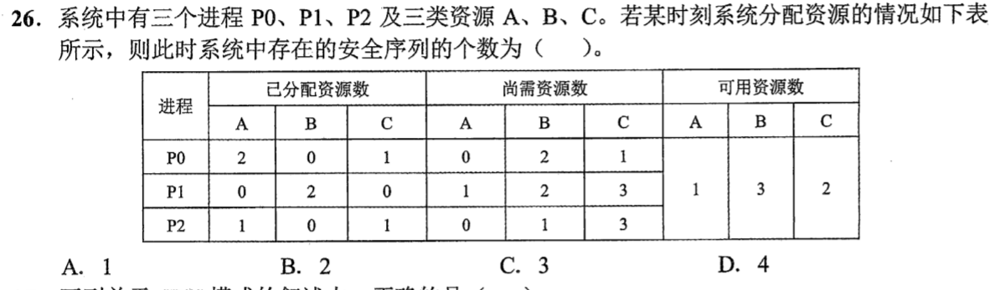

<details>
<summary>答案与解析</summary>

**答案：B。**

* **核心判据**：银行家算法安全性检查的多路径分支推演：
  * 初始可用资源向量：$\text{Work} = (1, 3, 2)$；
  * 比对第一步候选进程（需满足 $\text{Need}_i \le \text{Work}$）：
    * P0 尚需：$(0, 2, 1) \le (1, 3, 2)$ $\implies$ 可被满足；
    * P1 尚需：$(1, 2, 3) \not\le (1, 3, 2)$（C 类缺 1 个） $\implies$ 无法启动；
    * P2 尚需：$(0, 1, 3) \not\le (1, 3, 2)$（C 类缺 1 个） $\implies$ 无法启动；
    * **第一步唯一的合法选择只能是 P0**！
* **正选推导**：
  * P0 运行完成，释放其已分配的资源 $\text{Allocation}_{P0} = (2, 0, 1)$：
    $$\text{Work} = (1, 3, 2) + (2, 0, 1) = (3, 3, 3)$$
  * 此时再次比对剩余未完成的 P1 与 P2：
    * P1 尚需：$(1, 2, 3) \le (3, 3, 3)$，满足；
    * P2 尚需：$(0, 1, 3) \le (3, 3, 3)$，满足；
    * 此时 P1 和 P2 均可执行，产生两个互不干扰的调度分支：
      * **分支 1**：调度 P1 $\to$ P1 释放资源 $\to$ 调度 P2，得到安全序列：$P0 \to P1 \to P2$；
      * **分支 2**：调度 P2 $\to$ P2 释放资源 $\to$ 调度 P1，得到安全序列：$P0 \to P2 \to P1$；
  * 系统中存在的安全序列个数恰好为 **2**，选 B。
* **干扰项击穿**：
  * 误选 A（1 个）：以为安全序列只有一个，忽略了 P0 释放资源后 Work 达到 (3,3,3)，P1 和 P2 之间不存在先后资源依赖，具有完全对称的双向执行自由度。

</details>

## 解答题

### 大题1｜2024-43

[原题单 0920｜指令落到数据通路：寄存器、部件与控制信号协同](../src/0920.md)

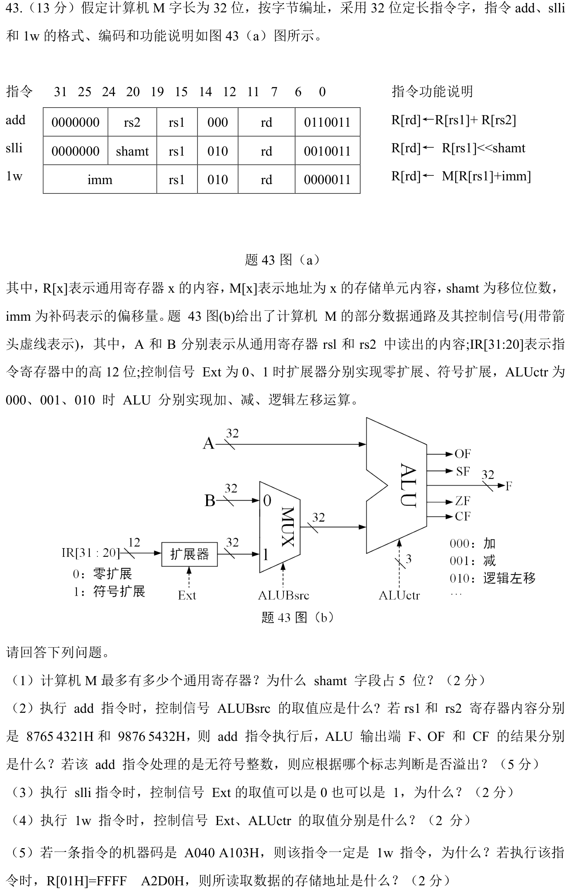

<details>
<summary>答案与解析</summary>

**答案与解析**：

**（1）通用寄存器最大数量与 shamt 字段位宽原因**：
* **通用寄存器最大数量**：
  * 查题 43(a) 表中的指令格式，寄存器操作数编号字段 `rd`、`rs1`、`rs2` 的位宽均为 **5 位**（例如位 `19:15`、`24:20`、`11:7` 均为 5 位）；
  * 5 位二进制编码最多可独立寻址 $2^5 = \mathbf{32}$ 个通用寄存器。
* **shamt 字段占 5 位的原因**：
  * 计算机 M 的机器字长为 32 位，对 32 位数据进行逻辑左移运算时，有效的移位量范围为 $0 \sim 31$ 位（移位达到或超过 32 位则数据全被移出，无实际运算意义）；
  * 表示 $0 \sim 31$ 共 32 种不同的移位位数，所需的二进制最少位数为 $\log_2 32 = \mathbf{5}$ 位。

---

**（2）add 指令控制信号、标志位运算与溢出判断依据**：
* **控制信号 ALUBsrc 的取值**：
  * `add` 指令执行寄存器与寄存器相加（$R[rd] \leftarrow R[rs1] + R[rs2]$），ALU 的下输入端必须选择通用寄存器读出的操作数 B；
  * 根据题 43(b) 图的 MUX 选择逻辑，选通输入端 0 即选择 B，因此 **ALUBsrc = 0**。
* **ALU 输出端 F、OF、CF 的计算结果**：
  * 两个 32 位输入操作数十六进制为：
    $$A = 8765\;4321\text{H}, \quad B = 9876\;5432\text{H}$$
  * 二进制加法推演（十六进制逐位相加）：
    * 低 16 位：$4321\text{H} + 5432\text{H} = 9753\text{H}$（向高位无进位）；
    * 高 16 位：$8765\text{H} + 9876\text{H} = 1\;1\text{FDB}\text{H}$（最高位产生进位 1）；
    * 33 位完整和为：$1\;1\text{FDB}\;9753\text{H}$；
  * **输出端 F（低 32 位结果）**：**1FDB 9753H**；
  * **CF（无符号数进位标志）**：最高位（第 31 位）向外产生了进位输出 $C_{\text{out}} = 1$。在加法运算中，$\text{CF} = C_{\text{out}} = \mathbf{1}$；
  * **OF（有符号数溢出标志）**：
    * 操作数 A 最高位为 1（8 开头，为负数）；
    * 操作数 B 最高位为 1（9 开头，为负数）；
    * 结果 F 最高位为 0（1 开头，最高位为正数）；
    * 两个负数相加得到正数，发生符号溢出，因此 **OF = 1**（或由 $C_{\text{out}} \oplus C_{31} = 1 \oplus 0 = 1$）。
* **无符号整数溢出判断依据**：
  * 处理无符号整数时，应根据 **CF 标志** 判断是否溢出（CF=1 表示溢出）。

---

**（3）slli 指令中 Ext 取值可为 0 也可为 1 的物理原因**：
* 扩展器的输入取自指令的高 12 位 `IR[31:20]`；
* 查题 43(a) 表中的 `slli` 指令编码，其最高 7 位 `IR[31:25]` 恒定固定为全零（`0000000`）；
* 这意味着扩展器输入端的**最高有效符号位 `IR[31]` 必然为 0**；
* 当 $\text{Ext}=0$（零扩展）时，高 20 位直接填 0；
* 当 $\text{Ext}=1$（符号扩展）时，因最高位本身为 0，高 20 位填充符号位同样全为 0；
* 两种扩展方式得到的 32 位结果完全相同（均为高 27 位补 0、低 5 位为 shamt），因此 Ext 取 0 或 1 硬件效果完全等价。

---

**（4）lw 指令中 Ext、ALUctr 控制信号的取值**：
* 题干明确指出“`imm` 为补码表示的偏移量”，因此从 `IR[31:20]` 截取的 12 位立即数必须进行**符号扩展**为 32 位补码，故 **Ext = 1**；
* `lw` 指令计算访存有效地址采用基址加偏移量（$R[rs1] + \text{imm}$），ALU 必须执行**加法**运算，查题 43(b) 控制表得 **ALUctr = 000**。

---

**（5）机器码 A040 A103H 指令类型判定与访存地址计算**：
* **为什么一定是 lw 指令**：
  * 将十六进制机器码 `A040 A103H` 展开为低 7 位操作码 `opcode`：
    * `03H` 的二进制为 `0000011`；
    * 查题 43(a) 表，三条指令的操作码分别为：`add` 为 `0110011`，`slli` 为 `0010011`，`lw` 为 `0000011`；
    * 该机器码的低 7 位操作码与 `lw` 指令唯一精准匹配，因此该指令一定是 `lw` 指令。
* **读取数据的存储物理地址计算**：
  * 对 `A040 A103H` 进行完整字段切分：
    * `[31:20]` (imm) = `1010 0000 0100` = `A04H`；
    * `[19:15]` (rs1) = `00001` = 寄存器 01H；
  * 12 位补码 `imm = A04H` 最高位为 1，经符号扩展至 32 位为：`FFFF FA04H`；
  * 访存有效地址为基址加偏移：
    $$\text{Address} = R[01\text{H}] + \text{imm} = \text{FFFF A2D0H} + \text{FFFF FA04H}$$
    * 低 16 位：$\text{A2D0H} + \text{FA04H} = 1\;9\text{CD4H}$；
    * 高 16 位：$\text{FFFFH} + \text{FFFFH} + 1 = 1\;\text{FFFFH}$；
    * 截取 32 位结果（最高进位自然丢弃）：
      $$\text{Address} = \mathbf{FFFF\;9CD4H}$$
  * 所读取数据的存储地址为 **FFFF 9CD4H**。

</details>

### 大题2｜2024-44

[原题单 0919｜表示到汇编：同一位模式在类型、指令与调用中怎样解释](../src/0919.md)

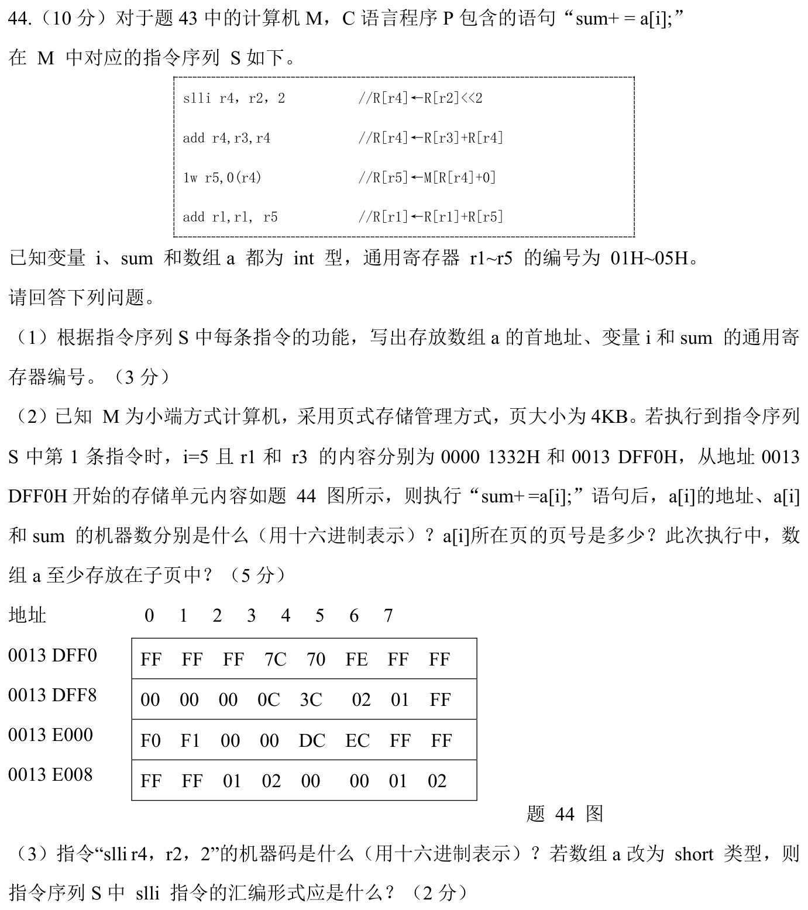

本题沿用本日43题的题干。

<details>
<summary>答案与解析</summary>

**答案与解析**：

**（1）存放数组 a 首地址、变量 i 和 sum 的通用寄存器编号**：
* **指令执行语义逐行剖析**：
  1. `slli r4, r2, 2`：执行 $R[r4] \leftarrow R[r2] \ll 2 = 4 \times R[r2]$。在 32 位整型（int 占 4 字节）数组寻址中，元素偏移字节数等于下标乘 4，故 $R[r2]$ 存放**变量 i**，寄存器编号为 **02H**；
  2. `add r4, r3, r4`：执行 $R[r4] \leftarrow R[r3] + 4i$，基址加偏移定位元素 `a[i]` 的内存地址，故 $R[r3]$ 存放**数组 a 的首地址**，寄存器编号为 **03H**；
  3. `lw r5, 0(r4)`：执行 $R[r5] \leftarrow M[R[r4]]$，将 `a[i]` 的值加载至临时寄存器 r5；
  4. `add r1, r1, r5`：执行 $R[r1] \leftarrow R[r1] + a[i]$，完成累加赋值 `sum += a[i]`，故 $R[r1]$ 存放**变量 sum**，寄存器编号为 **01H**。
* **结论**：
  * 数组 a 的首地址：**03H**（r3）
  * 变量 i：**02H**（r2）
  * 变量 sum：**01H**（r1）

---

**（2）a[i] 地址、机器数、sum 结果、页号及跨页分析**：
* **a[i] 的存储地址计算（此时 $i=5$）**：
  * 数组首地址为 `0013 DFF0H`；
  * $a[5]$ 的内存起始地址：
    $$\text{Addr} = \text{0013 DFF0H} + 5 \times 4 = \text{0013 DFF0H} + 20 = \text{0013 DFF0H} + 14\text{H} = \mathbf{0013\;E004H}$$
* **a[i] 机器数的十六进制确定（小端方式存储）**：
  * 从地址 `0013 E004H` 处读取连续 4 个字节，查题 44 图的内存行 `0013 E000`：
    * 偏移 4（地址 `...004`）：`DC`（存放在最低地址，为最低有效字节 LSB）
    * 偏移 5（地址 `...005`）：`EC`
    * 偏移 6（地址 `...006`）：`FF`
    * 偏移 7（地址 `...007`）：`FF`（存放在最高地址，为最高有效字节 MSB）
  * 机器 M 为**小端存储（Little-Endian）**，高字节在高地址、低字节在低地址，从高到低拼装为：
    $$a[5] = \mathbf{FFFF\;ECDCH}$$
* **sum 的机器数更新**：
  * 原 sum 值为 $R[r1] = \text{0000 1332H}$；
  * 新 sum $= \text{0000 1332H} + \text{FFFF ECDCH}$：
    * 低 16 位：$1332\text{H} + \text{ECDCH} = 1\;000E\text{H}$；
    * 高 16 位：$0000\text{H} + \text{FFFFH} + 1 = 1\;0000\text{H}$；
    * 32 位寄存器截断保留低 32 位：
      $$\text{sum} = \mathbf{0000\;000EH}$$
* **a[i] 所在页的页号**：
  * 系统页大小为 $4\text{KB} = 2^{12}\text{B}$，虚拟地址的低 12 位（十六进制低 3 位）为页内偏移，高位为虚拟页号；
  * $a[5]$ 地址为 `0013 E004H`，低 12 位偏移为 `004H`，高位虚拟页号为 **0013EH**。
* **数组 a 至少存放在几页中**：
  * 数组起始元素 $a[0]$ 地址为 `0013 DFF0H`，所在页号为 **0013DH**（页内偏移为 `FF0H`）；
  * 元素 $a[5]$ 地址为 `0013 E004H`，所在页号为 **0013EH**；
  * 仅前 6 个元素就已经跨越了两个不同的页面（页 `0013DH` 与页 `0013EH`），因此数组 a 至少存放在 **2 页** 中。

---

**（3）slli 机器码与 short 数组汇编改写**：
* **指令 `slli r4, r2, 2` 的机器码（十六进制）**：
  * 查题 43(a) 格式填入各字段二进制：
    * `opcode` [6:0] = `0010011`
    * `rd` [11:7] = 4 = `00100`
    * `funct3` [14:12] = `010`
    * `rs1` [19:15] = 2 = `00010`
    * `shamt` [24:20] = 2 = `00010`
    * `[31:25]` = `0000000`
  * 拼接 32 位二进制：
    `0000 0000 0100 0010 0010 0010 0001 0011`
  * 转换为十六进制机器码为：**0042 2213H**。
* **short 类型数组的 slli 汇编形式**：
  * C 语言中 `short` 类型数据占用 **2 个字节**；
  * 寻址偏移量计算公式为 $\text{Offset} = i \times 2 = i \ll 1$；
  * 因此逻辑左移位数由 2 改为 1，指令的汇编形式为：**`slli r4, r2, 1`**。

</details>

## 一行记录

```text
实际用时__；未完成或未核对的题号__；今天最容易混淆的是__
```
