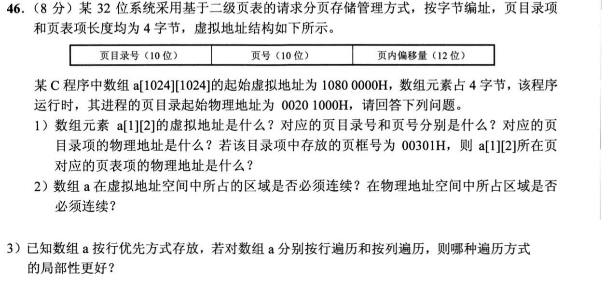
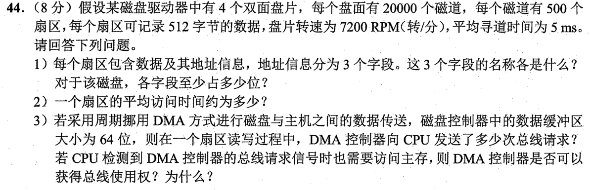

# Day 16｜数据通路、Web会话与两级页表

[← Day 15](day15.md) · [总入口](README.md) · [Day 17 →](day17.md)

## 今天按这个顺序做

1. **回忆至多10分钟。** 只回看昨天的一处真实断点。
2. **选择题及补学至多50分钟。** 只做以下指定题，先作答再展开。
   - [0819｜数据通路与并行执行](modules/0819.md) · [原题单](../src/0819.md) · 2022-22、2025-19
   - [0908｜Web对象请求与 Cookie](modules/0908.md) · [原题单](../src/0908.md) · 2022-40、2026-40
3. **两道大题及补学至多50分钟。** 每题先独立尝试5分钟，卡住才打开提示，随后遮住重做。
4. **闭卷检查至多10分钟。** 到120分钟收笔，按 I／H／U 记真实状态。

## 大题1｜2020-46 · 二维数组与两级页表

[原题单 0926](../src/0926.md)

没有入口时的第一步

先求数组元素字节地址，再按10／10／12切字段。

完整解法与必要补学

（1）虚址1080 0000H+(1024+2)×4=1080 1008H。页目录号42H，二级页号001H，偏移008H。目录项物理地址0020 1000H+42H×4=0020 1108H。二级页表的页框号00301H左移12位得0030 1000H，再加001H×4，表项物理地址为0030 1004H。

（2）数组的虚址区间连续。相邻虚页可映到任意不相邻的物理页框，请求分页下也可暂不驻留。

（3）按行遍历局部性更好，相邻元素差4B，整行4096B恰好一页。按列访问步长是4096B，每次跨到另一页。

重做后检查

页表框号须先左移12位才能作为字节基址。

## 大题2｜2022-44 · 磁盘旋转与DMA周期挪用

[原题单 0927](../src/0927.md)

没有入口时的第一步

分别算柱面、盘面、扇区的数量，把转速换成每圈时间。

完整解法与必要补学

（1）柱面号（磁道号）15位，磁头号（盘面号）3位，扇区号9位。需要区分20000个柱面、8个盘面、每道500个扇区。

（2）7200rpm等于120转/秒，周期约8.333ms。平均旋转等待4.167ms，单扇区传输8.333/500≈0.0167ms，加寻道5ms，总计约9.183ms。

（3）DMA每次交接64位=8B，512/8=64次总线请求。CPU也要访存时，通常DMA优先获得一个可分配的总线周期，CPU暂停该次访存。若CPU已有事务正在执行，需等它结束。优先权有助于及时接收设备的连续数据。

重做后检查

用7200/60检查每秒转数，用4个双面盘片检查盘面数。

## 最后闭卷检查

Cookie在哪一层？页目录项和普通页表项分别指向哪里？

检查答案

HTTP应用层。目录项指向二级页表页框，普通页表项指向数据页框。

记录：实际用时__；选择 I__/H__/U__；两道大题状态__；下次先修的题号与卡点__。
