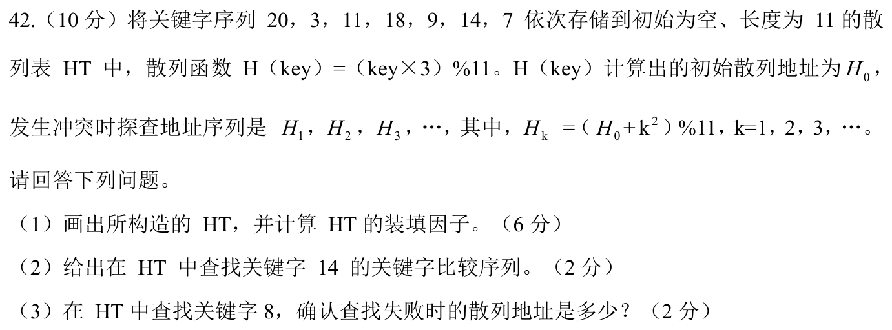
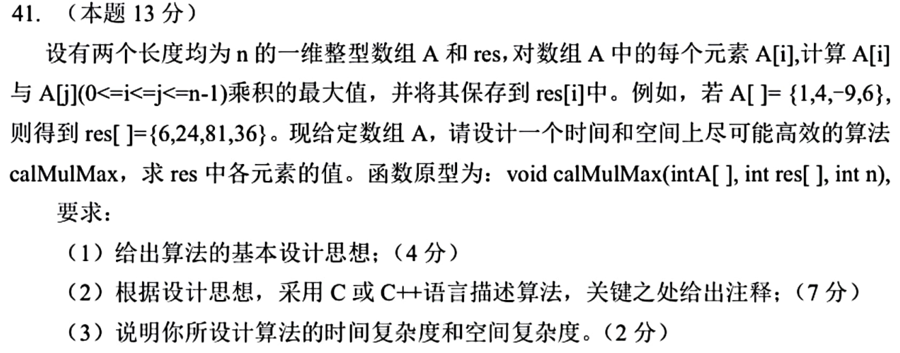

# Day 17｜散列探查、KMP 与后缀极值

[← Day 16](day16.md) · [总入口](README.md) · [Day 18 →](day18.md)

## 今天按这个顺序做

1. **回忆至多10分钟。** 只回看昨天的一处真实断点。
2. **选择题及补学至多50分钟。** 只做以下指定题，先作答再展开。
   - [0808｜散列冲突与平均查找长度](modules/0808.md) · [原题单](../src/0808.md) · 2022-09、2025-09
   - [0809｜KMP 失配时保留的前缀](modules/0809.md) · [原题单](../src/0809.md) · 2024-06
3. **两道大题及补学至多50分钟。** 每题先独立尝试5分钟，卡住才打开提示，随后遮住重做。
4. **闭卷检查至多10分钟。** 到120分钟收笔，按 I／H／U 记真实状态。

## 大题1｜2024-42 · 按二次探查重建散列表

[原题单 0918](../src/0918.md)



<details>
<summary>没有入口时的第一步</summary>

先写 H₀，后续每次都从 H₀ 加 k²。不要在上一个位置继续累加 k²。

</details>

<details>
<summary>完整解法与必要补学</summary>

（1）按顺序，20、3、11、18、9、14、7 分别落入5、9、0、10、6、2、3。按槽0～10写为 [11, 空, 14, 7, 空, 20, 9, 空, 空, 3, 18]，装填因子7/11。

（2）14的 H₀=9，探查地址9、10、2，比较关键字3、18、14。

（3）8的 H₀=2，探查地址2、3、6、0、7；到地址7遇空，确认失败。

</details>

<details>
<summary>重做后检查</summary>

14的第三个探查地址是(9+4)%11=2。8的失败地址是空槽7，不是此前最后比较的槽0。

</details>

## 大题2｜2025-41 · 最大乘积只需记录后缀两端极值

[原题单 0914](../src/0914.md)



<details>
<summary>没有入口时的第一步</summary>

固定 A[i]。若它为负，乘积随 A[j] 减小而增大。倒序扫描可以原地维护后缀最小值与最大值。

</details>

<details>
<summary>完整解法与必要补学</summary>

（1）从右向左扫描，先把 A[i] 纳入后缀。A[i] 非负就乘后缀最大值，为负就乘后缀最小值。

（2）沿用题设 int 输出，假定应存入 res 的乘积在 int 范围内。

```c
void calMulMax(int A[], int res[], int n) {
    if (n <= 0) return;
    int lo = A[n - 1], hi = A[n - 1];
    for (int i = n - 1; i >= 0; --i) {
        int x = A[i];
        // 先纳入自身，保证后缀范围为 [i, n-1]
        if (x < lo) lo = x;
        if (x > hi) hi = x;
        res[i] = x * (x < 0 ? lo : hi);
    }
}
```

（3）每个位置处理一次，时间 O(n)，除输入输出外空间 O(1)。

</details>

<details>
<summary>重做后检查</summary>

用 {1,4,−9,6} 走一遍，得到 {6,24,81,36}。再用单元素负数检查是否允许与自己相乘。

</details>

## 最后闭卷检查

同一个失配字符为何能跳过 nextval 合并的候选？探查为何从 H₀ 重算？

<details>
<summary>检查答案</summary>

相同的模式字符必然再次失配；题设的 k² 是相对于初址的偏移。

</details>

记录：实际用时__；选择 I__/H__/U__；两道大题状态__；下次先修的题号与卡点__。
