# Day 19｜数据结构＋操作系统

[← Day 18](day18.md) · [总入口](README.md) · [Day 20 →](day20.md)

**选择题：17道，来自两份完整src题单；大题：1道。** 先做选择题，再展开题下解析。组内题目沿用src顺序；标为复做的组，已会的快速通过，重点处理上次错题。

**预计用时：60—95分钟。** 选择题及核对约30—50分钟，大题约25—35分钟，最后用5—10分钟重做今天最值得记住的一道错题。约两小时是配题目标，不是必须耗满或到点强停；计算卡住时先保留题号，先完成其余选择题。

## 选择题组1｜0809 · 数据结构

[失配之后：KMP如何保留已经知道的部分](../src/0809.md) · 1道 · 首次。

### 选择题1｜2024-06


<details>
<summary>答案与解析</summary>

**答案：A。**

**直接法：** 按1起始下标，aabaab 的 nextval 为 0、0、2、0、0、2。第5位失配时，依次可退到第2位和第1位，但三者都是 a，已知都会失配，最终退到0。右移5个位置；第6位仍可退到第2位，只移4位。

</details>

## 选择题组2｜0824 · 操作系统

[系统边界：应用如何进入内核](../src/0824.md) · 16道 · 复做第1次。

### 选择题2｜2020-18

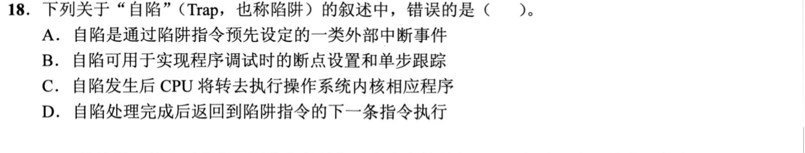

<details>
<summary>答案与解析</summary>

**答案：A。**

**直接法：** Trap由当前指令引发，属于CPU内部的同步事件；A把它说成“外部中断事件”，错误。

**排除法／易混点：** B断点、单步可通过陷阱进入调试处理；C陷入后执行内核处理程序；D本题的陷阱处理完返回下一条指令。不要把Trap与需要重新执行故障指令的Fault混为一谈。

</details>

### 选择题3｜2020-25

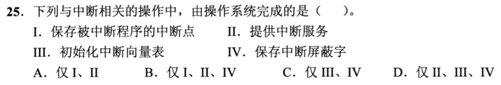

<details>
<summary>答案与解析</summary>

**答案：D。**

**直接法：** II中断服务、III初始化中断向量表、IV保存中断屏蔽字都由操作系统代码完成；I保存断点在中断响应阶段由硬件完成。故选II、III、IV。

**排除法／易混点：** 排除所有包含I的A、B；C少了操作系统执行的中断服务II。关键是“响应阶段的硬件动作”与“处理程序的软件动作”分开。

</details>

### 选择题4｜2021-23

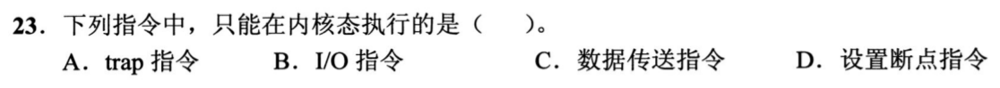

<details>
<summary>答案与解析</summary>

**答案：B。**

**直接法：** I/O指令直接控制设备，属于特权指令，只能在内核态执行。

**排除法／易混点：** A的trap恰是用户程序请求进入内核的入口，因此允许在用户态执行；C普通数据传送、D程序调试用断点也不是本题所指的特权I/O操作。

</details>

### 选择题5｜2021-32

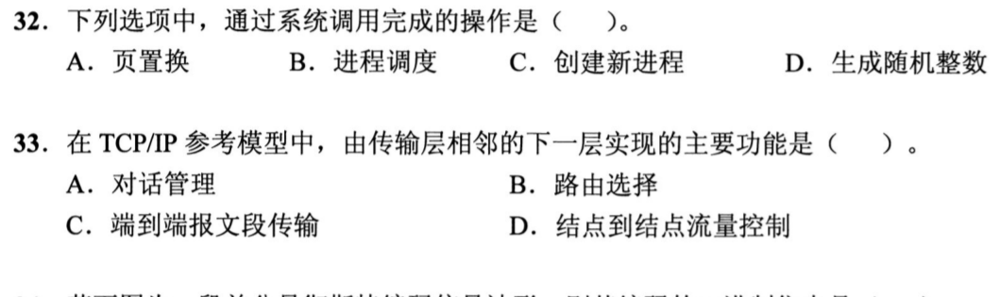

<details>
<summary>答案与解析</summary>

**答案：C。**

**直接法：** 创建新进程需要内核建立进程管理信息、分配资源，用户程序通过系统调用请求完成，所以选C。

**排除法／易混点：** A页置换、B进程调度也是内核工作，但它们是内核管理机制，不等于用户主动调用的系统服务；D题中的普通伪随机整数可由用户态算法生成。不能用“内核会做”替代“通过系统调用请求”。

</details>

### 选择题6｜2022-24

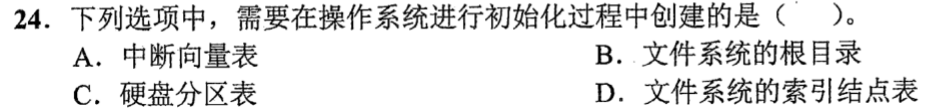

<details>
<summary>答案与解析</summary>

**答案：A。**

**直接法：** 操作系统启动时要建立中断入口到处理程序的对应关系，初始化中断向量表，因此选A。

**排除法／易混点：** B根目录、D文件系统索引结点表在建立文件系统时创建；C硬盘分区表在分区时创建。它们可以早已保存在磁盘上，不需每次启动重新创建。

</details>

### 选择题7｜2022-27

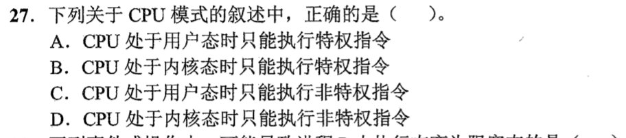

<details>
<summary>答案与解析</summary>

**答案：C。**

**直接法：** 用户态只能执行非特权指令；内核态既能执行特权指令，也能执行非特权指令。

**排除法／易混点：** A把用户态权限说反；B、D的“只能”都把内核态可执行的另一类指令排除了。内核态是权限更高，不是只能执行另一套指令。

</details>

### 选择题8｜2022-31

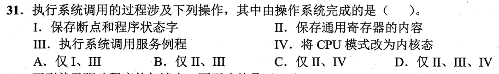

<details>
<summary>答案与解析</summary>

**答案：B（II、III）。**

**直接法：** 系统调用进入内核后，操作系统代码保存通用寄存器、执行系统调用服务例程，因此II、III属于操作系统完成的工作。

**排除法／易混点：** I保存断点和PSW、IV切换内核态由陷入响应的硬件完成。这里按题目教材模型区分响应与软件处理，不能把进入内核前后全部动作都算给操作系统。

</details>

### 选择题9｜2023-21

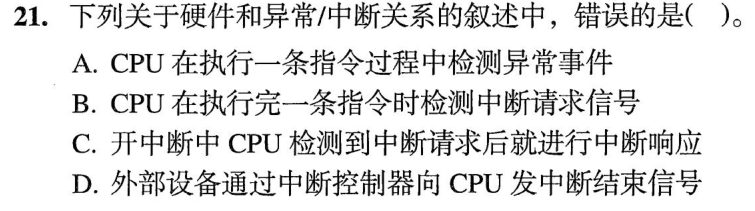

<details>
<summary>答案与解析</summary>

**答案：D。**

**直接法：** 中断控制器向CPU发送的是中断请求信号，不是“中断结束信号”，所以D错误。

**排除法／易混点：** A异常随当前指令执行而被检测；B外中断通常在指令边界检查；C在开中断且请求满足响应条件时进入中断响应。区分异常的指令内检测和外中断的指令间响应。

</details>

### 选择题10｜2023-23

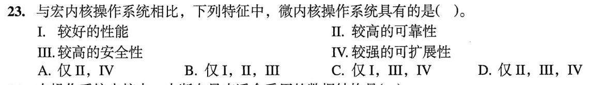

<details>
<summary>答案与解析</summary>

**答案：D（II、III、IV）。**

**直接法：** 微内核将更多服务放在独立的用户态进程中，便于隔离故障、限制权限和替换扩展服务，故可靠性、安全性、可扩展性成立。

**排除法／易混点：** I“较高性能”不能一般成立：跨进程服务调用可能增加IPC和模式切换开销。不是内核越小，执行每项服务就一定越快。

</details>

### 选择题11｜2023-24

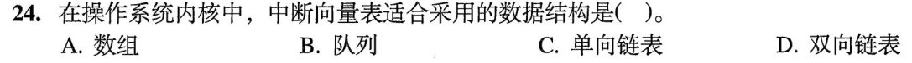

<details>
<summary>答案与解析</summary>

**答案：A。**

**直接法：** 中断号可直接作为下标，定位对应入口；中断向量表适合用数组实现。

**排除法／易混点：** 队列、单链表、双链表要按顺序访问或遍历，不能利用中断号直接定位这一特点。

</details>

### 选择题12｜2023-26

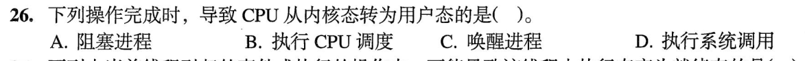

<details>
<summary>答案与解析</summary>

**答案：B。**

**直接法：** CPU调度选定并切换到将运行的进程，完成后恢复其运行现场，返回用户态执行，所以选B。

**排除法／易混点：** 阻塞、唤醒只是修改进程状态和队列，操作本身在内核中完成；执行系统调用是从用户态进入内核态，方向相反。

</details>

### 选择题13｜2024-23

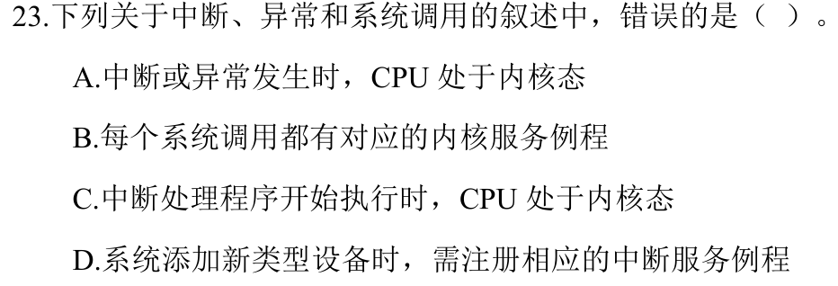

<details>
<summary>答案与解析</summary>

**答案：A。**

**直接法：** 用户程序运行时也会发生中断或异常，例如访存触发缺页；发生那一刻CPU可以仍在用户态，随后才转入内核处理，所以A错误。

**排除法／易混点：** C说的是“中断处理程序开始执行时”，这时已经是内核态，与A的“发生时”不同。B对应系统调用服务例程；D新增设备需相应中断处理支持，均成立。

</details>

### 选择题14｜2025-23

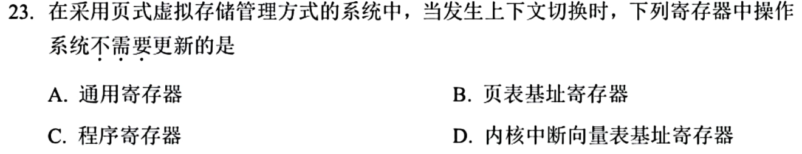

<details>
<summary>答案与解析</summary>

**答案：D。**

**直接法：** 上下文切换换的是当前进程；中断向量表是系统级的中断入口表，不随普通进程切换而更换。

**排除法／易混点：** A通用寄存器、C程序寄存器保存进程运行现场；B页表基址对应进程地址空间，换地址空间要更新。不要把系统的中断入口表当作某个进程的页表。

</details>

### 选择题15｜2025-24

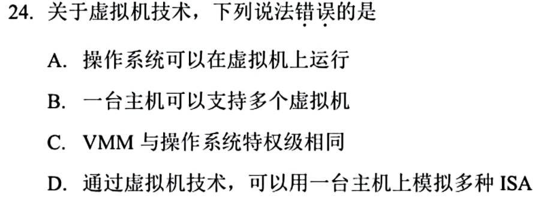

<details>
<summary>答案与解析</summary>

**答案：C。**

**直接法：** VMM要控制和隔离客户操作系统，实际控制权限高于客户内核；C说两者特权级相同，错误。

**排除法／易混点：** A操作系统可在虚拟机内运行，B一台主机可支持多台虚拟机；D可借助指令模拟或动态翻译模拟异构ISA。D不等于普通硬件辅助虚拟化就能直接执行任意ISA。

</details>

### 选择题16｜2026-23

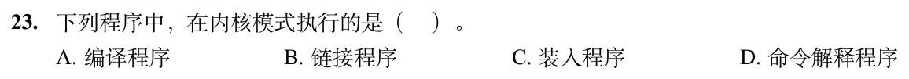

<details>
<summary>答案与解析</summary>

**答案：C。**

**直接法：** 按408操作系统教材模型，装入程序负责将可执行程序装入内存并建立运行所需的装入信息，属于内核装入功能。

**排除法／易混点：** 编译器、链接器、命令解释器通常是用户态程序。命令解释器能发起系统调用，不意味着其自身一直在内核态运行。

</details>

### 选择题17｜2026-24

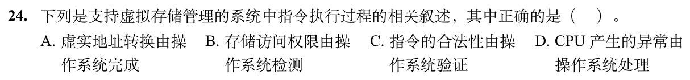

<details>
<summary>答案与解析</summary>

**答案：D。**

**直接法：** CPU检测到异常后，转入操作系统的异常处理程序，由操作系统处理，故选D。

**排除法／易混点：** A地址转换主要由MMU硬件完成；B访存权限由硬件按页表权限位检测；C非法指令也由CPU硬件识别。操作系统设置规则和处理异常，不等于逐条指令亲自检测。

</details>

## 解答题

### 大题1｜2021-44

[原题单 0924｜地址翻译链：TLB、页表与 Cache 的先后关系](../src/0924.md)

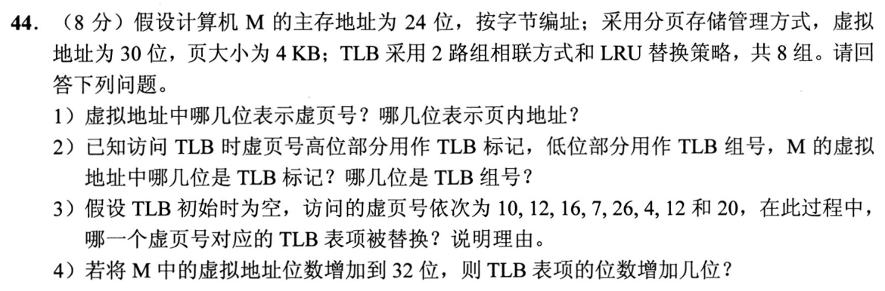

<details>
<summary>答案与解析</summary>

（1）页大小4KiB=2^12B，虚拟地址低12位（11—0）为页内地址，高18位（29—12）为虚页号。

（2）TLB组号用虚页号低3位，即虚拟地址14—12位；TLB标记为虚拟地址29—15位，共15位。不能把24位物理地址用于切虚拟标记。

（3）按“虚页号mod8”分组。10、26在第2组，刚好占满两路，无替换；12、4、20在第4组。顺序访问12、4、12后，4最久未用，因此20到来时替换虚页4对应表项。16在第0组，7在第7组，互不争用。只有4被替换，不能在整张TLB上做全局LRU。

（4）虚拟地址增为32位，页大小、物理地址与组数不变，虚页号增加2位，TLB标记随之增加2位；页框号及其他状态字段不变，所以每个TLB表项增加2位。

</details>

## 一行记录

```text
实际用时__；未完成或未核对的题号__；今天最容易混淆的是__
```
