# Day 20｜组成原理＋计算机网络

[← Day 19](day19.md) · [总入口](README.md) · [Day 21 →](day21.md)

**选择题：12道，来自两份完整src题单；大题：2道。** 先做选择题，再展开题下解析。组内题目沿用src顺序；标为复做的组，已会的快速通过，重点处理上次错题。

**预计用时：75—115分钟。** 选择题及核对约30—50分钟，大题约40—55分钟，最后用5—10分钟重做今天最值得记住的一道错题。约两小时是配题目标，不是必须耗满或到点强停；计算卡住时先保留题号，先完成其余选择题。

## 选择题组1｜0821 · 组成原理

[性能方程：时间由多少工作和每步多慢共同决定](../src/0821.md) · 4道 · 首次。

### 选择题1｜2021-12

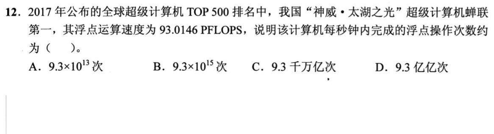

<details>
<summary>答案与解析</summary>

**参考答案：D（待逐题复核）。** 解析待补。

</details>

### 选择题2｜2022-12

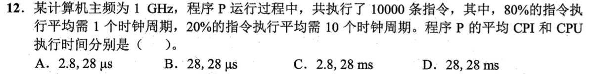

<details>
<summary>答案与解析</summary>

**答案：A。**

**直接法：** 平均 CPI=0.8×1+0.2×10=2.8。10000条需28000周期，1GHz下每周期1ns，共28μs。

</details>

### 选择题3｜2023-12

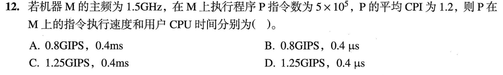

<details>
<summary>答案与解析</summary>

**参考答案：C（待逐题复核）。** 解析待补。

</details>

### 选择题4｜2025-18

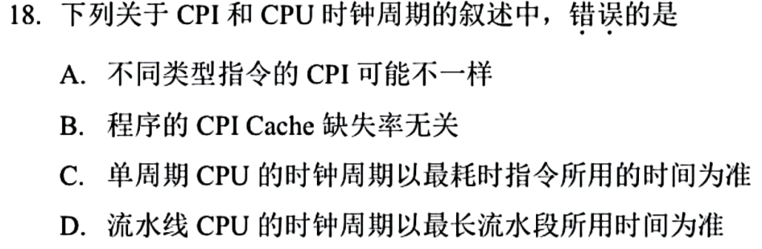

<details>
<summary>答案与解析</summary>

**答案：B。**

**直接法：** Cache缺失可使流水或访存停顿，平均CPI因增加的周期而上升。单周期和流水线时钟分别受最慢指令、最慢段约束。

</details>

## 选择题组2｜0904 · 计算机网络

[局域网转发：介质竞争、MAC与交换机](../src/0904.md) · 8道 · 复做第1次。

### 选择题5｜2020-35

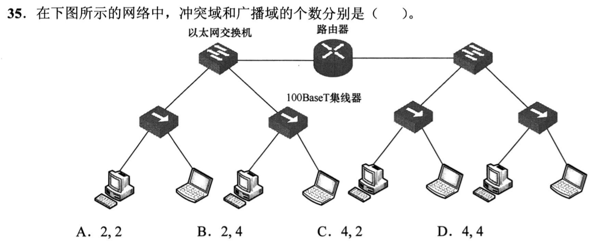

<details>
<summary>答案与解析</summary>

**答案：C。**

**直接法：** 四个集线器各连到交换机独立端口，形成4个共享冲突域；中间路由器把左右分成2个广播域。按题目的统计口径，交换机与路由器间的点到点全双工链路不计为共享冲突域。

</details>

### 选择题6｜2020-37

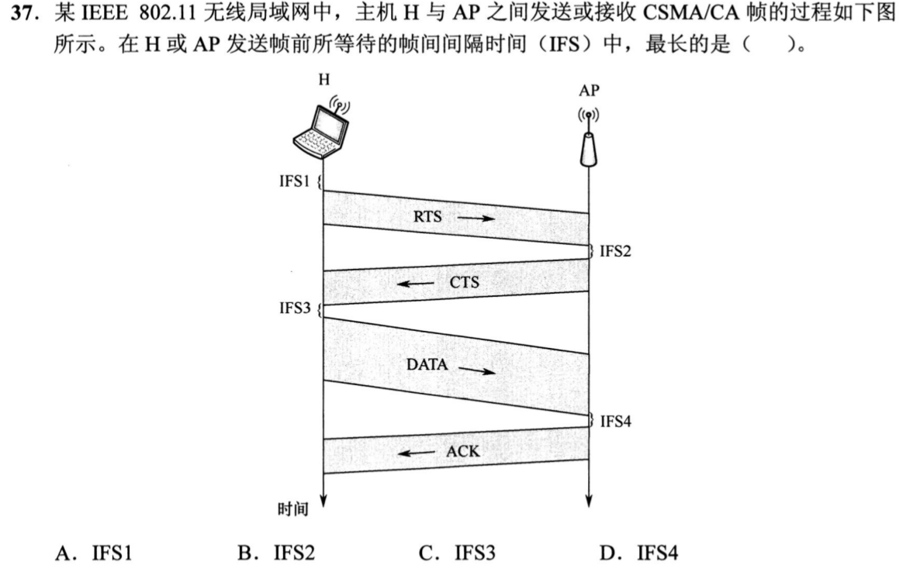

<details>
<summary>答案与解析</summary>

**参考答案：A（待逐题复核）。** 解析待补。

</details>

### 选择题7｜2022-37

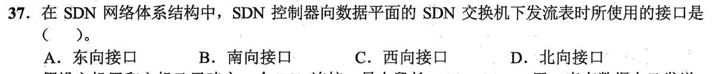

<details>
<summary>答案与解析</summary>

**答案：B。**

**直接法：** 控制平面向数据平面下发流表用南向接口；北向连接应用与控制器。

</details>

### 选择题8｜2023-36

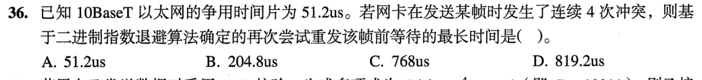

<details>
<summary>答案与解析</summary>

**参考答案：C（待逐题复核）。** 解析待补。

</details>

### 选择题9｜2024-35

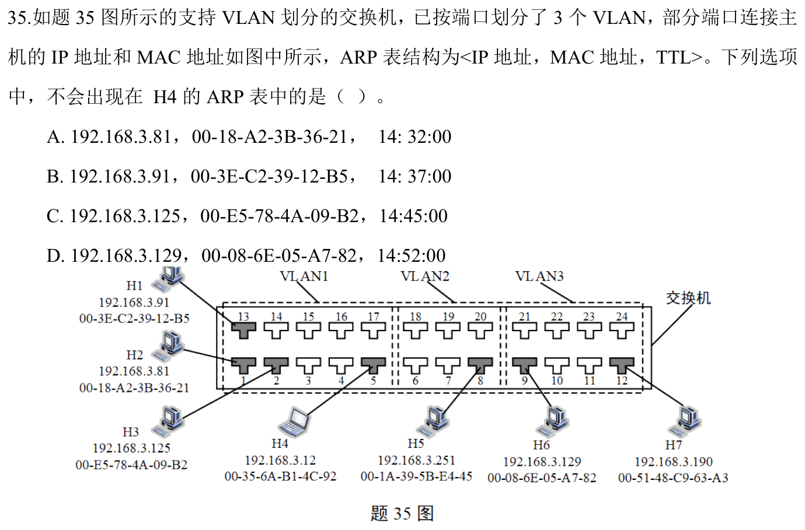

<details>
<summary>答案与解析</summary>

**答案：D。**

**直接法：** H4在VLAN1，能ARP解析同广播域的H1、H2、H3；H6在VLAN3，其MAC不会通过普通跨VLAN ARP出现在H4表。IP看似同网段也不能越过VLAN广播隔离。

</details>

### 选择题10｜2024-36

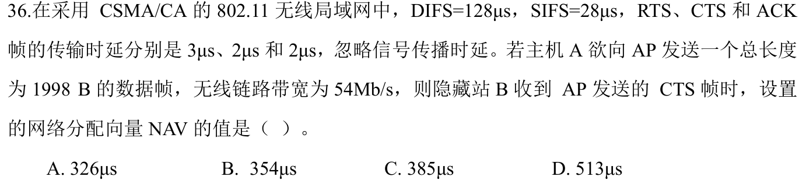

<details>
<summary>答案与解析</summary>

**参考答案：B（待逐题复核）。** 解析待补。

</details>

### 选择题11｜2025-35

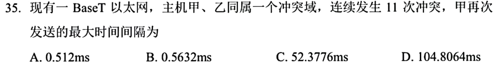

<details>
<summary>答案与解析</summary>

**参考答案：C（待逐题复核）。** 解析待补。

</details>

### 选择题12｜2026-36

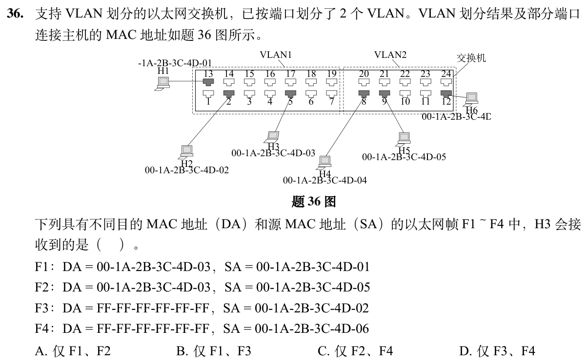

<details>
<summary>答案与解析</summary>

**答案与解析待补。**

</details>

## 解答题

### 大题1｜2023-43

[原题单 0923｜Cache 局部性：地址映射、访问序列与缺失代价](../src/0923.md)

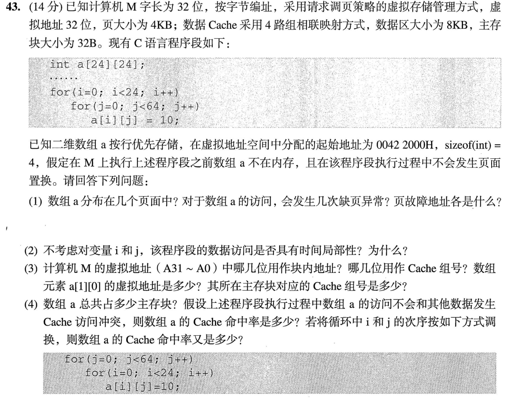

<details>
<summary>答案与解析</summary>

**解析待补。**

</details>

### 大题2｜2023-44

[原题单 0919｜表示到汇编：同一位模式在类型、指令与调用中怎样解释](../src/0919.md)

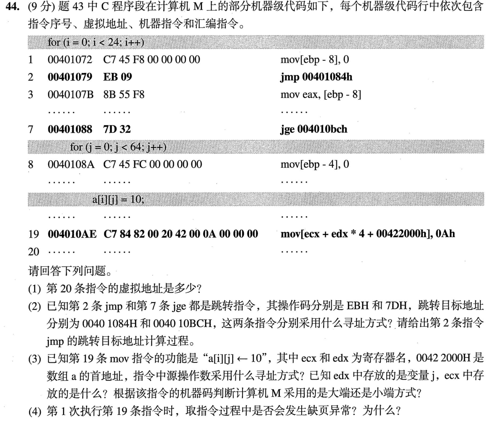

本题沿用本日43题的题干。

<details>
<summary>答案与解析</summary>

**解析待补。**

</details>

## 一行记录

```text
实际用时__；未完成或未核对的题号__；今天最容易混淆的是__
```
