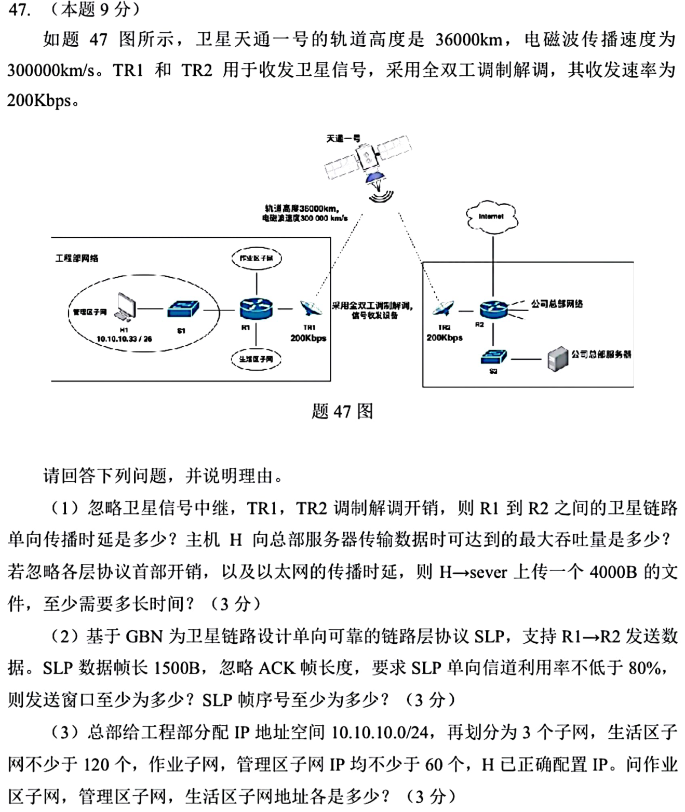
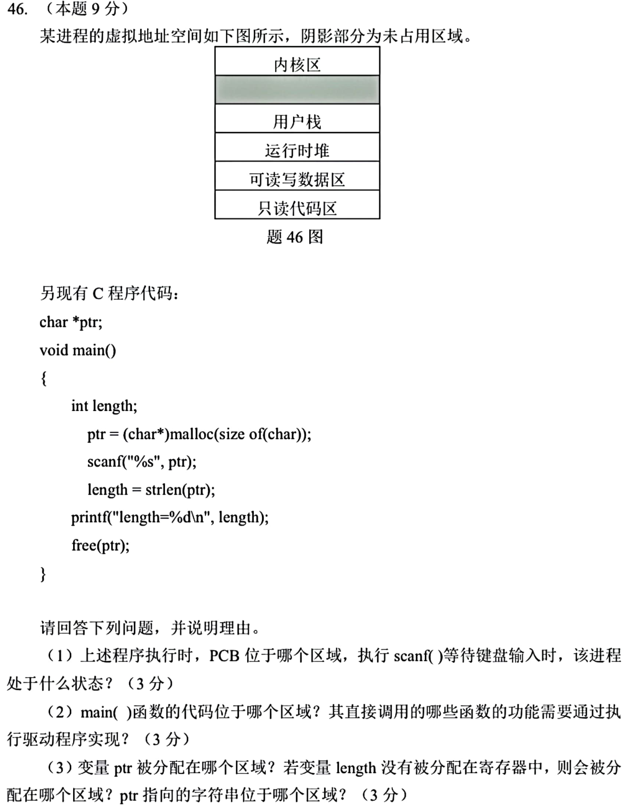

# Day 20｜总线、I/O 权限与卫星链路

[← Day 19](day19.md) · [总入口](README.md) · [Day 21 →](day21.md)

## 今天按这个顺序做

1. **回忆至多10分钟。** 只回看昨天的一处真实断点。
2. **选择题及补学至多50分钟。** 只做以下指定题，先作答再展开。
   - [0822｜总线事务与峰值带宽](modules/0822.md) · [原题单](../src/0822.md) · 2023-20、2024-20
   - [0823｜中断 I/O：优先级与权限边界](modules/0823.md) · [原题单](../src/0823.md) · 2024-21、2026-21
3. **两道大题及补学至多50分钟。** 每题先独立尝试5分钟，卡住才打开提示，随后遮住重做。
4. **闭卷检查至多10分钟。** 到120分钟收笔，按 I／H／U 记真实状态。

## 大题1｜2025-47 · 卫星传播、GBN 窗口与子网

[原题单 0930](../src/0930.md)

没有入口时的第一步

把传输时延和传播时延分开。信号从R1到R2先上行再下行，ACK也要走回相同距离。

完整解法与必要补学

（1）单程传播时延为2×36000/300000=0.24s，单方向吞吐量由卫星链路限制为200kb/s。4000B序列化耗时0.16s，在题设忽略开销且按瓶颈链路下界计时的口径下，共0.40s。

（2）每帧1500×8/200000=0.06s，首帧发出到ACK返回需0.06+2×0.24=0.54s。利用率至少80%要求 W×0.06≥0.8×0.54，向上取整得8帧。GBN要求 W≤2ᵏ−1，最少4位序号。

（3）生活区需/25，另两区需/26。H1=10.10.10.33/26锁定管理区为10.10.10.0/26。作业区为10.10.10.64/26，生活区为10.10.10.128/25。

重做后检查

3个子网分别占64、64、128个地址，正好覆盖/24。GBN 的窗口8必须有至少9个不同的序号。

## 大题2｜2025-46 · 地址空间、驱动与阻塞

[原题单 0928](../src/0928.md)

没有入口时的第一步

逐个区分变量本身、变量指向的对象、代码，以及CPU当前状态。

完整解法与必要补学

（1）PCB在内核区，由操作系统管理。scanf 等待键盘输入期间进程阻塞。

（2）main代码在只读代码区。题设以终端为I/O设备，scanf 读取键盘、printf 向终端输出，其底层需要系统调用和相应驱动。strlen 在用户态读字符串；malloc/free 管理进程堆，扩展堆等可能请求内核，无须依赖键盘或终端驱动。

（3）全局指针 ptr 在可读写数据区。length 未放寄存器时通常在用户栈。ptr 指向 malloc 分配的对象，位于运行时堆。题图中的分配大小只够一个 char，真实程序读普通非空字符串时还要预留结尾的空字符；这一点不改变各对象所在区。

重做后检查

把 ptr 改为 main 内局部变量，未放寄存器时指针本身移到栈，malloc 对象仍在堆。

## 最后闭卷检查

总线峰值能直接当整笔事务平均值吗？GBN 窗口8至少几位序号？

检查答案

要看是否摊入地址和等待周期。窗口8至少4位。

记录：实际用时__；选择 I__/H__/U__；两道大题状态__；下次先修的题号与卡点__。
