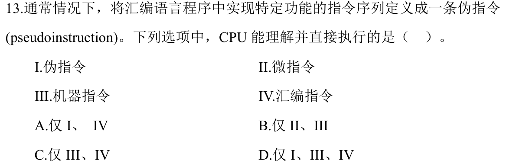
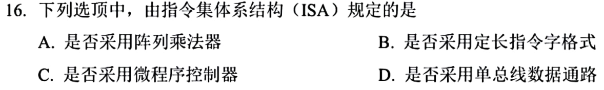
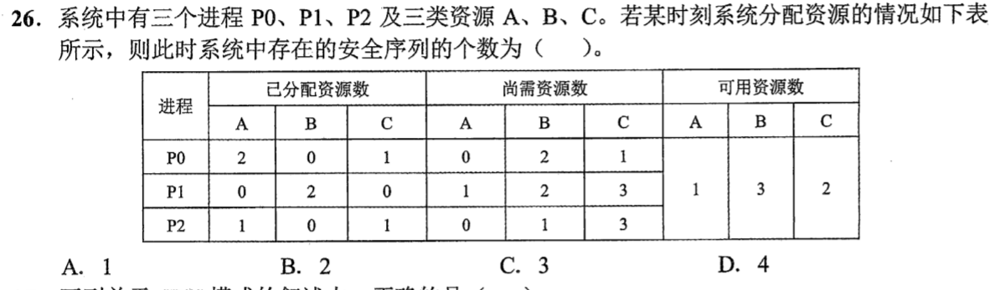

# Day 21｜选择题主线，全量覆盖

[← Day 20](day20.md) · [总入口](README.md) · [Day 22 →](day22.md)

**本日新题：选择题7道，大题1道。** 选择题先做；同一题号只在一天计为首次覆盖。原有讲解按需展开，不再额外执行旧版每日页的两道大题和复盘排期。

## 今天按这个顺序做

1. **0–75分钟｜选择题及核对。** 按下方七题逐题作答，写选项和一句依据；单题独立尝试至多2分钟，无入口先标U，再补概念。核对和遮住重做包含在本段，避免一道难题拖住整组。
2. **75–110分钟｜大题针对训练。** 这一道最多35分钟；保留整题及所有小问，先写能确定的部分。无入口5分钟后再看已有讲解；优先练会建模、公式、状态表或代码的第一步，不为誊写长解挤占选择题。
3. **110–120分钟｜闭卷回收。** 从今天错误的选择题中选一题遮住重做；若七题均独立正确，再回收大题的一处断点。记录实际完成题号，未完成保留U。

**120分钟为预算上限，不保证每个人都能做完。** 题量已排齐不等于已完成；到点停止，用下方记录保留未做和待核对项。

## 选择题｜本日必做7题

### 选择题1｜2024-07 · 数据结构

[原题单 0805｜有序树：从局部旋转到多路分裂](../src/0805.md)


<details>
<summary>作答后展开核对与补学入口</summary>

[本题已有讲解](modules/0805.md)。按年份题号 2024-07 定位，只读本题；读后遮住重做。

</details>

### 选择题2｜2025-08 · 数据结构

[原题单 0805｜有序树：从局部旋转到多路分裂](../src/0805.md)


<details>
<summary>作答后展开核对与补学入口</summary>

**待核对线索：C。** 来自[仓内2025参考答案](../data/reference/answers/2025.txt)，该文件明确标为模型手解、待官方核对，本轮未独立复核，不将该字母当作定论。

本题已补入全量训练，**尚无Sprint40独立解析**。若无法解释选项依据，记U；不要把看见参考字母记为掌握。

</details>

### 选择题3｜2024-13 · 组成原理

[原题单 0818｜程序层级：从源程序到CPU真正执行的对象](../src/0818.md)



<details>
<summary>作答后展开核对与补学入口</summary>

[本题已有讲解](modules/0818.md)。按年份题号 2024-13 定位，只读本题；读后遮住重做。

</details>

### 选择题4｜2025-16 · 组成原理

[原题单 0818｜程序层级：从源程序到CPU真正执行的对象](../src/0818.md)



<details>
<summary>作答后展开核对与补学入口</summary>

**待核对线索：B。** 来自[仓内2025参考答案](../data/reference/answers/2025.txt)，该文件明确标为模型手解、待官方核对，本轮未独立复核，不将该字母当作定论。

本题已补入全量训练，**尚无Sprint40独立解析**。若无法解释选项依据，记U；不要把看见参考字母记为掌握。

</details>

### 选择题5｜2022-26 · 操作系统

[原题单 0827｜资源闭环：死锁、避免与检测](../src/0827.md)



<details>
<summary>作答后展开核对与补学入口</summary>

[本题已有讲解](modules/0827.md)。按年份题号 2022-26 定位，只读本题；读后遮住重做。

</details>

### 选择题6｜2020-24 · 操作系统

[原题单 0828｜内存边界：分配、回收与保护](../src/0828.md)


<details>
<summary>作答后展开核对与补学入口</summary>

**仓内参考答案：A。** 来自[原有答案PDF抽取键](../data/reference/answers/2020.txt)，本轮未重新逐图复核。

本题已补入全量训练，**尚无Sprint40独立解析**。若无法解释选项依据，记U；不要把看见参考字母记为掌握。

</details>

### 选择题7｜2022-35 · 计算机网络

[原题单 0905｜网络地址：子网、分片与可达范围](../src/0905.md)


<details>
<summary>作答后展开核对与补学入口</summary>

[本题已有讲解](modules/0905.md)。按年份题号 2022-35 定位，只读本题；读后遮住重做。

</details>

## 大题｜整题作答，针对断点

### 大题1｜2022-44 · 组成原理

[原题单 0927｜文件与磁盘：名字、索引和物理块怎样连接](../src/0927.md)


<details>
<summary>独立尝试后打开本题已有讲解</summary>

[进入 2022-44 原有逐问讲解](lessons/day16.md)，按本题号定位。该页保留旧讲解和变式，只读本题，页内旧时间安排不执行。

</details>

## 今日记录

```text
实际用时__；选择题已作答__/7，已核对__/7，I__/H__/U__
大题实际完成的小问__；未做或未核对的题号__
下一次先回收的选择题__；错误发生在__
```
