# Day 21｜数据结构＋操作系统

[← Day 20](day20.md) · [总入口](README.md) · [Day 22 →](day22.md)

**选择题：18道，来自两份完整src题单；大题：1道。** 先做选择题，再展开题下解析。组内题目沿用src顺序；标为复做的组，已会的快速通过，重点处理上次错题。

**预计用时：100—155分钟。** 选择题及核对约70—110分钟，大题约25—35分钟，最后用5—10分钟重做今天最值得记住的一道错题。约两小时是配题目标，不是必须耗满或到点强停；计算卡住时先保留题号，先完成其余选择题。

## 选择题组1｜0810 · 数据结构

[排序过程：一趟以后什么已经确定](../src/0810.md) · 15道 · 首次。

### 选择题1｜2020-09

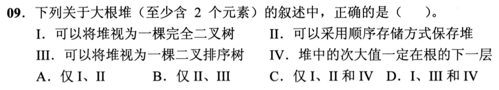

<details>
<summary>答案与解析</summary>

**参考答案：C（待逐题复核）。** 解析待补。

</details>

### 选择题2｜2020-11

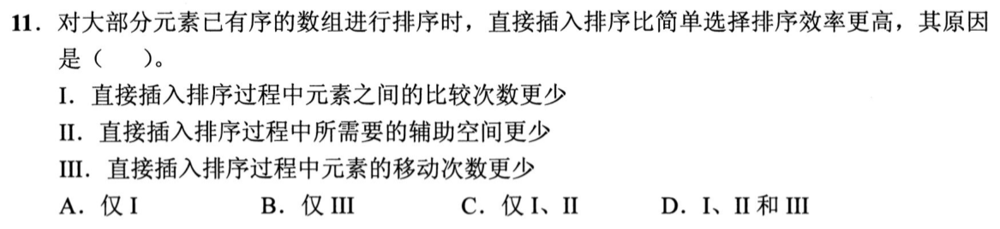

<details>
<summary>答案与解析</summary>

**参考答案：A（待逐题复核）。** 解析待补。

</details>

### 选择题3｜2021-10

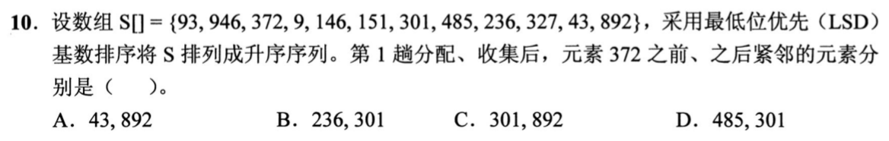

<details>
<summary>答案与解析</summary>

**参考答案：C（待逐题复核）。** 解析待补。

</details>

### 选择题4｜2021-11

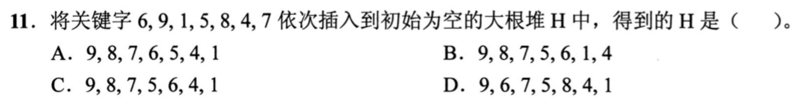

<details>
<summary>答案与解析</summary>

**参考答案：B（待逐题复核）。** 解析待补。

</details>

### 选择题5｜2022-10

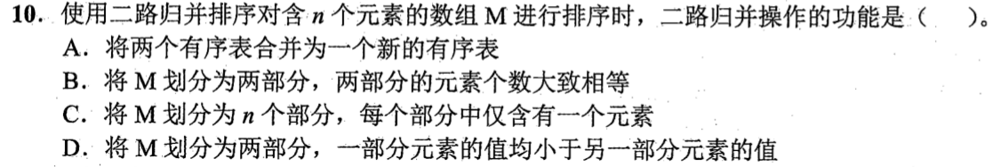

<details>
<summary>答案与解析</summary>

**参考答案：A（待逐题复核）。** 解析待补。

</details>

### 选择题6｜2022-11

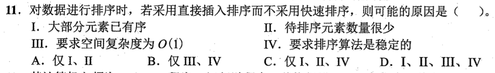

<details>
<summary>答案与解析</summary>

**参考答案：D（待逐题复核）。** 解析待补。

</details>

### 选择题7｜2023-10

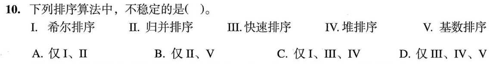

<details>
<summary>答案与解析</summary>

**参考答案：C（待逐题复核）。** 解析待补。

</details>

### 选择题8｜2023-11

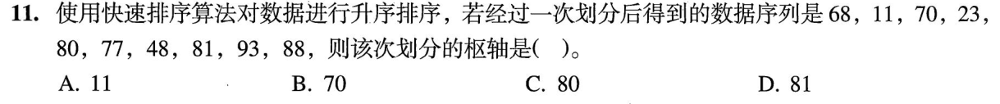

<details>
<summary>答案与解析</summary>

**参考答案：D（待逐题复核）。** 解析待补。

</details>

### 选择题9｜2024-08

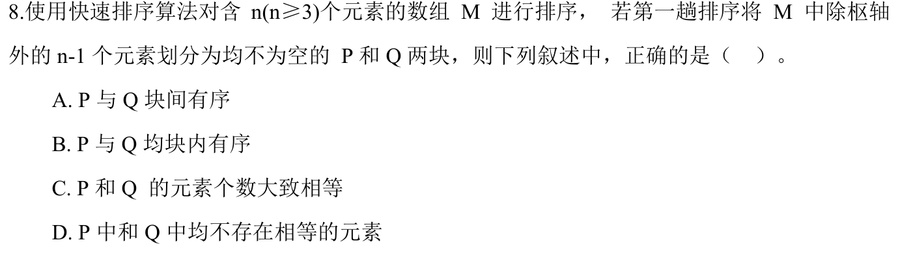

<details>
<summary>答案与解析</summary>

**答案：A。**

划分后左块元素均不大于右块元素，两块之间有序。块内仍可无序、存在重复，枢轴也可能使两块很不均衡。

</details>

### 选择题10｜2024-09

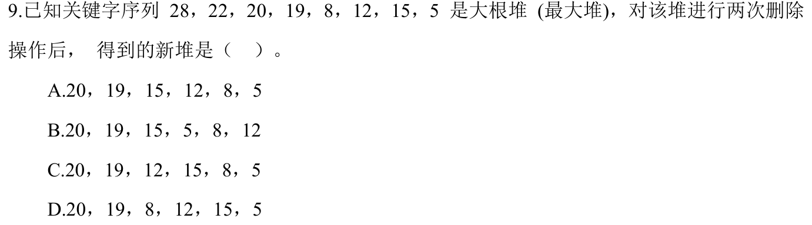

<details>
<summary>答案与解析</summary>

**参考答案：B（待逐题复核）。** 解析待补。

</details>

### 选择题11｜2024-10

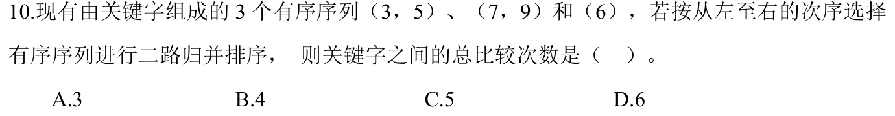

<details>
<summary>答案与解析</summary>

**参考答案：C（待逐题复核）。** 解析待补。

</details>

### 选择题12｜2025-10

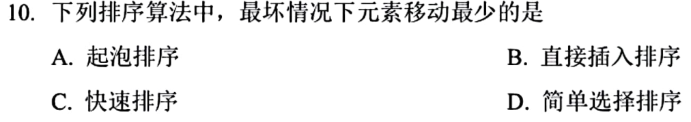

<details>
<summary>答案与解析</summary>

**答案：D。**

简单选择排序每趟至多一次交换，总移动量 O(n)。逆序时冒泡和直接插入的移动可达平方量级。快排的移动量随划分方式与输入而变，多层划分均交换大量元素时可超过线性。选择排序的比较次数仍是平方量级。

</details>

### 选择题13｜2025-11

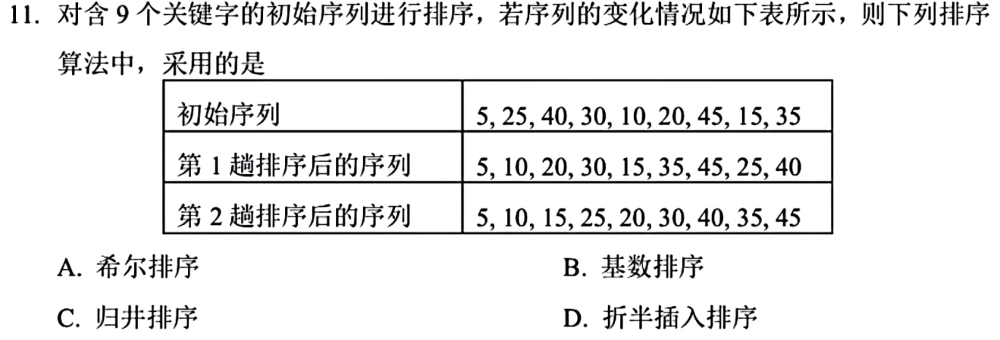

<details>
<summary>答案与解析</summary>

**参考答案：A（待逐题复核）。** 解析待补。

</details>

### 选择题14｜2026-09

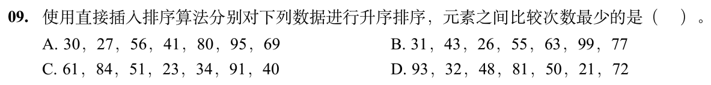

<details>
<summary>答案与解析</summary>

**答案：B。**

逐趟统计直接插入的元素比较次数：A为1、1、2、1、1、3，共9次；B为1、2、1、1、1、2，共8次；C、D各16次，故B最少。

只数关键字比较，不数j是否越界；遇到第一个不大于待插值的元素时，那次失败比较也要计入。不能只看原序列有多少对相邻逆序。

</details>

### 选择题15｜2026-10

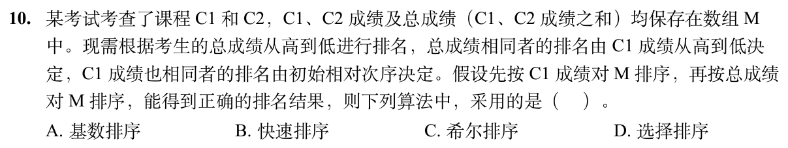

<details>
<summary>答案与解析</summary>

**答案与解析待补。**

</details>

## 选择题组2｜0827 · 操作系统

[资源闭环：死锁、避免与检测](../src/0827.md) · 3道 · 复做第1次。

### 选择题16｜2020-27

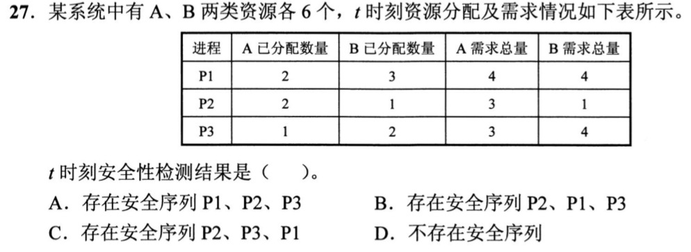

<details>
<summary>答案与解析</summary>

**答案：B。**

剩余资源为(6−5,6−6)=(1,0)。P1还需(2,1)，P2还需(1,0)，P3还需(2,2)，只能先让P2完成；回收后可用(3,1)，此时P1可完成而P3仍缺B。再回收P1后P3才能完成，安全序列P2、P1、P3。

</details>

### 选择题17｜2021-31

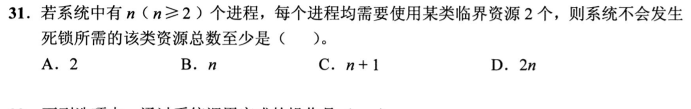

<details>
<summary>答案与解析</summary>

**参考答案：C（待逐题复核）。** 解析待补。

</details>

### 选择题18｜2022-26


<details>
<summary>答案与解析</summary>

**答案：B。**

Available=(1,3,2)，起初只有P0可完成；释放(2,0,1)后Work=(3,3,3)，P1、P2任意顺序皆可。因此P0P1P2、P0P2P1，共2种。

</details>

## 解答题

### 大题1｜2022-44

[原题单 0927｜文件与磁盘：名字、索引和物理块怎样连接](../src/0927.md)

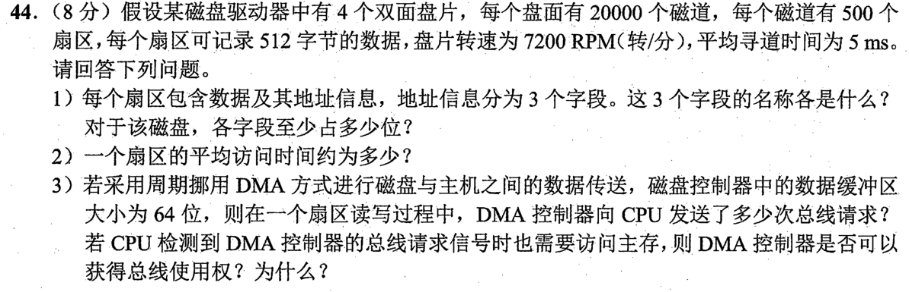

<details>
<summary>答案与解析</summary>

（1）柱面号（磁道号）15位，磁头号（盘面号）3位，扇区号9位。需要区分20000个柱面、8个盘面、每道500个扇区。

（2）7200rpm等于120转/秒，周期约8.333ms。平均旋转等待4.167ms，单扇区传输8.333/500≈0.0167ms，加寻道5ms，总计约9.183ms。

（3）DMA每次交接64位=8B，512/8=64次总线请求。CPU也要访存时，通常DMA优先获得一个可分配的总线周期，CPU暂停该次访存。若CPU已有事务正在执行，需等它结束。优先权有助于及时接收设备的连续数据。

</details>

## 一行记录

```text
实际用时__；未完成或未核对的题号__；今天最容易混淆的是__
```
