# Day 22｜组成原理＋计算机网络

[← Day 21](day21.md) · [总入口](README.md) · [Day 23 →](day23.md)

**选择题：13道，来自两份完整src题单；大题：2道。** 先做选择题，再展开题下解析。组内题目沿用src顺序；标为复做的组，已会的快速通过，重点处理上次错题。

**预计用时：85—130分钟。** 选择题及核对约40—65分钟，大题约40—55分钟，最后用5—10分钟重做今天最值得记住的一道错题。约两小时是配题目标，不是必须耗满或到点强停；计算卡住时先保留题号，先完成其余选择题。

## 选择题组1｜0822 · 组成原理

[传输时间：宽度、频率、事务与瓶颈](../src/0822.md) · 5道 · 首次。

### 选择题1｜2020-19

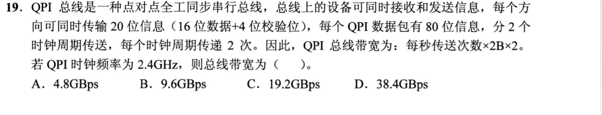

<details>
<summary>答案与解析</summary>

**参考答案：C（待逐题复核）。** 解析待补。

</details>

### 选择题2｜2021-19

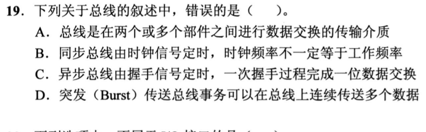

<details>
<summary>答案与解析</summary>

**参考答案：C（待逐题复核）。** 解析待补。

</details>

### 选择题3｜2023-20

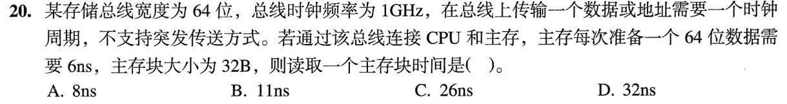

<details>
<summary>答案与解析</summary>

**答案：D。**

32B分4次送。每次1ns发地址、6ns准备、1ns发数据，共4×8=32ns。

</details>

### 选择题4｜2024-20

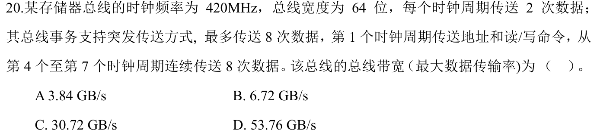

<details>
<summary>答案与解析</summary>

**答案：B。**

题目问总线最大数据传输率。连续传数据时每拍2×8B，420MHz下为6.72GB/s。把7拍事务全部摊入，才得到单笔连续突发的平均3.84GB/s。

</details>

### 选择题5｜2025-20

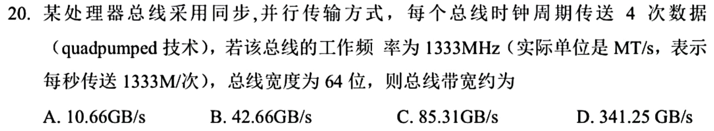

<details>
<summary>答案与解析</summary>

**参考答案：A（待逐题复核）。** 解析待补。

</details>

## 选择题组2｜0905 · 计算机网络

[网络地址：子网、分片与可达范围](../src/0905.md) · 8道 · 复做第1次。

### 选择题6｜2021-35

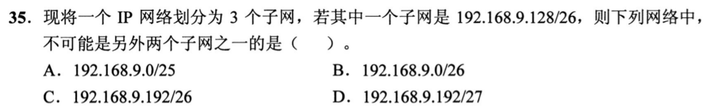

<details>
<summary>答案与解析</summary>

**参考答案：B（待逐题复核）。** 解析待补。

</details>

### 选择题7｜2022-35

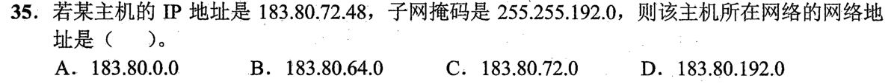

<details>
<summary>答案与解析</summary>

**答案：B。**

第三字节72与192按位与得64；第四字节与0得0，所以网络地址183.80.64.0（/18）。

</details>

### 选择题8｜2022-36

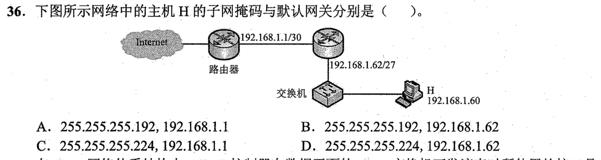

<details>
<summary>答案与解析</summary>

**参考答案：D（待逐题复核）。** 解析待补。

</details>

### 选择题9｜2023-38

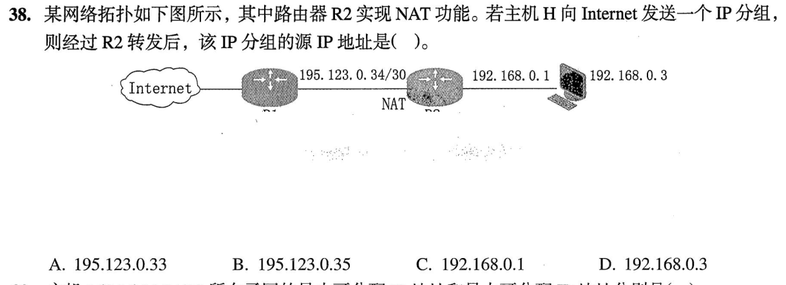

<details>
<summary>答案与解析</summary>

**答案：A。**

图中公网链路195.123.0.32/30，可用.33、.34；R1已占.34，R2的公网出口只能是.33，故NAT后源地址195.123.0.33。

</details>

### 选择题10｜2023-39

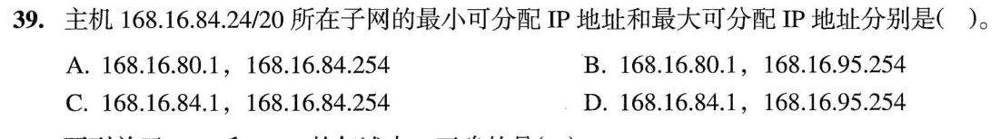

<details>
<summary>答案与解析</summary>

**参考答案：B（待逐题复核）。** 解析待补。

</details>

### 选择题11｜2023-40

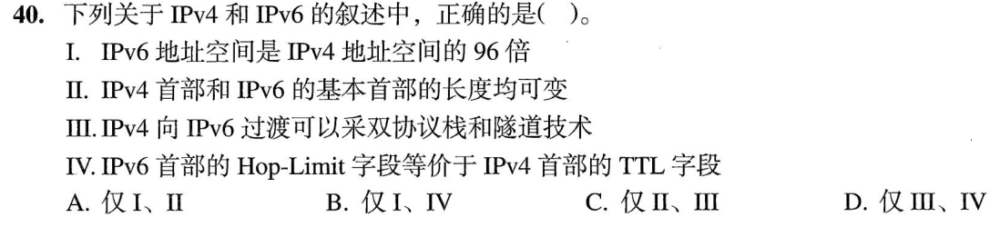

<details>
<summary>答案与解析</summary>

**答案：D。**

III双栈/隧道可过渡，IV Hop Limit等效TTL；地址空间比是2^(128−32)=2⁹⁶倍，不是96倍；IPv6基本首部固定，II错。

</details>

### 选择题12｜2025-36

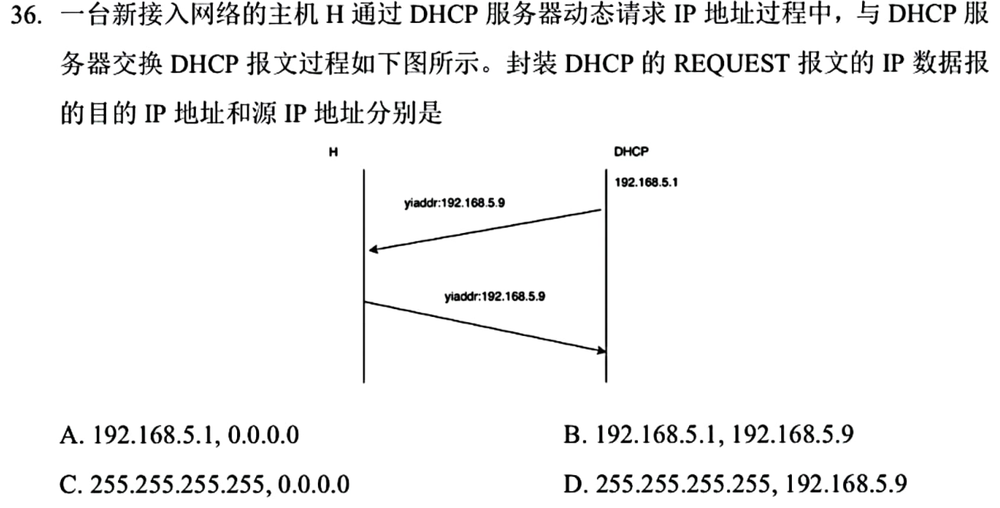

<details>
<summary>答案与解析</summary>

**答案：C。**

新接入主机对OFFER发初次REQUEST时使用源0.0.0.0、目的255.255.255.255广播，通知各服务器选择结果。题目问目的在前、源在后，顺序别倒。

</details>

### 选择题13｜2026-39

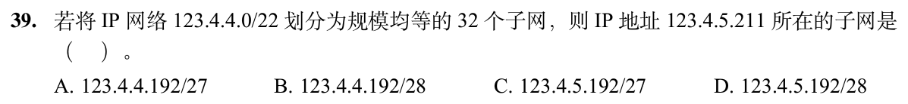

<details>
<summary>答案与解析</summary>

**答案与解析待补。**

</details>

## 解答题

### 大题1｜2025-43

[原题单 0923｜Cache 局部性：地址映射、访问序列与缺失代价](../src/0923.md)

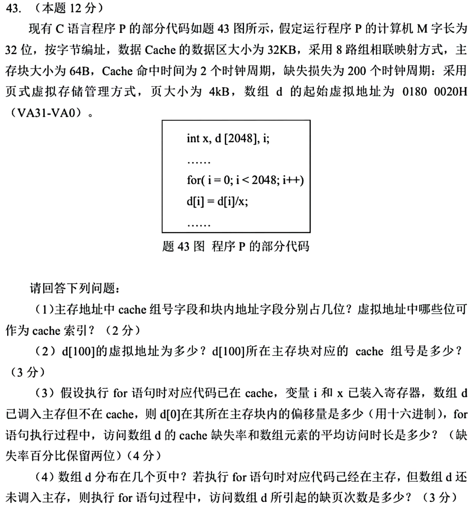

<details>
<summary>答案与解析</summary>

（1）32KiB÷64B÷8=64组，组号6位，块内偏移6位。两者都落在4KiB页内偏移的12位中，VA11～VA6 可用于索引。

（2）d[100] 地址为0180 0020H+190H=0180 01B0H。取VA11～VA6，组号6。

（3）d[0] 块内偏移20H。8192B从块内第32字节开始，覆盖129块。页内索引使数组的129块在64个组中每组至多3块。按本题常规的循环指令不造成额外替换的口径，8路足够。每块首次读缺失，紧接的同元素写命中，共4096次数据访问，缺失率129/4096≈3.15%。平均每次数据访问为2+(129/4096)×200≈8.30个周期。

（4）8192B从4KiB页内偏移32开始，跨3页。以初始均未调入、数组扫描过程中页面能驻留为题设口径，每页首次访问缺页，共3次。

</details>

### 大题2｜2025-44

[原题单 0919｜表示到汇编：同一位模式在类型、指令与调用中怎样解释](../src/0919.md)

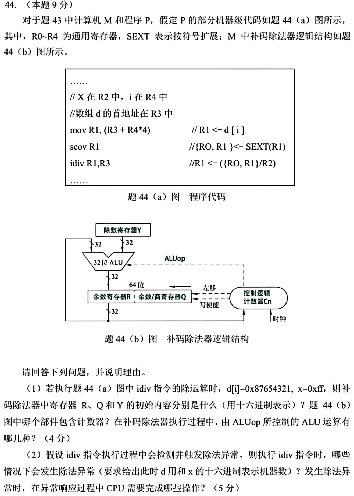

本题沿用本日43题的题干。

<details>
<summary>答案与解析</summary>

**题面说明：** 图注以R2作为除数，汇编行末的R3与注释冲突；下解按指令功能注释，以R2的内容为除数。

（1）被除数为32位负数，扩展到64位后高32位全1。R=FFFFFFFFH，Q=87654321H，Y=000000FFH。控制逻辑内含计数器Cn，追踪逐位运算次数。ALU在补码除法循环中做加、减；图中移位由R、Q寄存器联动实现。

（2）x=00000000H 时除零，d[i]取任意32位机器数。d[i]=80000000H 且 x=FFFFFFFFH 时，−2³¹/−1=+2³¹，超出32位有符号商范围。其他合法非零除数下，32位有符号被除数的商可表示。

检测到异常后，CPU保存可定位故障指令的断点及状态，受控进入内核态，按异常类型定位入口并转去执行异常处理程序。该除法没有正常写回结果；后续由处理程序决定终止或如何恢复。

</details>

## 一行记录

```text
实际用时__；未完成或未核对的题号__；今天最容易混淆的是__
```
