# Day 23｜数据结构＋操作系统

[← Day 22](day22.md) · [总入口](README.md) · [Day 24 →](day24.md)

**选择题：15道，来自两份完整src题单；大题：1道。** 先做选择题，再展开题下解析。组内题目沿用src顺序；标为复做的组，已会的快速通过，重点处理上次错题。

**预计用时：60—90分钟。** 选择题及核对约30—45分钟，大题约25—35分钟，最后用5—10分钟重做今天最值得记住的一道错题。约两小时是配题目标，不是必须耗满或到点强停；计算卡住时先保留题号，先完成其余选择题。

## 选择题组1｜0811 · 数据结构

[外存归并：内存装不下以后怎样排序](../src/0811.md) · 2道 · 首次。

### 选择题1｜2024-11


<details>
<summary>答案与解析</summary>

**答案：D。**

升序归并的冠军对应各段当前最小段首。冠军结点保存该关键字所在的归并段号，由段号读取元素和补入下一条。

</details>

### 选择题2｜2026-11

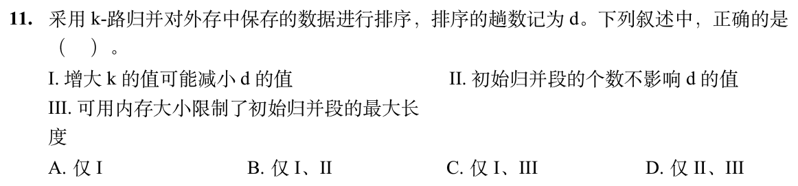

<details>
<summary>答案与解析</summary>

**答案：A。**

r个初始段做k路归并，归并趟数约为⌈logₖr⌉，增大k可能减少趟数，Ⅰ正确；r当然影响趟数，Ⅱ错误。置换选择生成的初始段可一边读一边输出，段长可能超过内存容量，因此Ⅲ所说内存限制“最大长度”不成立。普通内存排序形成定长初始段只是其中一种方法。

</details>

## 选择题组2｜0825 · 操作系统

[执行生命线：进程、线程、状态与调度](../src/0825.md) · 13道 · 复做第1次。

### 选择题3｜2020-26

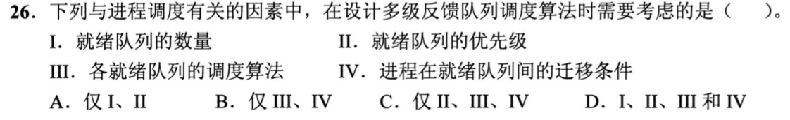

<details>
<summary>答案与解析</summary>

**答案：D。**

多级反馈队列要先确定有几级、各级优先级及内部算法，还要规定新进程进入哪一级、用完时间片或长时间等待后怎样迁移。四项都是调度规则的一部分；只设置队列优先级而不定义迁移，就没有形成反馈机制。

</details>

### 选择题4｜2020-29

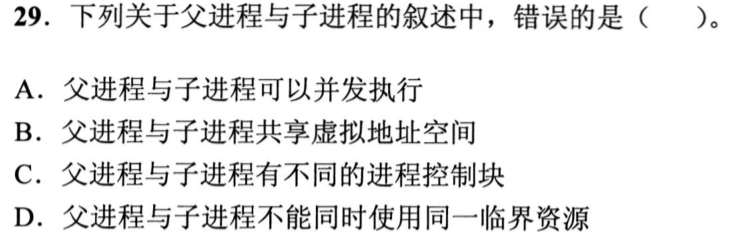

<details>
<summary>答案与解析</summary>

**答案：B。**

父子是两个进程，各有自己的虚拟地址空间和PCB，B错误。创建时可以复制映射并用写时复制共享物理页，但不等于共用同一个虚拟地址空间。它们可并发执行；若访问同一临界资源，仍须遵守互斥，亲子关系不豁免同步要求。

</details>

### 选择题5｜2021-24

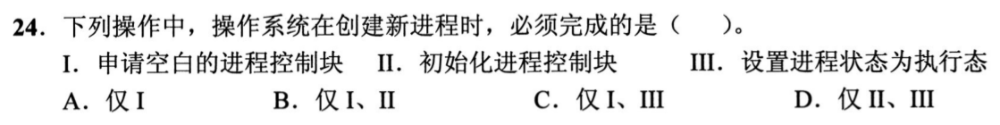

<details>
<summary>答案与解析</summary>

**答案：B。**

创建进程必须先申请PCB并初始化身份、状态、资源等信息，Ⅰ、Ⅱ成立。创建完成通常进入就绪队列，何时执行由调度决定，并不必须立即设为执行态，Ⅲ不成立。就绪与执行之间还差一次CPU分配。

</details>

### 选择题6｜2021-25

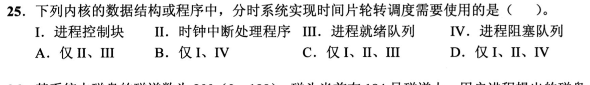

<details>
<summary>答案与解析</summary>

**答案：C。**

时间片轮转需PCB记录上下文、时钟中断计时、就绪队列轮换；不因采用轮转就必须用阻塞队列，选I、II、III。

</details>

### 选择题7｜2021-27

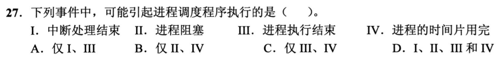

<details>
<summary>答案与解析</summary>

**答案：D。**

阻塞、结束、时间片用完都会使当前进程让出CPU，需要调度。中断处理结束时也可能出现新唤醒的高优先级进程，触发重新调度，因此Ⅰ同样可能。题目问“可能”，不要求每次中断结束都发生进程切换。

</details>

### 选择题8｜2022-23

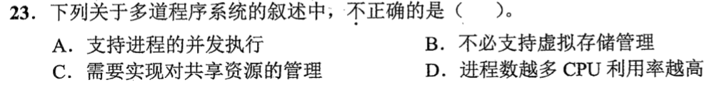

<details>
<summary>答案与解析</summary>

**答案：D。**

多道程序允许进程并发并由系统管理共享资源，但进程过多会增加切换、竞争和内存压力，CPU利用率不会无限提高，D错误。多道程序并不以请求分页等虚拟存储机制为必需条件；没有虚拟存储也能在内存装入多道程序。

</details>

### 选择题9｜2022-25

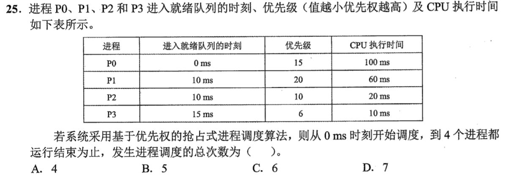

<details>
<summary>答案与解析</summary>

**答案：C。**

优先级数值越小越高。执行顺序为P0(0～10)、P2(10～15)、P3(15～25)、P2(25～40)、P0(40～130)、P1(130～190)，共6次调度，含0ms首次选中P0。仅有进程到达却未改变CPU归属，不另计调度；全部完成后的空闲不再计一次。

</details>

### 选择题10｜2022-28


<details>
<summary>答案与解析</summary>

**答案：D。**

读文件、申请外设和P操作都可能等待而阻塞；时间片用完转就绪，不转阻塞。选I、III、IV。

</details>

### 选择题11｜2023-27

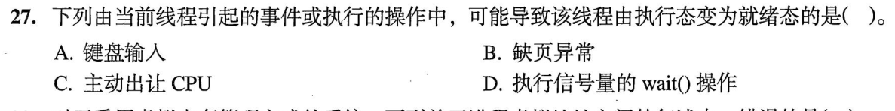

<details>
<summary>答案与解析</summary>

**答案：C。**

主动让出CPU时，线程还具备运行条件，只是放弃当前CPU，转入就绪态。缺页或wait条件不满足通常转阻塞态，等待输入也属于等待事件；不能把所有离开执行态的情况都归为就绪。键盘输入完成可能唤醒别的线程，不是当前线程主动让出的操作。

</details>

### 选择题12｜2023-29

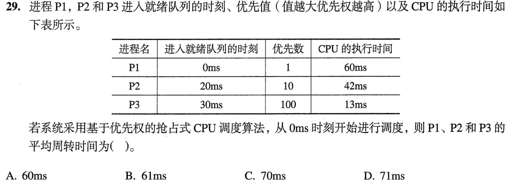

<details>
<summary>答案与解析</summary>

**答案：B。**

执行顺序P1：0～20，P2：20～30，P3：30～43，P2：43～75，P1：75～115。完成时刻分别115、75、43，减去到达时刻0、20、30，周转时间为115、55、13，平均183/3=61ms。不能把完成时刻直接求平均，也不能只算排队等待。

</details>

### 选择题13｜2024-24

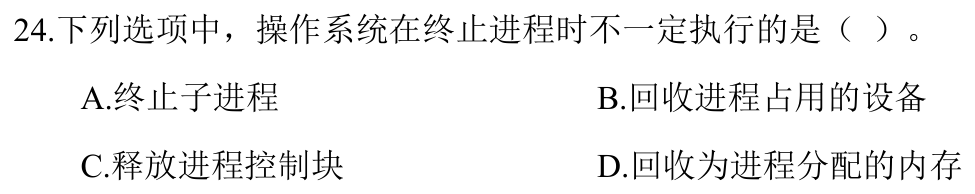

<details>
<summary>答案与解析</summary>

**答案：A。**

终止父进程不一定连带终止子进程，系统可以让子进程继续运行并重新指定其父进程。父进程自己的设备、地址空间和PCB则要在退出清理过程中回收。这里问的是是否必须终止子进程，不是某一系统能否采用级联终止策略。

</details>

### 选择题14｜2025-25

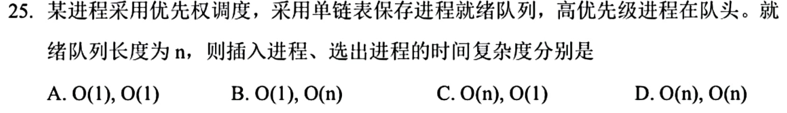

<details>
<summary>答案与解析</summary>

**答案：C。**

队列已按优先级排好，插入新进程最坏要沿单链表找位置，O(n)；选取最高优先级进程直接摘队头，O(1)。插入时修改指针本身虽为常数时间，找到该插入位置的扫描不能省掉。

</details>

### 选择题15｜2026-25

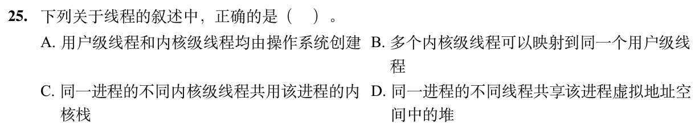

<details>
<summary>答案与解析</summary>

**答案：D。**

进程堆属于共同虚拟地址空间，同进程线程共享，D正确。用户级线程由用户线程库管理，不都由内核创建；常见映射是多个用户线程对应一个或多个内核线程，不是给一个用户线程配多个内核执行实体；不同内核线程各有自己的内核栈，C错。

</details>

## 解答题

### 大题1｜2021-45

[原题单 0925｜并发同步：PV 操作大题](../src/0925.md)

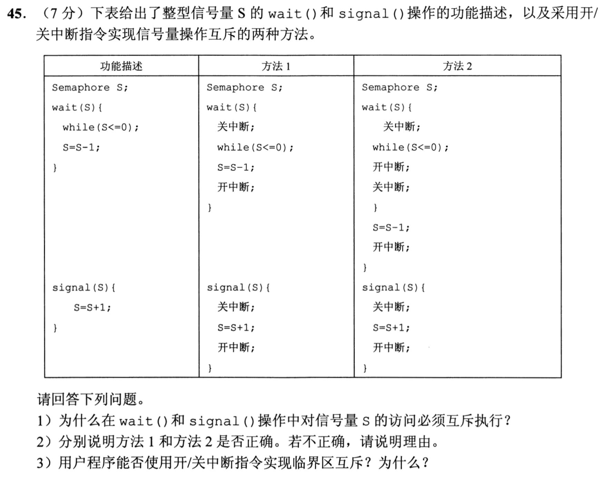

**题图勘误：** 方法2的 `while(S<=0)` 后应为左花括号，不能按图中的分号执行。作答时使用下面这个循环体：

```text
while (S <= 0) {
    开中断;
    关中断;
}
```

<details>
<summary>答案与解析</summary>

（1）S是共享资源计数，检查与修改必须互斥。否则两个调用者可能同时看到S=1并都通过等待，导致同一份资源被重复分配。

（2）以本题的单处理器模型判断。方法1错误：S≤0时一直关中断忙等，能执行 signal 的进程得不到调度，S可能一直无法增大。方法2正确：只有检查得到 S≤0 才进入循环体临时开中断，给其他进程运行机会；重新关中断后再检查。最后一次检查得到 S>0 时直接跳过循环体，接着执行 S--，这两步始终关中断。signal 修改 S 时也关中断。

上方已明确修正题图的循环边界。若坚持按分号空循环逐字执行，方法2同样会在关中断状态下忙等，不能得出“方法2正确”；本解的正确结论只针对花括号版本。

（3）用户程序不能用开/关中断指令实现临界区互斥，因为它们是特权指令，只能在内核态执行；用户态应通过提供的同步机制或原子操作实现互斥。即使在内核使用，单纯屏蔽本CPU中断也不能自动解决多核之间的互斥。

</details>

## 一行记录

```text
实际用时__；未完成或未核对的题号__；今天最容易混淆的是__
```
