# Day 24｜组成原理＋计算机网络

[← Day 23](day23.md) · [总入口](README.md) · [Day 25 →](day25.md)

**选择题：19道，来自两份完整src题单；大题：1道。** 先做选择题，再展开题下解析。组内题目沿用src顺序；标为复做的组，已会的快速通过，重点处理上次错题。

**预计用时：75—120分钟。** 选择题及核对约45—75分钟，大题约25—35分钟，最后用5—10分钟重做今天最值得记住的一道错题。约两小时是配题目标，不是必须耗满或到点强停；计算卡住时先保留题号，先完成其余选择题。

## 选择题组1｜0823 · 组成原理

[I/O路径：轮询、中断与DMA怎样交接控制权](../src/0823.md) · 14道 · 首次。

### 选择题1｜2020-20

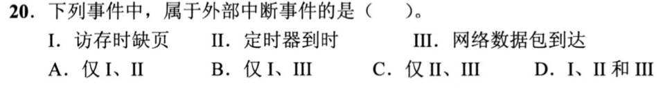

<details>
<summary>答案与解析</summary>

**参考答案：C（待逐题复核）。** 解析待补。

</details>

### 选择题2｜2020-21

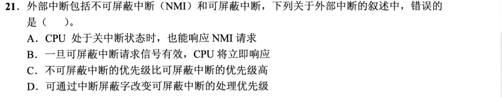

<details>
<summary>答案与解析</summary>

**参考答案：B（待逐题复核）。** 解析待补。

</details>

### 选择题3｜2020-22

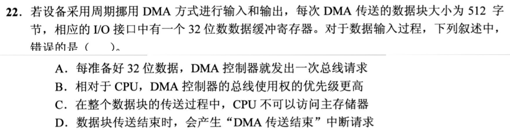

<details>
<summary>答案与解析</summary>

**参考答案：C（待逐题复核）。** 解析待补。

</details>

### 选择题4｜2021-20

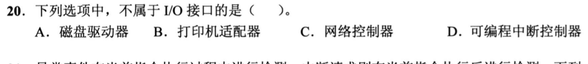

<details>
<summary>答案与解析</summary>

**参考答案：A（待逐题复核）。** 解析待补。

</details>

### 选择题5｜2021-21

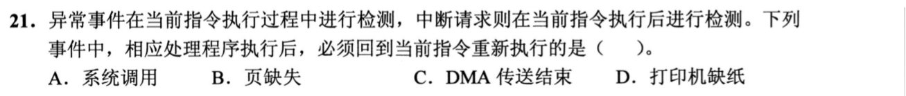

<details>
<summary>答案与解析</summary>

**参考答案：B（待逐题复核）。** 解析待补。

</details>

### 选择题6｜2021-22

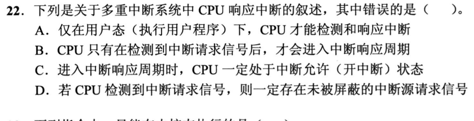

<details>
<summary>答案与解析</summary>

**参考答案：A（待逐题复核）。** 解析待补。

</details>

### 选择题7｜2022-21

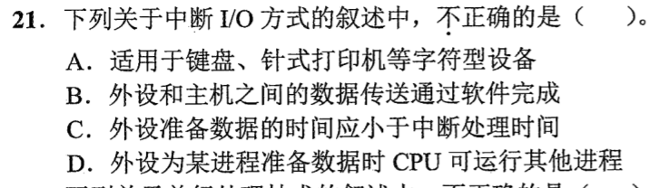

<details>
<summary>答案与解析</summary>

**参考答案：C（待逐题复核）。** 解析待补。

</details>

### 选择题8｜2023-22

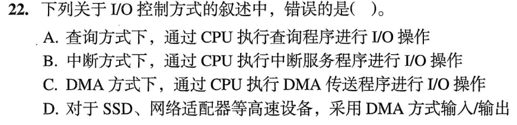

<details>
<summary>答案与解析</summary>

**参考答案：C（待逐题复核）。** 解析待补。

</details>

### 选择题9｜2024-21

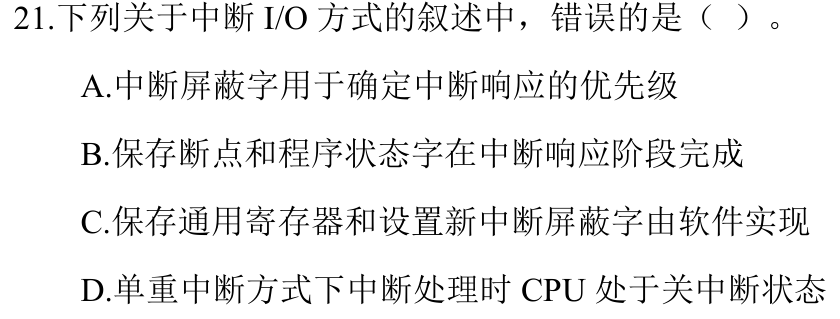

<details>
<summary>答案与解析</summary>

**答案：A。**

响应优先级由中断判优逻辑决定。屏蔽字可决定当前处理期间允许哪些中断嵌套，从而改变处理优先关系。断点和状态字由响应阶段保存，通用寄存器与新屏蔽字可由软件处理。

</details>

### 选择题10｜2024-22

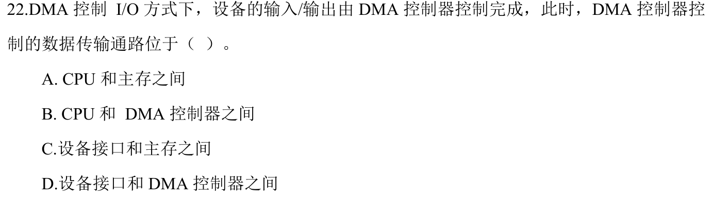

<details>
<summary>答案与解析</summary>

**参考答案：C（待逐题复核）。** 解析待补。

</details>

### 选择题11｜2025-21

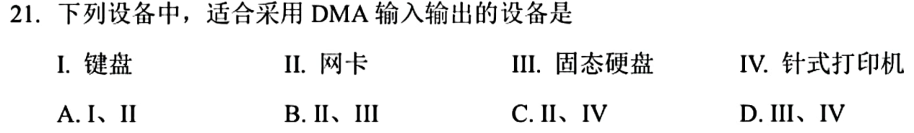

<details>
<summary>答案与解析</summary>

**参考答案：B（待逐题复核）。** 解析待补。

</details>

### 选择题12｜2025-22

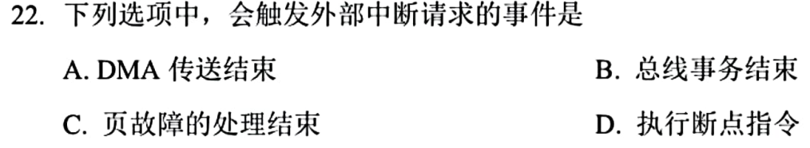

<details>
<summary>答案与解析</summary>

**参考答案：A（待逐题复核）。** 解析待补。

</details>

### 选择题13｜2026-21

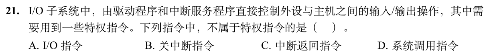

<details>
<summary>答案与解析</summary>

**答案：D。**

系统调用指令允许用户程序主动陷入。直接控制设备、关中断和恢复中断前机器状态涉及特权，不能由普通用户程序任意执行。

</details>

### 选择题14｜2026-22

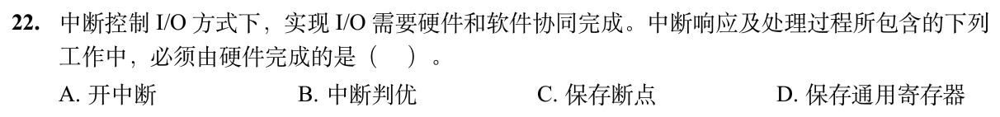

<details>
<summary>答案与解析</summary>

**答案与解析待补。**

</details>

## 选择题组2｜0906 · 计算机网络

[控制转发路径：ARP、路由协议与下一跳](../src/0906.md) · 5道 · 复做第1次。

### 选择题15｜2021-36

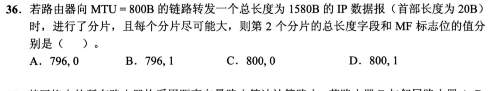

<details>
<summary>答案与解析</summary>

**答案：B。**

每片扣20B首部后最多780B，但非末片数据必须是8B整数倍，所以实际最多776B。原数据1560B，分成776、776、8，共3片。第二片总长776+20=796B，后面还有第三片，MF=1。不是把第二片当作最后一片，也不能直接填满800B。

</details>

### 选择题16｜2021-37

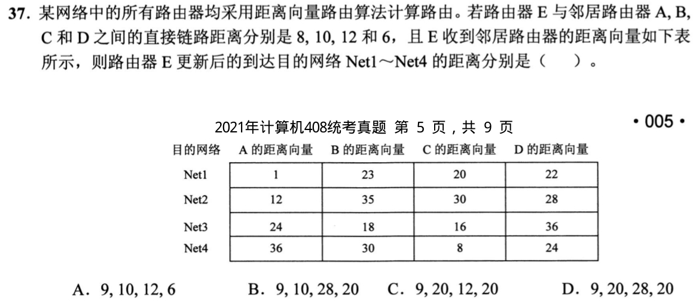

<details>
<summary>答案与解析</summary>

**答案：D。**

每个目的网络都计算“E到邻居距离＋邻居通告距离”再取最小。Net1最小8+1=9；Net2最小8+12=20；Net3最小为10+18或12+16，均28；Net4最小12+8=20。因此为9、20、28、20，不能只比较邻居通告值而漏掉到邻居这一段。

</details>

### 选择题17｜2025-37

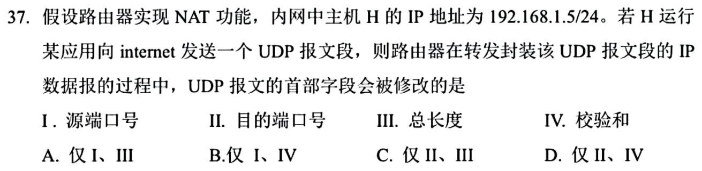

<details>
<summary>答案与解析</summary>

**答案：B。**

NAPT可能改源端口，源IP也变，UDP校验和涉及这些字段故需更新；目的端口与总长度不随普通地址端口转换改变。选I、IV。

</details>

### 选择题18｜2026-37

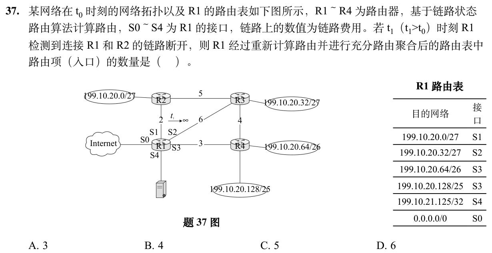

<details>
<summary>答案与解析</summary>

**答案：B。**

断链后到R2须经R3，走S2费用6+5=11，优于经R4、R3的3+4+5=12；到R3也仍走S2。于是199.10.20.0/27与.32/27可合成.0/26走S2；.64/26和.128/25合成.0/24走S3，并由更长前缀.0/26覆盖前64个地址。再保留服务器/32走S4及默认路由走S0，共4项。聚合时允许更具体路由纠正，不必只合并同出口且等长的相邻项。

</details>

### 选择题19｜2026-38

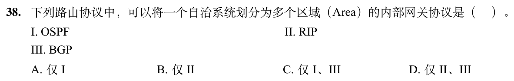

<details>
<summary>答案与解析</summary>

**答案：A。**

OSPF支持一个AS分成多个Area；RIP没有这种区域分层机制，BGP是外部网关协议，不符合题目“内部网关”。

</details>

## 解答题

### 大题1｜2022-46

[原题单 0925｜并发同步：PV 操作大题](../src/0925.md)

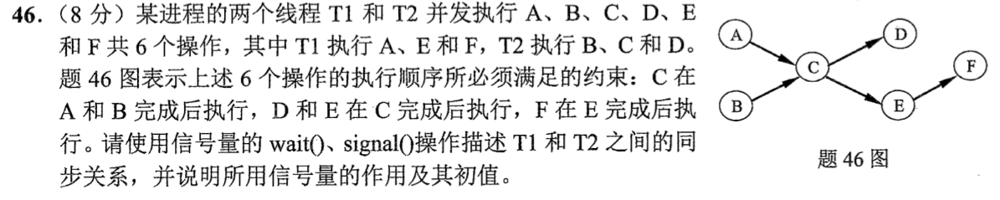

<details>
<summary>答案与解析</summary>

设 aDone、cDone 初值均为0，分别表示 A 完成与 C 完成。

```text
T1: A; signal(aDone); wait(cDone); E; F
T2: B; wait(aDone); C; signal(cDone); D
```

T2 的 C 由程序顺序保证在 B 后，再由 wait(aDone) 保证在 A 后。T1 通过 wait(cDone) 在 C 后执行 E，其后才是 F。T2 内 D 写在 C 后。D 与 E 之间没有额外顺序要求。

</details>

## 一行记录

```text
实际用时__；未完成或未核对的题号__；今天最容易混淆的是__
```
