# Day 25｜数据结构＋操作系统

[← Day 24](day24.md) · [总入口](README.md) · [Day 26 →](day26.md)

**选择题：17道，来自两份完整src题单；大题：1道。** 先做选择题，再展开题下解析。组内题目沿用src顺序；标为复做的组，已会的快速通过，重点处理上次错题。

**预计用时：70—115分钟。** 选择题及核对约40—70分钟，大题约25—35分钟，最后用5—10分钟重做今天最值得记住的一道错题。约两小时是配题目标，不是必须耗满或到点强停；计算卡住时先保留题号，先完成其余选择题。

## 选择题组1｜0731 · 数据结构

[时间复杂度：循环执行次数](../src/0731.md) · 4道 · 复做第1次。

### 选择题1｜2022-01

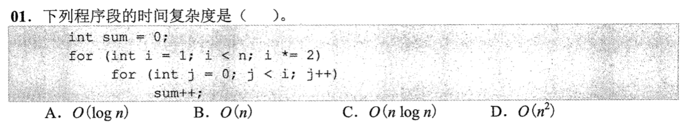

<details>
<summary>答案与解析</summary>


**答案：B。**

* **核心判据**：内层循环的上界直接依赖外层循环变量 $i$；外层 $i$ 呈几何级数翻倍，总执行次数由等比数列求和直接决定，不能机械地将两层最大边界直接相乘。
* **正选推导**：外层 $i$ 取值依次为 $1, 2, 4, \dots, 2^k \le n$。内层每轮循环执行 $i$ 次，总步数为等比数列求和：$S = 1 + 2 + 4 + \dots + 2^k = 2^{k+1} - 1 = 2 \cdot 2^k - 1$。因为末项 $2^k \le n < 2^{k+1}$，故 $S$ 的量级严格与 $n$ 同阶，时间复杂度为 $O(n)$。
* **干扰项击穿**：
  * **A. $O(\log n)$**：只计算了外层循环的轮数 $\log_2 n$，完全漏掉了内层循环随 $i$ 递增所消耗的操作量。
  * **C. $O(n \log n)$**：错误地假设每轮内层循环都会跑满最大上限 $n$（将 $\sum i$ 误当成 $\sum n$）。
  * **D. $O(n^2)$**：错误地把外层步进当成了线性的 $i++$。


</details>

### 选择题2｜2023-01

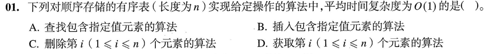

<details>
<summary>答案与解析</summary>


**答案：D。**

* **核心判据**：顺序存储结构的物理内存地址是连续的，具有“随机存取（Random Access）”特性，给定逻辑序号即可通过基址加偏移量一步硬件算定物理地址。
* **正选推导**：按下标取第 $i$ 个元素时，硬件直接根据公式 $\text{LOC}(a_i) = \text{LOC}(a_1) + (i - 1) \times L$ 计算内存首地址，属于单次算术操作，时间复杂度为 $O(1)$。
* **干扰项击穿**：
  * **A 按值查找**：只知道目标元素的内容，不知道其存放位置；即使表有序，最快二分查找也需要 $O(\log n)$，无序表则需顺序遍历 $O(n)$。切勿混淆“按位置访问”与“按内容查找”。
  * **B 插入 / C 删除**：为了维持顺序表的物理连续性，在第 $i$ 个位置插入或删除元素平均需要向后移动 $\frac{n}{2}$ 个或向前移动 $\frac{n-1}{2}$ 个元素，平均时间复杂度均为 $O(n)$。


</details>

### 选择题3｜2025-01

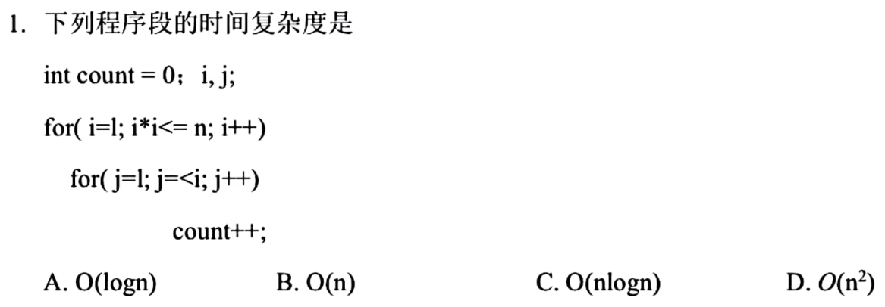

<details>
<summary>答案与解析</summary>


**答案：B。**

* **核心判据**：外层循环的终止条件由代数方程限制（$i^2 \le n \iff i \le \lfloor\sqrt{n}\rfloor$）；内层为线性累加，总复杂度等于内层次数对实际有效轮数的闭式求和。
* **正选推导**：外层循环变量 $i$ 每次自增 1，上限为 $m = \lfloor\sqrt{n}\rfloor$。内层每轮循环执行 $i$ 次。总执行次数为等差数列求和：$S = \sum_{i=1}^{m} i = \frac{m(m + 1)}{2} \approx \frac{(\sqrt{n})^2}{2} = \frac{n}{2}$，其最高阶项与 $n$ 同阶，故为 $O(n)$。
* **干扰项击穿**：
  * **A. $O(\sqrt{n})$**：只算了外层循环本身的循环次数 $m \approx \sqrt{n}$，漏算了内层 $j$ 随 $i$ 递增的累计步数。
  * **C. $O(n\sqrt{n})$**：误把内层每次执行的次数都顶格估算为上限 $\sqrt{n}$（$\sqrt{n} \times \sqrt{n} = n$，若算成 $n\sqrt{n}$ 则连外层上限都搞成了 $n$）。
  * **D. $O(n^2)$**：彻底忽略了外层限制条件是 $i^2 \le n$ 而不是 $i \le n$。


</details>

### 选择题4｜2026-01

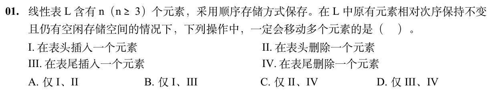

<details>
<summary>答案与解析</summary>


**答案：A。**

* **核心判据**：顺序表在物理上通过紧邻的内存块保持元素的前后逻辑次序。对头部进行增删必须移动后续所有元素以腾位或填坑；对尾部操作则无需触动前面的已有元素。
* **正选推导**：
  * **I 表头插入**：必须先将原先的全部 $n$ 个元素依次向后挪动 1 个位置，移动元素次数为 $n$（当 $n \ge 3$ 时必然 $\ge 3$）。
  * **II 表头删除**：必须将第 2 至第 $n$ 个元素（共 $n-1$ 个）依次向前移动 1 个位置填补首部空缺，移动元素次数为 $n - 1$（当 $n \ge 3$ 时必 $\ge 2$ 次，必然移动多个元素）。
  * 故 I、II 都必定需要移动多个元素，选 A。
* **干扰项击穿**：
  * **III 表尾插入**：表尾原本就有预留的连续空闲空间，直接在 `data[length]` 写入新元素并执行 `length++` 即可，移动元素次数为 0。
  * **IV 表尾删除**：只需在逻辑上直接将表长减 1（`length--`），原末尾数据在物理上无需任何搬运，移动元素次数为 0。


</details>

## 选择题组2｜0829 · 操作系统

[页面驻留：置换、工作集与缺页代价](../src/0829.md) · 13道 · 复做第1次。

### 选择题5｜2020-28

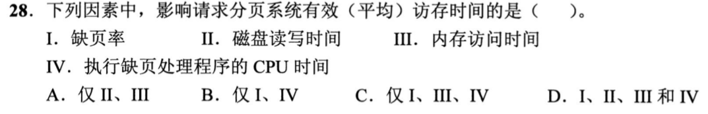

<details>
<summary>答案与解析</summary>

**答案：D。**

缺页率决定走慢路径概率；磁盘读写、内存访存、CPU处理异常均贡献耗时，I—IV都影响。

</details>

### 选择题6｜2021-28

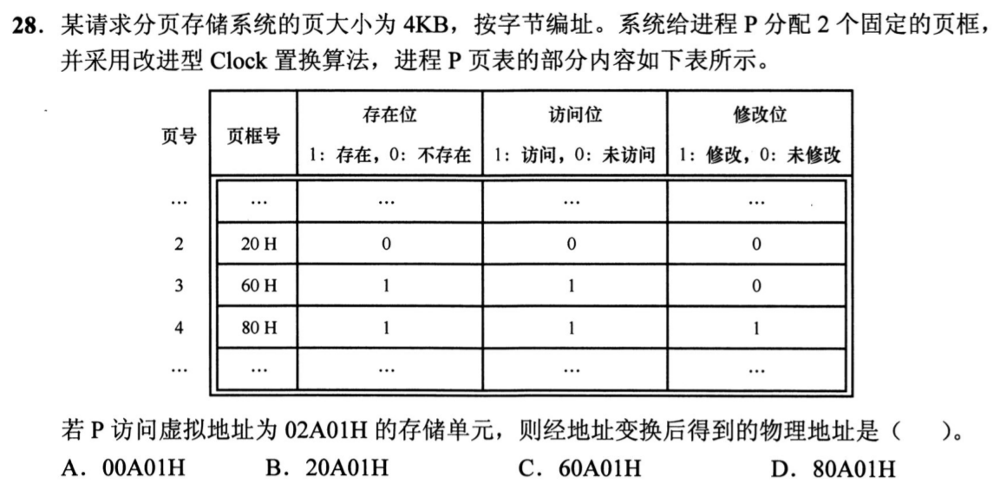

<details>
<summary>答案与解析</summary>

**答案：C。**

02A01H的虚页号为2、页内偏移A01H。页2不在内存，两个固定页框已满；改进Clock先清访问位后，优先淘汰未修改的页3，而非需要写回的页4。页2装入页3原占页框60H，物理地址60A01H。页2原表项里的20H在存在位0时不能直接使用。

</details>

### 选择题7｜2021-29

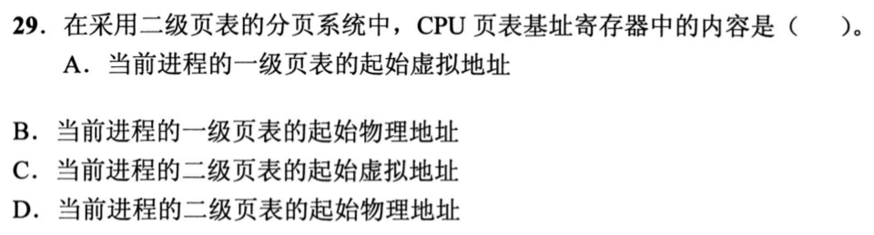

<details>
<summary>答案与解析</summary>

**答案：B。**

页表基址寄存器指向当前进程的一级页表物理起址，硬件从这里开始查一级项，再找到二级表。它不能存待转换的虚拟地址，否则第一次访表就仍需一次地址转换；也不能只指向某张二级表，因为不同一级索引对应不同二级表。

</details>

### 选择题8｜2022-29

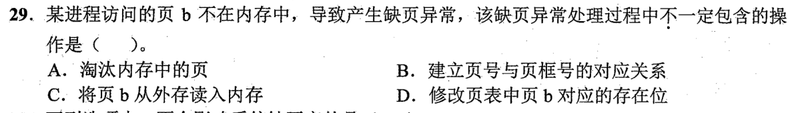

<details>
<summary>答案与解析</summary>

**答案：A。**

若还有空闲页框，可直接把b读入其中，不必淘汰任何驻留页。无论是否置换，都要读入b、建立页号到页框号映射，并把存在位设为1。缺页意味着所需页未驻留，不等于内存已经用满。

</details>

### 选择题9｜2022-30

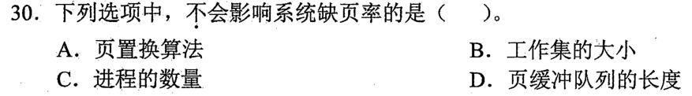

<details>
<summary>答案与解析</summary>

**答案：D。**

缺页率取决于访问局部性、工作集与分配页框、置换算法；进程多会争用页框，也可能改变缺页率。页缓冲队列保留已被换出页的内容，能减少再次访问时的磁盘I/O，但该页若已不在进程驻留集中，访问仍会触发缺页，所以不以队列长度直接改变缺页次数。

</details>

### 选择题10｜2023-25

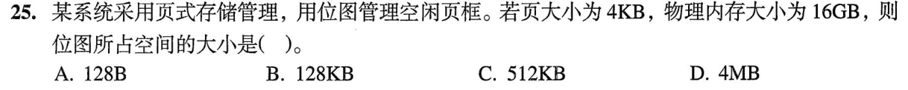

<details>
<summary>答案与解析</summary>

**答案：C。**

16GiB÷4KiB=2²²个页框，每框用1bit表示状态；位图占2²²bit÷8=2¹⁹B=512KiB。

D的4MB漏了bit转Byte的除8。位图不是每页框存一个字节。

</details>

### 选择题11｜2023-28

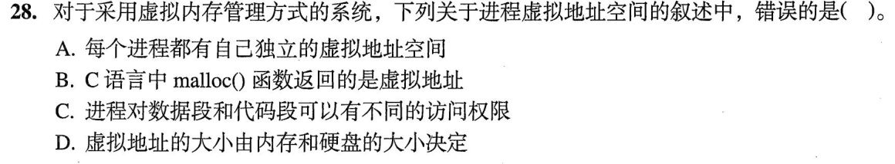

<details>
<summary>答案与解析</summary>

**答案：D。**

虚拟地址空间的范围由地址位数和体系结构约定决定，内存与硬盘容量限制可实际承载的内容，不决定虚拟地址数值范围，D错误。各进程有自己的地址空间，malloc返回其中的虚拟地址；页表权限可以把代码设为只读、数据设为可写，A、B、C成立。

</details>

### 选择题12｜2024-25

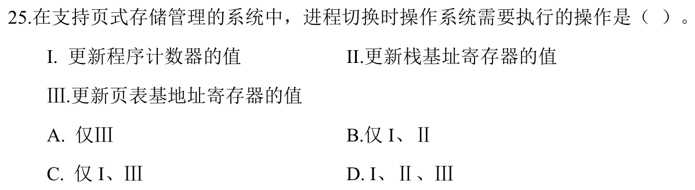

<details>
<summary>答案与解析</summary>

**答案：D。**

切换到另一进程要恢复其执行位置PC、栈基址等现场，并切换页表基址以使用它的地址空间，三项都需更新。线程切换可能仍共用页表，而本题明确是进程切换；不能把“只切换地址转换信息”当成全部现场恢复。

</details>

### 选择题13｜2025-26

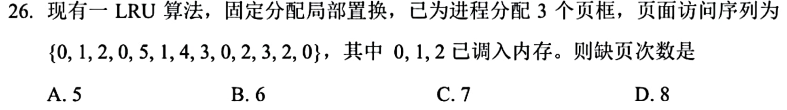

<details>
<summary>答案与解析</summary>

**答案：B。**

最初0、1、2已驻留，不重复计调入缺页。前三次访问后最近顺序为0、1、2，再访问0更新为1、2、0（从旧到新）。随后5、1、4、3、0、2各缺页一次，依次淘汰1、2、0、5、1、4；最后3、2、0均命中，共6次。命中也要更新LRU顺序，不能只在缺页时调队列。

</details>

### 选择题14｜2025-27


<details>
<summary>答案与解析</summary>

**答案：D。**

最少页框要保证一条指令能完成：指令本身和各次间接寻址、操作数访问可能落在不同页，因而取决于指令系统支持的寻址方式。虚拟空间或物理空间总大小决定总体规模，代码段长度决定全部代码多少页，都不直接决定这条指令需要同时驻留的最少页数。

</details>

### 选择题15｜2025-30

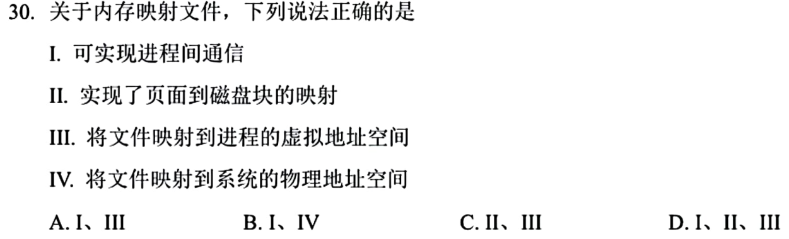

<details>
<summary>答案与解析</summary>

**答案：D。**

映射把文件区间关联到进程虚拟页，并记录这些页对应的文件偏移和磁盘后备内容，Ⅱ、Ⅲ成立。多个进程共享映射同一文件即可通信，Ⅰ成立。映射时不要求把整个文件立即装入物理内存，更不是把文件直接映射成固定物理地址区间，Ⅳ不选。

</details>

### 选择题16｜2026-29

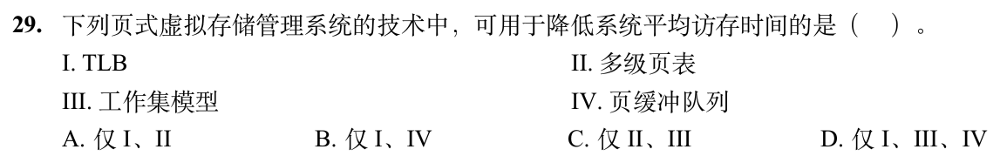

<details>
<summary>答案与解析</summary>

**答案：D。**

TLB减少查页表的访存；工作集模型尽量让近期所需页驻留，降低抖动与缺页代价；页缓冲保留被换出内容，减少重新读盘，Ⅰ、Ⅲ、Ⅳ均可降低平均访存时间。多级页表主要节省页表空间，未命中TLB时反而可能增加访表次数，Ⅱ不选。

</details>

### 选择题17｜2026-30

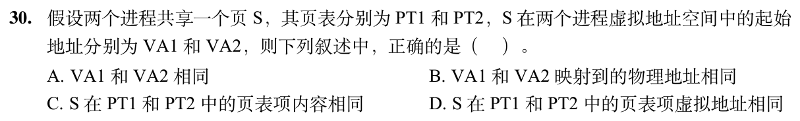

<details>
<summary>答案与解析</summary>

**答案：B。**

共享同一页意味着两个进程所见数据映射到同一物理页；虚拟起址可不同，页表项权限等内容可不同，页表项自身的存放地址也不必相同。

</details>

## 解答题

### 大题1｜2023-45

[原题单 0925｜并发同步：PV 操作大题](../src/0925.md)

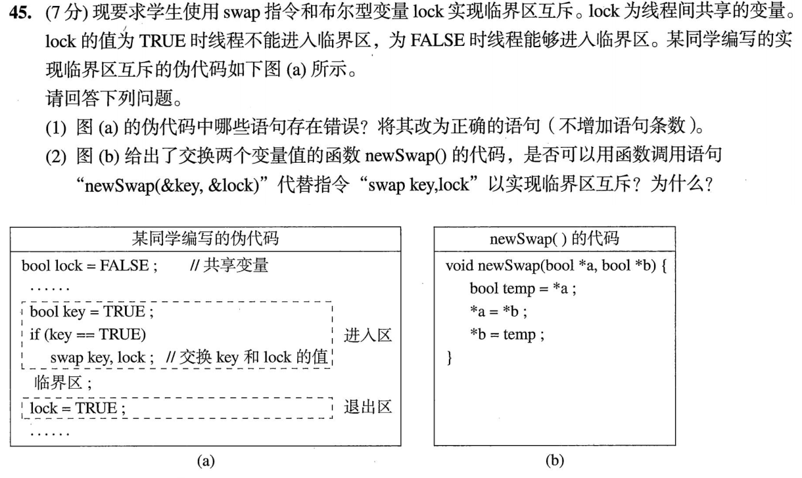

<details>
<summary>答案与解析</summary>

（1）进入区中的`if (key == TRUE)`须改为`while (key == TRUE)`；退出区中的`lock = TRUE`须改为`lock = FALSE`。正确逻辑为：

```text
bool key = TRUE;
while (key == TRUE) swap key, lock;
临界区;
lock = FALSE;
```

硬件swap原子交换key与共享lock。拿到FALSE的线程停止自旋，同时把lock置TRUE；没拿到锁的线程继续等待。

（2）不能直接用题示newSwap替代。函数里的读取、赋值是多条普通操作，可与另一线程交错；函数调用本身不会使整个函数原子化。两个线程可能都在lock为FALSE时读到它并误以为取得锁。判断依据是原子保证，不是变量交换后的单线程结果是否相同。

</details>

## 一行记录

```text
实际用时__；未完成或未核对的题号__；今天最容易混淆的是__
```
