# Day 26｜组成原理＋计算机网络

[← Day 25](day25.md) · [总入口](README.md) · [Day 27 →](day27.md)

**选择题：18道，来自两份完整src题单；大题：1道。** 先做选择题，再展开题下解析。组内题目沿用src顺序；标为复做的组，已会的快速通过，重点处理上次错题。

**预计用时：70—110分钟。** 选择题及核对约40—65分钟，大题约25—35分钟，最后用5—10分钟重做今天最值得记住的一道错题。约两小时是配题目标，不是必须耗满或到点强停；计算卡住时先保留题号，先完成其余选择题。

## 选择题组1｜0812 · 组成原理

[位模式的解释权：整数、浮点与类型转换](../src/0812.md) · 13道 · 复做第1次。

### 选择题1｜2020-13

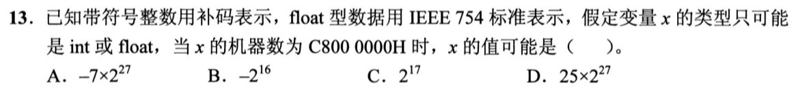

<details>
<summary>答案与解析</summary>

**答案：A。**

* **核心判据**：同一串二进制位（Bit Pattern）本身没有任何预设含义，其真值完全取决于软件与指令集所采用的**解码解释模型（32位补码整型、无符号数、或 IEEE 754 浮点数）**。
* **正选推导**：
  * 若按 **32 位有符号整数补码**解释：最高十六进制位为 `C`（`1100_1000`），最高符号位为 1，代表负数。
  * 补码真值直接按同余公式计算：
    $$\text{真值} = \text{C8000000H} - 2^{32} = -(\text{38000000H}) = -(3 \times 16^7 + 8 \times 16^6) = -(3 \times 2^{28} + 2^{27}) = -(6 + 1) \times 2^{27} = -7 \times 2^{27}$$
  * 故 A 成立。
* **干扰项击穿**：
  * **B $-2^{16}$**：若按 **IEEE 754 单精度浮点数**解释：
    * 符号位 $S = 1$（负数）；
    * 阶码字段 $E = 1001\_0000_2 = 144$，指数真值 $e = 144 - 127 = 17$；
    * 尾数字段全 0，带隐含 1 得到有效数值 $1.0$；
    * 浮点真值应为 $-1.0 \times 2^{17} = -2^{17}$，并非 B 的 $-2^{16}$。
  * **C $+7 \times 2^{27}$ / D $+2^{17}$**：最高位为 1，无论按有符号整型补码还是浮点数解释，都必定是负数，绝不可能为正数。

</details>

### 选择题2｜2020-14

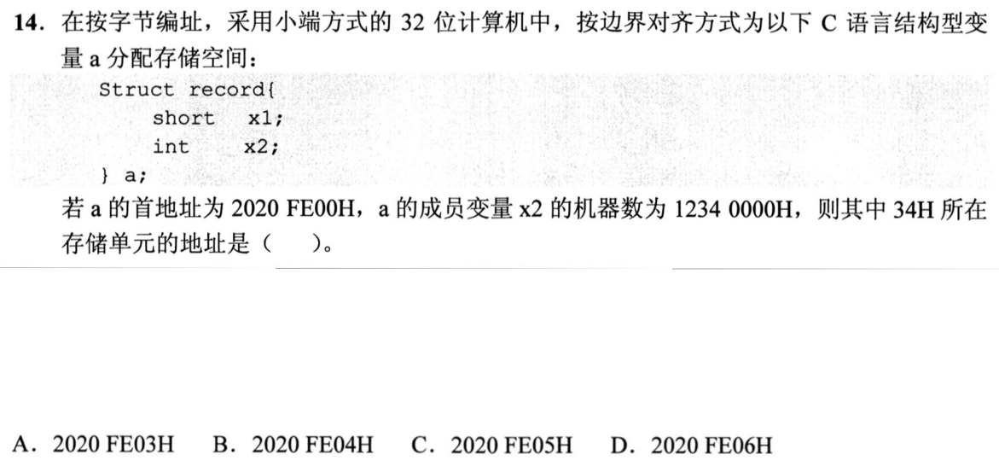

<details>
<summary>答案与解析</summary>

**答案：D。**

* **核心判据**：结构体成员变量遵循“**自身大小自然对齐（Self-alignment）**”规则；多字节数据在小端模式（Little-Endian）下遵循“**低字节存低地址，高字节存高地址**”。
* **正选推导**：
  1. **成员地址定位**：
     * `x1`（`short`，2 字节）占基址偏移 `+0` 和 `+1`；
     * `x2`（`int`，4 字节）的首地址必须能够被 4 整除，因此偏移 `+2` 和 `+3` 必须被硬件自动填充填充字节（Padding），`x2` 严格从偏移 `+4` 开始存放。
  2. **小端字节排布**：
     * `x2 = 12340000H` 共有 4 个字节，从低位到高位依次为 `00H`、`00H`、`34H`、`12H`；
     * 写入内存时低字节放低地址：
       * 偏移 `+4`：`00H`（最低字节）
       * 偏移 `+5`：`00H`
       * 偏移 `+6`：`34H`（次高字节）
       * 偏移 `+7`：`12H`（最高字节）
     * 因此 `34H` 的物理地址为 $\text{基址} + 6 = \text{2020FE00H} + 6 = \text{2020FE06H}$，选 D。
* **干扰项击穿**：
  * **B 2020FE04H**：是 `x2` 的起始存放地址，存放的是最低字节 `00H`；若误把对齐漏掉（以为 `x2` 在偏移 `+2`）且按大端排布，会撞上此项。
  * **C 2020FE05H**：存放的是第二个 `00H`。

</details>

### 选择题3｜2021-14

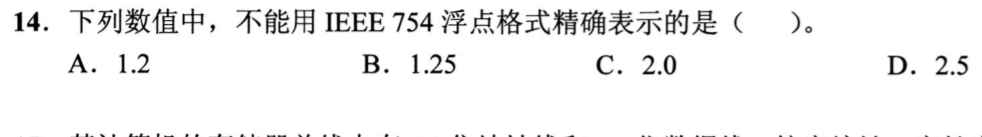

<details>
<summary>答案与解析</summary>

**答案：A。**

* **核心判据**：十进制小数能否被二进制浮点数精确表示，取决于其化为最简分数 $\frac{A}{B}$ 后，**分母 $B$ 的质因数是否只有 2**。一旦分母含有除 2 以外的任何质因子（如 3、5），其二进制展开必为无限循环小数，有限位数的尾数必然产生截断舍入误差。
* **正选推导**：
  * **A 1.2**：化为最简分数为 $\frac{6}{5}$，分母含有质因数 5。在二进制下是无限循环小数（$1.00110011\dots_2$），单精度 float 的 23 位尾数无法精确容纳，必定丢失精度，故选 A。
* **干扰项击穿**：
  * **B 1.25**：$1 + \frac{1}{4} = 1.01_2$，仅需 2 位小数即可精确表示。
  * **C 2.0**：$2.0 = 10.0_2$，整数完全能精确表示。
  * **D 2.5**：$2 + \frac{1}{2} = 10.1_2$，仅需 1 位小数即可精确表示。

</details>

### 选择题4｜2022-13

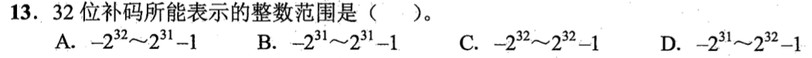

<details>
<summary>答案与解析</summary>

**答案：B。**

* **核心判据**：$n$ 位补码的表示范围严格是非对称区间 $[-2^{n-1}, 2^{n-1} - 1]$。其负数端能够多表示一个数，是因为原码中的“负零”（`100...00`）在补码中被赋予了最小负数 $-2^{n-1}$ 的物理权值。
* **正选推导**：
  * 在 32 位补码中，$n = 32$：
    * 最高符号位的权值为 $-2^{31}$；
    * 其余 31 位数据位全为 1 时的最大正数值为 $\sum_{i=0}^{30} 2^i = 2^{31} - 1$；
    * 故 32 位有符号整数的表示范围为 $[-2^{31}, 2^{31} - 1]$，选 B。
* **干扰项击穿**：
  * **A $[-2^{32}, 2^{32} - 1]$**：多占用了一位符号位（属于 33 位补码或与无符号数混淆）。
  * **C / D**：误将补码记成关于 0 对称的原码/反码范围（原码存在 $+0$ 与 $-0$ 冗余，范围为 $[-(2^{31}-1), 2^{31}-1]$）。

</details>

### 选择题5｜2022-14

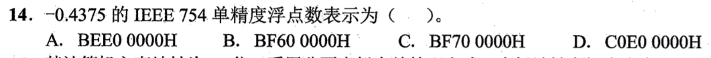

<details>
<summary>答案与解析</summary>

**答案：A。**

* **核心判据**：IEEE 754 单精度浮点数的二进制拼装结构：**1位符号位 $S$ + 8位阶码 $E$（移码，偏置值 $+127$）+ 23位尾数 $M$（省去规格化开头的隐含 1）**。
* **正选推导**：
  1. **真值二进制展开**：
     $$-0.4375 = -(\frac{7}{16}) = -0.0111_2 = -1.11_2 \times 2^{-2}$$
  2. **拆解三要素**：
     * 符号位 $S = 1$（负数）；
     * 阶码真值 $e = -2$，阶码字段 $E = -2 + 127 = 125 = 0111\_1101_2$；
     * 规格化尾数 $1.11_2$ 去掉最高位的隐含 1 后，尾数字段 $M = 1100\dots_2$（补齐 23 位）。
  3. **拼接二进制并转十六进制**：
     $$\text{位串} = \underbrace{1}_{S}\ \underbrace{0111\ 1101}_{E}\ \underbrace{1100\ 0000\ 0000\ 0000\ 0000\ 000}_{M}$$
     按 4 位一组划分：`1011 1110 1110 0000 0000 0000 0000 0000` $\implies$ **`BEE00000H`**，选 A。
* **干扰项击穿**：
  * 若阶码忘记加上偏置值 127、或者误将隐含的 1 填入尾数字段，均会导致高位字节产生错误。

</details>

### 选择题6｜2023-13

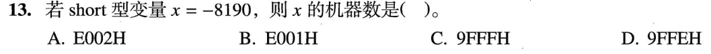

<details>
<summary>答案与解析</summary>

**答案：A。**

* **核心判据**：16 位有符号整型（`short`）的补码是其真值在模 $2^{16} = 65536$ 下的非负同余数：$[\text{X}]_{\text{补}} = 2^{16} + X$。
* **正选推导**：
  * 真值 $X = -8190$；
  * 补码数值为：
    $$[\text{X}]_{\text{补}} = 65536 - 8190 = 57346$$
  * 将 57346 转换为十六进制：
    $$57346 = 14 \times 4096 + 0 \times 256 + 0 \times 16 + 2 = \text{E002H}$$
  * （亦可由绝对值取反加一推导：$+8190 = 8192 - 2 = 0001\_1111\_1111\_1110_2 = \text{1FFEH}$；按位取反加一得 $\text{E001H} + 1 = \text{E002H}$）。故选 A。
* **干扰项击穿**：
  * 最高十六进制位为 `E`（`1110`），最高符号位为 1，准确代表负数；切勿把负数的十六进制机器码误当成无符号数正数处理。

</details>

### 选择题7｜2023-14

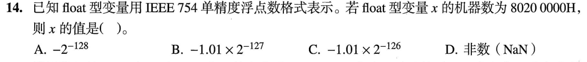

<details>
<summary>答案与解析</summary>

**答案：A。**

* **核心判据**：IEEE 754 规定：**阶码字段全 0 且尾数字段非 0 为非规格化数（Subnormal Number）**。非规格化数的隐含整数位为 0（即 $0.M$），且阶码真值固定绑定为 $e = 1 - 127 = -126$（而非常规的 $0 - 127 = -127$），以此实现从规格化数到 0 的渐进式平滑下溢。
* **正选推导**：
  1. **十六进制展开为 32 位比特**：
     `80200000H` = `1_00000000_01000000000000000000000`
  2. **解析各字段**：
     * 符号位 $S = 1$（负数）；
     * 阶码字段 $E = 0000\_0000_2 = 0$（阶码全 0，触发非规格化数！）；
     * 尾数字段 $M = 0100\dots_2 = 2^{-2} = \frac{1}{4}$；
  3. **套用非规格化数解码公式**：
     $$\text{真值} = (-1)^S \times (0.M) \times 2^{-126} = -(\frac{1}{4}) \times 2^{-126} = -2^{-2} \times 2^{-126} = -2^{-128}$$
  * 故选 A。
* **干扰项击穿**：
  * 若机械套用规格化公式加上隐含 1（误当成 $1.M = 1.25$），或误将指数算为 $-127$，就会得出 $-1.25 \times 2^{-127}$ 等错解。

</details>

### 选择题8｜2024-12

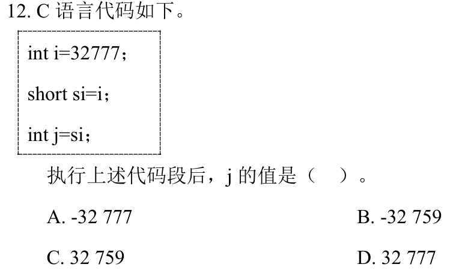

<details>
<summary>答案与解析</summary>

**答案：B。**

* **核心判据**：
  1. **宽字长转窄字长（截断）**：直接丢弃高位比特，只保留低位比特；
  2. **窄字长转宽字长（扩展）**：对于有符号数（`short`），高位执行**符号扩展（Sign Extension）**，即全部填充符号位。
* **正选推导**：
  1. 初始整型变量：$si = 32777 = 32768 + 9 = \text{0000 8009H}$；
  2. 强转为 16 位 `short`：截断高 16 位，只保留低 16 位位模式 `8009H`；
  3. 此时 `ss` 作为 16 位有符号数，最高符号位为 1（`1000_0000_0000_1001`），其实际真值为负数：
     $$\text{真值} = 32777 - 2^{16} = 32777 - 65536 = -32759$$
  4. 随后将 `ss` 再次提升转换为 32 位 `int`：由于 `short` 是有符号数，进行符号扩展，高 16 位全部填充符号位 1，变成 `FFFF 8009H`，数值严格保持其真值 $-32759$ 不变。故选 B。
* **干扰项击穿**：
  * **D $+32759$**：忽略了截断后最高位变成 1 导致的负数解释。
  * **C $+32777$**：误以为转回 `int` 会恢复原始数值。
  * **A $-32777$**：误以为截断只是加了个负号。

</details>

### 选择题9｜2024-14

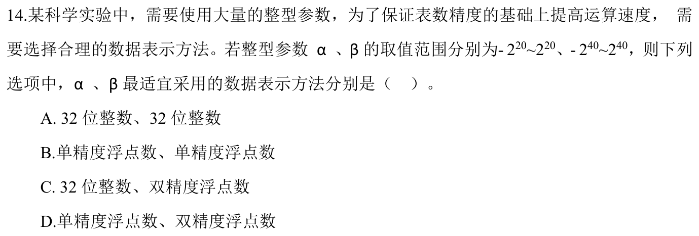

<details>
<summary>答案与解析</summary>

**答案：C。**

* **核心判据**：整数能否被浮点数**精确表示（无任何舍入误差）**，取决于整数的有效二进制位数是否小于等于浮点数的**有效尾数位数（含隐含 1）**，而不能只看浮点数的表示范围。
  * 32 位 `int`：精确整数范围为 $[-2^{31}, 2^{31} - 1]$；
  * IEEE 754 单精度 `float`：尾数只有 $23 + 1 = 24$ 位有效精度，超过 $2^{24}$（约 $1.67 \times 10^7$）的整数必定出现低位丢弃；
  * IEEE 754 双精度 `double`：尾数有 $52 + 1 = 53$ 位有效精度，可绝对精确覆盖 $2^{53}$（约 $9 \times 10^{15}$）以内的所有整数。
* **正选推导**：
  * $\alpha \in [-2^{20}, 2^{20}]$：有效位数不超过 21 位，32 位 `int`（可容纳 31 位数据）完全能精确保存，且整数运算效率远高于浮点；
  * $\beta \in [-2^{40}, 2^{40}]$：大小远超 32 位整型（溢出）；而 `float` 仅能保证 24 位精度，存入 $2^{40}$ 级别的数会导致低 16 位精度被硬性舍入截断；唯有双精度 `double` 的 53 位尾数精度（$53 > 40$）能够百分之百精确无损地保存 $\beta$。
  * 因此 $\alpha$ 取 `int`，$\beta$ 取 `double`，选 C。
* **干扰项击穿**：
  * **B / D**：给 $\beta$ 选 `float`，严重混淆了“能存得下量级（阶码够大）”与“能精确保存（尾数够长）”的物理边界。

</details>

### 选择题10｜2025-12

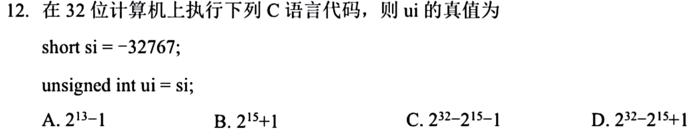

<details>
<summary>答案与解析</summary>

**答案：D。**

* **核心判据**：C 语言在混合类型转换时的底层物理时序：**先做字长位宽扩展，再改变符号属性解释**。`short` 转 `unsigned int` 必须先由 16 位符号扩展为 32 位有符号 `int`，再将这 32 位机器码按无符号数直接解码。
* **正选推导**：
  1. $si = -32767 = -(2^{15} - 1)$；
  2. 转换为 32 位时，先执行符号扩展（高位全补 1），此时位模式在代数上仍严格代表真值 $-32767$ 的 32 位补码；
  3. 最终重新解释为 32 位无符号整数（对模 $2^{32}$ 取等价正值）：
     $$ui = 2^{32} + (-32767) = 2^{32} - (2^{15} - 1) = 2^{32} - 2^{15} + 1$$
  * 故选 D。
* **干扰项击穿**：
  * **B $2^{16} - 2^{15} + 1$**：错在先将 16 位位串解释为无符号数再做零扩展。
  * **C $2^{32} - 2^{15} - 1$**：去括号负负得正时符号算错（将 $+1$ 误写为 $-1$）。

</details>

### 选择题11｜2025-13

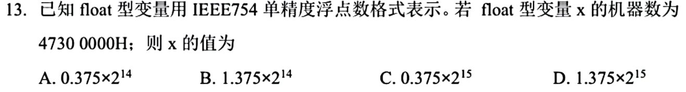

<details>
<summary>答案与解析</summary>

**答案：D。**

* **核心判据**：IEEE 754 单精度规格化数解码标准公式：$V = (-1)^S \times (1.M) \times 2^{E - 127}$。
* **正选推导**：
  1. 十六进制数 `47300000H` 展开为 32 位二进制：
     `0_10001110_01100000000000000000000`
  2. 提取三部分：
     * 符号位 $S = 0$（正数）；
     * 阶码字段 $E = 1000\_1110_2 = 128 + 8 + 4 + 2 = 142$；
     * 阶码真值 $e = 142 - 127 = 15$；
     * 尾数字段 $M = 0110\dots_2$；
  3. 加上规格化数隐含的整数 1：
     $$\text{有效数值} = 1.M = 1.011_2 = 1 + 2^{-2} + 2^{-3} = 1 + 0.25 + 0.125 = 1.375$$
  4. 最终浮点真值：$1.375 \times 2^{15}$，选 D。
* **干扰项击穿**：
  * 若阶码未减偏置 127、或尾数前漏加规格化隐含 1，均会得到错误真值。

</details>

### 选择题12｜2025-15

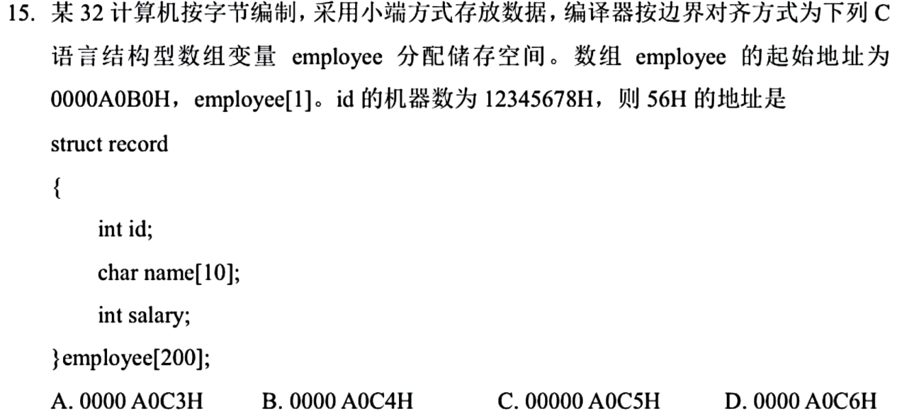

<details>
<summary>答案与解析</summary>

**答案：C。**

* **核心判据**：结构体不仅每个成员要按自身大小对齐，**结构体整体大小也必须是其内部最大基本成员大小的整数倍（尾部对齐填充）**；数组下标直接通过乘以单体大小进行基址偏移定位。
* **正选推导**：
  1. **计算单个结构体大小**：
     * `id`（`int`，4B）：偏移 `+0x00 ~ +0x03`；
     * `name`（`char[10]`，10B）：偏移 `+0x04 ~ +0x0D`；
     * `salary`（`int`，4B）：起始地址必须是 4 的倍数，当前偏移 `0x0E` 不是 4 的倍数，必须插入 2 字节填充（`+0x0E ~ +0x0F`），`salary` 占偏移 `+0x10 ~ +0x13`（4B）；
     * 此时占用 20B（`14H`），最大成员为 4B，20 已经是 4 的整数倍，末尾无需额外填充。单个结构体总大小严格为 20 字节（`14H`）。
  2. **定位 `employee[1].id` 地址**：
     * 数组首地址为 `A0B0H`；
     * `employee[1]` 的首地址 $= \text{A0B0H} + 1 \times 14\text{H} = \text{A0C4H}$；
     * `id` 是结构体的首个成员，因此 `employee[1].id` 的起始地址就是 `A0C4H`。
  3. **小端方式存放与定位**：
     * `id` 值为 `12345678H`，小端机低位低址存放：
       * `A0C4H`: `78H`（最低字节）
       * `A0C5H`: `56H`（次低字节）
       * `A0C6H`: `34H`
       * `A0C7H`: `12H`（最高字节）
     * 故 `56H` 存放在 **`A0C5H`**，选 C。
* **干扰项击穿**：
  * **A A0C3H**：漏算了 `salary` 前面的 2B 填充对齐（误将单体算成 18 字节）。
  * **B A0C4H**：是 `id` 的首地址，存放的是最低位 `78H`。
  * **D A0C6H**：存放的是 `34H`。

</details>

### 选择题13｜2026-14

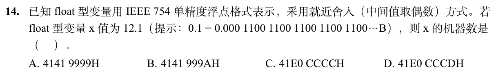

<details>
<summary>答案与解析</summary>

**答案：B。**

* **核心判据**：IEEE 754 规定浮点数默认采用**就近舍入（Round to Nearest, ties to even）**。当截断处多余比特严格大于“中点”（最高被舍弃位为 1 且其后还有非 0 位）时，尾数必须无条件向上进位（$+1$）。
* **正选推导**：
  1. **真值二进制展开**：
     * 整数部分：$12 = 1100_2$；
     * 小数部分：$0.1 = 0.0001100110011\dots_2$（无限循环）；
     * 拼合规格化：$12.1 = 1100.0001100110011\dots_2 = 1.100000110011001100110011\dots_2 \times 2^3$。
  2. **提取基本字段**：
     * 符号位 $S = 0$；
     * 阶码 $E = 3 + 127 = 130 = 1000\_0010_2$；
     * 提取 23 位尾数字段：
       `1000001 10011001 10011001`（对应高位拼合后为 `4141 9999H`）；
  3. **就近舍入决断**：
     * 观察被截断的第一位丢弃位：紧随其后的是 `10011...`；
     * 该舍弃部分最高位是 1 且后续有非 0 比特，其权值**严格大于半个最低有效位（中点）**，必须向上舍入（尾数最低位 $+1$）；
     * 末尾的 `...9H` 进位变成 `...AH`，最终十六进制机器码为 **`4141999AH`**，选 B。
* **干扰项击穿**：
  * **A 41419999H**：直接截断（Truncation），未做标准的就近进位舍入。
  * **C / D**：阶码计算错误。

</details>

## 选择题组2｜0908 · 计算机网络

[应用会话：DNS、Web、邮件与文件传输](../src/0908.md) · 5道 · 复做第1次。

### 选择题14｜2020-40

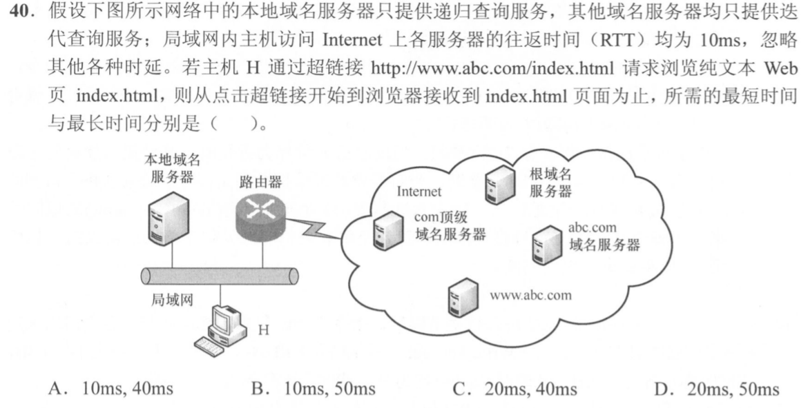

<details>
<summary>答案与解析</summary>

**答案：D。**

* **核心判据**：DNS 递归/迭代解析与 HTTP 事务往返时延（RTT）的物理链路构成：
  * 主机 H 与本地域名服务器均处于同一局域网（题图直连局域网总线），局域网内部时延忽略不计；访问 Internet 上各服务器的往返时延 RTT 恒为 10ms；
  * **HTTP 传输阶段的不可压缩固定物理开销**：
    1. 主机 H 与目标 Web 服务器（Internet 上的 `www.abc.com`）建立 TCP 连接（三次握手）：耗费 **1 个 RTT**（10ms）；
    2. 主机 H 发送 HTTP GET 请求并接收到纯文本页面 `index.html`：耗费 **1 个 RTT**（10ms）；
    3. HTTP 阶段总耗时恒为 **2 个 RTT = 20ms**！
  * **DNS 域名解析阶段的时延区间**：
    * **最短时间（缓存全命中）**：本地域名服务器（或 H 本机缓存）已保存该域名解析记录，局域网内查询即刻返回，DNS 访问外网消耗的 RTT 为 **0**。
      $$\text{最短总时间} = 0\text{ (DNS)} + 20\text{ms (HTTP)} = \mathbf{20\text{ms}}$$
    * **最长时间（缓存完全未命中，全链路迭代解析）**：
      * 本地域名服务器依次向外网发起 3 次迭代查询：
        1. 向**根域名服务器**查询：耗费 1 个 RTT（10ms），获取 com 顶级域名服务器地址；
        2. 向 **com 顶级域名服务器**查询：耗费 1 个 RTT（10ms），获取 abc.com 权威域名服务器地址；
        3. 向 **abc.com 权威域名服务器**查询：耗费 1 个 RTT（10ms），获取 www.abc.com 的目标 IP；
      * DNS 迭代查询总耗时：$3 \times 10\text{ms} = 30\text{ms}$；
      $$\text{最长总时间} = 30\text{ms (DNS)} + 20\text{ms (HTTP)} = \mathbf{50\text{ms}}$$
* **正选推导**：
  * 所需的最短时间为 20ms，最长时间为 50ms，选 D。
* **干扰项击穿**：
  * **误选 A 或 B（最短时间 10ms）**：极其致命的低级失误！只算了发送 HTTP 请求并获取网页的 10ms，完全漏掉了 TCP 建立连接所必需的 1 个握手 RTT（SYN $\to$ SYN+ACK）；
  * **误选 C（最长 40ms）**：在迭代查询中漏算了顶级或权威域名服务器其中一级的迭代交互。

</details>

### 选择题15｜2022-40

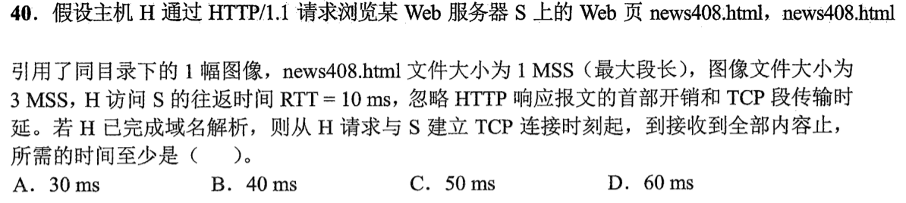

<details>
<summary>答案与解析</summary>

**答案：B。**

* **核心判据**：TCP 拥塞控制慢开始（Slow Start）与 HTTP/1.1 持久连接往返时序推进：
  * 题设参数：$RTT = 10\text{ ms}$，HTML 文件为 1 MSS，图像文件为 3 MSS；
  * **TCP 慢开始规则**：连接建立后初始拥塞窗口 $\text{cwnd} = 1\text{ MSS}$。每收到 1 个确认 ACK，$\text{cwnd}$ 增加 1 MSS（即每个 RTT 窗口大小翻倍：$1 \to 2 \to 4 \dots$）；
  * **全流程物理时序推演**：
    1. **第 1 个 RTT（0 ~ 10ms）**：
       * 主机 H 向服务器 S 发送 TCP SYN，S 返回 SYN+ACK，完成 TCP 三次握手建立连接；
       * 此时服务端 TCP 连接就绪，初始 $\text{cwnd} = 1\text{ MSS}$；
    2. **第 2 个 RTT（10 ~ 20ms）**：
       * H 发送 HTTP GET 请求获取 `news408.html`（大小 1 MSS）；
       * 服务端受制于 $\text{cwnd} = 1\text{ MSS}$，发出 1 个 MSS 的 HTML 页面；
       * H 接收到 HTML 页面，发送对该数据段的 ACK 确认；
       * 服务端收到确认，慢开始窗口翻倍：$\text{cwnd} = 1 + 1 = \mathbf{2\text{ MSS}}$；
    3. **第 3 个 RTT（20 ~ 30ms）**：
       * H 解析 HTML 页面，发现引用了 1 幅 3 MSS 大小的图像，立即在同一条持久 TCP 连接上发送图像 GET 请求；
       * 服务端接收到请求准备发送 3 MSS 的图像数据。但当前服务端的拥塞窗口仅为 $\text{cwnd} = \mathbf{2\text{ MSS}}$！
       * 因此服务端在当前轮次**只能发送前 2 个 MSS 的图像数据**；
       * H 接收到这 2 个 MSS 的图像数据并返回 ACK 确认；
       * 服务端收到 2 个 ACK 确认，窗口更新为 $\text{cwnd} = 2 + 2 = \mathbf{4\text{ MSS}}$；
    4. **第 4 个 RTT（30 ~ 40ms）**：
       * 此时 $\text{cwnd} = 4 \ge 1$，服务端将图像剩余的最后 1 个 MSS 发送给 H；
       * H 成功接收完图像最后 1 个 MSS，全部页面与内嵌资源彻底接收完毕。
* **正选推导**：
  * 全过程总计耗费 4 个完整 RTT，所需时间至少为 $4 \times 10\text{ms} = \mathbf{40\text{ms}}$，选 B。
* **干扰项击穿**：
  * **A项（30ms）**：严重忽略了 TCP 慢开始窗口的物理流控约束！误以为服务端可以在第 3 个 RTT 一口气把 3 个 MSS 全部发完（$10\text{ms 握手} + 10\text{ms HTML} + 10\text{ms 图像} = 30\text{ms}$）。如果服务端在第 2 轮之后 $\text{cwnd}$ 只有 2 MSS，强行发 3 MSS 将违背 TCP 拥塞控制基本物理定理；
  * **C/D项**：多算了非必要的额外往返。

</details>

### 选择题16｜2024-40

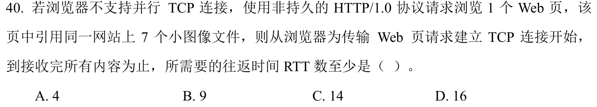

<details>
<summary>答案与解析</summary>

**答案：D。**

* **核心判据**：非持久 HTTP/1.0 串行传输的连接生命周期模型：
  * **非持久连接（Non-persistent Connection）特征**：每个独立的 Web 对象（HTML 页面及每个内嵌的多媒体资源）在传输时，**必须独立建立一条专用的 TCP 连接，对象传输完毕后该 TCP 连接立即被强制关闭**；
  * **单对象获取时延**：每次获取一个对象必须经历：
    1. 建立 TCP 连接的往返握手：**1 个 RTT**；
    2. 发送 HTTP 请求报文并接收响应对象数据：**1 个 RTT**；
    3. 每个对象获取固定耗费 **2 个 RTT**；
  * **串行无并发约束**：题目明确限定“浏览器不支持并行 TCP 连接”，因此所有对象的连接建立与获取只能按前后次序**逐一串行排队执行**。
* **正选推导**：
  * 待获取对象总数：
    * 1 个基础 Web 页面（HTML）
    * 7 个内嵌小图像文件
    * 共计 $1 + 7 = 8$ 个对象。
  * 8 个对象依次串行请求，所需总 RTT 数量严格为：
    $$\text{总 RTT 数} = 8 \times 2\text{ RTT} = \mathbf{16\text{ RTT}}$$
  * 选 D。
* **干扰项击穿**：
  * **B项（9 RTT）**：混淆为 HTTP/1.1 非流水线持久连接（建立 1 次 TCP 连接花 1 RTT，随后在同一条连接上串行请求 8 个对象各花 1 RTT，总共 $1 + 8 = 9$ RTT）；
  * **A项（4 RTT）**：混淆为支持流水线的持久连接（1 握手 + 1 HTML + 1 图像流水线并发）；
  * 题设是原汁原味的“非持久 HTTP/1.0 且不支持并行”，每一个小图像都必须重新经过 TCP 三次握手，不存在任何连接复用。

</details>

### 选择题17｜2025-40

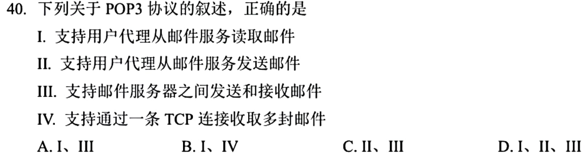

<details>
<summary>答案与解析</summary>

**答案：B。**

* **核心判据**：应用层邮件传输协议的方向性语义分工：
  * **POP3（邮局协议版本 3 / Post Office Protocol v3）的拉取（Pull）本质**：
    * POP3 是专为用户代理（Client UA）从远程邮件接收服务器**读取/下载邮件**而设计的应用层协议（熟知端口 110，I 正确）；
    * **连接复用与批处理能力（IV 正确）**：POP3 建立 TCP 连接并完成身份认证后进入事务处理状态（TRANSACTION），客户端可在同一个 TCP 连接中通过多次发送 `RETR <msg_id>` 命令连续收取多封邮件，无需为每封邮件重复建立 TCP 连接；
  * **SMTP（简单邮件传输协议）的推送（Push）本质**：
    * 用户代理向邮件服务器发送邮件（II）、以及邮件服务器之间互相中继路由传输邮件（III），**均由 SMTP 协议（熟知端口 25）全权负责**；POP3 协议规范内部根本没有定义任何发送或中继邮件的指令与机制。
* **正选推导**：
  * 正确的叙述是 I、IV，选 B。
* **干扰项击穿**：
  * **混淆收信与发信（II、III 错误）**：用户在客户端界面上既能写邮件发信又能收信，常误以为客户端使用的单一协议负责全流程。实际上邮件系统发信与收信是两条完全解耦的单向协议通道：发信走 SMTP 推送，收信走 POP3/IMAP 拉取。POP3 绝不参与发邮件或服务器间中继。

</details>

### 选择题18｜2026-40

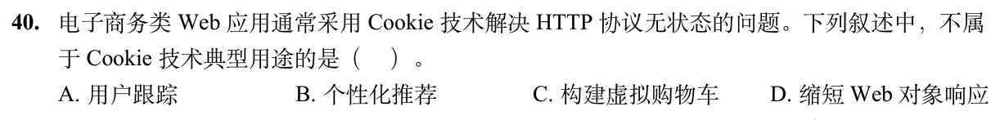

<details>
<summary>答案与解析</summary>

**答案：D。**

* **核心判据**：Cookie 状态管理机制 vs Web 缓存（Caching）性能加速机制：
  * HTTP 协议本质是无状态的（Stateless），服务器无法识别多次请求是否来自同一个客户端；
  * **Cookie 技术的典型核心用途（状态跟踪与个性化）**：
    1. **用户会话管理与跟踪（A）**：识别用户身份，维持登录会话状态（Session）；
    2. **个性化推荐（B）**：记录用户历史访问记录与偏好设置，实现定制化内容与商品推荐；
    3. **状态保留与虚拟购物车（C）**：在无状态的跨页面跳转过程中，将用户选购的商品 ID 暂存于 Cookie 中，构建完整的购物车逻辑；
  * **为什么 Cookie 不能缩短响应时间（D 不属于典型用途）**：
    * “缩短 Web 对象响应时间”是 **Web 缓存（Browser Cache / Proxy Cache）** 或 CDN 的专属职能（通过避免重复向源站拉取数据来降低网络时延）；
    * 相反，在 HTTP 请求报文中附加 Cookie 字段还会使每个请求的首部字节数略微增加，完全不具备任何缩短传输时间或加速响应的物理功能。
* **正选推导**：
  * 题目要求选出“不属于 Cookie 技术典型用途的是”，D 属于 Web 缓存技术而非 Cookie，符合题意，选 D。
* **干扰项击穿**：
  * A、B、C 均为 RFC 6265 标准中明确定义的 Cookie 经典核心应用场景。

</details>

## 解答题

### 大题1｜2024-46

[原题单 0925｜并发同步：PV 操作大题](../src/0925.md)

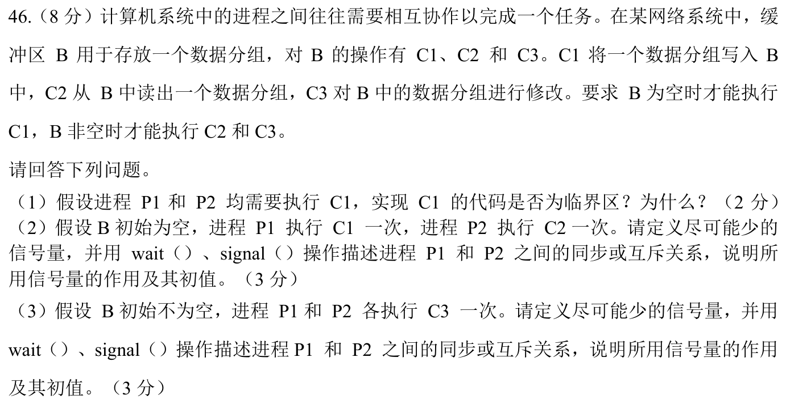

<details>
<summary>答案与解析</summary>

**核心判据**：
1. **临界资源与临界区（Critical Section）定义**：
   - **临界资源**：系统中一次仅允许一个进程访问的物理或逻辑共享资源；
   - **临界区**：进程中**直接访问临界资源的代码片段**。若多个进程并发执行写操作可能导致数据交叉覆盖破坏一致性，则该操作代码属于临界区，必须互斥执行。
2. **信号量最简化设计准则（极简信号量拓扑）**：
   - 当两个单次执行的操作满足明确的单向前趋时，仅需 **1 个同步信号量**（初值为 0）即可构建严格的前趋因果链；
   - 当多个进程对同一共享资源执行竞争性并发写/修改操作时，仅需 **1 个互斥信号量**（初值为 1）构建互斥锁。

**分问推导**：
**(1) 实现 C1 的代码是否为临界区判定**：
- **是临界区**。
- **理由**：
  - 缓冲区 B 是由多个并发进程共享的数据结构，且容量受限（仅容纳一个数据分组），属于典型的**共享临界资源**；
  - 进程 P1 和 P2 均需要执行 C1（向 B 中写入数据）。若两进程同时并发执行 C1，将产生写写竞争冲突（Race Condition），导致数据相互交叠覆盖、破坏分组完整性；
  - 依据操作系统定义，进程中访问共享临界资源的代码段即为临界区。因此，实现 C1 的代码是临界区，必须互斥执行。

**(2) B 初始为空，P1 执行 C1 一次，P2 执行 C2 一次**：
- **同步关系分析**：
  - B 初始为空，P1 执行写操作 C1 的前置条件（B 为空）初始天然满足；
  - P2 执行读操作 C2 必须在 B 非空时才能执行，因此构成严格的前趋依赖关系：**$C1 \to C2$**；
  - 两进程各执行一次，只需确保 P2 的 C2 必须在 P1 的 C1 完成之后执行。
- **信号量定义（极简设计，仅需 1 个信号量）**：
  - `semaphore full = 0;`：表示缓冲区 B 中是否已写入数据分组（B 是否非空）。初值为 0。
- **进程伪代码实现**：
  ```c
  semaphore full = 0; // 表示缓冲区是否有数据分组，初值为 0

  void P1() {
      C1();            // 向 B 中写入一个数据分组
      signal(full);    // 通知 P2：数据已就绪，B 非空
  }

  void P2() {
      wait(full);      // 等待 B 中有数据分组
      C2();            // 从 B 中读出一个数据分组
  }
  ```
  *(注：若按经典生产者-消费者定义两信号量 empty=1, full=0 亦完全正确，但本题强调“尽可能少”，因只执行一次且初始为空，单个同步信号量 full 即可完备解决)*。

**(3) B 初始不为空，P1 和 P2 各执行 C3 一次**：
- **互斥关系分析**：
  - B 初始不为空，C3 的执行前置条件（B 非空）初始已经满足；
  - 操作 C3 是对 B 中的数据分组进行修改（包含读出、修改、写回），属于复合写操作；
  - P1 和 P2 同时执行修改操作会发生竞态条件导致修改丢失，两者之间是**互斥关系**。
- **信号量定义（仅需 1 个互斥信号量）**：
  - `semaphore mutex = 1;`：用于实现对缓冲区 B 修改操作的互斥访问。初值为 1。
- **进程伪代码实现**：
  ```c
  semaphore mutex = 1; // 缓冲区 B 的互斥访问信号量，初值为 1

  void P1() {
      wait(mutex);     // 申请缓冲区互斥访问权
      C3();            // 对 B 中的数据分组进行修改
      signal(mutex);   // 释放缓冲区访问权
  }

  void P2() {
      wait(mutex);     // 申请缓冲区互斥访问权
      C3();            // 对 B 中的数据分组进行修改
      signal(mutex);   // 释放缓冲区访问权
  }
  ```

</details>

## 一行记录

```text
实际用时__；未完成或未核对的题号__；今天最容易混淆的是__
```
