# Day 27｜数据结构＋操作系统

[← Day 26](day26.md) · [总入口](README.md) · [Day 28 →](day28.md)

**选择题：15道，来自两份完整src题单；大题：1道。** 先做选择题，再展开题下解析。组内题目沿用src顺序；标为复做的组，已会的快速通过，重点处理上次错题。

**预计用时：55—85分钟。** 选择题及核对约25—40分钟，大题约25—35分钟，最后用5—10分钟重做今天最值得记住的一道错题。约两小时是配题目标，不是必须耗满或到点强停；计算卡住时先保留题号，先完成其余选择题。

## 选择题组1｜0801 · 数据结构

[位置关系：指针、下标与压缩存储](../src/0801.md) · 8道 · 复做第1次。

### 选择题1｜2020-01

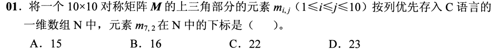

<details>
<summary>答案与解析</summary>

**答案：C。**

* **核心判据**：对称矩阵具有对角线对称性（$m_{i,j} = m_{j,i}$）。题目要求将**上三角部分按列优先**存入数组 $C[0..m]$。当查询下三角元素 $m_{7,2}$（行号 $i >$ 列号 $j$）时，必须先**映射为其对称的上三角元素 $m_{2,7}$** 再计算定位。
* **正选推导**：
  1. 矩阵行列号从 1 开始计，$m_{7,2} = m_{2,7}$（即第 2 行、第 7 列）。
  2. **上三角按列优先存储**：第 $k$ 列只包含行号从 1 到 $k$ 的 $k$ 个元素。
  3. 第 7 列之前（第 1 到第 6 列）的所有上三角元素总数为：
     $$S = 1 + 2 + 3 + 4 + 5 + 6 = \frac{6 \times 7}{2} = 21\text{ 个}$$
  4. 在第 7 列内部，元素自上而下依次为 $m_{1,7}$（第 1 个）、$m_{2,7}$（第 2 个）。
  5. 故 $m_{2,7}$ 是数组中的第 $21 + 2 = 23$ 个元素。
  6. 数组下标从 0 开始编号，第 23 个元素的存储下标为 $23 - 1 = \mathbf{22}$，选 C。
* **干扰项击穿**：
  * 切勿直接把下三角的 $i=7, j=2$ 硬套公式（上三角第 2 列只有 2 个元素，根本不存在第 7 行）；
  * 算出第 23 个元素后，切勿漏掉下标以 0 开始的减 1 偏移（错选 23）。

</details>

### 选择题2｜2021-01

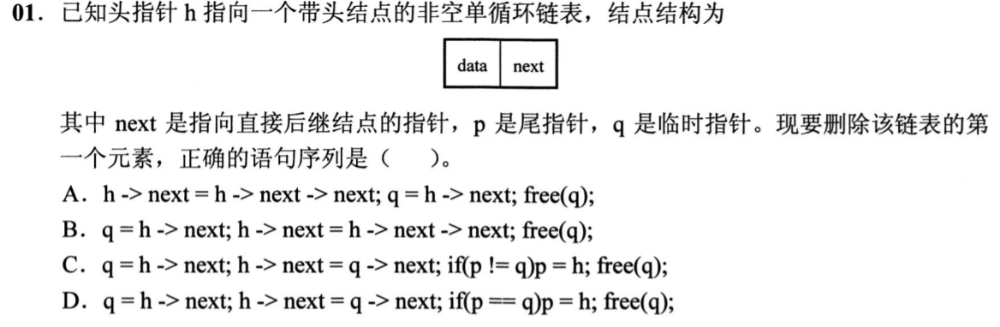

<details>
<summary>答案与解析</summary>

**答案：D。**

* **核心判据**：单链表删除结点的物理本质是跨过目标结点修正前驱指针。核心边界不变量：**当被删除的首元结点恰好也是尾结点（链表仅含单个数据结点）时，尾指针 $p$ 必须同步退化指向头结点 $h$**，否则尾指针将沦为指向已释放堆内存的悬空指针（Dangling Pointer）。
* **正选推导**：
  1. 暂存待删除结点：`q = h->next;`
  2. 头结点后继指针跨跳：`h->next = q->next;`
  3. 边界检查：若 `p == q`（说明原表中仅有一个数据结点，删完后链表变为空表），尾指针 $p$ 必须修正指向头结点：`p = h;`
  4. 释放内存：`free(q);`
  * 完整逻辑严格匹配 D 选项。
* **干扰项击穿**：
  * A、B、C 均未对 `p == q` 这一单结点极端边界做维护；一旦遇到单数据结点链表，执行完操作后尾指针 $p$ 仍然指向被释放的无效内存，后续再用 $p$ 尾插必然引发内存段错误。

</details>

### 选择题3｜2021-03

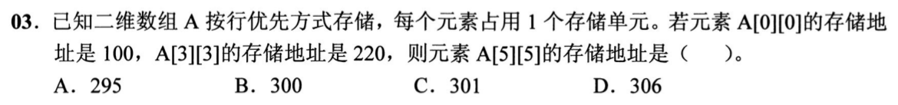

<details>
<summary>答案与解析</summary>

**答案：B。**

* **核心判据**：二维数组按行优先存储的物理地址映射公式为：$\text{Addr}(A[i][j]) = \text{Base} + (i \times C + j) \times L$（其中 $C$ 为矩阵列数，即每行元素个数；$L$ 为每个元素占用的存储单元数）。
* **正选推导**：
  1. 题目给定每个元素占 1 个存储单元（$L = 1$），基址 $\text{Addr}(A[0][0]) = 100$；
  2. 已知 $\text{Addr}(A[3][3]) = 220$，则 $A[3][3]$ 相对于基地址的偏移量为：
     $$\text{Offset} = 220 - 100 = 120\text{ 个单元}$$
  3. 代入行优先公式：$(3 \times C + 3) \times 1 = 120 \implies 3C = 117 \implies C = 39$（即该数组每行恰有 39 个元素）；
  4. 计算 $A[5][5]$ 的物理存储地址：
     $$\text{Addr}(A[5][5]) = 100 + (5 \times 39 + 5) \times 1 = 100 + 200 = \mathbf{300}$$
  * 故选 B。
* **干扰项击穿**：
  * 审题注意下标均从 0 开始；
  * 计算 $A[3][3]$ 时不能漏掉列偏移 $+3$（若算成 $3C = 120 \implies C = 40$，则会错算成 $100 + 5 \times 40 + 5 = 305$）。

</details>

### 选择题4｜2023-02

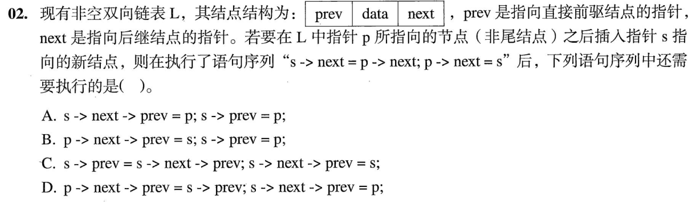

<details>
<summary>答案与解析</summary>

**答案：C。**

* **核心判据**：双链表指针修改的拓扑顺序不变量：新结点 $s$ 的 `prev` 必须指向其前驱 $p$；原 $p$ 的后继结点的 `prev` 必须指向新结点 $s$。在已有操作 `s->next = p->next; p->next = s;` 执行后，原后继结点的地址只能通过 `s->next` 访问。
* **正选推导**：
  1. 当前状态下，原后继结点的 `prev` 指针仍完好地指向 $p$（即 `s->next->prev` 的值为 $p$）；
  2. **第一步（挂接 $s$ 的前驱）**：利用原后继的反向链取出 $p$，赋给 $s$ 的前驱指针：
     `s->prev = s->next->prev;`（等价于 `s->prev = p;`）
  3. **第二步（修正后继结点的反向指针）**：将后继结点的 `prev` 重新指向新插入的结点 $s$：
     `s->next->prev = s;`
  * 严格对应 C 选项。
* **干扰项击穿**：
  * 若颠倒执行顺序，先执行 `s->next->prev = s;`，原后继结点的反向指针已被篡改为 $s$；紧接着执行 `s->prev = s->next->prev;` 会导致 `s->prev` 错误地指向 $s$ 自身（形成指针自环死锁），丢失前驱 $p$。

</details>

### 选择题5｜2023-03

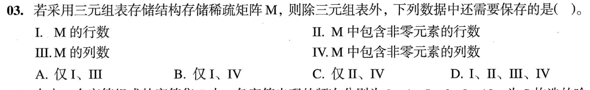

<details>
<summary>答案与解析</summary>

**答案：A。**

* **核心判据**：稀疏矩阵三元组顺序表由两部分构成：**全量非零元素的三元组线性表 $(i, j, v)$**，以及描述**矩阵完整代数尺寸的元数据**。
* **正选推导**：
  * 三元组表中的每个项只记录非零元的位置 $(i, j)$。若矩阵末尾若干行或最后若干列全为 0（没有任何非零元），那么仅扫描三元组表绝对无法得知矩阵总共有多少行多少列；
  * 为了在转置或还原矩阵时精确恢复其空间尺寸，必须在表头结构中显式存储**行数（I）**与**列数（III）**；
  * “含有非零元素的行数（II）”与“含有非零元素的列数（IV）”对还原矩阵阶数毫无意义，故选 A（仅 I、III）。
* **干扰项击穿**：
  * 区分“非零行数量”与“矩阵总行数”：若 $100 \times 100$ 的矩阵只有第 1 行有非零元，非零行数是 1，但矩阵总行数是 100，只有总行数能决定矩阵的真实维度。

</details>

### 选择题6｜2024-01

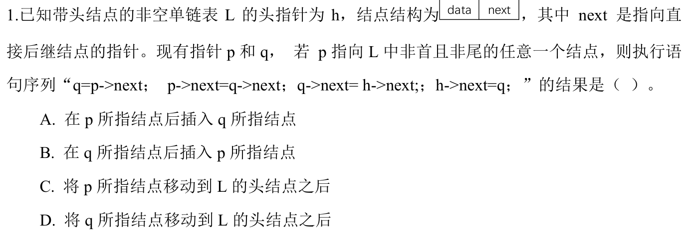

<details>
<summary>答案与解析</summary>

**答案：D。**

* **核心判据**：链表结点移动的经典物理两步法：**① 原位脱链（Bypass $q$） $\to$ ② 目标位置重新头插（Insert $q$ after $h$）**。
* **正选推导**：
  1. 初始状态：$p$ 是尾结点，$q$ 是 $p$ 的后继（即首元结点 $q = p->next$）；
  2. **脱链操作**：将 $p$ 的后继跨过 $q$，直接指向 $q$ 的下一个结点：
     `p->next = q->next;`（将 $q$ 从原位置安全摘下）
  3. **头插操作**：将 $q$ 插入到头结点 $h$ 之后：
     - $q$ 的后继先接管原链表的首个元素：`q->next = h->next;`
     - 头结点的后继指向 $q$：`h->next = q;`
  4. 整合后指令序列为：`p->next = q->next; q->next = h->next; h->next = q;`，选 D。
* **干扰项击穿**：
  * 头插两句不可颠倒：若先执行 `h->next = q;`，原首元结点的地址立刻丢失，导致链表后半段内存泄漏截断。

</details>

### 选择题7｜2026-01

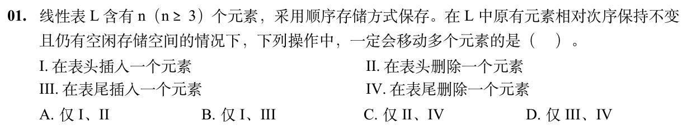

<details>
<summary>答案与解析</summary>

**答案：A。**

* **核心判据**：顺序表在物理上通过紧邻的内存块保持元素的前后逻辑次序。对头部进行增删必须移动后续所有元素以腾位或填坑；对尾部操作则无需触动前面的已有元素。
* **正选推导**：
  * **I 表头插入**：必须先将原先的全部 $n$ 个元素依次向后挪动 1 个位置，移动元素次数为 $n$（当 $n \ge 3$ 时必然 $\ge 3$）。
  * **II 表头删除**：必须将第 2 至第 $n$ 个元素（共 $n-1$ 个）依次向前移动 1 个位置填补首部空缺，移动元素次数为 $n - 1$（当 $n \ge 3$ 时必 $\ge 2$ 次，必然移动多个元素）。
  * 故 I、II 都必定需要移动多个元素，选 A。
* **干扰项击穿**：
  * **III 表尾插入**：表尾原本就有预留的连续空闲空间，直接在 `data[length]` 写入新元素并执行 `length++` 即可，移动元素次数为 0。
  * **IV 表尾删除**：只需在逻辑上直接将表长减 1（`length--`），原末尾数据在物理上无需任何搬运，移动元素次数为 0。

</details>

### 选择题8｜2026-02

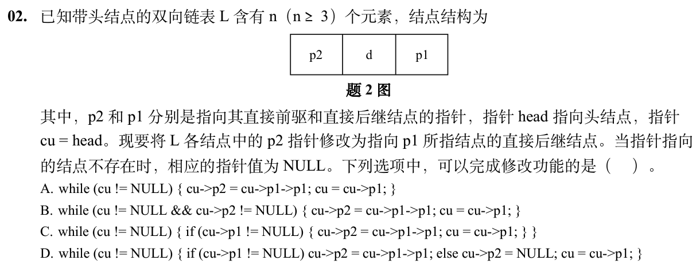

<details>
<summary>答案与解析</summary>

**答案：D。**

* **核心判据**：链表隔项跳跃赋值的健壮性控制：**必须严密防御空指针解引用（NULL Pointer Dereference）并确保工作指针无条件向前推进**。当当前结点已是链表倒数第二项或尾项时，其隔项后继不存在，必须安全置为 NULL。
* **正选推导**：
  1. 游标指针遍历：`cu` 从首元结点开始，每轮沿 `p1` 前进一步（`cu = cu->p1;`）；
  2. 针对当前结点 `cu` 的分支保护：
     * 若 `cu->p1 != NULL && cu->p1->p1 != NULL`：说明其后继的后继存在，安全赋值 `cu->p2 = cu->p1->p1;`；
     * 否则（已到达链表最后两个结点之一）：隔项后继不存在，安全置空 `cu->p2 = NULL;`；
  3. 推进游标：分支结束后必须推进 `cu = cu->p1;`。D 选项逻辑周全且终止边界明确，选 D。
* **干扰项击穿**：
  * **A 项**：在链尾直接调用 `cu->p1->p1`，引发野指针或空指针非法内存访问崩溃。
  * **B 项**：循环条件或初始逻辑错误导致循环体根本无法正常执行。
  * **C 项**：在处理某些边界分支时遗漏了游标前进语句，导致程序陷入死循环。

</details>

## 选择题组2｜0831 · 操作系统

[设备服务：缓冲、磁盘与请求调度](../src/0831.md) · 7道 · 复做第1次。

### 选择题9｜2021-26

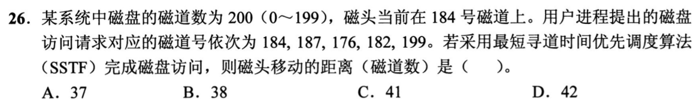

<details>
<summary>答案与解析</summary>

**答案：C。**

* **核心判据**：最短寻道时间优先（SSTF）算法的局部贪心不变量：**磁头每完成一次服务，下一步都必须从当前停靠的磁道出发，挑选距离当前位置绝对差值最小（最近）的未处理请求**。
* **正选推导**：
  * 初始位置为 **184**，请求队列：{184, 182, 187, 176, 199}。
  * **第 1 步**：服务 184 本身，位移 $= |184 - 184| = 0$；停在 184；
  * **第 2 步**：剩余 {182, 187, 176, 199}，距 184 距离分别为 2、3、8、15；最近为 182：
    移至 182，位移 $= |184 - 182| = 2$；停在 182；
  * **第 3 步**：剩余 {187, 176, 199}，距 182 距离分别为 5、6、17；最近为 187：
    移至 187，位移 $= |187 - 182| = 5$；停在 187；
  * **第 4 步**：剩余 {176, 199}，距 187 距离分别为 11、12；最近为 176：
    移至 176，位移 $= |187 - 176| = 11$；停在 176；
  * **第 5 步**：剩余 {199}：
    移至 199，位移 $= |199 - 176| = 23$。
  * **累加总移动距离**：
    $$0 + 2 + 5 + 11 + 23 = \mathbf{41}$$
  * 故选 C。
* **干扰项击穿**：
  * SSTF 极易在 182 处发生折返（184 $\to$ 182 $\to$ 187 $\to$ 176 $\to$ 199），切勿将其混淆为沿单一方向扫描的 SCAN/电梯算法。

</details>

### 选择题10｜2022-32

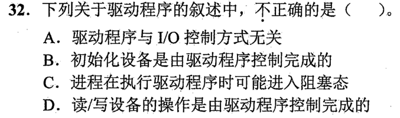

<details>
<summary>答案与解析</summary>

**答案：A。**

* **核心判据**：设备驱动程序是操作系统内核与具体硬件控制器之间的通信翻译层，其核心代码必须**强依赖于底层硬件采用的特定 I/O 控制方式（轮询、中断驱动、DMA）**。
* **A 选项错误（正选项）**：
  * 若为**轮询方式**：驱动程序必须编写代码在 CPU 中循环轮询设备状态寄存器忙标志位；
  * 若为**中断方式**：驱动程序必须包含中断服务例程并在中断触发时执行数据读取；
  * 若为**DMA 方式**：驱动程序必须向 DMA 控制器配置物理起始内存地址、传输字节数并下达启动命令。
  * 故驱动程序必须深度耦合具体的 I/O 控制方式，A 选项声称“与控制方式无关”完全错误，选 A。
* **B、C、D 正确性解析**：
  * **B**：设备启动运行前的参数配置与初始化，完全由驱动程序写入控制字实现；
  * **C**：应用发起 I/O 时，由驱动程序向设备控制器发送启动读写命令；
  * **D**：在同步 I/O 请求下，在驱动程序启动设备到 I/O 结束期间，请求进程让出 CPU 转入阻塞状态等待唤醒。

</details>

### 选择题11｜2023-32

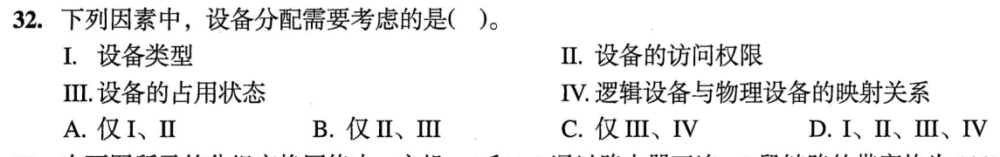

<details>
<summary>答案与解析</summary>

**答案：D（I、II、III、IV）。**

* **核心判据**：设备分配必须满足**物理适应性、系统安全性、逻辑独立性与当前可用性**的闭环考量。
* **四项因素全量击穿**：
  * **I 设备固有属性（独占/共享/虚拟）**：独占设备（打印机）必须单独互斥分配；共享设备（磁盘）可并发分配；虚拟设备通过 Spooling 技术重定向分配。属性决定了分配算法策略。
  * **II 设备分配安全性**：分配设备前必须进行死锁防范检测（如通过银行家算法校验本次分配是否会导致系统进入不安全状态，避免死锁）。
  * **III 设备独立性（设备无关性）**：用户进程在代码中只引用逻辑设备名（如 `stdout`），操作系统分配时必须通过逻辑设备表（LUT）映射到具体的物理设备端口上。
  * **IV 设备的分配状态**：分配必须检查设备当前是空闲、已占用还是处于等待维护状态。
* 结论：四项均需考虑，选 D。

</details>

### 选择题12｜2024-31

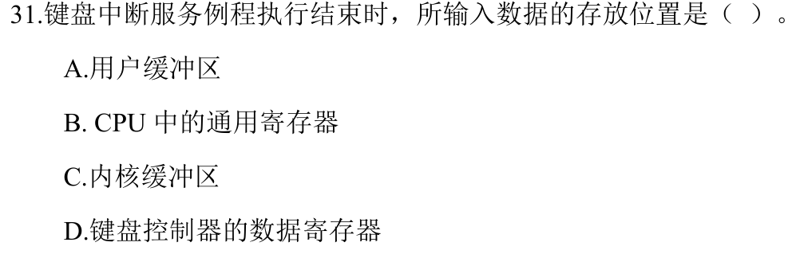

<details>
<summary>答案与解析</summary>

**答案：C。**

* **核心判据**：I/O 数据传输的系统流动层级：**外设硬件 $\to$ 设备接口数据寄存器 $\to$ 操作系统内核缓冲区 $\to$ 用户进程虚拟空间缓冲区**。
* **正选推导**：
  * 键盘每敲击一个按键，外设电路将字符编码放入键盘控制器的输入数据缓冲寄存器，并拉高中断引脚；
  * CPU 硬件隐指令响应中断后切入内核态；
  * **中断服务程序（ISR，软件代码）执行**：通过特权 I/O 指令从设备控制器的硬件端口中读出该字符，并直接放入**操作系统的系统内核缓冲区（如键盘行缓冲队列）**；
  * 随后，中断服务程序负责唤醒处于阻塞态等待键盘输入的用户进程，由系统调用在退出内核时将字符拷贝至用户缓冲区。故中断服务程序存放字符的目的地是内核缓冲区，选 C。
* **干扰项击穿**：
  * **A CPU 寄存器**：仅仅是执行指令时的暂存载体，中断例程退出前必须清空/恢复，无法充当存储容器；
  * **B 设备数据缓冲寄存器**：是外设芯片上的寄存器，中断例程是“从中读出”，而不是存入；
  * **D 用户进程缓冲区**：中断发生时当前运行的进程不一定是等待该输入的进程，中断服务程序不能也不应该直接跨进程上下文写用户空间，必须先由内核缓冲解耦。

</details>

### 选择题13｜2024-32

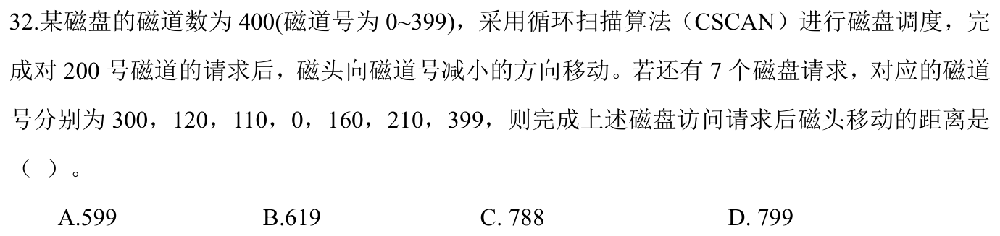

<details>
<summary>答案与解析</summary>

**答案：C。**

* **核心判据**：循环扫描算法（C-SCAN）的严格物理定义：
  1. **单向服务**：磁头严格朝一个固定方向移动，沿途服务所有的请求；
  2. **到达物理边界**：**标准 C-SCAN 必须走到底部物理边界（0 柱面）**；
  3. **单向快速空程回跳**：到达一端边界后，磁头**直接单向空程跳回另一端的物理边界（399 柱面）**；
  4. **回跳距离计入寻道**：回跳过程中虽不提供 I/O 服务，但机械臂发生真实物理位移，回跳距离必须计入总寻道量；
  5. 回跳到 399 后，继续沿原方向（向小号方向）扫描服务。
* **正选推导**：
  1. 当前磁头停在 200，刚服务完 190，表明移动方向为**向小号磁道移动**；
  2. 待处理请求：{110, 160, 210, 300}；
  3. 向小号扫描依次服务：$200 \to 160 \to 110$；
  4. 磁头继续移动到底部物理边界 0 号磁道：位移量 $= 200 - 0 = 200$；
  5. 磁头快速回跳到另一侧物理边界 399 号磁道：空程位移量 $= 399 - 0 = 399$；
  6. 在 399 号磁道继续向小号方向扫描，依次服务剩余的 300 和 210：
     位移量 $= 399 - 210 = 189$；
  7. **累计总寻道移动磁道数**：
     $$\text{总移动量} = 200 + 399 + (399 - 210) = 200 + 399 + 189 = \mathbf{788}$$
  * 故选 C。
* **干扰项击穿**：
  * 绝不能混淆 **C-SCAN** 与 **C-LOOK**：C-LOOK 只走到最小请求 110 就直接回跳到最大请求 300；而题目明确写明是 C-SCAN，必须触碰物理边界 0 和 399。

</details>

### 选择题14｜2026-31

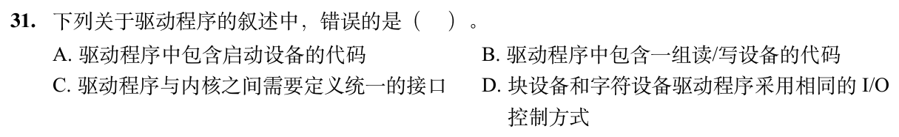

<details>
<summary>答案与解析</summary>

**答案：D。**

* **核心判据**：块设备（如磁盘、SSD）与字符设备（如键盘、打印机）在数据组织与存取特性上具有根本差异：
  * **块设备**：以固定大小的“块（Block）”为传输单位，具有物理地址，**支持随机存取（Random Access）**；由于数据吞吐量极大，必须采用高带宽的 **DMA 控制方式**。
  * **字符设备**：以“字符/字节（Byte）”为单位流式传输，不可寻址，**只支持顺序存取**；传输速率慢且无规则，通常采用**中断驱动控制方式**。
* **D 选项错误（正选项）**：声称两者“必须采用相同的 I/O 控制方式”，完全违背了硬件传输速率与特性的客观规律，选 D。
* **A、B、C 正确性解析**：
  * **A**：块设备具有可寻址性，支持随机读取任意扇区；
  * **B**：字符设备按顺序数据流处理，不可对单个字符做物理绝对寻址；
  * **C**：操作系统通过设备独立性软件层，将两类设备统一抽象为 `read/write/ioctl` 等统一标准的系统调用接口。

</details>

### 选择题15｜2026-32

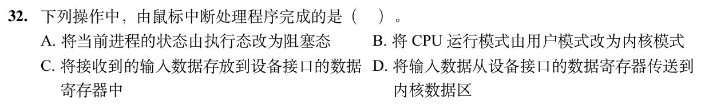

<details>
<summary>答案与解析</summary>

**答案：D。**

* **核心判据**：严格区分**“中断响应阶段的硬件隐指令”**、**“外设硬件芯片动作”**与**“操作系统中断服务例程（软件代码）的实质工作”**。
* **正选推导**：
  * 鼠标发生位移，鼠标硬件传感器生成坐标位移数据，放入鼠标控制器的接口寄存器中并拉高中断线；
  * CPU 硬件隐指令自动保护断点并切换至内核态；
  * **操作系统鼠标中断处理程序（软件）启动执行**：其核心动作是通过读取接口数据寄存器中的鼠标坐标数据，并**将其放入操作系统的内核输入事件缓冲区**，以供视窗管理器或 GUI 进程后续读取，选 D。
* **干扰项击穿**：
  * **B 将 CPU 模式改为内核态**：这是 **CPU 硬件隐指令** 在跳转到中断例程前自动完成的硬件动作，中断例程代码执行时特权级早已是内核态；
  * **C 将数据放入设备接口数据寄存器**：这是**鼠标外设硬件**的电气动作，软件代码无法无中生有地将物理数据放进外设端口；
  * **A 把当前进程改为阻塞态**：当前被中断的进程只是碰巧在 CPU 上执行的受害者，中断处理程序绝不会无缘无故将其阻塞；相反，若有 GUI 进程正等待鼠标事件，中断处理程序的动作是**唤醒**等待进程。

</details>

## 解答题

### 大题1｜2025-45

[原题单 0925｜并发同步：PV 操作大题](../src/0925.md)

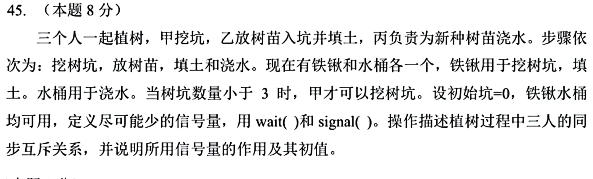

<details>
<summary>答案与解析</summary>

**核心判据**：
1. **多级流水线生产者-消费者与前趋拓扑分解**：
   - 工序全链路：`挖树坑 (甲)` $\to$ `放树苗并填土 (乙)` $\to$ `浇水 (丙)`；
   - **容量配额约束**：题目明确“当树坑数量小于 3 时，甲才可以挖树坑”，即系统中允许存在的未填土树坑上限为 3。设置容量信号量 `empty = 3` 控制坑位配额；
   - **前后道工序前趋同步**：
     - 甲挖坑 $\to$ 乙放苗填土：设立信号量 `holes = 0` 表示已挖好待放苗的坑数；
     - 乙填土 $\to$ 丙浇水：设立信号量 `trees = 0` 表示已填土待浇水的树苗数。
2. **临界资源物理独占性与“极简信号量”原则**：
   - **铁锹（共 1 把）**：甲（挖坑）和乙（填土）均需使用铁锹，两者对铁锹构成互斥竞争，必须设置互斥信号量 `shovel = 1`；
   - **水桶（共 1 个）**：仅有丙一人负责浇水，不存在其他并发竞争者，单线程串行执行天然保证水桶独占，**无需设置水桶信号量**（满足题目“尽可能少”的硬性要求）。

**分问推导与伪代码实现**：
**(1) 信号量定义、作用与初值**：
- `semaphore empty = 3;`：表示允许挖树坑的容量配额（最大容纳 3 个空坑），初值为 3。
- `semaphore holes = 0;`：表示已挖好、等待放树苗和填土的树坑数量，初值为 0。
- `semaphore trees = 0;`：表示已填土、等待浇水的新树苗数量，初值为 0。
- `semaphore shovel = 1;`：表示铁锹的互斥使用权（甲和乙共享），初值为 1。

**(2) 三人协同并发伪代码实现**：
```c
semaphore empty = 3;  // 树坑容量配额，初值为 3
semaphore holes = 0;  // 已挖树坑数，初值为 0
semaphore trees = 0;  // 待浇水树苗数，初值为 0
semaphore shovel = 1; // 铁锹互斥信号量，初值为 1

void 甲() {
    while (1) {
        wait(empty);    // 检查树坑数量是否小于 3（申请坑位配额）
        wait(shovel);   // 申请铁锹
        挖树坑();
        signal(shovel); // 归还铁锹
        signal(holes);  // 通知乙：有新挖好的树坑
    }
}

void 乙() {
    while (1) {
        wait(holes);    // 等待甲挖好树坑
        放树苗();       // 放树苗入坑（不占用铁锹）
        wait(shovel);   // 申请铁锹用于填土
        填土();
        signal(shovel); // 归还铁锹
        signal(empty);  // 填土完毕，腾出一个空坑容量配额
        signal(trees);  // 通知丙：有新种好的树苗等待浇水
    }
}

void 丙() {
    while (1) {
        wait(trees);    // 等待乙填好土的树苗
        浇水();         // 水桶由丙独占使用，无需信号量互斥
    }
}
```

**(3) 防死锁与执行逻辑正确性检验**：
- **死锁免疫推导**：
  - 甲先申请配额 `empty` 再申请 `shovel`；乙先申请工序资源 `holes` 再申请 `shovel`；
  - 甲和乙对铁锹的申请均在自身上游依赖满足之后，持有铁锹期间仅执行单一的物理动作（挖坑或填土），随后立即 `signal(shovel)` 归还，不存在“请求并保持”其他资源的情况，系统绝无死锁风险。
- **容量配额闭环**：甲每挖一坑消耗一个 `empty`，乙填土后 `signal(empty)` 归还配额，严格将空坑数量限制在 $[0, 3)$ 区间内，完美契合题设要求。

</details>

## 一行记录

```text
实际用时__；未完成或未核对的题号__；今天最容易混淆的是__
```
